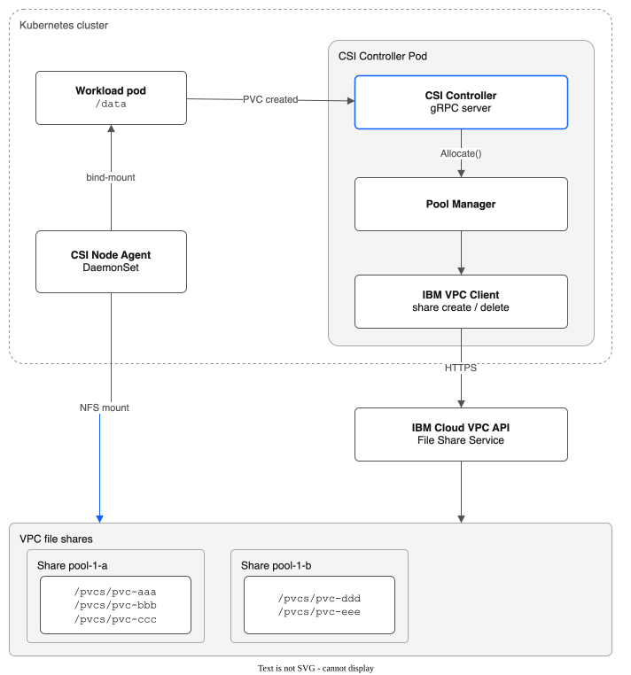
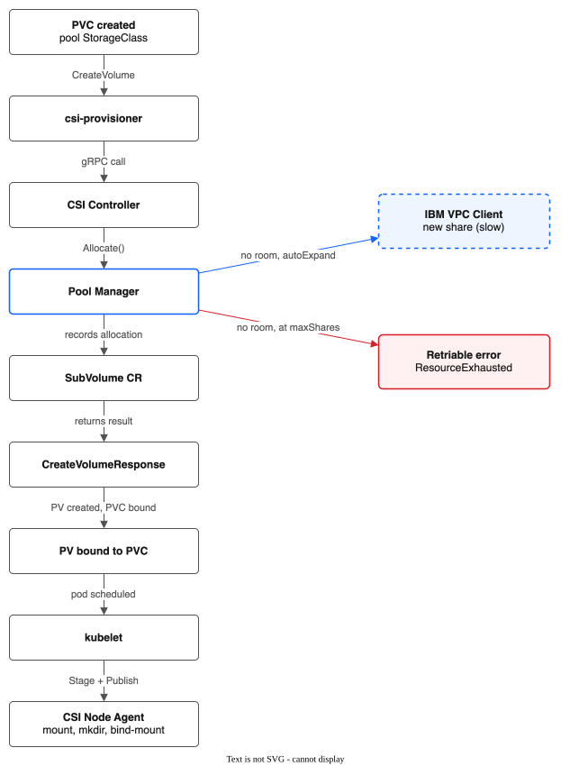
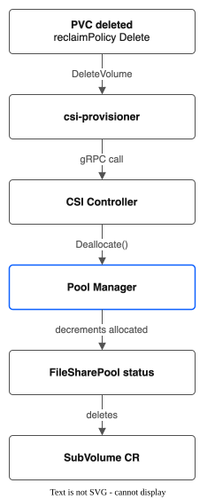
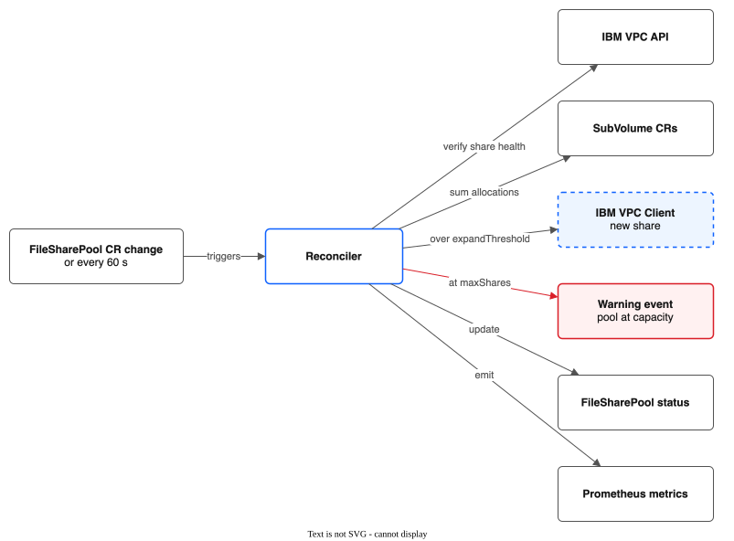
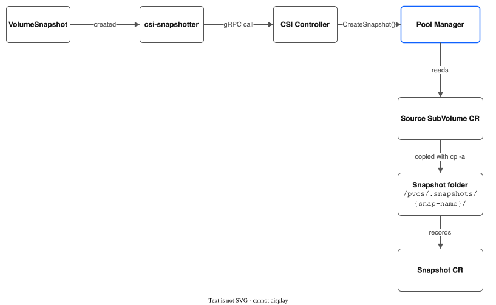

# Architecture Reference

For the meaning of project words such as pool, share, SubVolume and moment, see [CONTEXT.md](CONTEXT.md).

## System Overview



## Components

### 1. CSI Controller (Deployment)

The gRPC server that implements CSI Controller RPCs. Runs as a Deployment with 1–2 replicas using leader election.

**Responsibilities:**
- Receive `CreateVolume` / `DeleteVolume` / `ControllerExpandVolume` calls from the Kubernetes CSI sidecar containers.
- Delegate to the Pool Manager for allocation decisions.
- Return volume info (NFS server IP, share path, subdir path) to the kubelet via the CSI protocol.

**Sidecar containers** (standard CSI sidecars, deployed alongside the controller):
- `csi-provisioner` — watches PVCs, calls CreateVolume/DeleteVolume
- `csi-resizer` — watches PVC size changes, calls ControllerExpandVolume
- `liveness-probe` — health checks

**Does NOT:**
- Mount anything.
- Call IBM VPC API directly (goes through Pool Manager → IBM VPC Client).
- Create VPC file shares on purpose in the CreateVolume path. The one exception is auto-expand: when no share fits and `autoExpand` is on, `Allocate` calls `CreateFileShare` once (see [Pool Manager](#3-pool-manager)) and CreateVolume returns a retriable error so the provisioner retries after the share is ready.

### 2. CSI Node Agent (DaemonSet)

Runs on every worker node. Implements CSI Node RPCs.

**Responsibilities:**
- `NodeStageVolume`: Mount the VPC file share (NFS) at the staging folder that kubelet gives for this volume. If that staging folder is already mounted (a second pod on the same volume), reuse the mount. A different volume on the same share has its own staging folder, so the share is mounted again.
- `NodePublishVolume`: Create the subdirectory on the share if it does not already exist (with uid/gid/permissions from VolumeContext), then bind-mount it into the pod's volume path.
- `NodeUnpublishVolume`: Unmount the bind-mount from the pod path.
- `NodeUnstageVolume`: Unmount the NFS mount at the volume's staging folder. Kubelet calls this when no pod on the node uses the volume any more.
- `NodeGetVolumeStats`: Return capacity/usage stats for the subdirectory (via `du` or `statfs`).

**Mount tracking (one NFS mount per staged volume):**

```
Node filesystem:
  <kubelet dir>/plugins/kubernetes.io/csi/<driver>/<hash for volume aaa>/globalmount/
    └── NFS mount of the whole share (one per staged volume)
        └── pvcs/pvc-aaa/             ← subdirectory for PVC aaa
  <kubelet dir>/plugins/kubernetes.io/csi/<driver>/<hash for volume bbb>/globalmount/
    └── NFS mount of the same share, mounted again for volume bbb
        └── pvcs/pvc-bbb/             ← subdirectory for PVC bbb

  <kubelet dir>/pods/{pod-uid}/volumes/kubernetes.io~csi/{pv-name}/mount/
    └── (bind mount of <staging folder>/pvcs/pvc-aaa/)
```

The volume ID is `{pool}/{share-id}/{pv-name}`, so it includes the PV name. Kubelet therefore stages each volume in its own folder, and the node agent keeps an in-memory list of staged folders (not a reference count). A second pod on the same volume reuses the mount. A different volume on the same share is mounted again. Kubelet calls `NodeUnstageVolume` when the last pod on the node stops using the volume.

**NFS mount via nsenter wrapper:**

The node agent container includes a `/usr/local/bin/mount` wrapper that routes NFS mounts through the host's mount namespace using `nsenter --mount=/proc/1/ns/mnt --root=/proc/1/root`. Bind mounts use the container's local `/usr/bin/mount`. This requires `hostPID: true` on the DaemonSet so `/proc/1` refers to the host's PID 1.

**Cross-zone server selection:**

When volumeContext contains `server.<zone>` keys (from pools with accessor zones), the node agent selects the IP matching its own zone (`topology.kubernetes.io/zone` label). This ensures NFS traffic stays within the zone for lower latency. Falls back to the default `server` key if no zone match is found.

### 3. Pool Manager

The core logic component. Runs within the controller pod but is architecturally distinct.

**Two modes of operation:**

#### A. Synchronous allocation (called from CSI Controller)

```go
type PoolManager interface {
    // Allocate finds a share with room, records the SubVolume CR, and returns
    // the share's mount info. Subdirectory creation is deferred to NodePublishVolume.
    Allocate(ctx context.Context, req AllocationRequest) (*AllocationResult, error)

    // Deallocate deletes the SubVolume CR and updates pool tracking.
    // Does not remove the subdirectory on the NFS share (nfsOps is nil in controller mode).
    Deallocate(ctx context.Context, subVolumeName string) error

    // Expand updates the allocation size for an existing SubVolume.
    Expand(ctx context.Context, subVolumeName string, newSizeGB int64) error

    // CreateSnapshot creates a directory-level copy of a SubVolume.
    CreateSnapshot(ctx context.Context, snapshotName, sourceVolumeID string, params map[string]string) (*SnapshotResult, error)

    // DeleteSnapshot removes a snapshot directory and its CR.
    DeleteSnapshot(ctx context.Context, snapshotName string) error

    // ListSnapshots lists snapshots, optionally filtered by source volume.
    ListSnapshots(ctx context.Context, sourceVolumeID string) ([]SnapshotResult, error)

    // RestoreSnapshot creates a new SubVolume from a snapshot.
    RestoreSnapshot(ctx context.Context, snapshotName string, req AllocationRequest) (*AllocationResult, error)

    // CloneVolume creates a new SubVolume that is a copy of an existing one.
    // The copy always runs asynchronously: the SubVolume CR is created with
    // cloneStatus=Pending and the clone worker copies the data with a Job.
    CloneVolume(ctx context.Context, sourceVolumeID string, req AllocationRequest) (*AllocationResult, error)

    // CreateVolumeGroupSnapshot creates snapshots for multiple SubVolumes in sequence.
    // Does NOT execute hooks -- the CSI controller handles hook orchestration.
    CreateVolumeGroupSnapshot(ctx context.Context, req GroupSnapshotRequest) (*GroupSnapshotResult, error)

    // DeleteVolumeGroupSnapshot deletes all member snapshots and the group CR.
    DeleteVolumeGroupSnapshot(ctx context.Context, groupName string) error
}

type AllocationRequest struct {
    PVName        string
    PVCName       string
    PVCNamespace  string
    PoolName      string
    RequestedGB   int64
    Zone          string
}

type AllocationResult struct {
    ShareID         string            // VPC share ID
    MountTargetIP   string            // Primary mount target IP
    SubPath         string            // Subdirectory path, e.g., "/pvcs/pvc-abc123"
    SharePath       string            // NFS export root, e.g., "/"
    UID             *int64            // Unix user ID for the subdirectory
    GID             *int64            // Unix group ID
    Permissions     string            // Unix permissions string (e.g., "755")
    MountTargets    map[string]string // Zone -> IP mapping (nil for single-zone)
    AccessibleZones []string          // All zones this volume is accessible from
}
```

#### B. Asynchronous reconciliation (controller-runtime reconciler)

Watches `FileSharePool` CRs and reconciles pool state:
- Ensure a matching StorageClass exists for the pool (auto-created, with OwnerReference for GC).
- If total allocated capacity exceeds `expandThreshold` percentage, create a new VPC file share and add it to the pool.
- If a share is unhealthy (VPC API reports degraded), mark it as draining — no new allocations, but existing PVCs remain.
- Periodically scan SubVolume CRs and reconcile actual share state.
- Update `FileSharePool.Status` with current share inventory and capacity.

### 4. IBM VPC Client

Thin wrapper around the `vpc-go-sdk`. Isolates all IBM Cloud API calls.

**Operations:**
- `CreateFileShare(ctx, spec)` → share ID, mount target IP
- `DeleteFileShare(ctx, shareID)` → error
- `ExpandFileShare(ctx, shareID, newSizeGB)` → error
- `GetFileShare(ctx, shareID)` → share details (state, size, IOPS, mount targets)
- `ListFileShares(ctx, filters)` → list of shares (for discovery/reconciliation)
- `CreateShareMountTarget(ctx, shareID, input)` → mount target for a share that has none
- `GetSubnetZone(ctx, subnetID)` and `FindSecurityGroupID(ctx, vpcID, name)` → the subnet and security group for a mount target

Shares use security group access mode: each share has one mount target, with a network interface in the worker subnet of the pool's zone.

All operations are idempotent or check-before-act. All have context-based timeouts.

### 5. Clone Worker

Background component within the controller pod that handles every volume clone. All clones are asynchronous.

**Responsibilities:**
- Process SubVolumes with `cloneStatus=Pending` or `cloneStatus=InProgress`.
- Create a Kubernetes Job that performs the `cp -a` data copy (same-share or cross-share). The controller pod has no NFS access, so the Job does the copy.
- Update SubVolume CR status as clone progresses: `Pending` → `InProgress` → `Complete` or `Failed`.
- Handle crash recovery by restarting incomplete clones on controller restart.

**Does NOT:**
- Block `CreateVolume` — the CSI controller returns immediately after recording the clone.
- Allow pod access before clone completes — the node agent gates `NodePublishVolume` on `cloneStatus=Complete`.

### 6. Replication Controller

Standalone reconciler that handles cross-region disaster recovery by copying SubVolume data between pools.

**Responsibilities:**
- Watch `ReplicationPolicy` CRs and execute replication cycles on a configurable schedule.
- Mount source shares (read-only) and destination shares (read-write, cross-region via Transit Gateway).
- Copy each matching SubVolume's subdirectory from source to destination in one of two modes. Direct NFS mode runs a Job that uses rsync (`SyncDir` incremental, or `CopyDir` full copy). Receiver mode (`destinationEndpoint` set) tars the whole folder and uploads it to the receiver each cycle; only direct NFS mode uses rsync.
- Execute pre-sync and post-sync lifecycle hooks via the Hook Orchestrator for application-consistent replication.
- Track replication progress, RPO, bytes transferred, and consecutive failures in `ReplicationPolicy.Status`.
- Expose Prometheus metrics for replication lag, RPO, and error counts.

**Does NOT:**
- Create or delete VPC file shares (destination pool must already exist).
- Interfere with the CSI controller, node agent, or pool manager.
- Provide crash consistency or cross-file transactional consistency (file-level consistency only, unless application quiesce hooks are configured).

### 7. Migration CLI

Utility package (`pkg/migrate/`) for migrating PVCs from the stock IBM VPC file CSI driver to the pool-based driver.

**Components:**
- **Planner** (`planner.go`) — analyzes existing PVCs and generates a migration plan.
- **Executor** (`executor.go`) — executes the migration plan: creates SubVolume CRs, spawns data-copy pods, and rebinds PVCs.
- **Pod** (`pod.go`) — manages ephemeral pods used for data transfer during migration.

### 8. Hook Orchestrator

Sequential hook execution engine (`pkg/hooks/`) that runs pre/post lifecycle hooks for replication and group snapshot operations.

**Responsibilities:**
- Dispatch hooks to the correct executor based on hook type (`exec` or `http`).
- `ExecHook`: Find pods via Kubernetes label selector and execute commands via the pod exec API (SPDY remote command).
- `HTTPHook`: Send HTTP requests (GET/POST/PUT) with custom headers to webhook endpoints and validate 2xx responses.
- Enforce per-hook timeouts via context deadlines (default 30 seconds).
- Respect `OnError` policy: `Abort` stops the operation on hook failure, `Continue` logs and proceeds.
- Collect `HookResult` records with success/failure, timing, and truncated output for CRD status.

**Wired into:**
- Replication Controller — pre/post-sync hooks for application-consistent DR replication.
- VolumeGroupSnapshot — pre/post-snapshot hooks for coordinated multi-PVC snapshots.

### 9. Admission Webhooks

Validating admission webhooks (`pkg/webhook/`) registered with the controller-runtime manager. Enforce CRD field constraints at admission time, rejecting invalid create/update requests before they are persisted.

**Validators:**
- `FileSharePoolValidator` — field ranges, required fields, immutable zone/profile on update.
- `SubVolumeValidator` — required fields, subPath regex validation with path traversal protection.
- `ReplicationPolicyValidator` — required fields, Go duration parsing for schedule, maxRetries range.
- `SnapshotValidator` — required sourceSubVolume and poolName.
- `VolumeGroupSnapshotValidator` — required fields, failurePolicy enum validation.

### 10. CRD Controllers

Six CRD types, managed by controller-runtime:

- **FileSharePool** — defines a pool of VPC file shares; reconciler ensures the pool has enough capacity.
- **SubVolume** — tracks a single PVC's allocation: which share, subdirectory path, requested size, and clone/snapshot state.
- **Snapshot** — tracks a point-in-time directory copy of a SubVolume, stored under `/pvcs/.snapshots/`.
- **VolumeGroupSnapshot** — coordinates multiple Snapshot CRs for multi-PVC consistent snapshots, with pre/post-snapshot lifecycle hooks.
- **ReplicationPolicy** — defines a cross-region replication relationship between a source pool and a destination pool, with pre/post-sync lifecycle hooks. Direct NFS mode can use incremental rsync; receiver mode uploads the whole folder each cycle.
- **Hook** (embedded type) — defines a lifecycle hook with exec or HTTP execution, timeout, and on-error policy. Embedded in VolumeGroupSnapshot and ReplicationPolicy specs.

See `CRD-SPEC.md` for full type definitions.

## Data Flow: CreateVolume



1. The user creates a PVC with the pool's StorageClass (auto-created, named after the pool).
2. The `csi-provisioner` sidecar calls the `CreateVolume` gRPC.
3. The CSI Controller receives `CreateVolume`. It takes the pool name from the StorageClass parameters and the requested size from the PVC spec.
4. It calls `PoolManager.Allocate(ctx, request)`:
   - 4a. Read the FileSharePool CR for the named pool.
   - 4b. Read all SubVolume CRs for that pool (or use cached state).
   - 4c. Calculate the allocated capacity of each share.
   - 4d. Pick a share with enough remaining capacity (strategy: spread or bin-pack, per pool config).
     - If no share has room and `pool.spec.autoExpand` is on and shares < `maxShares`: create a new VPC file share through the IBM VPC Client (slow: 30-90 s), wait for it to become "stable", add it to `FileSharePool.Status.Shares`, and use it.
     - Otherwise: return a retriable `codes.ResourceExhausted` error.
   - 4e. Create the SubVolume CR that records the allocation.
   - 4f. Return an `AllocationResult` (share IP, subpath, uid, gid, permissions).

   The subdirectory is not created here. It is created in `NodePublishVolume` on the node agent. The controller does not create directories on the NFS share (`nfsOps` is nil).
5. The CSI Controller returns `CreateVolumeResponse` with:
   - `volume_id`: `"{pool}/{share-id}/{subdir-name}"`
   - `volume_context`:
     ```
     server: "10.240.1.5"                  # Primary (home zone) IP
     server.us-south-1: "10.240.1.5"       # Zone-keyed IPs (when accessorZones configured)
     server.us-south-2: "10.240.2.10"      # Accessor zone IP
     share: "/"
     subDir: "/pvcs/pvc-abc123"
     pool: "general-purpose"
     shareID: "r006-a1b2c3d4-..."
     permissions: "0755"   # optional
     uid: "1000"           # optional
     gid: "1000"           # optional
     ```
   - `accessible_topology`: `[zone]`
6. Kubernetes creates the PV and binds it to the PVC.
7. The pod is scheduled, and kubelet calls `NodeStageVolume` and `NodePublishVolume`.
8. The node agent mounts the share (if not cached), creates the subdirectory if it does not exist (with uid/gid/permissions from VolumeContext), then bind-mounts the subdirectory into the pod.

## Data Flow: DeleteVolume



1. The PVC is deleted (`reclaimPolicy: Delete`).
2. The `csi-provisioner` calls the `DeleteVolume` gRPC.
3. The CSI Controller receives `DeleteVolume` and parses the `volume_id` to get the pool, share ID and subdir name.
4. It calls `PoolManager.Deallocate(ctx, subVolumeName)`:
   - 4a. Read the SubVolume CR to get the share details.
   - 4b. Update `FileSharePool.Status` (decrement allocated capacity).
   - 4c. Delete the SubVolume CR.

   The controller does not remove subdirectories on the NFS share (`nfsOps` is nil in controller mode). Subdirectory cleanup is a future enhancement or handled by an external garbage collection process.
5. The CSI Controller returns success.

## Data Flow: Pool Reconciliation (Background)



Every 60 seconds, or on a FileSharePool CR change:

1. The reconciler reads the FileSharePool CR.
2. For each share in `Status.Shares`, it calls the IBM VPC API to verify share health. If a share is "degraded" or "failed", it marks the share as draining in `Status`.
3. It calculates the total pool utilization: the sum of all SubVolume allocations, compared with the total pool capacity.
4. If utilization is above `expandThreshold`:
   - If `shares.count < maxShares`: create a new VPC file share (IBM VPC Client) and add it to `Status.Shares` when it becomes "stable".
   - Otherwise: emit a Warning event ("pool at capacity").
5. It updates `FileSharePool.Status` with the current metrics.
6. It emits Prometheus metrics:
   - `pool_total_capacity_gb`
   - `pool_allocated_capacity_gb`
   - `pool_pvc_count`
   - `pool_share_count`
   - `share_allocated_capacity_gb` (per share)
   - `share_pvc_count` (per share)

## Data Flow: CreateSnapshot



1. The user creates a VolumeSnapshot that references a PVC.
2. The `csi-snapshotter` sidecar calls the `CreateSnapshot` gRPC.
3. The CSI Controller receives `CreateSnapshot` and parses the source volume ID to get the pool, share ID and subdir name.
4. It calls `PoolManager.CreateSnapshot(ctx, snapshotName, sourceVolumeID, params)`:
   - 4a. Read the source SubVolume CR.
   - 4b. Create the snapshot directory `/pvcs/.snapshots/{snap-name}/`.
   - 4c. Run `cp -a` from the source subdirectory to the snapshot directory.
   - 4d. Create the Snapshot CR that records the snapshot metadata.
5. The CSI Controller returns `CreateSnapshotResponse`.

## Data Flow: CloneVolume


1. The user creates a PVC with a `dataSource` that references an existing PVC.
2. The `csi-provisioner` detects the `dataSource` and sets `VolumeContentSource`.
3. The CSI Controller receives `CreateVolume` with `VolumeContentSource.Volume`.
4. It calls `PoolManager.CloneVolume(ctx, sourceVolumeID, req)`. This creates a SubVolume CR with `cloneStatus=Pending` and returns at once (the pod waits).
   - The background Clone Worker updates the CR to `cloneStatus=InProgress`, creates a Job that runs `cp -a` from the source to the target, then updates the CR to `cloneStatus=Complete` or `Failed`.
5. `NodePublishVolume` gates pod access on `cloneStatus=Complete`. Kubelet retries with backoff until the clone finishes.

## Volume ID Format

The CSI volume ID encodes everything needed to locate the subvolume:

```
Format: {pool-name}/{share-vpc-id}/{subdir-name}

Example: general-purpose/r006-a1b2c3d4-5678-90ab-cdef-1234567890ab/pvc-abc123

Parsing:
  pool-name: general-purpose
  share-vpc-id: r006-a1b2c3d4-5678-90ab-cdef-1234567890ab
  subdir-name: pvc-abc123
```

This format is:
- Deterministic (same inputs → same ID)
- Parseable without external lookups
- Human-readable in `kubectl get pv` output

## Security Model

### RBAC
The controller ServiceAccount needs:
- FileSharePool, SubVolume: full CRUD
- PersistentVolumes: get, list, watch, create, update, patch, delete (CSI provisioner creates PVs)
- PersistentVolumeClaims: get, list, watch, update, patch
- PersistentVolumeClaims/status: patch
- Nodes: get, list, watch (for topology)
- Secrets: get, list, watch
- ConfigMaps: get, list, watch
- StorageClasses: get, list, watch, create
- Events: create, patch
- Leases: get, create, update (for leader election)
- CSINode: get, list, watch

### Secrets
- On managed clusters (ROKS/ROVS/IKS), authentication is provided by the `storage-secret-sidecar` which populates the `storage-secret-store` secret. No standalone API key secret is needed.
- On self-managed clusters, an IBM Cloud API key is stored in a Kubernetes Secret (`ibm-cloud-credentials`).
- Never logged, never included in CRD status or events.

### NFS Security
- Shares use VPC security group rules (TCP 2049).
- Mount options: `nfsvers=4.1,sec=sys` (or `sec=krb5p` if encryption-in-transit is enabled).
- Subdirectories created with specific UID/GID/permissions per StorageClass config.
- Node agent validates all paths before mount/unmount to prevent traversal attacks.

### Pod Isolation
- Pods get a bind-mount of their specific subdirectory, NOT the whole share.
- A pod cannot traverse above its subdirectory because the bind-mount is the filesystem root from the pod's perspective.

## Failure Modes

| Failure | Impact | Recovery |
|---------|--------|----------|
| Controller pod crash | New PVCs queue; existing PVCs unaffected | Pod restarts; leader election transfers |
| Node agent crash | New pod mounts fail on that node | DaemonSet restarts; existing mounts survive (kernel-level) |
| VPC file share unavailable | All PVCs on that share lose access | IBM HA (99.999%); pool manager marks share as draining |
| IBM VPC API down | No new shares can be created; existing PVCs unaffected | Pool manager retries with backoff; allocations to existing shares still work |
| SubVolume CR accidentally deleted | Allocation tracking lost for that PVC | Data still on share; operator can recreate CR from share contents |
| FileSharePool CR deleted | Pool manager stops reconciling | Don't delete it; use finalizers to prevent accidental deletion |
| Disk full on a share | Writes fail for all PVCs on that share | Monitoring alerts; auto-expand or manual expand |
