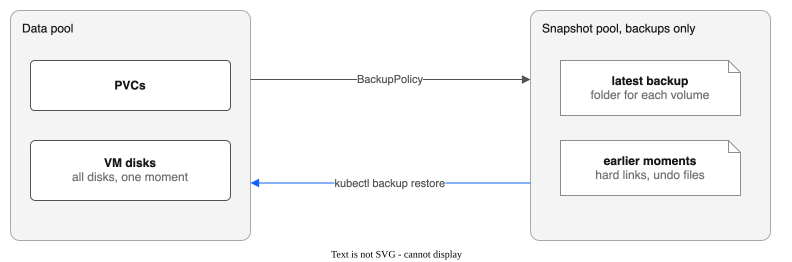
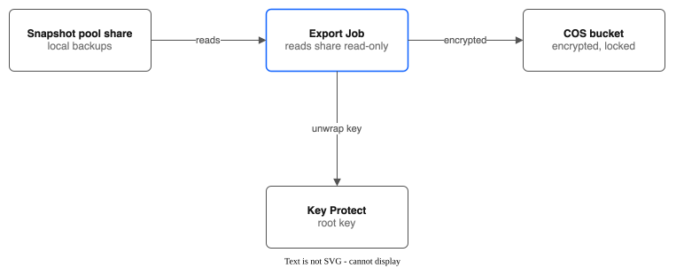
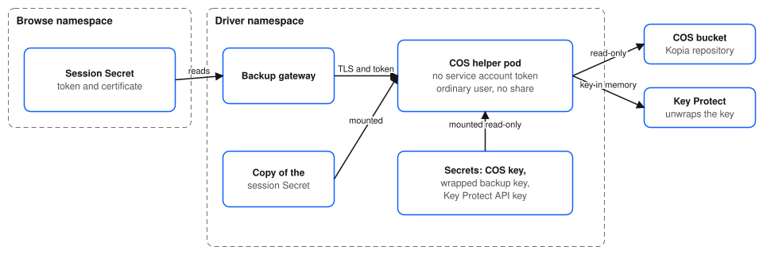

# Backup & Recovery Guide — IBM VPC File Pool CSI Driver

Data protection strategy using the driver's snapshot, clone, backup, and replication features. For the meaning of words such as moment, restore point and snapshot pool, see [CONTEXT.md](CONTEXT.md).

---

## Data Protection Options

| Method | RPO | RTO | Scope | Best For |
|--------|-----|-----|-------|----------|
| [Volume Snapshots](#volume-snapshots) | Point-in-time | Minutes (copy speed) | Single PVC | Regular backups of individual volumes |
| [Volume Clones](#volume-clones) | Point-in-time | Minutes (the time to copy the data) | Single PVC | Dev/test copies, pre-migration backup |
| [Group Snapshots](#group-snapshots) (not active) | None: the driver does not act on them | None | Multiple PVCs | Do not use. A snapshot of a running VM already covers all its disks |
| [Backups to a Snapshot Pool](#backups-to-a-snapshot-pool) | Schedule-based (minutes to hours) | Minutes to hours (copy speed) | Selected PVCs and VMs, all disks of a VM together | Keeping many moments of a volume or VM in the same region, on shares of their own |
| [Cross-Region Replication](#cross-region-replication) | Schedule-based (minutes to hours) | Manual failover | Full pool or label-selected | Disaster recovery |
| [Application-Level Backup](#application-level-backup) | Varies | Varies | Application-specific | Databases, VMs, crash-consistent workloads |

---

## Volume Snapshots

A snapshot is a copy of one volume that stays on the same share as the volume (see [CONTEXT.md](CONTEXT.md#snapshot)). It does not protect you from the loss of the share. See [USER-GUIDE.md — Snapshots](USER-GUIDE.md#snapshots) for basic usage.

### Scheduled Snapshots with CronJob

```yaml
apiVersion: batch/v1
kind: CronJob
metadata:
  name: snapshot-myapp-data
  namespace: default
spec:
  schedule: "0 */6 * * *"  # Every 6 hours
  concurrencyPolicy: Forbid
  jobTemplate:
    spec:
      template:
        spec:
          serviceAccountName: snapshot-creator
          containers:
            - name: snapshot
              image: bitnami/kubectl:latest
              command:
                - /bin/sh
                - -c
                - |
                  TIMESTAMP=$(date +%Y%m%d-%H%M%S)
                  cat <<SNAP | kubectl apply -f -
                  apiVersion: snapshot.storage.k8s.io/v1
                  kind: VolumeSnapshot
                  metadata:
                    name: myapp-data-${TIMESTAMP}
                    namespace: default
                    labels:
                      app: myapp
                      snapshot-type: scheduled
                  spec:
                    volumeSnapshotClassName: ibm-vpc-file-pool
                    source:
                      persistentVolumeClaimName: myapp-data
                  SNAP
                  echo "Snapshot myapp-data-${TIMESTAMP} created"
          restartPolicy: OnFailure
---
# RBAC for the CronJob
apiVersion: v1
kind: ServiceAccount
metadata:
  name: snapshot-creator
  namespace: default
---
apiVersion: rbac.authorization.k8s.io/v1
kind: Role
metadata:
  name: snapshot-creator
  namespace: default
rules:
  - apiGroups: ["snapshot.storage.k8s.io"]
    resources: ["volumesnapshots"]
    verbs: ["create", "get", "list"]
---
apiVersion: rbac.authorization.k8s.io/v1
kind: RoleBinding
metadata:
  name: snapshot-creator
  namespace: default
subjects:
  - kind: ServiceAccount
    name: snapshot-creator
roleRef:
  apiGroup: rbac.authorization.k8s.io
  kind: Role
  name: snapshot-creator
```

### Snapshot Retention Script

Delete snapshots older than a retention period:

```bash
#!/bin/bash
# delete-old-snapshots.sh
# Usage: ./delete-old-snapshots.sh <namespace> <label-selector> <max-age-days>

NAMESPACE=${1:-default}
SELECTOR=${2:-snapshot-type=scheduled}
MAX_AGE_DAYS=${3:-7}

CUTOFF=$(date -u -d "${MAX_AGE_DAYS} days ago" +%Y-%m-%dT%H:%M:%SZ 2>/dev/null || \
         date -u -v-${MAX_AGE_DAYS}d +%Y-%m-%dT%H:%M:%SZ)

echo "Deleting snapshots older than ${MAX_AGE_DAYS} days (before ${CUTOFF})"

kubectl get volumesnapshots -n "$NAMESPACE" -l "$SELECTOR" \
  -o jsonpath='{range .items[*]}{.metadata.name}{"\t"}{.metadata.creationTimestamp}{"\n"}{end}' | \
while read name timestamp; do
  if [[ "$timestamp" < "$CUTOFF" ]]; then
    echo "Deleting snapshot: $name (created $timestamp)"
    kubectl delete volumesnapshot -n "$NAMESPACE" "$name"
  fi
done
```

Run as a CronJob for automated retention:

```yaml
apiVersion: batch/v1
kind: CronJob
metadata:
  name: snapshot-retention
  namespace: default
spec:
  schedule: "0 2 * * *"  # Daily at 2 AM
  jobTemplate:
    spec:
      template:
        spec:
          serviceAccountName: snapshot-creator
          containers:
            - name: cleanup
              image: bitnami/kubectl:latest
              command:
                - /bin/sh
                - -c
                - |
                  # Keep snapshots for 7 days
                  CUTOFF=$(date -u -d "7 days ago" +%Y-%m-%dT%H:%M:%SZ)
                  kubectl get volumesnapshots -n default -l snapshot-type=scheduled \
                    -o jsonpath='{range .items[*]}{.metadata.name} {.metadata.creationTimestamp}{"\n"}{end}' | \
                  while read name ts; do
                    if [ "$ts" \< "$CUTOFF" ]; then
                      kubectl delete volumesnapshot -n default "$name"
                      echo "Deleted: $name"
                    fi
                  done
          restartPolicy: OnFailure
```

### Snapshot Performance

A snapshot of a plain volume is a full directory copy (`cp -a`). Performance depends on data size. A snapshot of a VM disk is faster: it is a QEMU copy, or an instant snapshot where the Sidecar gate is on (see [VM-INSTANT-SNAPSHOTS.md](VM-INSTANT-SNAPSHOTS.md)).

| Data Size | Approximate Snapshot Time |
|-----------|--------------------------|
| 1 GB | 5-15 seconds |
| 10 GB | 30-90 seconds |
| 100 GB | 5-15 minutes |
| 1 TB | 1-2 hours |

Snapshot creation consumes share capacity equal to the source data size. Monitor pool capacity to ensure room for snapshots.

---

## Volume Clones

Full copies of existing PVCs. See [USER-GUIDE.md — Volume Cloning](USER-GUIDE.md#volume-cloning) and [VOLUME-CLONING.md](VOLUME-CLONING.md) for design details.

### Pre-Change Backup via Clone

Before a risky operation (upgrade, migration, schema change):

```bash
# 1. Create a clone of the data PVC
kubectl apply -f - <<'EOF'
apiVersion: v1
kind: PersistentVolumeClaim
metadata:
  name: myapp-data-backup
  namespace: default
  labels:
    backup-reason: pre-upgrade
spec:
  accessModes: [ReadWriteMany]
  storageClassName: ibm-vpc-file-pool
  resources:
    requests:
      storage: 50Gi
  dataSource:
    kind: PersistentVolumeClaim
    name: myapp-data
EOF

# 2. Wait for clone to complete
# The SubVolume is named after the new PV (pvc-<uuid>)
PV=$(kubectl get pvc myapp-data-backup -o jsonpath='{.spec.volumeName}')
kubectl get subvolume ${PV} -w
# Wait for cloneStatus to show "Complete"

# 3. Proceed with the risky operation
# ...

# 4. If rollback needed, swap PVC references in your deployment
# 5. Clean up the backup clone when no longer needed
kubectl delete pvc myapp-data-backup
```

### Clone from Snapshot (Point-in-Time Restore)

```yaml
apiVersion: v1
kind: PersistentVolumeClaim
metadata:
  name: myapp-data-restored
  namespace: default
spec:
  accessModes: [ReadWriteMany]
  storageClassName: ibm-vpc-file-pool
  resources:
    requests:
      storage: 50Gi
  dataSource:
    name: myapp-data-20260221-060000   # Snapshot name
    kind: VolumeSnapshot
    apiGroup: snapshot.storage.k8s.io
```

### Restore in the console

The console can do the same without YAML. Open a snapshot in the IBM VPC File Pools page (Snapshots tab) and choose **Restore to new PVC**, on the details page or in the row menu.

- The form has defaults: the name is `<source claim>-restored`, the size is the snapshot's size (you can make it bigger, not smaller), and the storage class, access mode and volume mode come from the source claim when it still exists.
- The namespace is fixed to the namespace of the snapshot. This is a Kubernetes rule.
- The action only creates a new claim. It never replaces an existing volume.
- The claim stays `Pending` until the copy ends, and becomes `Bound` only then. A Job runs the copy. If the copy fails, the driver keeps the new volume's record and starts a new copy at the next retry. The claim is not deleted.
- The action is off, with a reason, when the snapshot is not ready or when no `VolumeSnapshot` points to it. A snapshot made directly as a `Snapshot` object has no `VolumeSnapshot`: create one first.
- **The form warns when a VM uses the source claim.** The warning text says a snapshot of a running VM is a plain file copy that may not boot. That text is older than the driver: a snapshot of a running VM's disk is now a QEMU copy or an instant snapshot (see the [KubeVirt VMs](#kubevirt-vms) section). Check `status.consistency` on the `Snapshot` before you restore.

---

## Group Snapshots

> **Not active (issue #100).** The driver does not act on `VolumeGroupSnapshot` records: nothing watches them, the hooks below never run, and the CSI group snapshot service is not registered, so Kubernetes' own group snapshot API cannot reach the driver. There is no plan to turn it on. A running VM with several disks does not need it: its snapshots show one moment already (see [KNOWN-LIMITATIONS.md](KNOWN-LIMITATIONS.md)). This page describes the design, not a working feature.

Coordinated multi-PVC snapshots for applications with related volumes. See [USER-GUIDE.md — Volume Group Snapshots](USER-GUIDE.md#volume-group-snapshots) and [VOLUME-GROUP-SNAPSHOTS.md](VOLUME-GROUP-SNAPSHOTS.md) for design details.

### Application-Consistent Group Snapshot with Hooks

For applications that support quiesce/thaw operations:

```yaml
apiVersion: storage.ibmcloud.io/v1alpha1
kind: VolumeGroupSnapshot
metadata:
  name: mydb-consistent-snap
spec:
  poolName: general-purpose
  sourcePVCs:
    - pvcName: mydb-data
      pvcNamespace: default
    - pvcName: mydb-wal
      pvcNamespace: default
  failurePolicy: Abort
  preSnapshotHooks:
    - name: quiesce-db
      type: exec
      exec:
        podSelector:
          app: mydb
        namespace: default
        container: db
        command: ["pg_ctl", "stop", "-m", "fast"]
      timeoutSeconds: 30
      onError: Abort
  postSnapshotHooks:
    - name: resume-db
      type: exec
      exec:
        podSelector:
          app: mydb
        namespace: default
        container: db
        command: ["pg_ctl", "start"]
      timeoutSeconds: 30
      onError: Continue
```

### Best-Effort Group Snapshot (No Hooks)

For workloads where brief inconsistency is acceptable:

```yaml
apiVersion: storage.ibmcloud.io/v1alpha1
kind: VolumeGroupSnapshot
metadata:
  name: myapp-group-snap
spec:
  poolName: general-purpose
  sourcePVCs:
    - pvcName: myapp-data
      pvcNamespace: default
    - pvcName: myapp-config
      pvcNamespace: default
    - pvcName: myapp-logs
      pvcNamespace: default
  failurePolicy: Continue
```

The inconsistency window (time between first and last member copy) is tracked in `status.inconsistencyWindow`. For the smallest window, order PVCs from largest to smallest so the longest copy runs first.

---

## Backups to a Snapshot Pool

A `BackupPolicy` backs up the PVCs and VMs you select into a pool that holds only backups. The pool has its own VPC file share, so losing or filling a data share does not take the backups with it. The pool must hold only backups: the policy stops backing up while it holds any volume. So the driver refuses to make a volume (a new claim, a clone or a restore) on a pool that a policy uses as its snapshot pool, and the console leaves that pool's storage class out of its lists. A running VM is backed up at one moment for all its disks, with the guest file systems frozen for a fraction of a second, and only changed blocks are copied after the first backup.



### What a backup looks like

A backup is a set of files on a share of the snapshot pool. You cannot browse backups from the cluster or the console yet (issue #92). `kubectl backup list` shows what exists. The folders are below `/backup/<policy>/` on the share. Each volume has a folder named after its PersistentVolume (`pvc-<uuid>`), not after its claim.

- **A plain volume is a folder of files.** `/backup/<policy>/pvcs/pvc-<uuid>/` holds the files as they were at the latest backup. Each earlier moment is a folder of hard links, named by its UTC time (for example `20261021T093000Z`), in `/backup/<policy>/.moments/pvcs/pvc-<uuid>/`. A file that did not change takes no extra space.
- **A VM disk is one file, `disk.img`.** The folder `/backup/<policy>/pvcs/pvc-<uuid>/` holds the latest backup as a whole raw disk. Earlier moments are not separate disks. They are undo files in the folder `.repl-undo` next to the disk. Each undo file holds the old contents of the blocks that the next backup changed. A restore of an earlier moment applies the undo files, newest first.
- **A VM with several disks has one folder for each disk.** All its disks show the same moment, so a restore at that moment gives a VM that boots.

The words moment and restore point are defined in [CONTEXT.md](CONTEXT.md#moment).

```yaml
apiVersion: storage.ibmcloud.io/v1alpha1
kind: FileSharePool
metadata: {name: backups}
spec:
  zone: eu-de-3
  profile: dp2
  shareSizeGB: 2000
  iops: 3000
  maxShares: 1          # more than one share is allowed; each volume stays on one of them
  initialShares: 1
  autoExpand: false
---
apiVersion: storage.ibmcloud.io/v1alpha1
kind: BackupPolicy
metadata: {name: nightly}
spec:
  snapshotPool: backups
  schedule: 6h
  keepFor: 14d
  namespaces: [vms, apps]
  selector:
    matchLabels: {backup: "yes"}     # a label on the PVCs
```

Check it, and list the moments you can restore:

```bash
kubectl get backuppolicy nightly
kubectl backup list --policy nightly
```

Restore a volume as it was at a moment, to a new PVC (the volume may be gone). A VM has one PVC for each disk: restore each disk at the same moment, then make a VM from the new PVCs.

```bash
kubectl backup restore --policy nightly --pvc vms/web-root --to vms/web-root-restored \
  --moment 2026-10-20T09:00:00Z --wait
```

Things to know:
- **Size the snapshot pool** for one whole copy of the selected data plus the changes kept for `keepFor`. A VM that rewrites half its disk a day, kept for 14 days, needs up to 7 extra disks of undo files. When the share is more than 85% full, the policy stops new backups: its `status.phase` is `Error` and `status.message` says how full the share is. The controller starts a small Job on the share about every 10 minutes to read its usage (`df`), and pauses the policy's `ReplicationPolicy` objects with the same annotation that `suspend` uses. **Backups are never deleted to make room.** Backups resume by themselves when usage falls to 85% or less, for example after you lower `keepFor` or remove the backups of a volume. Alert on `vpc_file_pool_backup_snapshot_pool_used_percent` (see [MONITORING.md](MONITORING.md#backup-metrics)) so you act before the limit.
- A volume that is not a VM disk is synced with rsync and each sync is kept as a folder of hard links, so a backup of a running database is only as consistent as its files. Use the hooks of replication for such volumes.
- Backups are in the same VPC as the data. They do not cover the loss of the VPC; use cross-region replication for that.
- A volume that is deleted, or no longer matches the selector, keeps its backups until `keepFor` has passed since its last backup, and can be restored until then. Deleting a policy keeps its backups on the share; `kubectl backup delete` removes them (below).
- A VM restored from an earlier moment may need its guest to run a file system check, as after a power loss, if the backup is `CrashConsistent`. A backup that says `FileSystemConsistent` does not.

Remove the backups of a volume you no longer want (for example a volume that is gone and will never be restored). This is the only way to remove them before `keepFor` has passed, and only this command does it: the controller never removes backups by itself.

```bash
kubectl backup delete --policy nightly --pvc vms/web-root
```

It measures the backup folder and the folder of earlier moments with a Job on the snapshot pool's share, shows both paths and the size, and asks you to type `vms/web-root`. Use `--yes` instead of the typed answer; in a shell that is not interactive (a script, CI) `--yes` is required, and without it the command stops before it starts a Job. The Jobs run in the driver namespace (`--driver-namespace`, default `kube-system`), so you need the right to make, read and delete Jobs and PersistentVolumeClaims there, to list the pods of those Jobs (it reads the size from their termination message), and to make, read and delete PersistentVolumes (cluster-wide). You also need to read `backuppolicies`, `backuprestores` and `filesharepools` (cluster-wide).

It refuses, and changes nothing, in these cases:
- The policy still backs up the volume. Remove the label that selects the claim (or delete the policy), wait for one backup cycle so `kubectl backup list` shows the volume as `retained`, then run it again.
- A restore of the volume has not ended (any `BackupRestore` for that policy and claim that is not `Done` or `Failed`).

If the policy is already deleted, its status can no longer say where the backup is. Name the snapshot pool and the volume yourself: `--pool backups --volume pvc-...`. The volume name is the folder under `/backup/<policy>/pvcs/` on the share.

### Backups in the console

The **Backups** tab of the IBM VPC File Pools page shows the same facts as `kubectl backup list`, with no `kubectl`.

- The list has one row for each policy: snapshot pool, schedule, keep time, phase, number of volumes, the age of the stalest backup, and whether the COS export is on.
- A policy page shows its settings and one row for each volume: the claim, the VM, the newest and oldest backup, the restore points, what the newest backup wrote (VM disks only: a plain volume shows `-`, because its file copy does not count bytes), the consistency, the last error and the export state. A volume the policy no longer backs up is marked with the date its backups are kept until. A crash consistent copy has an orange label.
- When new backups are stopped because the snapshot pool is more than 85% full, a banner says so on both pages and links to the pool. Nothing is deleted to make room; see [Backups stopped](TROUBLESHOOTING.md#backups-stopped-the-snapshot-pool-is-above-85-full).
- Restore is in the console too (next section). The COS tab and restore from COS are described below.

#### Make and change a policy in the console

On the Backups tab, **Create BackupPolicy** opens a form that makes the same `BackupPolicy` as the YAML above. **Edit** on the list or on a policy page opens it again.

- **Snapshot pool.** Only a pool that holds no workload claims and has a ready share can be chosen; the other pools are listed, switched off, with the reason.
- **Schedule and keep for.** The page checks the same limits as the admission webhook (a schedule of at least 1 minute, a keep time of at least 1 hour) and shows the webhook's own message if it refuses the policy.
- **Labels and namespaces.** The page counts, live, the claims the labels match (and says when a VM's other disks join), so a wrong label shows at once. A policy with no labels is refused. Match expressions cannot be edited in the form; an edit keeps them, and keeps the `export` block.
- **VM copy speed limit.** Explained as on the replication form, with the note that Red Hat does not support copying a running VM.
- The form explains the 85% stop: when a share of the snapshot pool is more than 85% full, no new backups are made for the volumes on it, and nothing is deleted to make room.
- **Suspend and Resume** are on the list menu and on the policy page. They set `spec.suspend`; existing backups stay.
- **Delete** asks first. Deleting a policy stops new backups; the backups already made stay on the snapshot pool. Remove them with **Delete backups** on the volume (while the policy exists) or with `kubectl backup delete`.
- Without the right to create, update or delete `BackupPolicy` objects, the action is off, the page names the missing right, and (for create and edit) shows the YAML for an administrator.

#### Restore a backup in the console

Open a policy, and choose **Restore** in the menu of a volume. This does what `kubectl backup restore` does: it makes one `BackupRestore` object, and the driver makes the new claim and copies the backup into it.

- **Volume.** Any volume the policy has backups of, including a volume that is gone (marked "no longer backed up").
- **Latest backup, or a moment.** For a moment, choose a time in your time zone. The restore uses the newest backup at or before it, and the banner tells you which backup it used. The page shows the oldest and the newest backup, and refuses a time before the oldest. It cannot list the moments one by one, because the policy status holds only the count of restore points.
- **Namespace and new claim name.** The name must not exist; the page checks the namespace live and refuses a name that is taken, as a restore never writes over a volume.
- **Storage class.** The default is the class of the backed-up claim. Only classes of this driver are offered.
- A confirmation says that a new claim is made, that nothing is overwritten, and that the copy takes time.
- The page then follows the restore: Pending, Provisioning, Restoring, Done (with the restored moment) or Failed (with the message). The new claim cannot be used until it is Done.
- A crash consistent VM disk shows a warning: the guest may need a file system check when it starts.
- If your account may not create `BackupRestore` objects, the button is off, the page names the missing right, and it shows the YAML an administrator can apply for you.
- Other pages can link to the page with `?claim=<namespace>/<name>` and `?moment=<time>`.

#### Delete the backups of a volume in the console

**Delete backups** in the menu of a volume does what `kubectl backup delete` does, as a dialog. It is the only destructive action of the Backups tab.

1. **Refusals.** The dialog refuses, and starts nothing, while the policy still backs up the volume (the label that selects it is still there; remove it, or delete the policy, and wait for one backup cycle so the volume shows as "no longer backed up"), and while a restore of the volume has not ended. It uses the words of the command line.
2. **Measure.** The console starts the same measure Job as the command, on the snapshot pool's share, and shows how much would go, for example "12.0 GiB, 9 moments". The Job only reads. If the folders are empty or missing, the dialog says so and stops.
3. **Confirm.** You type the claim as `namespace/name`. Only then does the console start the delete Job. The backups cannot be recovered; the volume itself is not touched.
4. **Result.** The dialog follows the Job and says "Removed the backups of ... (size)", or the error. The console removes each Job, its claim and its PV when the Job ends.

The Jobs run in the driver namespace (`kube-system`) with your own rights: to make and remove Jobs and claims there, to make and remove PersistentVolumes, and to list pods. Without them the dialog is off, names the missing rights, and shows the YAML of the delete objects for an administrator to apply (applying it removes the backups without the measure step or the typed confirmation, so only apply it knowingly). A link can open the dialog with `?claim=<namespace>/<name>` on the policy page. After a policy is deleted, its status can no longer say where its backups are; use `kubectl backup delete --pool ... --volume ...`.

#### The COS tab and restore from COS in the console

The **COS** tab of a policy page shows what `kubectl backup cos-list` shows, without `kubectl`.

- **Export settings.** Bucket, endpoint, folder, keep time, lock, schedule, and the names of the Secrets and the Key Protect key. The console shows Secret names only and never reads a Secret.
- **Export state of each volume.** When the newest copy in COS was sent and how big it was, or the export error. A failed export is tried again by itself and never stops the local backups.
- **List COS contents.** Runs the same read-only Job as `cos-list` in the driver namespace and shows the volumes and their moments. It needs the right to make and remove a Job there and to list pods; without it the button is off, the missing right is named and the Job YAML is shown for an administrator. A long list is cut: enter one volume to see all its moments.

**Set up the export** is a guide at the top of the COS tab. The console does not run `cos-setup`: it needs your own IBM Cloud login, and the console has none and must not hold an IBM Cloud API key. So the guide shows the command with your names filled in and what each flag means (run it with `--dry-run` first). After it has run, you paste what it wrote:

1. The contents of the two Secret files (the COS key and the wrapped backup key), and the Key Protect API key. The console makes the Secrets in the driver namespace from them. It sends each once, never reads a Secret back, and leaves a Secret that exists already as it is. It refuses Secrets in another namespace, Secrets with other keys, and the readable backup key (keep that outside IBM Cloud).
2. The `spec.export` block that the command printed. The console checks it with the same rules as the admission webhook, shows the webhook's message if it still refuses, and writes it into the policy.
3. A line then says whether the export works: how many volumes have been sent to COS, or that a volume has an export error. The first export runs after the next local backup.

Without the rights to make Secrets or to change the policy, the buttons are off and the missing right is named.

**Restore from COS** (link on the Backups list and on the COS tab) makes one `BackupRestore` with `spec.fromCOS`, as `kubectl backup restore --from-cos` does, and works in a cluster that has no policy and no snapshot pool. Fill the settings from a policy of this cluster, or type them for another cluster's bucket. COS keeps neither the claim name, the storage class nor the size, so you give them. The Secrets (COS key, wrapped backup key, Key Protect API key) must already exist in the driver namespace. Two things the console cannot do, because it has no IBM Cloud login: it does not remove delete markers in the bucket (use the command if a backup you can see is not found), and it does not fetch the wrapped backup key from the bucket into a missing Secret. The readable emergency key as a file (`--backup-key-file`) is a command-line option only. The page takes `?policy=`, `?volume=` and `?moment=`.

### Export to COS (built; proved in stage 18 except the emergency-key and DR-cluster restores)

A policy can also send its backups to an IBM Cloud Object Storage bucket, encrypted before they leave the cluster, with a lock that nobody can shorten. The controller does this with the `spec.export` block:

```yaml
spec:
  export:
    bucket: pool-backups
    endpoint: s3.eu-de.cloud-object-storage.appdomain.cloud
    prefix: lab
    credentialsSecret: cos-credentials   # in the driver namespace
    backupKeySecret: cos-backup-key      # in the driver namespace: the backup key, wrapped by Key Protect
    keyProtect:                          # which root key unwraps it (all four are required)
      instanceID: <Key Protect instance GUID>
      region: eu-de
      rootKeyID: <root key ID>
      apiKeySecret: keyprotect-apikey    # Secret, key "apikey": an API key with the Reader role on the root key
    emergencyKeySecret: ""               # optional; see "Backup key handling" below
    keepFor: 30d                         # default; at least 25h with lock Compliance
    lock: Compliance                     # or None
    schedule: 6h                         # optional; default: after each local backup
```

After each local backup of a volume, an export Job reads the snapshot pool's share (read-only, so a running VM is never slowed) and sends the changes to the bucket. `kubectl get backuppolicy NAME -o yaml` shows `exportedTime`, `exportedBytes` and `exportError` for each volume. A failed export is tried again after 5 minutes and never stops the backups to the snapshot pool. While the export of a volume runs, the next local backup of that volume waits (the volume's status says `held: export to COS running`), so the export never reads a disk that changes under it; other volumes are not held, except that all disks of a running VM are held together, because one VM copy takes all its disks. A hold ends with the export, or after 6 hours, when the export is stopped and tried again. Restore points of a volume get older by the length of its export. A maintenance Job runs once a day (hourly for the shortest keep time of 25 hours) and deletes snapshots older than `keepFor`. Alert rules for a late export are in [MONITORING.md](MONITORING.md#backup-metrics).



**`kubectl backup cos-setup`** makes the IBM Cloud side with your own login (`IBMCLOUD_API_KEY`, `IBMCLOUD_IAM_TOKEN` or your `ibmcloud` login; it needs no cluster; it deletes only the instance-wide policy that IBM Cloud adds for the new HMAC key). Run it with `--dry-run` first: it prints every step and the exact objects.

```bash
kubectl backup cos-setup --dry-run \
  --region eu-de --resource-group my-rg --bucket my-backups-0123 \
  --root-key crn:v1:bluemix:public:kms:eu-de:a/ACCT:INSTANCE:key:KEYID \
  --vpc-crn <cluster VPC CRN> --admin-address <your public address>[,more] \
  --key-file ~/.config/pool-csi/cos-key.yaml --secret-file ~/.config/pool-csi/backup-key-secret.yaml
```

It makes (or reuses, by name) the COS instance, a versioned bucket with object lock and no default keep time, the `PoolCsiBackupWriter` role, a service ID limited to that one bucket, an HMAC key, a CBR zone and rule, and a backup key wrapped by your Key Protect root key. You must give an existing Key Protect root key; it does not make one. It refuses to run with `--cbr-mode enabled` (the default) when your own address is not in the zone, so you cannot lock yourself out; use `--zone-id` to reuse a zone. It refuses a bucket it did not make unless you pass `--existing-bucket`. It writes the COS key to `--key-file` (a Secret manifest, mode 0600, never printed), shows the readable backup key once and waits until you type that you saved a copy outside IBM Cloud, then stores only the wrapped copy in the bucket and in `--secret-file`. A keep time above 90 days needs a typed confirmation because a Compliance lock cannot be undone. Run it again at any time: what exists is left as it is. It prints the `spec.export` block to paste. It was run against real IBM Cloud in stage 18 of the release test.

**Backup key handling.** The readable backup key is never stored in the cluster or in the bucket. Only the copy wrapped by Key Protect is: in the Secret `backupKeySecret` (key `wrappedKey`) and next to the backups in the bucket. Each export and maintenance Job asks Key Protect to unwrap it. The driver has no identity of its own in Key Protect. It uses the API key of a service ID that has the Reader role on the root key, and that API key is held in the Secret `keyProtect.apiKeySecret` (key `apikey`; `cos-setup` does not make this Secret, it prints the command), keeps the readable key in memory (a memory-backed folder, mode 0400, removed as soon as Kopia has read it) and never logs it. The controller never reads these Secrets and never calls Key Protect. If you remove the API key's access in Key Protect, exports and maintenance stop. Key Protect runs in one region. If it is unreachable, a Job fails with a message that says so, and tries again later; to keep exporting through a Key Protect outage, set `emergencyKeySecret` to a Secret (key `backupKey`) with the readable key: the Job then uses it and logs that it did. That Secret is a readable copy in the cluster, so it weakens the protection against someone who takes over the cluster; the safer emergency copy is the one `cos-setup` shows you once, kept outside IBM Cloud, and used by the restore. A wrong root key or a bad API key is always an error, never a reason to use the emergency key. The unwrap was proved against a real Key Protect root key in stage 18 of the release test (see [DEPLOYMENT-NOTES.md](DEPLOYMENT-NOTES.md)). Not yet proved: the emergency-key restore (`--backup-key-file`) and a restore from COS in the other (DR) cluster.

#### Restore from COS

This is the way back when the pools are gone. It works in any cluster that runs the driver: it needs no `BackupPolicy` and no snapshot pool, only a pool to restore into, the bucket, and the keys.

1. In the new cluster, make the two Secrets in the driver namespace that `cos-setup` wrote manifests for: the COS key (`cos-credentials`) and the Key Protect API key (`keyprotect-apikey`). The wrapped backup key Secret is made for you from the copy in the bucket if it does not exist.
2. List what is in the bucket:

```bash
kubectl backup cos-list --policy nightly --bucket my-backups-0123 \
  --endpoint s3.eu-de.cloud-object-storage.appdomain.cloud --prefix lab \
  --kp-instance <GUID> --kp-region eu-de --kp-root-key <ID>
```

   It prints each volume (`pvc-<uuid>`) and the moment of each export. It runs a read-only Job in the driver namespace, so the cluster must be able to reach the bucket. The answer is cut at about 3.5 KB; add `--volume pvc-...` to see every moment of one volume. COS keeps no claim names, so the volume name is how you identify a backup; the size and the class are not kept either.
3. Restore one volume to a new PVC:

```bash
kubectl backup restore --from-cos --policy nightly --volume pvc-11111111-2222-3333-4444-555555555555 \
  --to apps/db-restored --storage-class ibmc-vpc-file-pool --size-gb 40 \
  --bucket my-backups-0123 --endpoint s3.eu-de.cloud-object-storage.appdomain.cloud --prefix lab \
  --kp-instance <GUID> --kp-region eu-de --kp-root-key <ID> --moment 2026-10-21T09:30:00Z --wait
```

   The same flags as `cos-list`, plus the new PVC, its class and size, and an optional `--moment`. With your own IBM Cloud login (`IBMCLOUD_API_KEY`, `IBMCLOUD_IAM_TOKEN` or the `ibmcloud` login) the command first **removes delete markers** in the policy's area of the bucket: a delete made with the driver's key only hides data, and a hidden chunk looks missing to Kopia. It removes markers only, by version, and never a real version. The endpoint must be a COS S3 host (`s3.[direct.|private.]<region>.cloud-object-storage.appdomain.cloud`); your token is sent to no other host. Symlinks in a backup are removed from the scratch copy, and the restore Job refuses a symlinked backup folder, disk or moment folder. Use `--skip-marker-cleanup` if nothing was deleted and your login cannot reach the bucket.

   The restore makes a `BackupRestore` with `spec.fromCOS`. It reuses the restore of a local backup: the export is copied from the bucket into a scratch folder on the share of the new volume, the restore Job copies it into the volume (a VM disk is rewound to the moment), and the scratch folder is removed. The new PVC is held back from pods until the copy ends, and the restore never writes over a PVC that exists. The share needs room for a second copy of the volume while the restore runs.

**If Key Protect or the root key is gone**, restore with the readable backup key that `cos-setup` showed you once: `--backup-key-file ./backup-key.txt`, and leave out the `--kp-*` flags. The command puts the key in a temporary Secret, never calls Key Protect, waits for the restore, and removes the Secret when the restore ends. If the wait times out, the Secret stays for the running Jobs and the command prints the `kubectl delete secret` line to run when the restore ends. This path needs the COS key Secret too. `--backup-key-file` is for restore only; `cos-list` uses Key Protect.

Proved against a real COS bucket and a real Key Protect root key in stage 18 of the release test (export, `cos-list`, restore into the same cluster; see [DEPLOYMENT-NOTES.md](DEPLOYMENT-NOTES.md)). Not yet proved: the emergency-key restore with `--backup-key-file`, and a restore from COS in the other (DR) cluster. The Jobs read the Kopia list with `sed` and `awk`; the tests ran them with the macOS tools, not with the ones in the driver image. For the bucket and its lock, see [TUTORIAL-09-COS-BACKUP-BUCKET.md](TUTORIAL-09-COS-BACKUP-BUCKET.md). The design is in `docs/specs/2026-10-21-backup-cos-export.md`.

**A Compliance lock cannot be undone**, not even by IBM. Locked data is billed until its lock ends, also after you delete the policy.

---

## Browse a backup and restore files (in development)

The goal (issue #92) is to look inside a backup and get back one file or folder without restoring the whole volume. The design is in `docs/specs/2026-10-22-backup-file-restore.md`. Only the first part exists:

- **The browse helper** (`cmd/browse`, image `browse`). It reads one backup folder, read-only. It lists a folder in pages of 1000 names, describes a name, reads a byte range of a file, and streams a folder as a tar. It never follows a symbolic link: a link is listed with its text, a download of a link is refused, and a tar keeps it as a link. A path is a list of names, so a name with a newline or bytes that are not text works. Every call needs the session token. The helper ends by itself after 15 minutes without use, or after 2 hours.
- **Browse sessions (part 2).** A `BackupBrowse` resource per open session; the controller starts the helper pod for it, with a random token and a per-session TLS certificate in a Secret, and removes everything when the session ends. The helper serves only over TLS. Defaults: 15 minutes idle, 2 hours hard limit, 5 open sessions in the cluster and 2 for each namespace; all are Helm values (`backupBrowse.*`).
- **The gateway and `kubectl backup` (part 3).** `kubectl backup ls`, `get` and `browse` list and download files and folders of a plain volume's backup, at the latest copy or at a moment. See "Browse from the command line" below.
- **Restore of files (parts 4 and 5).** A `BackupFileRestore` copies chosen files and folders out of a backup into a new claim or into a new folder of an existing claim. Users ask for it with `kubectl backup restore-files`, through the gateway, which checks their rights on both namespaces. See "Restore files into a claim" below.
- **The console file browser (phase 3, first half).** A **Browse files** action on each volume of a policy opens a page that lists folders and files, with a moment picker and downloads. See "Browse and download files in the console" below.
- **Backups in COS (phase 4).** The same commands read a plain volume's backup from the policy's COS bucket. See "Files from a backup in COS" below.
- **The console restore dialog (phase 3, second half).** See "Restore files in the console" below.
- **VM disks (phase 5, in development).** The files inside a VM disk, without starting the VM. See "Files inside a VM disk" below.
- **Not built yet:** VM disks in COS (phase 6), and in the console a switch to read from COS by hand.

### Browse from the command line

```
kubectl backup ls  --policy nightly --pvc apps/db [--moment 2026-10-21T09:30:00Z] [/var/www]
kubectl backup ls  --policy nightly --pvc apps/db --moments            # the moments that can be browsed
kubectl backup get --policy nightly --pvc apps/db /var/www/index.php --out ./restored/
kubectl backup get --policy nightly --pvc apps/db /var/www --extract ./www-copy
kubectl backup browse --policy nightly --pvc apps/db                    # prints a session name
kubectl backup ls --session bb-abc12 /                                  # reuse it
kubectl backup browse --close bb-abc12
```

A file is saved under its own name in `--out` (a folder), under the name you give, or on standard output with `--out -`. A file that exists is never replaced. A folder is saved as `NAME.tar`, or unpacked with `--extract`, which writes only folders and regular files below the folder you name and skips links and special files (it says which). A symbolic link in a backup is shown as a link and is not downloaded. A name that is not text is shown as `\xNN`, and you can type it the same way.

Without `--session`, each command reuses an open session of the same user, volume and moment, or opens one, and waits for the helper pod (a few seconds). A session ends after 15 minutes without use.

**Who may browse.** `kubectl backup` sends your own token from your kubeconfig (a token or an exec plugin; a client certificate alone has no token to send). The gateway checks the token with the Kubernetes API, then checks, on every call, that you may `get` the rights-only resource `backupfiles` (group `storage.ibmcloud.io`) in the **namespace of the backed-up claim**. No object of that kind exists: it only lets RBAC say "may read the backups of this namespace".

| Who | May browse the backups of namespace N |
|-----|----------------------------------------|
| Admin of N (the built-in `admin` role) | Yes, with no setup: `backup-file-reader` is aggregated into `admin` |
| A user with only `view` or `edit` in N | No |
| Anyone with a RoleBinding to `backup-file-reader` (or `backup-file-restorer`) in N | Yes |
| Cluster administrator | Yes |
| Admin of another namespace | No |

To let someone read another namespace's backups: `kubectl create rolebinding NAME -n N --clusterrole=backup-file-reader --user=alice`. A deleted claim's backup still belongs to its old namespace. A person without the right gets the same "forbidden" whether the volume exists or not. Removing the binding stops access on the next call; a session of that person cannot be used by anyone else.

**Audit.** Each session start, file download, folder download and close writes a Kubernetes Event on the `BackupBrowse` (in the driver namespace, on the ConfigMap `backup-gateway-info`, with the session in `related`): the user, the namespace, the volume, the moment and the **path**, never contents or tokens. People without rights in the driver namespace cannot read them.

**How the gateway is reached.** Through the reencrypt Route on OpenShift (the router answers with the cluster's ingress certificate and encrypts again to the gateway); elsewhere through the `…-gateway` Service and an ingress of your own. `kubectl backup` finds the address in the ConfigMap `backup-gateway-info` (readable by every signed-in user) or from `--gateway` or `KUBECTL_BACKUP_GATEWAY`. It trusts the system certificate roots; if your ingress certificate is from a private CA, `--gateway-ca-file` names that CA.

**Where it runs.** Helper pods and their Secrets are in their own namespace, `ibm-vpc-file-pool-csi-browse` (`backupBrowse.namespace`), which holds nothing else, so the gateway can read Secrets only there. The namespace allows root pods without capabilities (Pod Security level `baseline`); on OpenShift one SCC allows exactly that.

### Restore files into a claim

A `BackupFileRestore` (cluster scoped, short name `bfr`) copies the files and folders you list out of one backup into a claim. It is the file version of a `BackupRestore`. Users do not make it: `kubectl backup restore-files` asks the gateway, which checks their rights and makes it (below). A cluster administrator may also make it by hand, as here.

#### From the command line

```
kubectl backup restore-files --policy nightly --pvc apps/db --path /var/www/index.php --path /etc/app --to apps/db-files --wait
kubectl backup restore-files --policy nightly --pvc apps/db --moment 2026-10-21T09:30:00Z --paths-file paths.txt --to apps/db --existing --wait
kubectl backup restore-files --status bfr-abc12
```

`--path` is given once for each file or folder, as `kubectl backup ls` prints it (a name that is not text is `\xNN`); `--paths-file` reads one path on each line. `--to NAMESPACE/CLAIM` is the target. The default is a new claim (`--new-claim`, with `--size-gb` and `--storage-class` if you want to choose); `--existing` writes a new folder into a claim that exists. `--wait` follows the restore to the end and says where the files are; without it the command prints the name of the restore and `--status NAME` shows it later. A restore is shown only to the user who asked for it. A user may have 10 restores that have not ended (`backupGateway.maxOpenRestores`); more are refused. The limit is enforced by numbered object names (`bfr-<user hash>-<n>`), so parallel requests cannot pass it; a slot whose restore has ended is freed for the next one.

| What you ask for | You need |
|------------------|----------|
| Any restore | `get backupfiles` in the namespace of the **backed-up claim** (the built-in `admin` role has it; `backup-file-reader` and `backup-file-restorer` carry it) |
| Into a new claim | also `create` on `persistentvolumeclaims` in the **target** namespace |
| Into an existing claim | also `update` on `persistentvolumeclaims` and `create` on `pods` in the target namespace (writing files into a claim is the same power as mounting it) |

So an admin of namespace B can restore a file from the backup of namespace A into a claim of B only if someone with rights in A gave them `backup-file-reader` there. Without it they get the same "forbidden" whether the volume exists or not. The gateway reads the existing claim only after both rights are known, and takes its UID, so a claim that is deleted and made again before the restore runs is refused. Each request writes an audit Event `FileRestoreRequested` on the restore (in the driver namespace, on the ConfigMap `backup-gateway-info`, with the session in `related`): the user, the volume, the moment, the target and the **paths**, never contents or tokens. The controller writes `FileRestoreDone` or `FileRestoreFailed` with counts only.

```yaml
apiVersion: storage.ibmcloud.io/v1alpha1
kind: BackupFileRestore
metadata:
  name: web-files-1
spec:
  policy: nightly
  sourceNamespace: web          # the claim that was backed up
  sourceName: data
  moment: "2026-10-21T09:30:00Z"   # optional: the newest backup at or before it; unset is the latest copy
  paths:                           # a folder is restored with everything in it; "/" is the whole volume
    - /var/www/html/index.php
    - /etc/app
  targetNamespace: web
  targetName: data-restored
  existing: false               # false: make a new claim. true: write a new folder into targetName
```

**Two targets.**

| Target | What happens |
|--------|--------------|
| A new claim (`existing: false`) | The claim must not exist. The controller first runs a Job that only reads and adds up the size of the chosen files (skipped if you set `sizeGB`). The claim gets that size plus 20%, rounded up to a whole GiB, at least 1 GiB, and the class of the backed-up claim (or `storageClassName`). Pods are held back from the claim until the copy ends, as in a whole-volume restore. The tree under the volume's root is kept: `/var/www/html/index.php` becomes `/var/www/html/index.php` in the new claim |
| An existing claim (`existing: true`) | The files go into a new folder at the top of the claim, named `restored-<policy>-<moment>` (the latest copy is named by its newest moment, or `-latest` before the first moment; `-2`, `-3` if the name exists). Nothing else of the claim changes. The claim keeps working for its pods |

A restore never writes over a file that exists, and nothing is put back in place. Download a file with `kubectl backup get` instead, or copy from the restored folder.

**What is copied.** Regular files, folders and symbolic links. A link is copied as a link and never followed. Devices, pipes and sockets are left out and counted. A file or folder the reader cannot read inside a chosen folder is left out and counted (`status.unreadable`); a chosen path that is missing or unreadable ends the restore with an error. File times are kept. The setuid and setgid bits are removed. Extended attributes and ACLs are not copied.

**Owners and modes.** Everything restored gets the owner that the claim is configured with (`defaultUID` and `defaultGID` of the pool, for example 107 on KubeVirt pools); modes are kept. If the pool configures no owner, the files keep the owner they had in the backup. The folder itself gets the pool's `defaultPermissions` (or 0755). The Job sets times, then mode, then owner, for each file, and finishes a folder only after everything in it is written, so a folder with mode 0500 or a file with mode 0600 owned by another user is restored whole. If an owner cannot be set, the restore fails and removes what it wrote: files that nobody can read are worse than no restore. NFS maps root to an ordinary user on VPC file shares; reading was proven on the lab in phase 1 (below), and writing is checked by stage 20 of the release test.

**Safety.** The list of paths is a file in a ConfigMap that the restore owns, never an argument or part of a script. The Job is the driver program itself (`--mode=restore-files`), not a shell. It reads the backup read-only through the same handle-based reader as browsing, and writes the destination the same way: every name is made with `mkdirat`, `symlinkat` or `openat` with `O_EXCL` and `O_NOFOLLOW`, in a folder reached one name at a time without following a link. A person who puts a link into a claim while the restore runs makes it fail; it cannot make it write somewhere else. Into an existing claim the Job writes a hidden folder first (`.restoring-<restore UID>`) and renames it to its final name at the end, so nobody sees a half-written folder, and a failed or repeated try leaves nothing. The Job has no service account token, a read-only root file system and no capability except `CHOWN` and `FOWNER`.

**Refused.** A claim that holds a VM disk (`disk.img`): a VM disk is never a target. A claim with no data folder yet (start a pod that uses it first). A claim that is being restored, or that another restore is writing into (the second restore waits). A claim that was deleted and made again since the request (the claim's UID is pinned when the request is first seen, or when the gateway checked the user's rights). Files that do not fit: the Job checks before it copies, against the least of 200 GiB (`backupBrowse.restoreMaxBytes`), the free space of the share, and, for an existing claim, its size less what it holds.

**Status.** `phase` (`Pending`, `Measuring`, `Provisioning`, `Restoring`, `Done`, `Failed`), `message`, `folder`, `restoredMoment`, `latest`, `sizeGB`, the counts `files`, `dirs`, `links`, `skipped`, `unreadable` and `bytes`, and `endedTime`. A failed copy into a new claim leaves the claim held back; delete it and ask again. An ended restore is removed after 24 hours. The controller writes an Event on the restore when it ends. The Job gets 4 hours. At most 5 restores run at once in the cluster (`backupBrowse.restoreMaxRunning`); the others show `Pending` and "waiting" and go on, oldest first, when one ends.

### Browse and download files in the console

On a policy page, the **Browse files** action of a volume opens the file browser. The action shows only when the driver was installed with the backup gateway on (`backupGateway.enabled` and `backupBrowse.enabled`, the defaults) and only if you may `get` `backupfiles` in the claim's namespace; otherwise it names the missing right. The rules for who may browse are the ones in the table above.

- **Starting.** The page opens a session and shows "Starting the reader" until the reader is ready (a few seconds). It asks the gateway again every 2 seconds; no request waits for the reader. If the session ends (15 minutes without use, 2 hours, or another tab closed it), the page says so and offers **Open again**. The session is closed when you leave the page.
- **Folders.** The page lists a folder 1000 names at a time (**Load more** for the next page), with breadcrumbs back up the path. It shows size and time of change. A symbolic link is shown with the text it points to, marked "Link, not followed", and is never opened or downloaded. A file that the reader cannot open is marked "Not readable". A device, pipe or socket is marked as a special file.
- **Names.** A name is always shown as text, never as HTML. Characters that are not printable, and bytes that are not valid text, are shown as `\xNN` (and a backslash as `\\`), the same as `kubectl backup ls`, so you can find the same file with both.
- **Moment.** The picker offers **Latest copy** and every moment folder, newest first. Choosing one closes the session and opens a new one at that moment. The latest copy can change while you look, because the next backup replaces files in it one at a time; an older moment does not change until the keep time removes it.
- **Download.** **Download** saves one file; **Download as tar** (on a folder, or **Download this folder as tar** above the table, which at the root is the whole backup) saves a folder as a tar. They are plain links to the gateway through the console's plugin proxy: the console session supplies your token, so no token is in the link, and the browser writes the file to disk as it arrives (no copy in memory). The gateway answers with `Content-Disposition: attachment`, `X-Content-Type-Options: nosniff`, `Content-Security-Policy: sandbox; default-src 'none'`, `Cache-Control: no-store` and a type of `application/octet-stream` (`application/x-tar` for a folder), so a backup file can never be shown as a page of the console. The audit Event is the same as for `kubectl backup get`. A download is one file or one folder at a time, up to the gateway limit (`backupGateway.maxDownloadBytes`, 50 GiB); a tar does not tell the browser what it left out (the command line shows that).
- **Restore.** Tick files, folders and links, and press **Restore selected** (see "Restore files in the console" below).
- **Not in the console yet.** A switch to read from COS by hand, and the moments that only COS holds (the picker lists the moments of the snapshot pool; the gateway does choose COS by itself when a session or restore asks for a moment older than every local restore point). VM disks.

**Security notes.** The browser holds only your own token, which the console proxy adds; the gateway checks it and your right on every call. The link of a download holds the names of the path (base64), so the console's and the browser's logs can show them; file contents and tokens are never in a link. A failed download shows as a failed download in the browser (the error text is not shown there): the usual causes are a file over the limit or a session that ended. `kubectl backup get` gives the exact message.

### Files from a backup in COS

A policy with an export block sends its backups to a COS bucket (see "Export to COS" below). You can browse and restore files from there, with the same commands and the same rights as for the snapshot pool. The moments that the local keep time has removed are still in COS until the COS keep time ends.

```
kubectl backup ls  --from-cos --policy nightly --pvc apps/db --moment 2026-09-01T09:00:00Z /var/www
kubectl backup get --from-cos --policy nightly --pvc apps/db /etc/app.conf --out ./restored/
kubectl backup restore-files --from-cos --policy nightly --pvc apps/db --path /etc/app --to apps/db-files --wait
```

**Which source.** `--from-cos` asks for COS. Without it the gateway chooses: COS when the moment is older than the oldest local restore point, or when no local copy is left and the volume has been exported; the snapshot pool otherwise. The gateway's volume list (`GET /v1/volumes`) shows `exported` and `exportedTime` for a volume that has a copy in COS; `kubectl get backuppolicy NAME -o yaml` shows `exportedTime` too. A session on COS and a session on the snapshot pool are never mixed up: a request for one never reuses a session of the other. The reply names the source of the session.

**Which backup in the bucket.** The policy's export block names the bucket, the prefix, the Secrets and the Key Protect key, so a user names none of them. The volume is the one the policy keeps for the claim. For a moment, the reader takes the oldest export made at or after it (it holds the earlier moments too), then the newest moment folder at or before it, the same rule as `ChooseRoot` for a folder on a share. The latest copy is the newest export. `ls --moments` lists the moments in every export, so it shows what only COS holds.

**A bucket that no policy describes.** After a loss, in a new cluster, a cluster administrator can name the bucket: `--from-cos --policy AREA --bucket B --endpoint HOST --volume pvc-<uuid> [--prefix P]` with the key flags of `restore --from-cos` (`--kp-instance`, `--kp-region`, `--kp-root-key`, `--credentials-secret`, `--backup-key-secret`, `--kp-api-key-secret`). `--policy` is the policy's area in the bucket, and there is no `--pvc`. A readable key is given as a Secret in the driver namespace (`--emergency-key-secret NAME --emergency-key-only`), not as a file: a session lasts too long to keep a Secret that the command made. The gateway allows this only to someone who may `get` every Secret the request names, in the driver namespace (checked for each Secret by name, and again on every later call), because the helper would mount them. A new claim needs `--storage-class`, because COS does not keep it. The endpoint must be a COS S3 host (the key is sent to it); the request is checked by the command, the gateway and the controller.

**How it works.** The helper pod runs the pinned Kopia program as a child process, read-only (`kopia repository connect --readonly`, no credentials stored). It does not mount a share. It reads the COS key, the wrapped backup key and the Key Protect API key as read-only files, unwraps the backup key with Key Protect in its own memory (the controller never holds it), and gives Kopia the COS key and the backup key in an explicit environment and nowhere else: the Key Protect API key and the wrapped key never reach Kopia, and no key is on a command line. Kopia is run for the list of snapshots (`snapshot list --json`) and for one object at a time (`show <object ID>`); a folder is a JSON list that the reader parses. The file restore Job uses the same reader and writes the claim with the same safe writer as for a local backup.

**What keeps one volume out of another.** The helper's keys can read the whole policy area, which holds other namespaces' volumes. So: only snapshots whose tag names the volume **and** whose source path is exactly `/share0/backup/<policy>/pvcs/<volume>` (or its `.moments` twin) are used, a test tries a tag of this volume on another volume's path, a path of this volume on another volume's tag, another policy's area, and paths that look like these with `..` or an extra name. A user's path is never an argument to Kopia: the reader starts at the root object of the chosen snapshot and walks down by the object IDs that it reads from the repository, comparing each name with the names in that one folder. Each object ID is checked to be letters and digits before it is given to Kopia, so it cannot be an option. A name that cannot occur in a path (empty, `.`, `..`, with `/` or a NUL byte) is left out of the list and cannot be reached, and the same name twice in a folder is reported as damage. There is no file system under the reader, so a symbolic link is only text: it is listed with its target, a path through one is refused, and a download of one is refused.

**Where it runs.** The helper pod and the file restore Job for COS run in the **driver namespace**, next to the COS and Key Protect Secrets (a pod can mount only Secrets of its own namespace). The keys are not copied to the browse namespace, where the gateway may read Secrets. The controller keeps a second copy of each session's token and certificate in the driver namespace for the pod to mount, owned by the session and removed with it; the gateway reads only the first copy. The pods have no service account token, a read-only root file system, no capabilities, run as an ordinary user, and are reachable only by the gateway (a NetworkPolicy). The controller may make and delete Secrets in the driver namespace, nothing more (a Role); it checks from their metadata that the Secrets the export block names exist, and does not read them.



**When it fails.** The helper stops before it listens and puts the reason in the session status, in words and with no key in them:

| Cause | What you read |
|-------|---------------|
| A Secret named by the export block is missing | `the Secret "x" that the export block names does not exist in namespace kube-system` |
| A Secret lacks a key, or the image cannot be pulled | After five minutes: `the helper pod was not ready after 5m0s. Check that the Secrets ... hold the keys access_key_id, secret_access_key, wrappedKey and apikey` |
| Key Protect refuses the root key or the API key | `the backup key could not be unwrapped: ...` (the emergency key does not hide a refusal) |
| Key Protect cannot be reached and there is no emergency key | `cannot reach Key Protect and no emergency key is set` |
| The COS key is wrong or may not read the bucket | `COS refused the key: check the COS key Secret, that it may read this bucket, and the context-based restriction (CBR) rules` |
| The bucket or the endpoint is wrong | `the bucket does not exist at this COS endpoint` or `COS cannot be reached from the cluster` |
| Wrong prefix or policy | `there is no backup repository at this bucket and prefix` |
| The backup key does not open the repository | `the backup key does not open the repository in COS` |
| No export of the volume | `no backup of volume pvc-... was found in the COS bucket area of policy ...` |
| No moment at or before the time | `no backup at or before ...` |

**Limits.** Each folder step and each file is one run of the Kopia program, which opens the repository first. On a local repository that takes about 0.2 seconds; against a real bucket it will be more (not measured yet). A folder listing is cached, and at most 16 runs happen at once, so browsing is quick but a restore of many thousands of small files is slow. For a whole volume use `kubectl backup restore --from-cos`. A folder can hold up to a million names, and the helper pod gets 1 CPU and 1 GiB by default (`backupBrowse.cos.*`). A file name that is not valid text may come back under a different name: Kopia writes names into a JSON list, and JSON cannot hold arbitrary bytes (to be checked on the lab; the snapshot pool keeps such names exactly). A file's content is read from the start each time, so reading backward costs a restart of that file. VM disks in COS are phase 6 of the design.

### Restore files in the console

In the file browser, each file, folder and link has a checkbox (an entry the reader cannot open, and a device, pipe or socket, has none). The line above the table says how many you chose and how big the files are: for example "3 chosen: 2 files (3.0 KiB), 1 folder with everything in it". A folder is restored with everything in it, and a link is restored as a link (it is not followed). Your choice stays when you open another folder, and is dropped when you change the moment. **Clear** drops it at once. If you choose a folder and a file inside it, the file is not written twice.

**Restore selected** opens a dialog. It shows what will be written, from which backup and moment, and where it goes:

| Where | What happens |
|-------|--------------|
| **A new claim** (the default) | The claim is made in the namespace you type (the namespace of the backed-up claim by default), named `<claim>-restored` by default. Leave the size empty and the driver measures the chosen files first and makes the claim that size plus 20%, at least 1 GiB; or type a size in GiB. The storage class is the one of the backed-up claim unless you choose another |
| **A new folder in an existing claim** | The files go into a new folder at the top of the claim, named `restored-<policy>-<moment>`. Nothing else in the claim changes. The choice is turned off, with the missing rights named, if you may not do it (see below) |

A restore never writes over a file or a claim that exists, and never puts a file back in its old place. The dialog says so before you confirm. If you chose the **Latest copy**, it also warns that the next backup can change files while they are copied; choose a moment for a copy that stays as it is.

**Rights.** You need `get backupfiles` in the namespace of the backed-up claim (you have it, or you could not browse). For a new claim you also need `create` on `persistentvolumeclaims` in the target namespace; for an existing claim also `update` on `persistentvolumeclaims` and `create` on `pods` there. The dialog asks the cluster about the namespace you type, and turns off what you may not do; the gateway checks again.

**Progress.** After you confirm, the dialog shows the phase: Waiting to start (`Pending`), Measuring the size of the chosen files (`Measuring`), Making the claim (`Provisioning`), Copying the files (`Restoring`), then Done or Failed. It asks the gateway every 2 seconds with a short request, and stops when the restore ends or the dialog closes; the restore goes on without the dialog, and a restore you closed is still shown by `kubectl backup restore-files --status NAME` (the dialog shows the name when it cannot follow the restore any more). When it is done, the dialog links to the claim and names the folder, and shows the counts (files, folders, links), the size, anything left out, and the moment that was restored. When it fails, it shows the reason; a claim made for the failed restore stays held back from pods, so delete it before you ask again.

**Refusals, in plain words.**

| Answer | The dialog says |
|--------|-----------------|
| 403 | Which right is missing: `get backupfiles` in the source namespace, `create` (and `update`) on `persistentvolumeclaims` in the target namespace, or `create` on `pods` for an existing claim |
| 404 | There is no backup of this volume any more, or the chosen existing claim does not exist |
| 409 | A claim with that name already exists; a button fills in another name (`name-2`, `name-3`) |
| 429 | You have too many open restores (10 by default, `backupGateway.maxOpenRestores`); wait for one to end |

A restore takes at most 1000 chosen entries; choose a folder that holds them instead. Names are shown as text only, in the same escaped form as `kubectl backup ls`, and the console sends them to the gateway in that form. The browser holds only your own token; no file content is ever in a request.

### Files inside a VM disk (in development)

The backup of a VM disk is one raw disk, `disk.img`, plus an undo file for each older moment. To look inside it without starting the VM, a helper pod runs a small read-only appliance VM (libguestfs) that reads the guest file systems, and a read-only disk server shows it the disk as it was at the moment you chose. Built so far:

- **The disk view** (`replication.OpenDiskView`). It shows the disk as it was at any restore point, read-only, with no copy and no scratch space: a read takes the bytes from the latest disk and applies the undo files, newest first, to just the range that was asked for. A test checks, for random histories (writes, zeros, growing and shrinking disks, partial and full copies), that every moment reads byte for byte what `RestoreDisk` writes. The view never writes: it does not roll back a copy that stopped half way and does not remove a half-written undo file. If the disk or the undo folder changes while a view is open, for example because a new copy started, every read fails and the session must be opened again.
- **The disk server** (`pkg/nbd`). It gives a view to the appliance as a network block device on a private local socket. Only reads are answered; a write, trim or zero request is refused, and the export is marked read-only. The appliance parses file systems that someone else wrote, so the server treats it as hostile: it bounds every request, answers every option it does not know with "unsupported" and never allocates more than a read may ask for.
- **The hold.** A session on a VM disk (`BackupBrowse.spec.guest`) holds the disk's next backup copy while it is open, because a half-applied copy has the disk and the undo files out of step. The controller takes the hold before the helper starts, then waits until a copy that is already running has ended; the session shows `Pending` with the reason. A held volume gets no new copy (`held: waiting for a browse session` in the policy status, and all disks of a running VM are held together, because one VM copy takes all its disks). The hold ends when the helper is gone, at the latest at the session's hard limit (2 hours); a hold older than 3 hours is ignored, so a stopped controller cannot stop backups for good. Other volumes are not held. A backup of that one volume can be late by up to 2 hours.
- **The guest helper** (`Dockerfile.browse-guest`, `browse --guest`). A pod with the same read-only mount as the plain helper, an ordinary root user with every capability dropped, a read-only root file system, two scratch folders (`/tmp` and `/var/tmp`, 1 GiB each) and 1 CPU and 1 GiB of memory. It shows the disk to the appliance through the disk server and lists what is inside. The image is CentOS Stream 9 (pinned by digest) with `libguestfs`, `libguestfs-xfs`, `libguestfs-winsupport` and `guestfs-tools`, and the browse binary; the appliance is built into the image, so a pod does not build it at every start. With `backupBrowse.guest.kvmDevice` the pod asks for the KVM device (about 1.5 seconds per appliance start instead of about 12). The guest part is off until `backupBrowse.guest.enabled` is set, because it needs that image.
- **The top level is the list of file systems.** In a VM disk session, the first listing shows the guest's file systems as folders (`sda1`, `rhel-root`), each with its type and label. A volume that cannot be read is listed too, with the reason in plain words and no way to open it: LUKS and BitLocker (nobody can read them without the guest's key), ReFS, ZFS, a RAID member, swap, or a type the reader does not know. For those the whole-disk restore is the way. Below a file system the paths are the guest's own paths. LVM physical volumes are not listed (their logical volumes are).
- **Crash copies.** A backup of a running VM is a crash copy unless the freeze worked. The appliance's drive is read-only, so a journal can never be replayed. A file system that does not mount is tried once more without replaying its journal (`norecovery` for XFS, `noload` for ext3 and ext4), and then the session says so on the file system and in its notices. When the policy status says the newest copy is crash-consistent, XFS and ext4 start without the journal at once. The session shows "this copy was taken while the VM was running; the newest changes may be missing". Only the newest copy's consistency is recorded, so for an older moment the notice follows that record.
- **Cost and limits.** Each folder opened and each file read runs one of the libguestfs tools (`virt-ls`, `virt-cat`; NTFS is readable only through them), and each starts an appliance. Listings are kept for the session. One tool runs at a time, because each holds about 550 MiB. A big download therefore holds the reader, and a listing waits for it. Without KVM a folder takes about 12 seconds. The appliance may take 10 minutes at most to start; after that the session fails with the reason.
- **Not built yet:** the file system picker in the console, the `kubectl backup` commands and the gateway part for VM disks (the next change). Until then nothing creates a session on a VM disk.

### Can the helper read other users' files?

Yes. VPC file shares map root to an ordinary user, so this was a real question. It was tested on the lab (22 Oct 2026) with a volume filled by users 1000, 2000 and root: files with mode 0600, folders with mode 0700, a link to `/etc`, a name with a newline. The helper (user 0, no capabilities, read-only NFS mount with `sec=sys`) listed and read all of them. A `cp -a` as root, which is how the whole-volume restore Job copies, read all of them too. The file restore Job reads the same way as the helper. The only failures in that copy were changes of owner into a scratch folder that was not on the share, which the restore Job does on the share. A pipe could not be created on the share by a normal user (`mkfifo` is refused), so the share holds none.

## Cross-Region Replication

Schedule-based replication for disaster recovery. See [CROSS-REGION-DR.md](CROSS-REGION-DR.md) for architecture and consistency analysis.

### Setting Up DR

**Prerequisites:**
1. Transit Gateway connecting source and destination VPC regions
2. A `FileSharePool` in the destination region with shares mounted and accessible
3. The destination NFS server IP reachable from the source cluster

```yaml
apiVersion: storage.ibmcloud.io/v1alpha1
kind: ReplicationPolicy
metadata:
  name: prod-to-dr
spec:
  sourcePoolName: production
  schedule: "15m"                    # Sync every 15 minutes
  incrementalSync: true              # Use rsync for delta-only transfer
  maxRetries: 3                      # Pause after 3 consecutive failures
  destinationNFSServer: "10.245.0.100"   # DR region mount target IP
  destinationExportPath: "/"
  destinationBasePath: "/pvcs"       # Base path on destination share
  subVolumeSelector:                 # Optional: replicate only labeled SubVolumes
    matchLabels:
      backup: required
  preSyncHooks:                      # Optional: quiesce before sync
    - name: quiesce-apps
      type: http
      http:
        url: "http://myapp:8080/quiesce"
        method: POST
      timeoutSeconds: 60
      onError: Abort
  postSyncHooks:
    - name: resume-apps
      type: http
      http:
        url: "http://myapp:8080/resume"
        method: POST
      timeoutSeconds: 60
      onError: Continue
```

### Monitoring Replication Health

```bash
# Check replication status
kubectl get replicationpolicies -o wide

# Detailed status
kubectl get replicationpolicy prod-to-dr -o yaml

# PromQL: Current lag
# pool_csi_replication_lag_seconds{policy="prod-to-dr"}

# PromQL: Sync success rate
# rate(pool_csi_replication_sync_total{policy="prod-to-dr",result="success"}[1h])
```

### DR Failover Drill

Validate your DR readiness periodically:

```bash
# 1. Verify replication is current
kubectl get replicationpolicy prod-to-dr -o jsonpath='{.status.lastSyncTime}'

# 2. On the DR cluster, verify data exists
kubectl debug node/<dr-node> -it --image=busybox -- sh -c \
  "ls /host/var/data/kubelet/plugins/vpc-file-pool.csi.ibm.io/staging/<dr-share-id>/pvcs/"

# 3. Create test PVCs on the DR cluster pointing to replicated data
# 4. Deploy a test workload and verify data integrity
# 5. Clean up the test deployment
```

### Failover Procedure

Failover is manual by design (see [CROSS-REGION-DR.md](CROSS-REGION-DR.md) for why). Use the `kubectl failover` CLI plugin for structured DR promotion:

```bash
# 1. Stop replication on the source cluster to prevent partial syncs

# 2. Review what will be failed over and check RPO
kubectl failover plan --nfs-mount-path /repl/dst/10.245.3.8

# 3. Dry-run to preview resources that will be created
kubectl failover execute --nfs-mount-path /repl/dst/10.245.3.8 \
  --dr-pool dr-production --dr-share-ip 10.245.3.8 --dry-run

# 4. Execute failover — creates SubVolume CRs, PVs, and PVCs on the DR cluster
kubectl failover execute --nfs-mount-path /repl/dst/10.245.3.8 \
  --dr-pool dr-production --dr-share-ip 10.245.3.8

# 5. Verify PVC binding
kubectl failover status

# 6. Deploy workloads on the DR cluster
# 7. Update DNS/load balancer to point to the DR cluster
```

See [CROSS-REGION-DR.md — Failover CLI](CROSS-REGION-DR.md#failover-cli) for full flag reference and details.

---

## Application-Level Backup

For workloads that require crash consistency beyond what NFS directory copies provide.

### Databases

| Database | Recommended Backup Method |
|----------|--------------------------|
| PostgreSQL | `pg_dump` or `pg_basebackup` + WAL archiving |
| MySQL | `mysqldump` or `xtrabackup` |
| MongoDB | `mongodump` or filesystem snapshots with `db.fsyncLock()` |

Pool CSI snapshots can supplement application-level backups for non-critical data (configs, logs).

### KubeVirt VMs

**A snapshot of a running VM's disk is safe.** The driver sees that a running VM uses the claim and copies the disk with QEMU at one moment, with the guest file systems frozen for a fraction of a second. The Snapshot says `FileSystemConsistent` when that worked. The copy adapts its speed so the VM keeps its speed: it starts at 15 MB/s, speeds up while the share the VM reads is quiet, and slows down when the share is busy. Set `vmCopySpeedLimitMBps` on the VolumeSnapshotClass to set the highest speed, or `vmCopyAdaptive: "false"` to copy at that fixed speed instead (default 20 MB/s). Without the node agents' metrics the copy runs at the fixed speed. A VM with several pool disks gets one moment for all of them: when the first disk's snapshot starts, the driver copies every pool disk of the VM at once, and the snapshots of the other disks (KubeVirt asks for them together) join that copy. Their `status.copyMoment` and `status.copyID` are the same. A KubeVirt `VirtualMachineSnapshot` is done after a few seconds, but each disk's `VolumeSnapshot` is ready only when its copy ends; wait for all of them before you restore.

```bash
kubectl get snapshots.storage.ibmcloud.io <name> -o jsonpath='{.status.consistency}{" "}{.status.copyMoment}{"\n"}'
```

To match the disks of a VM today, or if you cannot use the QEMU copy:
1. **Stop the VM** with `virtctl stop <vm-name>`
2. **Create a volume snapshot** of each disk PVC
3. **Restart the VM** with `virtctl start <vm-name>`

For ongoing VM protection, use a [`BackupPolicy`](#backups-to-a-snapshot-pool) or [replication](#cross-region-replication). Both copy a running VM at one moment for all its disks. You can also use application-level backup tools such as Velero with the KubeVirt plugin, or Trilio.

---

## Strategy Recommendations by Workload Type

| Workload | Primary Protection | Secondary Protection | Notes |
|----------|-------------------|---------------------|-------|
| **Stateless apps** | None needed | — | Redeploy from source |
| **Config data** | Scheduled snapshots (daily) | Cross-region replication | Low RPO tolerance |
| **Application data** | Scheduled snapshots (6h) + clone before changes | Cross-region replication | Label-select critical PVCs |
| **Databases** | Application-level backup (pg_dump, etc.) | Pool snapshots as secondary | Never rely solely on NFS snapshots |
| **KubeVirt VMs** | Snapshot of the running VM (all pool disks are copied at one moment), or a `BackupPolicy` | Application-level backup | See [KNOWN-LIMITATIONS.md](KNOWN-LIMITATIONS.md) |
| **ML training data** | Scheduled snapshots (model + checkpoints) | Cross-region for final models | Intermediate checkpoints are expendable |
| **CI/CD artifacts** | None or short-lived snapshots | — | Easily reproducible |

---

## Recovery Runbooks

### Single PVC Recovery

```bash
# 1. Find available snapshots
kubectl get volumesnapshots -n <namespace> -l app=<app-name>

# 2. Restore from snapshot
kubectl apply -f - <<EOF
apiVersion: v1
kind: PersistentVolumeClaim
metadata:
  name: <pvc-name>-restored
  namespace: <namespace>
spec:
  accessModes: [ReadWriteMany]
  storageClassName: ibm-vpc-file-pool
  resources:
    requests:
      storage: <original-size>
  dataSource:
    name: <snapshot-name>
    kind: VolumeSnapshot
    apiGroup: snapshot.storage.k8s.io
EOF

# 3. Update application to use the restored PVC
# 4. Verify data integrity
# 5. Delete the old PVC if the restored one is confirmed good
```

### Full Pool Recovery

If an entire pool is lost (all shares destroyed):

```bash
# 1. Recreate the FileSharePool CR
kubectl apply -f pool-backup.yaml

# 2. Wait for shares to be provisioned
kubectl get filesharepools -w

# 3. Restore SubVolumes from the CRD backup
#    (This restores tracking metadata only — data must come from DR or backups)

# 4. If cross-region replication was configured:
#    - Switch to DR cluster (see "Failover Procedure" above)
#    OR
#    - Reverse-replicate from DR back to the recovered pool
```

### Cross-Region Failover Recovery

See the [DR Failover Procedure](#failover-procedure) section above.

---

## See Also

- [CONTEXT.md](CONTEXT.md) — What the words in this guide mean
- [USER-GUIDE.md](USER-GUIDE.md) — Snapshot and clone usage
- [VOLUME-CLONING.md](VOLUME-CLONING.md) — Clone design (asynchronous, Job-based)
- [VOLUME-GROUP-SNAPSHOTS.md](VOLUME-GROUP-SNAPSHOTS.md) — Group snapshot design (not active)
- [CROSS-REGION-DR.md](CROSS-REGION-DR.md) — Replication architecture and constraints
- [CONSISTENCY-MODEL.md](CONSISTENCY-MODEL.md) — NFS consistency guarantees
- [MONITORING.md](MONITORING.md) — Snapshot, clone, and replication metrics
