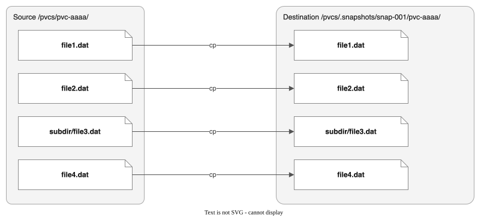
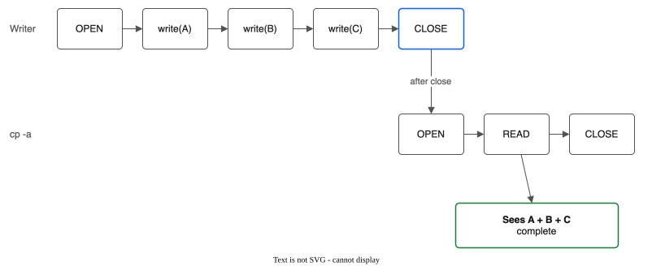
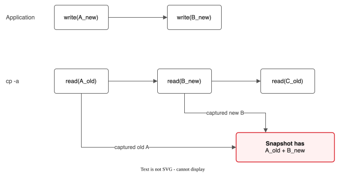
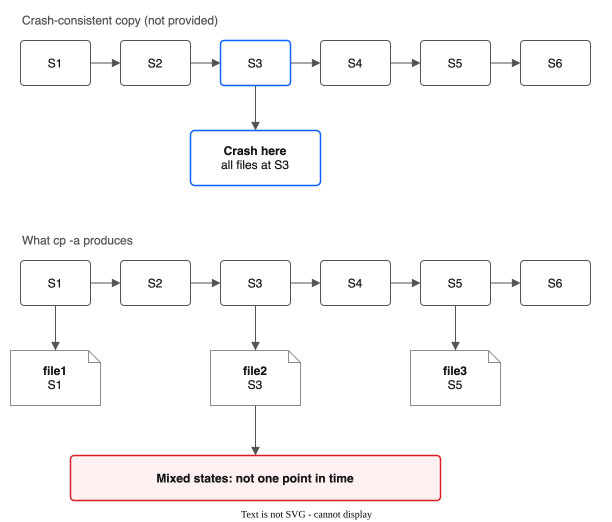
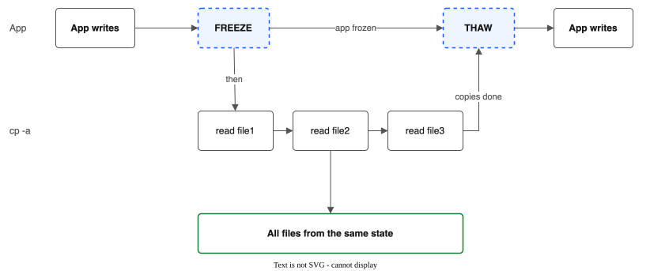
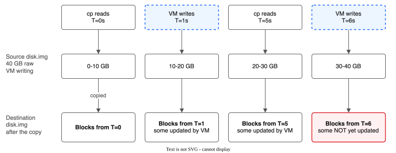
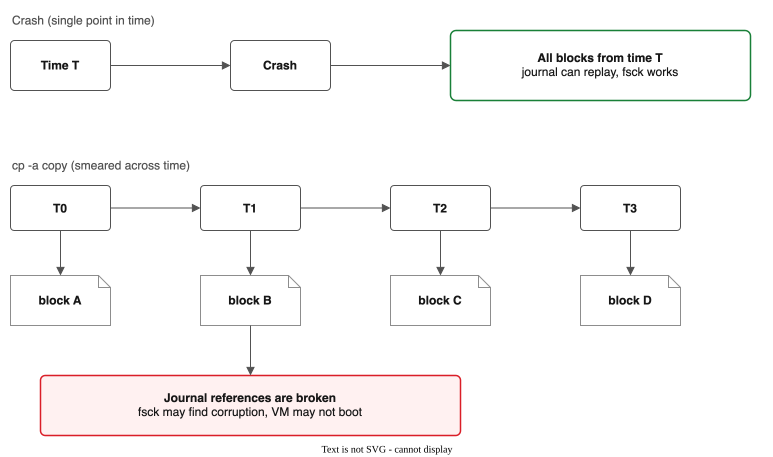
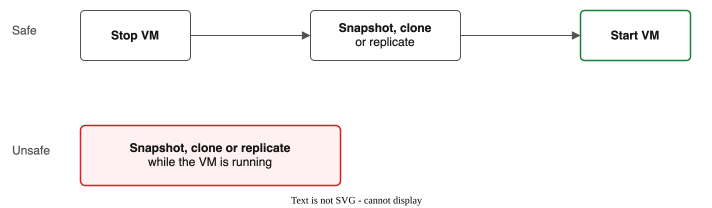
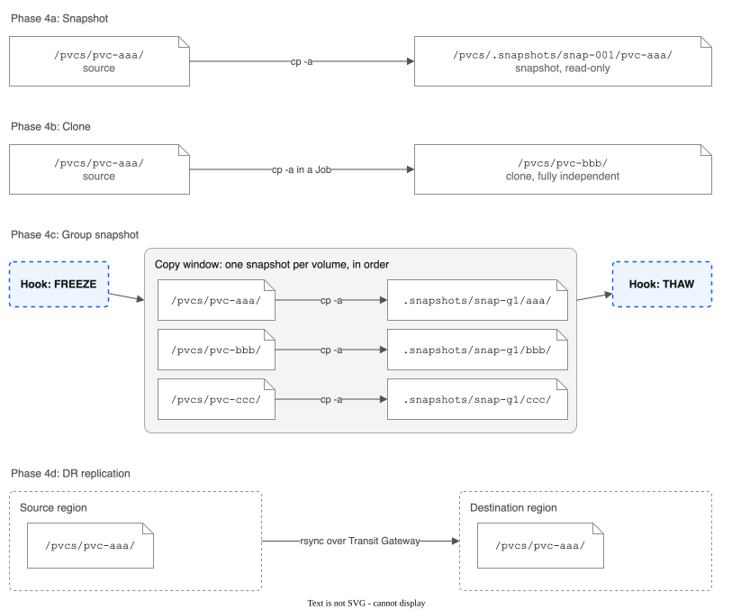
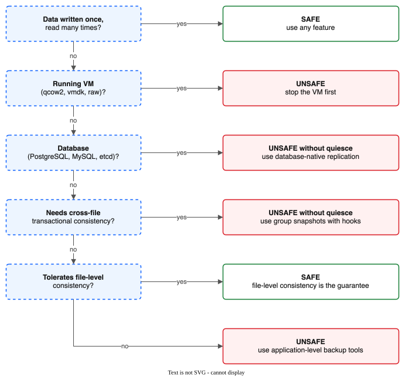

# Data Consistency Model

Definitive reference for understanding what this driver can and cannot guarantee about data consistency across all features: snapshots, clones, group snapshots, and cross-region DR.

**Audience:** Cluster operators, application developers, SREs evaluating whether their workload is safe with this driver.

**Bottom line:** For plain volumes, this driver provides **file-level consistency** only. If your workload requires cross-file transactional consistency, crash consistency, or intra-file point-in-time consistency, the file-copy features (snapshot, clone, replication and backup of a plain volume) are not safe for your data. Read on to understand exactly why.

**The exception is a running VM.** The driver copies all disks of a running VM with QEMU at one moment. The copy is file-system consistent when the guest could be frozen, and crash consistent when it could not. The status says which. See [CONTEXT.md](CONTEXT.md#how-good-a-copy-is) for the words.

---

## Why cp -a, Not COW

Every data-copy operation in this driver -- snapshots (Phase 4a), clones (Phase 4b), group snapshots (Phase 4c), and DR replication (Phase 4d) -- ultimately reduces to a recursive file copy (`cp -a` or `rsync`). This is not a design choice we made lightly. It is the only option.

### NFS Is a Protocol, Not a Filesystem

NFS (Network File System) is a remote file access protocol. It defines operations like `READ`, `WRITE`, `OPEN`, `CLOSE`, `GETATTR`, and `READDIR`. It does not define:

- Snapshots
- Copy-on-write (COW)
- Reflinks
- Filesystem freeze
- Block-level replication
- Change journals

These are filesystem features provided by local filesystems like ZFS, Btrfs, or XFS. NFS is a transport layer sitting above whatever filesystem the server uses. The server's filesystem may have these capabilities, but they are not exposed through the NFS protocol.

### VPC File Shares Are Opaque Managed Infrastructure

IBM VPC file shares are fully managed NFS services. We do not have:

- Access to the underlying block device
- Access to the server-side filesystem
- Administrative commands on the NFS server
- Any API to create directory-level or file-level snapshots (the VPC API can snapshot a whole share, see below)

The VPC API provides `CreateShare`, `DeleteShare`, `UpdateShare`, `ListShares`, and mount target management. It also has `CreateShareSnapshot`, `ListShareSnapshots` and `DeleteShareSnapshot`, but a share snapshot covers the whole share, not one volume, and IBM does not offer it for shares in `vpc` access mode. This driver does not use share snapshots: a pool share holds many volumes, so a share snapshot could not restore one volume without touching the others.

### The Only Mechanism Is Recursive File Copy

Given these constraints, the only way to capture the state of a subdirectory is to read every file in it and write those files somewhere else:



### Consequences

| Property | Impact |
|----------|--------|
| **Creation time proportional to data size** | A 100 GB subdirectory takes minutes to copy, not milliseconds |
| **Full storage cost** | Every snapshot/clone consumes the full size of the source data |
| **Source is live during copy** | The application continues writing while `cp -a` reads files sequentially |
| **No incremental snapshots** | Each snapshot is a full copy; no delta from the previous snapshot |
| **No space-efficient clones** | Clones are full copies, not COW references to shared blocks |

---

## Consistency Levels Defined

This section defines four levels of consistency, from weakest to strongest. Understanding these levels is essential for evaluating workload safety.

### File-Level Consistency (What We Guarantee)

Each individual file is internally consistent at the moment it was read. If a 50 MB file was being written when the copy started, the copy sees either the old complete version or the new complete version -- never a half-written file.

**Mechanism:** NFS close-to-open semantics. When a client closes a file, all data is flushed to the NFS server. When another client (or the same client on a different file descriptor) opens the file, it sees all data that was flushed at the previous close. `cp -a` opens, reads, and closes each file individually, so it reads a consistent version of each file.

**Caveat:** If a file is still open for writing by another process on the same node when `cp` reads it, close-to-open does not apply (the file has not been closed). In practice, NFS attribute caching and `cp`'s sequential read pattern mean the copy typically gets a coherent state, but this is not guaranteed by the protocol for files with concurrent open writers.



This is our baseline for **all** operations: snapshots, clones, group snapshots, and DR replication.

### Cross-File Consistency (NOT Guaranteed)

If an application writes file A then file B as part of a logical operation, the copy might capture the old version of A but the new version of B (or the reverse, if `cp` reaches B first). In the first case the copy holds a mix that never existed on the volume. There is no ordering guarantee across files.

**Why:** `cp -a` processes files in directory-listing order. The application writes in its own order. These two orders are unrelated. By the time `cp` gets to a file, it may have already been updated (capturing the new version) or may not yet have been updated (capturing the old version).



### Crash Consistency (NOT Guaranteed)

The copy does **not** represent a single point in time. A crash-consistent snapshot would capture the exact state of all files at time T, as if the power cord was pulled at that instant. Our copy captures file1 at time T1, file2 at time T2, file3 at time T3, and so on. The time span between T1 and TN can be seconds to minutes depending on data size.

**Why it matters:** Many systems (databases, filesystems, VMs) are designed to recover from a crash because a crash is a single point in time. Journal replay, WAL replay, and fsck all assume that the state is a consistent slice of a timeline. Our copies are not a slice -- they are a smear across a timeline.



### Application Consistency (Only With Quiesce Hooks)

If the application freezes writes before the copy and thaws after, all data is consistent because no mutations occur during the copy window. This is the strongest consistency level achievable with this driver.

**Mechanism:** The application must cooperate by:

1. Flushing all in-memory buffers to NFS.
2. Stopping all writes (quiesce/freeze).
3. Signaling readiness.
4. Waiting for the copy to complete.
5. Resuming writes (thaw).

**Applies to:** Group snapshots (Phase 4c) with configured `preSnapshotHooks` and `postSnapshotHooks`. DR replication (Phase 4d) with configured `quiesceHooks`.

**Cost:** Application downtime (I/O pause) equal to the copy duration.



---

## Per-Feature Consistency Matrix

| Feature | File-Level | Cross-File | Crash | App (with hooks) |
|---------|:----------:|:----------:|:-----:|:----------------:|
| Snapshot (Phase 4a) | Yes | No | No | N/A |
| Clone (Phase 4b, always async) | Yes | No | No | N/A |
| Group Snapshot (Phase 4c) | Yes (per member) | No (across members) | No | Yes (with hooks) |
| DR Replication (Phase 4d+5) | Yes | No | No | Yes (with hooks) |

**Notes:**

- **Snapshot and Clone** do not support quiesce hooks. The application must be manually quiesced before triggering these operations if consistency is required.
- **Group Snapshot** supports quiesce hooks via `preSnapshotHooks` and `postSnapshotHooks` in the VolumeGroupSnapshot spec. Hooks support `exec` (pod command) and `http` (webhook callback) types. This is one of the built-in paths to application-consistent multi-PVC snapshots.
- **DR Replication** supports quiesce hooks via `preSyncHooks` and `postSyncHooks` in the ReplicationPolicy spec. Pre-sync hooks execute before each replication cycle (abort on failure); post-sync hooks execute after successful sync (log-only on failure). Combined with incremental rsync (`SyncDir`), this provides efficient application-consistent cross-region replication.
- For group snapshots without hooks, the inconsistency window equals the time from the first member copy starting to the last member copy completing. This window is tracked in `status.inconsistencyWindowSeconds`.

---

## Workload Suitability

### Safe

These workloads produce correct, usable copies with all driver features:

| Workload | Why It Is Safe |
|----------|---------------|
| **Static assets** (images, CSS, JS) | Written once, read many. No concurrent writes during copy. |
| **ML model weights** | Written once by training pipeline. Immutable after write. |
| **Configuration files** | Small, infrequently updated. File-level consistency is sufficient. |
| **Log archives** | Append-only. The copy may be slightly behind, but every log entry present is complete. |
| **Cold data / backups** | Not being written. Full consistency by definition. |
| **Media files** (video, audio) | Large but immutable after creation. |
| **Container image layers** | Written once during build. Read-only at runtime. |

### Use With Caution

These workloads may produce usable copies depending on specific conditions:

| Workload | Condition for Safety |
|----------|---------------------|
| **Databases with checkpointing** | Safe if the application performs a checkpoint and flushes to disk before the copy. Must quiesce writes. Without quiesce, the copy is NOT safe. |
| **Applications tolerating stale reads** | Safe if the application can handle reading a mix of old and new file versions (eventual consistency model). |
| **Append-only data pipelines** | Safe if processing is idempotent and can handle duplicate or missing tail records. |
| **Warm standby for apps with native replication** | The copy is a starting point, not authoritative. The application's own replication protocol handles consistency. |

### Unsafe

These workloads will produce corrupted, unusable copies. Do not use driver snapshot/clone/replication features for these:

| Workload | Why It Fails |
|----------|-------------|
| **Running VM boot/data disks** (qcow2, vmdk, raw) | Intra-file block-level inconsistency. See detailed section below. |
| **Databases relying on WAL + data file relationships** | WAL and data files must be consistent with each other. Copy has no cross-file guarantee. |
| **Any workload requiring cross-file transactional consistency** | Config + data, output + completion marker, model weights + optimizer state -- all require atomic multi-file capture. |
| **Applications with memory-mapped files** | mmap writes may not be flushed to NFS before cp reads the file. |

---

## VM Disk Images: Why They Are Unsafe

This section explains in detail why copying a VM disk image while the VM is running produces a broken copy. This applies to all VM disk formats (raw, qcow2, vmdk) and all copy mechanisms (cp -a, rsync, tar).

### The Core Problem

A VM disk image is a single large file (e.g., `disk.img`, 40 GB raw). But **internally** it has block structure: an ext4/xfs filesystem with inodes, journals, block allocation bitmaps, and data blocks. The VM performs scattered random writes throughout the file as the guest OS operates.

`cp -a` reads the file **sequentially** (byte 0, byte 1, byte 2, ..., byte N). The VM writes **randomly** (block 50000, then block 1000, then block 30000). The copy captures some blocks from time T1, others from time T2, and others from time T3.

### Block-Level Interleaving



### Why This Is Worse Than a Crash

A crash captures the state at a **single** point in time. The filesystem journal, fsck, and recovery tools are designed to handle this: replay the journal forward from the crash point, or discard uncommitted transactions. The state is consistent "as of" the crash moment.

Our copy has **no single point in time**. The journal entries at the start of the file were written at T=0, but the data blocks they reference at offset 30 GB were captured at T=6. The journal says "I wrote block X with data Y at time T=2" but block X in the copy contains data from T=0 (before the write) or T=6 (after a different write). Journal replay produces nonsense.



### What Happens in Practice

- **Best case:** The VM guest filesystem detects corruption on boot and refuses to mount. The VM does not start.
- **Common case:** The VM boots but has silent data corruption. Files inside the guest appear intact but contain stale or mixed data.
- **Worst case:** The guest filesystem's metadata (inode tables, directory entries) is corrupted. Files disappear, directories are unreadable, or the filesystem panics.

### The Rule



This applies regardless of disk format (raw, qcow2, vmdk) and regardless of which driver feature is used (snapshot, clone, group snapshot, DR replication).

---

## What Would Fix This

The consistency limitations documented above are not bugs in this driver. They are fundamental constraints of operating on NFS without server-side snapshot support. Here is what would eliminate or mitigate each limitation:

### IBM Adds VPC Share-Level Snapshots

If the VPC API gained a `CreateShareSnapshot` operation that atomically captures the state of an entire file share at a single point in time:

- Snapshots would be **instant** (milliseconds, not minutes)
- Snapshots would be **crash-consistent** (all files from the same point in time)
- Snapshots would be **space-efficient** (copy-on-write, not full copies)
- VM disk images would be **safe** to snapshot while the VM is running
- Cross-file consistency would be **guaranteed** within the snapshot

This is the single most impactful improvement IBM could make. It would eliminate nearly every limitation in this document.

### Application Quiesce Hooks

Implemented for group snapshots (Phase 4c) and DR replication (Phase 4d), with hook execution added in Phase 5. The application freezes writes before the copy and thaws after. This achieves **application consistency** at the cost of an I/O pause. Hooks support both `exec` (pod command via Kubernetes exec API) and `http` (webhook callback) execution types.

**Limitations of quiesce hooks:**

- Requires application support (not all apps expose freeze/thaw)
- I/O pause duration equals the copy duration (can be minutes for large data)
- Does not help with VM disk images (you cannot `fsfreeze` a guest filesystem from outside the VM over NFS)

### Block-Level Replication

If VPC file shares exposed block-level access, tools like DRBD or LVM mirroring could provide synchronous or asynchronous replication with crash consistency. This is not available and is unlikely to be available on managed NFS.

### fsfreeze

`fsfreeze` freezes a local filesystem, flushing all pending writes and preventing new ones. It provides crash consistency for local filesystems. However, **fsfreeze does not work on NFS mounts**. It is a local filesystem operation implemented via the `FIFREEZE` ioctl, which NFS does not support.

```
$ fsfreeze --freeze /mnt/nfs-share
fsfreeze: /mnt/nfs-share: freeze failed: Inappropriate ioctl for device
```

---

## The Building Blocks Progression

Each phase builds on the previous, using the same fundamental `cp -a` mechanism but applying it to progressively more complex scenarios.

- **Phase 4a, Snapshot:** one SubVolume is copied with `cp -a` into an immutable copy under `.snapshots/`. This is the base primitive. Everything else builds on it.
- **Phase 4b, Clone:** the snapshot idea, with a copy to a new writable location. `cp -a` runs in a Kubernetes Job (async), and the node agent gates the mount.
- **Phase 4c, Group Snapshot:** coordinated, sequential snapshots of N SubVolumes. Optional quiesce hooks bracket the copy window. The inconsistency window is tracked in status. It is unbounded without hooks, and zero with successful hooks.
- **Phase 4d, DR Replication:** the snapshot idea, with a transfer to a remote region. A periodic rsync copies from the source pool to the destination pool. The snapshot gives a stable copy source for the transfer.



### How Consistency Propagates

The consistency of each phase is bounded by the consistency of its building block:

```
Phase 4a (Snapshot):
  Consistency = file-level (cp -a of one directory)

Phase 4b (Clone):
  Consistency = file-level (same cp -a as snapshot)
  Additional concern: async clones have longer copy windows

Phase 4c (Group Snapshot):
  Consistency = file-level per member
  Cross-member: NOT guaranteed without hooks
  With hooks: application-consistent across all members

Phase 4d (DR Replication):
  Consistency = file-level (rsync per SubVolume)
  Cross-SubVolume: NOT guaranteed
  Cross-region staleness: RPO = time since last sync
```

No phase can exceed file-level consistency without application cooperation (hooks). This is a fundamental ceiling imposed by the NFS protocol and VPC platform constraints.

---

## Quick Reference: Is My Workload Safe?



---

## Related Documents

| Document | Relevant Section |
|----------|-----------------|
| [Volume Cloning](VOLUME-CLONING.md) | Consistency Guarantees |
| [Volume Group Snapshots](VOLUME-GROUP-SNAPSHOTS.md) | Consistency Model, Quiesce Hook Design |
| [Cross-Region DR](CROSS-REGION-DR.md) | Consistency Guarantees, Unsupported Workload Types |
| [Known Limitations](KNOWN-LIMITATIONS.md) | Snapshots and Clones, Volume Group Snapshots, Cross-Region Replication |
| [VM Disk Formats](VM-DISK-FORMATS.md) | Why Raw Not qcow2, runtime I/O patterns |
