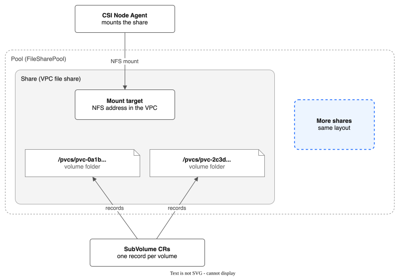

# Context: the words this project uses

This page defines each word once. Other pages link here instead of defining the word again. Each entry has one example.

The meanings come from the code (`api/v1alpha1/` and `pkg/`). If a page disagrees with this one, this one is right, and the page is a bug. Please report it.

For pictures you can click through, see the [interactive diagrams](diagrams/index.html).

**Contents**

- [Storage](#storage): pool, share, mount target, SubVolume, volume, plain volume, VM disk, allocation strategy, auto-expand, tier, drain, StorageClass, staging, reclaim policy
- [Copies in the same pool](#copies-in-the-same-pool): snapshot, file snapshot, QEMU copy, instant snapshot, chain, overlay file, VM hook, Sidecar gate, flatten, clone
- [How good a copy is](#how-good-a-copy-is): moment, file-system consistent, crash consistent, file copy, guest freeze
- [Backup](#backup): backup, BackupPolicy, snapshot pool, keep time, restore, BackupRestore, restore point, change list, COS export, lock, backup key, browse session, browse helper
- [Replication and failover](#replication-and-failover): replication, ReplicationPolicy, destination, receiver, rewind, failover
- [Other words](#other-words): golden image, lifecycle hook, group snapshot, user workload monitoring, command-line plugins

---

## Storage

### Pool

A **pool** is a group of VPC file shares that the driver manages as one unit. You define it with a `FileSharePool` resource. A pool lives in one zone and has one share profile (`dp2`).

Example: the pool `general-purpose` has 3 shares of 1000 GB each, and every PVC on the `ibm-vpc-file-pool` StorageClass lands on one of them.

### Share

A **share** is one VPC file share: an NFS export that IBM Cloud runs for you. A pool holds one or more shares. The driver creates a share in the background when a pool needs room. One exception: with auto-expand on, a PVC request that finds no share with room makes the share itself, and is told to retry.

Example: `r006-1234...` is a share of 1000 GB. It holds the folders of 40 PVCs.

### Mount target

A **mount target** is the NFS address of a share inside your VPC. Nodes mount a share through it. The driver makes one mount target for each share. It sits in the pool's zone and serves nodes in every zone.

Example: `10.240.64.5:/share_abc123`.

### SubVolume

A **SubVolume** is the driver's record of one PVC: which share holds it, which folder it uses, and how big it is. It is a cluster-wide resource. It is named after the PersistentVolume (`pvc-<uuid>`).

Example: `kubectl get subvolume pvc-0a1b...` shows the pool, the share and the folder `/pvcs/pvc-0a1b...`.

### Volume

A **volume** is a PVC that uses a pool StorageClass. Its data is a folder (`/pvcs/pvc-<uuid>`) on one share. The docs also call this folder the subdirectory or the `subPath`. Each staged volume has its own NFS mount on a node (a second pod on the same volume reuses it); each pod sees only its own folder.

Example: the PVC `db-data` in the namespace `apps` is a volume of 20 GB.

### Plain volume

A **plain volume** is a volume that is not a VM disk. It is a folder of ordinary files. A copy of it is a file copy, so it is only as consistent as its files are.

Example: the volume of a web server that stores uploaded images.

### VM disk

A **VM disk** is a volume that a KubeVirt `VirtualMachine` uses as a disk. It is one raw file, `disk.img`, in the volume's folder. A snapshot, backup or replication of a disk of a running VM is a QEMU copy of all the VM's disks at one moment. A disk of a stopped VM is copied as a folder, like a plain volume.

Example: the PVC `web-root` is the boot disk of the VM `web`. Its folder holds `disk.img`.

### Allocation strategy

The **allocation strategy** (`spec.allocationStrategy`) decides which share gets a new volume. `spread` picks the share with the most free space, so volumes spread out and one failure affects fewer of them. `binpack` picks the share with the least free space that still fits, so fewer shares are in use. The default is `spread`. Allocation only records a SubVolume and never calls the VPC.

Example: with `spread`, three new 10 GB volumes go to three different shares.

### Auto-expand

**Auto-expand** (`spec.autoExpand`) lets the pool add a share by itself. The background reconciler starts one when the space given to volumes crosses `expandThresholdPercent` (default 80) of the pool, and it stops at `maxShares`. A volume request that finds no share with room also makes a share itself (`tryAutoExpand`, inside `Allocate`), and gets a retry error. While it works, the pool phase is `Expanding`. If a request finds no room while the pool expands, it is told to retry shortly. If the pool is at `maxShares` and full, it is refused.

Example: a pool of 2 shares of 1000 GB adds a third when volumes hold 1600 GB.

### Tier

A **tier** is a named performance level inside one pool. Each tier has its own share size, IOPS and share count. The driver makes one StorageClass for each tier, named `<pool>-<tier>`, with the parameter `tier`.

Example: the pool has the tiers `standard` (100 IOPS) and `fast` (3000 IOPS).

### Drain

To **drain** a share is to stop putting new volumes on it. You list the share in `spec.drainShares`. The driver also drains a share by itself when the VPC reports it `failed` or `degraded`. Volumes already on a drained share keep working. The driver does not move them or delete the share. The share is **drained** when no volume and no snapshot is left on it.

Example: you drain share A. It is drained once its last PVC and snapshot are gone. Then you can delete share A by hand.

### Staging

**Staging** is the one NFS mount of a whole share on a node. Each volume on that node is then a bind-mount of its own folder from the staging mount into the pod. Ten pods on one node that use one share make one NFS connection.

Example: the node mounts share A once, and ten pods each see only their own folder.

### Reclaim policy

The **reclaim policy** is the Kubernetes setting on the StorageClass that says what happens to a volume when its PVC is deleted. With `Delete` (the default), the driver removes the folder and the SubVolume. With `Retain`, Kubernetes keeps the PersistentVolume, and the SubVolume and the folder stay until you clean them up by hand. The driver has no archive mode.

Example: use `Retain` for a pool of data you must never lose by a mistaken delete.

### StorageClass

A **StorageClass** tells Kubernetes to use this driver (`vpc-file-pool.csi.ibm.io`) and names the pool, and the tier if there is one. A **VolumeSnapshotClass** does the same for snapshots.

Example: the chart makes the StorageClass `ibm-vpc-file-pool`, and the driver makes one for each pool you create.

---

## Copies in the same pool

### Snapshot

A **snapshot** is a copy of one volume that stays on the same share as the volume. You ask for it with a Kubernetes `VolumeSnapshot`, and the driver records it in a `Snapshot` resource. A snapshot counts against the share's space. A snapshot does not protect you from the loss of the share. For that, use a [backup](#backup).

A snapshot is made in one of three ways: a file snapshot, a QEMU copy or an instant snapshot. The annotation `storage.ibmcloud.io/snapshot-method` on the `Snapshot` says which one (`file`, `vm` or `instant`). For a VM disk that was not snapshotted instantly, `status.methodReason` says why.

Example: a snapshot of `db-data` is ready when `kubectl get snapshot` shows `READY true`.

### File snapshot

A **file snapshot** is a snapshot that a Job makes by copying the volume's folder (`cp -a`) to `/pvcs/.snapshots/snap-<name>` on the same share. It is the way for a plain volume. It is only as consistent as the files are. Time passes while the Job copies.

Example: a 100 GB volume takes minutes to snapshot this way.

### QEMU copy

A **QEMU copy** is a copy of the disks of a running VM that QEMU (the program that runs the VM) writes. All disks of the VM show the same moment. It copies the whole disk the first time, and then only the blocks that changed. A snapshot of a running VM's disk is a QEMU copy when instant snapshots are off. Backup and replication of a running VM also use it.

Example: a snapshot of a running VM with two disks gives two snapshots that show the same moment.

### Instant snapshot

An **instant snapshot** is a snapshot of a VM disk that copies nothing. QEMU stops writing to the disk file and writes new data to a new file. The old file is the snapshot. It is ready in seconds, whatever the disk size. It needs the [Sidecar gate](#sidecar-gate). It is Experimental. See [VM-INSTANT-SNAPSHOTS.md](VM-INSTANT-SNAPSHOTS.md).

Example: a snapshot of a 500 GB disk is ready in 2 seconds.

### Chain

A **chain** is the set of files of a VM disk that has instant snapshots. The last file is `disk.img`. Newer files are `snap-<id>.qcow2`. Each file holds only what changed after the file before it. The `SubVolume` lists them in `status.diskChain`, newest first. A VM with a chain needs the [VM hook](#vm-hook) to start.

Example: `snap-a1.qcow2`, `snap-b2.qcow2`, `disk.img`.

### Overlay file

An **overlay file** is one `snap-<id>.qcow2` file of a chain. The project's design notes also call it an overlay. It is a file that holds only the changes made after the file below it.

Example: after two snapshots, a disk has two overlay files on top of `disk.img`.

### VM hook

The **VM hook** is a small extra container that the driver adds to the pod of a VM that has a chain. KubeVirt runs it just before the VM starts. It tells the VM to open the newest file of the chain, not `disk.img`. The driver adds it only to VMs that have instant snapshots.

Example: the ConfigMap `ibm-vpc-file-pool-vm-hook` holds the hook script in the VM's namespace.

### Sidecar gate

The **Sidecar gate** is the KubeVirt feature gate named `Sidecar`. KubeVirt refuses hook containers when it is off. Instant snapshots need it on. **Red Hat does not support this gate**, and OpenShift Virtualization then reports `TaintedConfiguration`. The chart can turn it on with `vmSnapshots.enableSidecarGate=true`, using a Job. The chart never turns it off.

Example: with the gate off, a snapshot of a VM disk is a QEMU copy, and `status.methodReason` says so.

### Flatten

To **flatten** a VM is to delete all its instant snapshots so that each disk is one plain `disk.img` again. Each delete merges the snapshot's file back into the disk. Run `kubectl pool-snapshots flatten <vm> -n <namespace>`.

Example: flatten a VM before you turn the Sidecar gate off.

### Clone

A **clone** is a new volume made from an existing volume. The clone worker, a background loop in the controller, runs the copy as a Kubernetes Job. A pod cannot mount the new volume until the copy ends: the node plugin answers `Unavailable` while `status.cloneStatus` is not `Complete`.

A clone is made for every volume size, and it prefers the share of its source.

Example: a PVC with `dataSource: {kind: PersistentVolumeClaim, name: db-data}` is a clone of `db-data`.

---

## How good a copy is

### Moment

A **moment** is the point in time that a copy, snapshot or backup shows. Moments are stored as UTC times in RFC 3339 form. All the disks of one VM in one copy show the same moment.

Example: `2026-10-21T09:30:00Z`.

### File-system consistent

A copy of a VM disk is **file-system consistent** when the driver froze the guest's file systems for the instant of the copy. The guest wrote its pending data first. A VM that starts from the copy needs no repair. The status field `consistency` says `FileSystemConsistent`.

Example: the copy of a Linux VM with a working guest agent.

### Crash consistent

A copy of a VM disk is **crash consistent** when the file systems were not frozen. The disk is as it would be after a power loss. A VM that starts from the copy may need a file-system check. The status field `consistency` says `CrashConsistent`, and `consistencyReason` says why the freeze did not happen (for example, no guest agent).

Example: the copy of a VM that has no guest agent.

### File copy

**File copy** is the consistency of a copy of a plain volume. The driver copies files one by one while they may still change, so the copy is not one moment. The status field `consistency` says `FileCopy`. For a database, stop it or use a [lifecycle hook](#lifecycle-hook) first.

Example: a backup of a volume that holds a log folder.

### Guest freeze

A **guest freeze** is a request through the VM's guest agent. The guest writes its pending data and holds new writes for a moment. The driver freezes a guest for the QEMU copy, and the guest thaws by itself after 30 seconds at most. OpenShift does its own freeze when you take a VM snapshot from the console. For an instant snapshot, the driver then does not freeze again.

Example: a freeze of 0.15 seconds was measured in a lab test.

---

## Backup

### Backup

A **backup** is a copy of a volume or VM, made on a schedule. The driver keeps it on a different share, in a [snapshot pool](#snapshot-pool). It keeps many moments. A backup survives the loss of the data share. It does not survive the loss of the whole VPC unless you also [export it to COS](#cos-export).

Example: a backup every 6 hours, kept for 14 days.

### BackupPolicy

A **BackupPolicy** says what to back up: a label selector, optionally limited to namespaces. It also names the snapshot pool, the `schedule` and the `keepFor` time. If any disk of a VM matches the selector, all its disks are backed up together. The controller makes the matching `ReplicationPolicy` objects itself. Do not edit them.

Example: `selector: {matchLabels: {backup: "yes"}}` backs up every PVC with the label `backup=yes`.

### Snapshot pool

A **snapshot pool** is a pool that holds only backups. It must hold no workload volumes. The driver refuses a pool that has any. It may have several shares. A volume stays on the share where its first backup went. Above 85% full, a share gets no new backups, and backups are never deleted to make room. This is not the same as a [snapshot](#snapshot), which stays next to the volume.

Example: the pool `backups` has one share of 2000 GB and no PVCs.

### Keep time

The **keep time** (`keepFor`) is how long backups are kept. It is a Go duration such as `36h`, or a number of days such as `30d`. The default is 7 days. The shortest is one hour. A volume that is deleted keeps its backups until the keep time has passed since its last backup.

Example: `keepFor: 14d`.

### Restore

To **restore** is to make a new PVC from a backup or a snapshot. A restore never writes over a volume that exists. The new PVC is held back from pods until the copy ends. Run `kubectl backup restore` for a backup, which also works after the source volume is gone. Use a PVC `dataSource` or the console for a snapshot.

Example: restore `vms/web-root` as it was at 09:00 into the new PVC `vms/web-root-restored`.

### BackupRestore

A **BackupRestore** is the request that `kubectl backup restore` creates. Its `status.phase` goes `Pending`, `Provisioning`, `Restoring`, then `Done` or `Failed`.

Example: `kubectl get backuprestore` shows `restore-web-root-lq3x9a  Done`.

### Restore point

A **restore point** is an earlier moment of a volume that you can still go back to. For a VM disk, the latest copy is whole. Each earlier moment is an undo file. It holds the old contents of the blocks that the next copy changed. For a plain volume, each earlier moment is a folder of hard links, so a file that did not change takes no extra space. Restore points older than the keep time are removed.

Example: with a copy every 6 hours and a keep time of 24 hours, a disk has about 4 restore points.

### Change list

A **change list** is QEMU's record of the blocks of a VM disk that changed since the last good copy. The next copy sends only those blocks. If the VM restarts or moves, the change list is lost and the next copy is a full copy. In the code it is a QEMU dirty bitmap, and the status field is `vmChangeList`.

Example: after the first copy of a 100 GB disk, a copy sends only the 81 MB that changed.

### COS export

A **COS export** sends backups to an IBM Cloud Object Storage (COS) bucket, encrypted before they leave the cluster. You turn it on with `spec.export` in a `BackupPolicy`. A problem with the export never stops the backups to the snapshot pool. Restore from COS works in any cluster that runs the driver.

Example: `kubectl backup restore --from-cos` in a new cluster after the VPC is lost.

### Lock

A **lock** is the COS object lock on exported backups. With `lock: Compliance`, nobody can delete the data or shorten the keep time before it ends. With `lock: None`, there is no lock. A Compliance lock cannot be undone, and locked data is billed until the lock ends.

Example: `keepFor: 30d` with `lock: Compliance` holds each exported backup for 30 days.

### Backup key

The **backup key** encrypts exported backups. The driver stores it only wrapped by an IBM Key Protect root key. Jobs unwrap it with the API key of a service ID (held in a Secret) that has the Reader role on the root key. The readable key is shown once, by `kubectl backup cos-setup`, and you must keep a copy outside IBM Cloud.

Example: restore with `--backup-key-file ./backup-key.txt` if Key Protect is gone.

### Browse session

A **browse session** is one open look into one backup, kept as a `BackupBrowse` resource. Users never make or see it: the backup gateway makes it after checking their rights. The backup controller runs a browse helper for it and ends it when idle, at the hard limit, or when it is closed.

Example: session for the backup of `apps/db`, open for 20 minutes, closed because it was idle.

### Browse helper

The **browse helper** is a small program in its own image (`browse`) that reads one backup folder, read-only, for the browse feature. It runs in a pod as root with no capabilities, on a read-only mount. It never follows a link, and it ends by itself when idle or after a time limit. Users never talk to it directly.

Example: it lists `/var/www` of last night's backup of the volume `web-data`.

---

## Replication and failover

### Replication

**Replication** copies volumes to a destination on a schedule. The destination is another pool or another cluster. If the source site is lost, you can start the workload there. By default it keeps only the latest copy of a plain volume (a backup keeps more moments). A plain volume is copied in one of two ways. In direct NFS mode (no `destinationEndpoint`), rsync copies it and only the files that changed cross the network (`incrementalSync`, on by default). In receiver mode (`destinationEndpoint` set, the mode for another cluster), the driver packs the whole folder into one tar stream and uploads all of it each cycle (`pkg/replication/syncclient.go`); `incrementalSync` does not reduce what is sent. A running VM is copied with a QEMU copy, all disks at one moment. The destination keeps restore points of VM disks for `restorePointKeepHours` (default 24).

Example: replicate the pool `production` in Frankfurt to a pool in London every 15 minutes.

### ReplicationPolicy

A **ReplicationPolicy** names the pool to copy (`sourcePoolName`, with an optional label selector). It names the destination, which is an NFS server or a receiver's URL. It also sets the `schedule`. It also sets how fast VM copies run (`vmCopyAdaptive`, default true: the copy follows the load on the share; `vmCopySpeedLimitMBps` is the highest speed, or the fixed speed when it does not adapt) and optional lifecycle hooks.

Example: `schedule: 15m`.

### Destination

The **destination** is where replicated data goes. It is a pool on another cluster or in another region, or a snapshot pool for a backup. Source and destination are roles of a copy, not kinds of cluster.

Example: the DR cluster is the destination of the policy `prod-to-dr`.

### Receiver

The **receiver** is a small HTTPS service on the destination cluster (`replicationReceiver.enabled=true` in the chart). Jobs on the source cluster send data to it with a bearer token. It writes the data to the destination share and applies VM copies. With a receiver, the source cluster needs no NFS route to the destination.

Example: `https://repl-receiver.apps.dr.example.com`.

### Rewind

To **rewind** a VM disk at the destination is to put it back to an earlier restore point. You rewind before you start the VM, with `kubectl failover ... --rewind-to`. After a VM has run on a disk, the disk no longer matches its restore points, and the driver refuses to rewind it.

Example: `--rewind-to 2026-10-21T09:00:00Z` starts the VM as it was at 09:00.

### Failover

**Failover** is making the replicated volumes usable on the destination cluster, so you can start the workload there. `kubectl failover execute` reads the metadata that replication left on the destination share, and creates the SubVolume, PersistentVolume and PVC for each volume. For a running VM it picks the newest moment that all the VM's disks can show. It does not start the workload, and it does not change DNS.

Example: `kubectl failover plan` shows an RPO of 14 minutes, so you run `execute`.

---

## Other words

### Golden image

A **golden image** is a ready-to-boot VM disk kept on pool storage. The golden image syncer finds CDI `DataImportCron` images and imports each one with a CDI DataVolume. It is Hidden: the code stays, but the console does not offer it. Use the standard OpenShift catalog instead. See [GOLDEN-IMAGE-WORKFLOW.md](GOLDEN-IMAGE-WORKFLOW.md).

Example: the DataVolume `golden-centos-stream9` in a target namespace.

### Lifecycle hook

A **lifecycle hook** is an action the hook orchestrator in the controller runs before or after a replication sync. It is either a command run in a pod (`exec`) or a web call (`http`). `onError` is `Abort` (the default) or `Continue`. Do not confuse it with the [VM hook](#vm-hook).

Example: an `http` hook that asks an application to flush its data before a sync.

### Group snapshot

A **group snapshot** (`VolumeGroupSnapshot`) was meant to snapshot several volumes together. It is **not active**. Nothing acts on the resource. A snapshot of a running VM already covers all its disks at one moment. See [KNOWN-LIMITATIONS.md](KNOWN-LIMITATIONS.md#volume-group-snapshots).

Example: do not create one; use a VM snapshot instead.

### User workload monitoring

**User workload monitoring** is the part of OpenShift's monitoring that reads your own projects. OpenShift's platform monitoring reads only the platform projects, and Red Hat does not support adding your own projects to it. The driver runs in `kube-system`, so its alerts and scraping are in a small namespace, `ibm-vpc-file-pool-csi-monitoring`, that only user workload monitoring reads. An admin turns it on once with `enableUserWorkload: true` in `openshift-monitoring/cluster-monitoring-config`. Without it **no alert fires**. See [MONITORING.md](MONITORING.md#where-alerts-run-on-openshift).

Example: `oc -n openshift-user-workload-monitoring get pods` lists `prometheus-user-workload` when it is on.

### Command-line plugins

The driver ships four `kubectl` plugins:

- `kubectl backup` lists, restores and deletes backups, sets up COS and restores from COS.
- `kubectl failover` plans and runs a failover on the destination cluster.
- `kubectl pool-snapshots` (the file is `kubectl-pool_snapshots`) flattens the instant snapshots of a VM.
- `kubectl migrate` moves PVCs from the stock IBM CSI driver to a pool.

Example: `kubectl backup list --policy nightly`.
