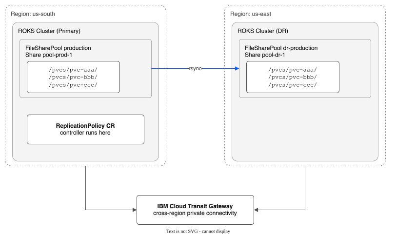
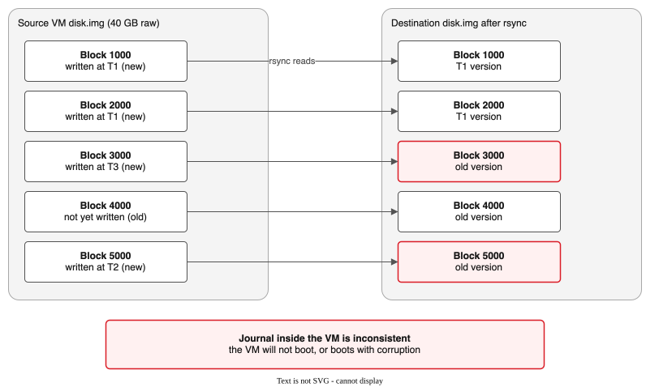
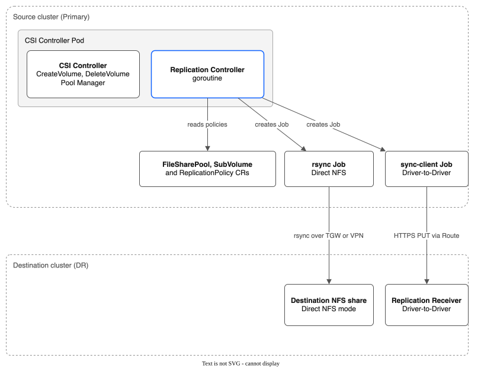
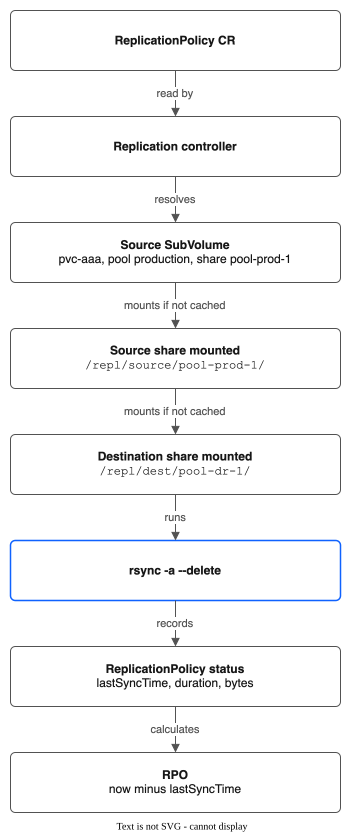
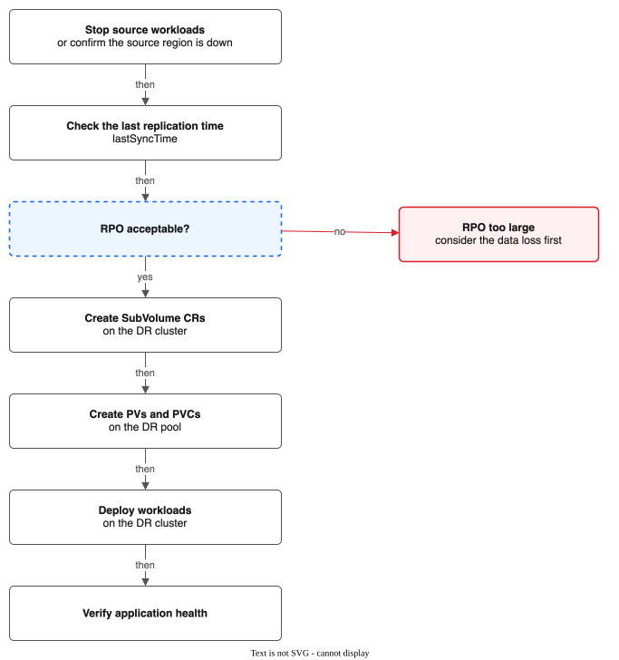
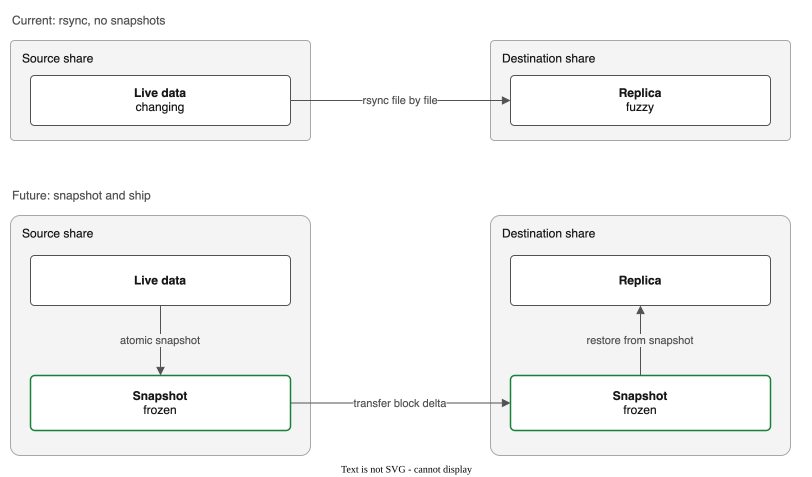

# Cross-Region Disaster Recovery (Phase 4d)

Design document for cross-region replication of pooled file share data.

**Status:** Implemented (v0.5.0)
**Depends on:** Phase 4a (Snapshots), cross-region VPC connectivity
**Last updated:** 2026-02-17

> **Implementation note:** The implementation simplifies several aspects of this design:
> - Direct NFS mode uses `SyncDir` (rsync-based incremental) by default, with `CopyDir` (full copy) as fallback when `incrementalSync` is disabled. Receiver mode (`destinationEndpoint`) does not use rsync: it tars and uploads the whole folder each cycle
> - Uses `time.Duration` schedule intervals instead of cron expressions
> - Destination is specified via `DestinationNFSServer` IP rather than a pool reference with share mappings
> - Pre/post-sync lifecycle hooks are implemented (Phase 5) — supports both exec (pod command) and HTTP hook types with configurable abort/continue-on-error policies

---

## Overview

Phase 4d adds optional cross-region disaster recovery for FileSharePool volumes. The goal is to allow cluster operators to replicate SubVolume data from a source pool in one IBM Cloud region to a destination pool in another region, so that workloads can be restarted in the DR region with a recent copy of their data.

This feature is **not** a general-purpose replication engine. It is designed for a narrow set of workloads where file-level consistency is sufficient and where the application can tolerate a non-zero Recovery Point Objective (RPO). It is explicitly unsuitable for workloads that require crash consistency, cross-file transactional guarantees, or intra-file point-in-time consistency.



---

## Platform Constraints

This section documents what the IBM VPC platform does and does not provide. These constraints are fundamental and cannot be worked around at the driver level.

### What IBM VPC File Shares Do NOT Provide

| Capability | Status | Impact |
|------------|--------|--------|
| **Native cross-region replication** | Not available | No async/sync mirror, no replica shares across regions. All replication must be built at the application layer. |
| **Share-level snapshots** | Available, not used | The VPC API can snapshot a whole file share, but not for shares in `vpc` access mode. A pool share holds many volumes, so the driver does not use it: one volume could not be restored without touching the others. |
| **Directory-level snapshots** | Not available | No way to atomically capture a subdirectory within a share. |
| **File-level snapshots** | Not available | No copy-on-write or reflink support at the NFS protocol level. |
| **Change tracking / changelog** | Not available | No journal, delta stream, or inotify-equivalent at the share level. Change detection requires full directory traversal. |
| **Cross-region share access** | Not available | A file share in `us-south` cannot have mount targets in `us-east`. Shares are region-local. |

### What IBM VPC File Shares DO Provide

| Capability | Details |
|------------|---------|
| **NFS v4.1** | Standard protocol with close-to-open cache consistency |
| **Cross-zone mount targets** | Shares in `us-south-1` can have mount targets in `us-south-2` and `us-south-3` (same region, already implemented in Phase 3d) |
| **Encryption at rest** | Provider-managed or customer-managed keys |
| **Encryption in transit** | NFS over Kerberos (`sec=krb5p`) |

### Network Connectivity Between Regions

Cross-region replication requires private network connectivity between regions. IBM Cloud provides:

- **Transit Gateway** -- connects VPCs across regions over IBM's private backbone. This is the recommended path.
- **VPN Gateway** -- IPsec tunnels between regions. Lower throughput, higher latency.
- **Public internet** -- not recommended (security, cost, unreliable bandwidth).

The replication controller does not provision network connectivity. Transit Gateway or equivalent must be configured by the cluster operator as a prerequisite.

---

## Consistency Guarantees

This is the most important section of this document. Read it carefully before deciding whether Phase 4d is appropriate for a given workload.

### What We CAN Guarantee

**File-level consistency:** Each individual file in the replicated copy is internally consistent. When NFS closes a file, the server flushes all pending writes. The replication tool (rsync) reads files after they are closed, so each file it copies reflects a complete write. If a 50 MB file was being written, rsync copies either the old version or the new version -- never a half-written version.

This guarantee comes from NFS close-to-open semantics: when a client closes a file, all data is flushed to the server. When another client (or rsync on the same client) opens the file, it sees all data that was flushed at the previous close.

### What We CANNOT Guarantee

**Cross-file consistency:** If an application writes to files A and B as part of a logical transaction, the replicated copy may contain the new version of A and the old version of B (or vice versa). There is no mechanism to capture a consistent snapshot across multiple files simultaneously.

```
Timeline on source:
  T1: Write file A (new)
  T2: rsync starts, copies A (new)
  T3: Write file B (new)    ← happens DURING rsync
  T4: rsync copies B (old)  ← rsync read B before T3 completed

Result on destination:
  A = new (T1)
  B = old (pre-T3)
  ← Cross-file inconsistency
```

**Crash consistency:** If the source application crashes or the node fails during a replication cycle, the destination may have a mix of pre-crash and during-crash file states. There is no rollback or atomic commit for the replication operation.

**Intra-file consistency for active writers:** If a file is being actively written (not yet closed) during the rsync window, the replicated copy may contain partial writes. This is an NFS protocol-level limitation -- NFS does not provide read isolation for files with open writers on other clients. rsync on the same node as the writer is somewhat better (close-to-open within the same client), but concurrent writes to the same file from different pods on the same node can still produce partial reads.

**Application-level consistency:** The replication engine has no knowledge of application semantics. It copies files. If an application requires that config.json and data.bin are updated atomically, replication cannot enforce this.

### Consistency Summary Table

| Guarantee | Provided? | Notes |
|-----------|-----------|-------|
| Each file internally consistent | YES | NFS close-to-open; rsync reads closed files |
| Cross-file atomic consistency | NO | No multi-file snapshot |
| Crash consistency | NO | No journal, no atomic capture |
| Application consistency | ONLY with quiesce hooks | Application must freeze I/O before rsync |
| Point-in-time recovery | NO | Each rsync cycle produces a "fuzzy" copy |

---

## Unsupported Workload Types

The following workloads MUST NOT be copied with rsync. A file copy of them produces corrupted or unusable replicas in the DR region. The controller never copies a running VM's disk with rsync: it uses a QEMU copy instead, as the VM section below describes.

### VM Boot and Data Disks (qcow2, vmdk, raw)

**Why it fails:** A VM performs scattered random writes within a single disk image file (`disk.img`). Even though rsync copies files, the problem is intra-file inconsistency during active VM operation. The VM writes block 1000 at T1, block 50000 at T2, block 3000 at T3 -- all within the same file. rsync reads this file while the VM is writing, producing a copy where some blocks are from T1, others from T2, others from T3. The result is a disk image with a structurally broken filesystem inside the VM.



The ext4 or xfs journal inside the VM is inconsistent. The VM will not boot, or it boots with filesystem corruption.

This is NOT a file-level consistency problem (rsync is reading one file). It is an intra-file consistency problem: the file's internal structure (filesystem metadata, journal, block allocation tables) requires all blocks to be from the same point in time, and rsync cannot provide that for a file being actively mutated by a VM.

**What the controller does:** in direct NFS mode, it copies a running VM's disks with QEMU, all at one moment, and never with rsync. The details are in `CRD-SPEC.md`, "Running VM disks". In receiver mode it does the same, and the receiver at the destination applies each copy, so each changed block crosses the network once. Hot-plugged disks are skipped, as described next.

**Skipped volumes:** it never copies a volume that a running or starting VM uses with rsync. Before each copy it looks for a KubeVirt pod (`kubevirt.io=virt-launcher` or `kubevirt.io=hotplug-disk`) in the claim's namespace that mounts the claim. If it finds one, it skips the volume and sets the volume's status error to `skipped: in use by running VM <namespace>/<pod>; ...`. The policy's `lastError` counts the skipped volumes. A skipped volume does not count as a failed cycle, so it does not pause the policy for the other volumes. If a VM starts while a copy runs, the controller does not record that copy as a sync. If the controller cannot list the pods, it does not copy the volume. Volumes of stopped VMs are copied as before; rsync leaves out any staging files left by an earlier VM copy.

**What to use instead:** the QEMU copy that the controller makes of a running VM (above). Its status says `FileSystemConsistent` or `CrashConsistent`. IBM Cloud VPC block storage snapshots and replication are another option for VM workloads.

### Databases with Write-Ahead Logs

**Why it fails:** Databases like PostgreSQL, MySQL, and etcd maintain a write-ahead log (WAL) and data files that must be consistent with each other. The WAL says "transaction X wrote page Y" -- if the replica has the WAL entry but not the updated page (or vice versa), the database is corrupted.

```
Source database files:
  data/base/16384/1234   ← table data file
  data/pg_wal/000000010000000000000001  ← WAL segment

rsync copies:
  1. WAL segment (contains record of writing page 42 in table 1234)
  2. Table data file (does NOT yet contain the page 42 write)

Destination: WAL references a write that isn't in the data file.
Recovery will fail or produce silent data corruption.
```

**What to use instead:** Database-native replication (PostgreSQL streaming replication, MySQL Group Replication, etcd learner nodes). These tools understand their own transaction semantics.

### Applications Requiring Cross-File Transactional Consistency

Any application that writes to multiple files as a logical unit and requires all-or-nothing semantics across those files. Examples:

- Configuration management systems that write a config file and a version marker atomically
- Batch processing pipelines where an output file and a completion marker must arrive together
- ML training checkpoints that span multiple files (model weights + optimizer state + metadata)

**What to use instead:** Application-level replication with quiesce hooks (see Supported Workloads), or redesign to use a single file per transaction boundary.

---

## Supported Workload Types

Phase 4d is designed for workloads where file-level consistency is sufficient and where a non-zero RPO (minutes to hours) is acceptable.

### Static Assets, Model Weights, Config Archives

Files that are written once and read many times. rsync produces a correct copy because the files are not being modified during replication.

```
Example: ML model serving
  /pvcs/pvc-model/
    model-v42.bin        ← 2 GB, written once by training pipeline
    tokenizer.json       ← written once
    config.yaml          ← written once

  rsync copies all three files. Each is complete and consistent.
  DR region can serve the model immediately.
```

### Log Aggregation and Cold Data

Log files are append-only. rsync copies the current state of each log file. The replica may be slightly behind (missing the last few seconds of logs), but every log entry that is present is complete.

### Warm Standby for Apps with Native Replication

Applications that already handle replication at the application layer (e.g., Kafka, Elasticsearch, CockroachDB) but want a filesystem-level warm standby for faster DR bootstrap. The replicated data is not authoritative -- it is a starting point that reduces recovery time.

### Workloads with Quiesce Hooks

Applications that can freeze I/O on command. The replication controller calls a pre-sync hook (e.g., exec into a pod, run `fsfreeze` or an application-specific flush command), then runs rsync, then calls a post-sync hook to resume I/O. This converts the "fuzzy" copy into an application-consistent copy at the cost of a brief I/O pause.

```
Replication cycle with quiesce:

  1. Controller calls pre-sync hook: "kubectl exec app-pod -- /scripts/flush-and-freeze.sh"
  2. Application flushes buffers, stops writing
  3. rsync runs (all files are quiesced, no concurrent writers)
  4. Controller calls post-sync hook: "kubectl exec app-pod -- /scripts/thaw.sh"
  5. Application resumes writing

  During step 3, every file is consistent AND cross-file consistency is achieved
  because no writes are happening. The I/O pause window = rsync duration.
```

---

## Architecture

### Design Principles

1. **Replication runs outside the CSI hot path.** The replication controller is a background goroutine in the controller pod. It never touches CreateVolume, DeleteVolume, or node mount operations.
2. **All state in CRDs.** ReplicationPolicy CRs define what to replicate. Status fields track progress, RPO, and errors.
3. **Two replication modes.** *Direct NFS mode*: rsync between NFS-mounted source and destination shares over Transit Gateway. *Driver-to-driver mode*: sync-client Jobs tar-stream data over HTTPS to a receiver service on the destination cluster — no cross-region NFS connectivity needed.
4. **Fail open.** If replication fails, the source cluster is unaffected. Replication errors are surfaced as CRD status and Prometheus metrics, never as PVC failures.
5. **Per-SubVolume granularity.** Each SubVolume (PVC subdirectory) is replicated independently. The operator chooses which SubVolumes to replicate via label selectors.

### Component Diagram



- **Source cluster (Primary):** the CSI Controller Pod holds the CSI Controller (CreateVolume, DeleteVolume, Pool Manager) and the Replication Controller (goroutine). For each ReplicationPolicy the Replication Controller lists the matching SubVolumes, creates Kubernetes Jobs per SubVolume, and updates the status on completion. It reads the FileSharePool, SubVolume and ReplicationPolicy CRs.
- **Jobs:** in Direct NFS mode, an rsync Job (CentOS). In Driver-to-Driver mode, a sync-client Job (driver image, tar over HTTPS).
- **Destination cluster (DR):** in Direct NFS mode, the destination NFS share (mounted); rsync goes over Transit Gateway or VPN. In Driver-to-Driver mode, the Replication Receiver service (extracts the tar, writes metadata); the data goes as an HTTPS PUT via an OpenShift Route.

### Replication Controller

The replication controller is a background goroutine in the CSI controller pod (with leader election) that:

1. Polls `ReplicationPolicy` CRs every 30 seconds. A policy starts a cycle when its schedule is due. While a cycle runs, the controller looks at the policy on every poll, and it also watches the Jobs in the driver namespace, so the policy status changes within seconds after a copy Job ends (not at the next scheduled cycle). Pre-sync hooks run once, when the cycle starts; post-sync hooks run once, when it ends.
2. For each policy, resolves the source `FileSharePool` and its SubVolumes (filtered by label selector).
3. Determines the replication mode based on the policy spec:
   - **Direct NFS mode** (`destinationNFSServer` set): Creates rsync Jobs that mount both source and destination NFS shares.
   - **Driver-to-driver mode** (`destinationEndpoint` set): Creates sync-client Jobs that tar-stream source data to the HTTPS receiver on the destination cluster.
4. On each replication cycle, creates Kubernetes Jobs (up to `maxParallelSyncs` concurrent) for each SubVolume.
5. Records completion time, bytes transferred, and duration in the ReplicationPolicy status.
6. Exposes Prometheus metrics for replication lag, RPO, transfer rate, and error counts.
7. Supports pause/resume via the `storage.ibmcloud.io/paused` annotation.

The controller does NOT:
- Create or delete VPC file shares (the destination pool must already exist).
- Create or delete SubVolume CRs on the destination (the failover CLI handles this).
- Interfere with the CSI controller or node agent in any way.

### TLS Configuration (Driver-to-Driver Mode)

When using driver-to-driver mode, the receiver service accepts HTTPS uploads from sync-client Jobs. TLS secures data in transit between clusters and authenticates the receiver endpoint.

**Receiver TLS (destination cluster):**

The receiver supports native TLS via cert-manager. Enable it in Helm values:

```yaml
replicationReceiver:
  enabled: true
  pvcName: replication-receiver-data
  authSecretName: replication-auth
  tls:
    enabled: true                    # Enables HTTPS on the receiver
    additionalDNSNames: []           # Extra SANs (optional)
    certManager:
      issuerKind: Issuer             # Issuer or ClusterIssuer
      issuerName: ""                 # Empty = auto-create self-signed Issuer
```

When `tls.enabled=true`:
- A self-signed cert-manager `Issuer` and `Certificate` are created in kube-system
- The Certificate includes SANs for the Service FQDN and the OpenShift Route hostname
- The OpenShift Route switches to `termination: passthrough` (TLS terminates at the receiver, not the router)
- Health probes use HTTPS instead of HTTP

**CA certificate verification (source cluster):**

When the receiver uses a self-signed certificate, sync-client Jobs need the CA cert to verify the connection. Configure this on the ReplicationPolicy:

```yaml
apiVersion: storage.ibmcloud.io/v1alpha1
kind: ReplicationPolicy
metadata:
  name: cross-region-dr
spec:
  sourcePoolName: production
  destinationEndpoint: "https://repl-receiver-kube-system.apps.dr-cluster.example.com"
  destinationAuthSecretRef: replication-auth-dr       # Bearer token Secret
  destinationCACertSecretRef: repl-receiver-ca        # CA cert Secret
  destinationBasePath: /pvcs
  schedule: "15m"
```

The `destinationCACertSecretRef` references a Secret in kube-system containing the CA certificate under the `ca.crt` key. Extract it from the destination cluster's cert-manager Certificate:

```bash
# On the destination cluster: extract the CA cert
kubectl get secret repl-receiver-tls -n kube-system \
  -o jsonpath='{.data.ca\.crt}' | base64 -d > ca.crt

# On the source cluster: create the CA cert Secret
kubectl create secret generic repl-receiver-ca \
  -n kube-system --from-file=ca.crt=ca.crt
```

The replication controller mounts this Secret into sync-client Job pods and passes `--ca-cert-file` to the sync-client binary, which creates an HTTPS client with a custom CA trust pool.

### Set up the receiver in the console

The console can make the two Secrets and test the receiver before it makes the policy. On the Replication tab, choose **Create ReplicationPolicy**, set the mode to **Driver-to-Driver**, and fill in:

1. **Receiver Endpoint.** The `https://` address of the receiver. The form refuses `http://`.
2. **Token and certificate.** Choose "Make new Secrets from what I paste" and paste the token (it is in the receiver's Secret on the destination cluster) and, for a self-signed receiver, the CA certificate in PEM form. The console makes the Secrets `<policy name>-receiver-token` and `<policy name>-receiver-ca` in `kube-system`. Or choose "Use Secrets that already exist" and give their names.
3. **Check connection.** The console runs a short Job in `kube-system`, with the driver image, that tests three things in order: the receiver answers, its certificate is trusted, and it accepts the token. The form shows the result: *The receiver is ready*, or one reason (`cannot connect`, `certificate not trusted`, `token refused`, `receiver storage not reachable`, or `receiver has no auth-check call; update it`).
4. **Create** turns on when the check passes. Change any field and the check must run again.

Notes:

- The token goes once from the browser to this cluster's API server. The console never reads a Secret back. If a Secret of the same name exists and the console did not make it, the form stops and says so.
- The check Job deletes itself after ten minutes.
- When you delete the policy in the console, the dialog has a box, off by default: "Also delete the Secrets the receiver setup made". It appears only for Secrets named `<policy name>-receiver-token` and `<policy name>-receiver-ca` that the policy uses and no other policy uses. The console deletes a Secret only after it proves the Secret carries the label the setup put on it, so a Secret you made yourself with the same name is left alone and named in a message.
- A user who may not make Jobs in `kube-system` sees a warning and can still make the policy without the check. A user who may not make Secrets there is told to ask an administrator and use existing Secrets.
- After the policy exists, the replication controller repeats the same checks (health call, certificate, token) once per schedule and sets the `ReceiverReachable` condition on the policy. The Replication Policies list has a Receiver column and the policy page a Receiver Status line: Reachable, Not reachable with the reason, or Checking... until the first result. `kubectl get replicationpolicy <name> -o jsonpath='{.status.conditions}'` shows the same. A failing check does not stop replication.
- The same test from a terminal: `curl -H "Authorization: Bearer $TOKEN" https://<receiver>/api/v1/auth-check` (add `--cacert ca.crt` for a self-signed receiver).

### Replication Data Flow



Replication cycle (one SubVolume):

1. The replication controller reads the ReplicationPolicy CR.
2. It resolves the source SubVolume: `pvc-aaa` on pool `production`, share `pool-prod-1`.
3. It mounts the source share (if not cached): NFS mount `10.240.1.5:/` at `/repl/source/pool-prod-1/`.
4. It mounts the destination share (cross-region, if not cached): NFS mount `10.245.3.8:/` at `/repl/dest/pool-dr-1/`.
5. It runs rsync:
   ```
   rsync -a --delete \
     /repl/source/pool-prod-1/pvcs/pvc-aaa/ \
     /repl/dest/pool-dr-1/pvcs/pvc-aaa/
   ```
6. It records the result in `ReplicationPolicy.status`:
   ```
   lastSyncTime: "2026-02-16T14:30:00Z"
   lastSyncDurationSeconds: 45
   lastSyncBytesTransferred: 104857600
   ```
7. It calculates and reports the RPO: `currentRPO = now - lastSyncTime`.

---

## CRD Design

### ReplicationPolicy

A new cluster-scoped CRD defining a replication relationship between a source pool and a destination pool.

```
Group:   storage.ibmcloud.io
Version: v1alpha1
Kind:    ReplicationPolicy
Scope:   Cluster
```

### Go Type Definition

```go
// api/v1alpha1/replicationpolicy_types.go

// +kubebuilder:object:root=true
// +kubebuilder:subresource:status
// +kubebuilder:resource:scope=Cluster,shortName=rp
// +kubebuilder:printcolumn:name="Source",type=string,JSONPath=`.spec.sourcePool`
// +kubebuilder:printcolumn:name="Dest",type=string,JSONPath=`.spec.destinationPool`
// +kubebuilder:printcolumn:name="Schedule",type=string,JSONPath=`.spec.schedule`
// +kubebuilder:printcolumn:name="RPO",type=string,JSONPath=`.status.currentRPO`
// +kubebuilder:printcolumn:name="Phase",type=string,JSONPath=`.status.phase`
// +kubebuilder:printcolumn:name="Last Sync",type=date,JSONPath=`.status.lastSyncTime`
type ReplicationPolicy struct {
    metav1.TypeMeta   `json:",inline"`
    metav1.ObjectMeta `json:"metadata,omitempty"`

    Spec   ReplicationPolicySpec   `json:"spec,omitempty"`
    Status ReplicationPolicyStatus `json:"status,omitempty"`
}

type ReplicationPolicySpec struct {
    // SourcePool is the name of the FileSharePool CR on this cluster to replicate from.
    // +kubebuilder:validation:Required
    SourcePool string `json:"sourcePool"`

    // DestinationPool defines the target pool in the DR region.
    // +kubebuilder:validation:Required
    DestinationPool DestinationPoolRef `json:"destinationPool"`

    // Schedule is a cron expression controlling replication frequency.
    // Examples: "*/15 * * * *" (every 15 min), "0 * * * *" (hourly), "0 */6 * * *" (every 6h).
    // +kubebuilder:validation:Required
    // +kubebuilder:validation:Pattern=`^(@(hourly|daily|weekly)|(\S+\s+){4}\S+)$`
    Schedule string `json:"schedule"`

    // SubVolumeSelector selects which SubVolumes to replicate.
    // If empty, ALL SubVolumes in the source pool are replicated.
    // +optional
    SubVolumeSelector *metav1.LabelSelector `json:"subVolumeSelector,omitempty"`

    // Paused stops replication cycles without deleting the policy.
    // +kubebuilder:default=false
    Paused bool `json:"paused"`

    // BandwidthLimitMbps caps rsync transfer rate to avoid saturating
    // the cross-region link. 0 = unlimited.
    // +kubebuilder:validation:Minimum=0
    // +kubebuilder:default=0
    BandwidthLimitMbps int32 `json:"bandwidthLimitMbps"`

    // MaxParallelSyncs controls how many SubVolumes are rsynced concurrently.
    // Higher values reduce total sync time but increase network and CPU load.
    // The controller uses a semaphore-gated worker pool internally.
    // +kubebuilder:validation:Minimum=1
    // +kubebuilder:default=1
    MaxParallelSyncs int32 `json:"maxParallelSyncs"`

    // QuiesceHooks define optional pre-sync and post-sync commands to run
    // in application pods for application-consistent replication.
    // +optional
    QuiesceHooks *QuiesceHooks `json:"quiesceHooks,omitempty"`

    // RsyncOptions allows overriding default rsync flags.
    // Default: ["-a", "--delete", "--partial", "--timeout=300"]
    // +optional
    RsyncOptions []string `json:"rsyncOptions,omitempty"`

    // RetryPolicy controls behavior on replication failure.
    // +optional
    RetryPolicy *RetryPolicy `json:"retryPolicy,omitempty"`
}

type DestinationPoolRef struct {
    // Region is the IBM Cloud region of the destination cluster (e.g., "us-east").
    // +kubebuilder:validation:Required
    Region string `json:"region"`

    // PoolName is the FileSharePool CR name on the destination cluster.
    // +kubebuilder:validation:Required
    PoolName string `json:"poolName"`

    // NFS mount connectivity to the destination share(s).
    // The replication controller mounts destination shares directly via NFS
    // over Transit Gateway. These IPs must be reachable from the source cluster.
    // +kubebuilder:validation:Required
    ShareMappings []ShareMapping `json:"shareMappings"`

    // CredentialsSecret is a reference to a Secret containing credentials
    // for the destination cluster's VPC API (for share discovery).
    // +optional
    CredentialsSecret *SecretRef `json:"credentialsSecret,omitempty"`
}

type ShareMapping struct {
    // SourceShareID is the VPC share ID in the source pool.
    SourceShareID string `json:"sourceShareID"`

    // DestinationShareIP is the NFS mount target IP of the corresponding
    // share in the destination pool, reachable over Transit Gateway.
    DestinationShareIP string `json:"destinationShareIP"`
}

type SecretRef struct {
    Name      string `json:"name"`
    Namespace string `json:"namespace"`
}

type QuiesceHooks struct {
    // PreSync is executed before each replication cycle.
    // The replication cycle is blocked until this command completes.
    // +optional
    PreSync *HookSpec `json:"preSync,omitempty"`

    // PostSync is executed after each replication cycle completes.
    // +optional
    PostSync *HookSpec `json:"postSync,omitempty"`
}

type HookSpec struct {
    // PodSelector selects the pod(s) to exec into.
    // +kubebuilder:validation:Required
    PodSelector metav1.LabelSelector `json:"podSelector"`

    // Namespace of the target pod(s).
    // +kubebuilder:validation:Required
    Namespace string `json:"namespace"`

    // Container is the container name to exec into. If empty, the first container is used.
    // +optional
    Container string `json:"container,omitempty"`

    // Command is the command to execute.
    // +kubebuilder:validation:Required
    // +kubebuilder:validation:MinItems=1
    Command []string `json:"command"`

    // TimeoutSeconds is the maximum time to wait for the hook to complete.
    // +kubebuilder:validation:Minimum=1
    // +kubebuilder:default=60
    TimeoutSeconds int32 `json:"timeoutSeconds"`
}

type RetryPolicy struct {
    // MaxRetries is the number of times to retry a failed replication cycle
    // before marking the policy as Failed.
    // +kubebuilder:validation:Minimum=0
    // +kubebuilder:default=3
    MaxRetries int32 `json:"maxRetries"`

    // BackoffSeconds is the initial backoff delay between retries.
    // Doubles on each subsequent retry (exponential backoff).
    // +kubebuilder:validation:Minimum=10
    // +kubebuilder:default=60
    BackoffSeconds int32 `json:"backoffSeconds"`
}
```

### Status

```go
type ReplicationPolicyStatus struct {
    // Phase is the overall replication state.
    // +kubebuilder:validation:Enum=Idle;Syncing;Paused;Failed;Degraded
    Phase string `json:"phase,omitempty"`

    // LastSyncTime is when the last successful replication completed.
    // +optional
    LastSyncTime *metav1.Time `json:"lastSyncTime,omitempty"`

    // LastSyncDurationSeconds is how long the last sync took.
    // +optional
    LastSyncDurationSeconds *int64 `json:"lastSyncDurationSeconds,omitempty"`

    // LastSyncBytesTransferred is the total bytes transferred in the last sync.
    // +optional
    LastSyncBytesTransferred *int64 `json:"lastSyncBytesTransferred,omitempty"`

    // CurrentRPO is the current recovery point objective — the time since
    // the last successful sync. Updated every reconcile loop.
    // Format: Go duration string (e.g., "15m32s", "2h10m").
    // +optional
    CurrentRPO string `json:"currentRPO,omitempty"`

    // SubVolumeCount is the number of SubVolumes being replicated.
    SubVolumeCount int32 `json:"subVolumeCount"`

    // SubVolumeStatuses tracks per-SubVolume replication state.
    // +optional
    SubVolumeStatuses []SubVolumeReplicationStatus `json:"subVolumeStatuses,omitempty"`

    // ConsecutiveFailures counts sequential failed replication cycles.
    // Resets to 0 on success.
    ConsecutiveFailures int32 `json:"consecutiveFailures"`

    // LastError is the error message from the most recent failure.
    // +optional
    LastError string `json:"lastError,omitempty"`

    // Conditions follows the standard Kubernetes conditions pattern.
    // +optional
    Conditions []metav1.Condition `json:"conditions,omitempty"`

    // NextSyncTime is when the next replication cycle is scheduled.
    // +optional
    NextSyncTime *metav1.Time `json:"nextSyncTime,omitempty"`
}

type SubVolumeReplicationStatus struct {
    // SubVolumeName is the SubVolume CR name.
    SubVolumeName string `json:"subVolumeName"`

    // LastSyncTime for this specific SubVolume.
    // +optional
    LastSyncTime *metav1.Time `json:"lastSyncTime,omitempty"`

    // BytesTransferred in the last sync for this SubVolume.
    // +optional
    BytesTransferred *int64 `json:"bytesTransferred,omitempty"`

    // State is the per-SubVolume sync state.
    // +kubebuilder:validation:Enum=Synced;Syncing;Failed;Skipped
    State string `json:"state"`

    // Error message if this SubVolume's last sync failed.
    // +optional
    Error string `json:"error,omitempty"`
}
```

### Example ReplicationPolicy CR

```yaml
apiVersion: storage.ibmcloud.io/v1alpha1
kind: ReplicationPolicy
metadata:
  name: prod-to-dr-east
spec:
  sourcePool: production
  destinationPool:
    region: us-east
    poolName: dr-production
    shareMappings:
      - sourceShareID: "r006-aaaa-1111"
        destinationShareIP: "10.245.3.8"
      - sourceShareID: "r006-aaaa-2222"
        destinationShareIP: "10.245.3.9"
    credentialsSecret:
      name: dr-region-credentials
      namespace: kube-system
  schedule: "*/15 * * * *"              # Every 15 minutes
  subVolumeSelector:
    matchLabels:
      replication: enabled              # Only replicate SubVolumes with this label
  bandwidthLimitMbps: 500
  maxParallelSyncs: 4                   # Sync up to 4 SubVolumes concurrently
  quiesceHooks:
    preSync:
      podSelector:
        matchLabels:
          app: my-stateful-app
      namespace: production
      command: ["/bin/sh", "-c", "kill -SIGUSR1 1"]  # App-specific flush
      timeoutSeconds: 30
    postSync:
      podSelector:
        matchLabels:
          app: my-stateful-app
      namespace: production
      command: ["/bin/sh", "-c", "kill -SIGUSR2 1"]  # App-specific resume
      timeoutSeconds: 30
  retryPolicy:
    maxRetries: 3
    backoffSeconds: 60
```

---

## Replication Approaches Considered

### 1. rsync (Recommended)

The replication controller runs rsync between source and destination NFS mounts on a cron schedule.

```
Source NFS mount (read-only)      Destination NFS mount (read-write)
/repl/src/share-1/pvcs/pvc-aaa → /repl/dst/share-1/pvcs/pvc-aaa
```

**Pros:**
- Battle-tested, well-understood tool
- Delta transfer -- only changed blocks are sent (uses rolling checksum)
- Bandwidth limiting (`--bwlimit`)
- Partial transfer resume (`--partial`)
- Works over any TCP-reachable NFS mount
- No custom protocol or data plane to build or maintain

**Cons:**
- Full directory scan on every cycle -- O(n) in total files, even if nothing changed
- No change detection -- must compare every file's metadata on every cycle
- CPU-intensive for large directories (checksum computation)
- Single-threaded per rsync process (can parallelize across SubVolumes but not within one)

**When it breaks down:** Pools with hundreds of thousands of small files per SubVolume. The initial scan phase dominates replication time even when few files have changed.

**Mitigation:** Run multiple rsync processes in parallel (one per SubVolume). Use `--checksum` only when needed (default uses mtime+size which is fast). For very large SubVolumes, consider `--files-from` with a pre-computed change list.

### 2. inotify + Streaming

Use Linux inotify (or fanotify) to watch source subdirectories for changes, then stream changed files to the destination in near-real-time.

**Pros:**
- Near-zero RPO (seconds instead of minutes)
- Only transfers changed files -- no full scan
- Low CPU overhead between changes

**Cons:**
- inotify does NOT work reliably on NFS mounts. The Linux inotify API watches the local VFS cache, not the remote server. Changes made by other NFS clients (other nodes) are invisible to inotify until the local cache expires. This is a fundamental limitation.
- fanotify (the newer alternative) has the same NFS limitation.
- Even if inotify worked, it produces per-file events with no ordering guarantees across files -- cross-file consistency is still impossible.
- Requires a persistent streaming connection between regions (complex failure modes).

**Verdict:** Not viable on NFS. Would only work if the replication agent runs on the same node as every writer, which defeats the purpose of a centralized replication controller.

### 3. Snapshot + Ship (Future -- Depends on Phase 4a)

Take a Phase 4a snapshot (tar/cp-based) of each SubVolume, transfer the snapshot archive to the DR region, and extract it.

```
Source:
  1. tar -cf /tmp/pvc-aaa.tar /pvcs/pvc-aaa/
  2. Transfer pvc-aaa.tar to DR region
  3. Extract on destination share

Or with delta:
  1. Create snapshot (tar) at T2
  2. Compute delta from T1 snapshot to T2 snapshot
  3. Ship delta
  4. Apply delta on destination
```

**Pros:**
- Snapshot provides a point-in-time capture (within the limits of Phase 4a's tar-based approach)
- Delta shipping reduces transfer size after the initial full copy
- Cleaner separation between capture and transfer phases

**Cons:**
- Phase 4a snapshots are NOT atomic. They use tar/cp which reads files sequentially -- same cross-file consistency problem as rsync.
- Requires 2x temporary storage for snapshot archives (source-side staging)
- Delta computation between tar archives is expensive and complex
- Adds latency: snapshot + transfer + extract vs. rsync's in-place delta

**Verdict:** Not better than rsync for consistency. Adds complexity without solving the fundamental problem. May become viable if IBM adds atomic share snapshots to the VPC API (see Future section below).

### Comparison Summary

| Approach | Consistency | RPO | Complexity | NFS Compatible |
|----------|------------|-----|------------|----------------|
| **rsync (cron)** | File-level | Minutes | Low | Yes |
| **inotify + stream** | File-level | Seconds | High | NO (broken on NFS) |
| **Snapshot + ship** | File-level (not atomic) | Minutes | Medium | Yes |

rsync wins on simplicity, reliability, and compatibility. It is the recommended approach.

---

## Dependencies

### Required Before Implementation

| Dependency | Owner | Status |
|------------|-------|--------|
| **Cross-region VPC connectivity** (Transit Gateway) | Cluster operator | Must be provisioned manually. NFS traffic (TCP 2049) must be routable between source and destination VPCs. |
| **Destination FileSharePool** in DR region | Cluster operator | Must be pre-created with sufficient capacity. Share mappings must be configured in the ReplicationPolicy CR. |
| **Security group rules** allowing NFS across regions | Cluster operator | Source cluster nodes must be able to mount destination shares via Transit Gateway IPs. |
| **IBM Cloud credentials** for destination region | Cluster operator | If the replication controller needs to discover destination shares via VPC API, it needs credentials for the destination region's account. |

### Required from Earlier Phases

| Dependency | Phase | Notes |
|------------|-------|-------|
| FileSharePool and SubVolume CRDs | v0.1.0 (done) | Already implemented |
| Cross-zone mount targets | Phase 3d (done) | Same pattern extends to cross-region (different NFS IPs per region) |
| Phase 4a Snapshots | Phase 4a (planned) | Not strictly required for rsync approach, but snapshot+ship becomes viable if 4a is completed |

### Nice to Have

| Dependency | Notes |
|------------|-------|
| **Prometheus + Alertmanager** | For RPO breach alerting |
| **Grafana** | For replication dashboards |
| **VPC Flow Logs** | For auditing cross-region NFS traffic |

---

## Prometheus Metrics

The replication controller exports the following metrics:

| Metric | Type | Labels | Description |
|--------|------|--------|-------------|
| `pool_csi_replication_last_sync_timestamp` | Gauge | `policy`, `source_pool` | Unix timestamp of last successful sync |
| `pool_csi_replication_rpo_seconds` | Gauge | `policy`, `source_pool` | Current RPO in seconds (now - last sync) |
| `pool_csi_replication_sync_duration_seconds` | Histogram | `policy`, `source_pool` | Duration of replication cycles |
| `pool_csi_replication_bytes_transferred` | Counter | `policy`, `source_pool`, `subvolume` | Total bytes transferred |
| `pool_csi_replication_sync_total` | Counter | `policy`, `source_pool`, `result` | Total sync attempts (result=success/failure) |
| `pool_csi_replication_subvolume_count` | Gauge | `policy`, `source_pool` | Number of SubVolumes being replicated |
| `pool_csi_replication_consecutive_failures` | Gauge | `policy`, `source_pool` | Current consecutive failure count |

### Alerting Rules

```yaml
groups:
  - name: replication
    rules:
      - alert: ReplicationRPOBreach
        expr: pool_csi_replication_rpo_seconds > 3600
        for: 5m
        labels:
          severity: warning
        annotations:
          summary: "Replication RPO exceeded 1 hour for policy {{ $labels.policy }}"

      - alert: ReplicationFailed
        expr: pool_csi_replication_consecutive_failures > 3
        for: 1m
        labels:
          severity: critical
        annotations:
          summary: "Replication policy {{ $labels.policy }} has failed 3+ consecutive times"
```

---

## Alternatives: When NOT to Use Phase 4d

Phase 4d is not the right tool for every DR scenario. This section documents when to use something else.

### Use IBM VPC Block Storage Replication When:

- Workloads require crash-consistent snapshots (databases)
- RPO must be near-zero (seconds)
- The workload uses ReadWriteOnce volumes (block is the natural fit)

IBM VPC block storage volumes support native snapshots and cross-region replication at the infrastructure layer, providing crash consistency that NFS file shares cannot.

### Use Application-Level Replication When:

- The application has built-in replication (PostgreSQL, MySQL, Redis, etcd, Kafka, Elasticsearch)
- Cross-file transactional consistency is required
- RPO must be near-zero

Application-level replication understands transaction boundaries and can guarantee consistency in ways that filesystem-level replication cannot.

### Use IBM Cloud Object Storage (COS) When:

- Data is write-once, read-many (backups, archives, logs)
- Data does not need to be mounted as a filesystem in the DR region
- Cross-region redundancy is needed without a second cluster

COS supports cross-region replication natively and is cheaper than maintaining a second VPC file share pool.

### Use Velero / OADP When:

- Full cluster DR is needed (not just storage)
- Kubernetes resource definitions must also be backed up
- RPO tolerance is hours to days

Velero (or OADP for OpenShift) backs up both Kubernetes resources and PV data. It can use rsync for PV data transfer, similar to Phase 4d, but also handles namespaces, deployments, services, etc.

### Decision Matrix

```
Is crash consistency required?
  YES → Use block storage replication or app-level replication. Stop here.
  NO  ↓

Is cross-file transactional consistency required?
  YES → Use app-level replication with quiesce, or redesign for single-file transactions.
  NO  ↓

Does the application have built-in replication?
  YES → Use it. Phase 4d adds no value over native replication.
  NO  ↓

Is the data write-once / append-only / static?
  YES → Phase 4d is a good fit. Also consider COS for cheaper storage.
  NO  ↓

Can the application tolerate quiesce pauses (seconds to minutes)?
  YES → Phase 4d with quiesce hooks. Good fit.
  NO  ↓

Is RPO tolerance > 15 minutes?
  YES → Phase 4d with scheduled rsync. Acceptable fit.
  NO  → Phase 4d is likely not appropriate. Use app-level replication.
```

---

## Failover Procedure

Failover is a manual process. Automated failover is explicitly out of scope for Phase 4d because the replication is async and the consistency guarantees are limited. An automated failover that activates a potentially inconsistent replica without human review would be dangerous.

### Manual Failover Steps



1. Stop the source workloads (or confirm the source region is down).
2. Verify the last successful replication time:
   ```
   kubectl get replicationpolicy prod-to-dr-east -o jsonpath='{.status.lastSyncTime}'
   ```
   - If the RPO is acceptable, proceed.
   - If the RPO is too large, consider the data loss implications before proceeding.
3. On the DR cluster, create SubVolume CRs matching the source. The replication controller copies DATA but not CRs. SubVolume CRs must be created on the DR cluster to register the replicated subdirectories with the DR pool manager.
4. Create PVs and PVCs on the DR cluster that reference the DR pool. Use the same PVC names and namespaces as the source for application compatibility.
5. Deploy the workloads on the DR cluster.
6. Verify application health.

### Failback

There is no failback command. `kubectl failover` works in one direction only: it turns replicated data on a destination into live PVCs. To go back, you do the steps by hand: create a ReplicationPolicy on the DR cluster that points back to the original region, wait for the data to arrive, stop the workload on the DR cluster, run `kubectl failover` on the original cluster, and start the workload there. A `Failover` resource that would automate this is only a proposal (a draft pull request) and does not exist.

---

## Future: What Changes If IBM Adds Share Snapshots

If IBM VPC adds native file share snapshot support (an atomic, point-in-time capture at the storage layer), the Phase 4d design would improve significantly:

### With Native Share Snapshots



With rsync and no snapshots, each file is consistent, but cross-file consistency is NOT guaranteed. With snapshot and ship, ALL files are consistent with each other at the snapshot point in time.

### Improvements Native Snapshots Would Enable

| Current Limitation | With Native Snapshots |
|-------------------|-----------------------|
| No cross-file consistency | Snapshot is atomic -- all files from same point in time |
| No crash consistency | Storage-layer snapshot is crash-consistent by definition |
| Full directory scan every cycle | Snapshot delta tracking (changed blocks only) |
| rsync CPU overhead | Block-level delta eliminates checksum computation |
| A running VM disk needs a QEMU copy | A storage-layer snapshot would not need QEMU (the QEMU copy is built today) |

### What Would Change in the CRD

The `ReplicationPolicySpec` would gain a `method` field:

```go
// Method selects the replication mechanism.
// +kubebuilder:validation:Enum=rsync;snapshot
// +kubebuilder:default=rsync
Method string `json:"method"`
```

With `method: snapshot`, the controller would:

1. Create a share snapshot via the VPC API (atomic)
2. Transfer the snapshot (or delta from previous snapshot) to the DR region
3. Restore the snapshot on the destination share

The ReplicationPolicy CRD and controller interface would remain the same -- only the internal replication mechanism changes. This is why the CRD design separates "what to replicate" (spec) from "how it was replicated" (status).

### Impact on Supported Workloads

With native snapshots, Phase 4d would expand to support:
- VM boot/data disks without QEMU (today a running VM is copied with QEMU)
- Databases (crash-consistent, WAL+data file consistency guaranteed)
- Any workload requiring cross-file transactional consistency

The "Unsupported Workload Types" section of this document would shrink dramatically.

---

## Open Questions

1. **Share mapping management:** The current design requires manual `shareMappings` in the ReplicationPolicy. Should the replication controller auto-discover destination shares by querying the destination cluster's VPC API? This adds complexity but reduces operator toil.
   > **Deferred to post-GA.** Manual `DestinationNFSServer` is simpler for beta.

2. **SubVolume CR replication:** Currently, the controller replicates data but not SubVolume CRs. On failover, the operator must create SubVolume CRs on the DR cluster. Should the controller also replicate SubVolume CRs (as dormant/standby objects)?
   > **Resolved** -- metadata sidecar (`.subvolume-metadata.json`) written alongside each replicated SubVolume. See [Metadata Sidecar](#metadata-sidecar) section below.

3. **Multi-cluster CRD federation:** If both clusters run the pool CSI driver, how do we avoid SubVolume name conflicts? The DR cluster should probably have its own SubVolume CRs with a `replica: true` label to distinguish them from locally-created SubVolumes.
   > **Resolved** -- failover CLI adds `storage.ibmcloud.io/failover-source` label to DR SubVolumes. See [Failover CLI](#failover-cli) section below.

4. **Rsync transport:** Should rsync run over NFS mounts (simpler, uses Transit Gateway) or over SSH (adds authentication complexity but enables compression)? The current design uses NFS mounts for simplicity.
   > **Resolved** -- NFS-mount-based rsync (no SSH tunnel needed). The replication controller mounts both source and destination shares via NFS over Transit Gateway and runs rsync locally between the two mount points.

5. **Parallel rsync:** For pools with many SubVolumes, should the controller run multiple rsync processes in parallel? This reduces total sync time but increases network and CPU load. A `maxParallelSyncs` spec field could control this.
   > **Resolved** -- `maxParallelSyncs` field with semaphore-gated worker pool. The controller spawns up to `maxParallelSyncs` concurrent rsync processes, each syncing one SubVolume. Defaults to 1 (sequential) for safety.

---

## Metadata Sidecar

Each replication cycle writes a `.subvolume-metadata.json` file alongside the replicated data in every SubVolume directory on the destination. This eliminates the need to replicate SubVolume CRs directly to the DR cluster and provides all the information the failover CLI needs to reconstruct SubVolume CRs on the destination.

### File Location

```
/pvcs/pvc-a1b2c3d4-5678-90ab-cdef-1234567890ab/
  ├── .subvolume-metadata.json    ← metadata sidecar
  ├── data/
  └── config/
```

### Contents

```json
{
  "subVolumeName": "pvc-a1b2c3d4-5678-90ab-cdef-1234567890ab",
  "sourcePool": "production",
  "sourceCluster": "us-south-roks-1",
  "capacityGB": 10,
  "labels": {
    "app.kubernetes.io/part-of": "critical-app",
    "replication": "enabled"
  },
  "annotations": {
    "storage.ibmcloud.io/tier": "standard"
  },
  "uid": 107,
  "gid": 107,
  "permissions": "0777",
  "lastSyncTime": "2026-02-24T10:15:00Z"
}
```

The metadata sidecar is written atomically (write to a temp file then rename) to avoid partial reads during failover. It is updated on every successful sync cycle for the SubVolume. The replication controller reads SubVolume CR spec and labels from the source cluster and serializes them into the JSON file.

---

## Failover CLI

The `kubectl failover` CLI plugin provides a structured workflow for promoting DR-replicated data to live PVCs on the destination cluster. It reads the `.subvolume-metadata.json` sidecar files to reconstruct SubVolume CRs without requiring cross-cluster API access.

### Commands

#### `kubectl failover plan`

Dry-run that scans the destination NFS mount for `.subvolume-metadata.json` files and reports what SubVolumes would be created on the DR cluster.

```bash
kubectl failover plan \
  --destination-nfs-server 10.241.5.10 \
  --destination-base-path /pvcs \
  --target-pool dr-production

# Output:
# PLAN: 3 SubVolumes found on destination
#   pvc-a1b2c3d4-... (10 GB, last sync: 2m ago)  → will create SubVolume + PV + PVC
#   pvc-b2c3d4e5-... (25 GB, last sync: 2m ago)  → will create SubVolume + PV + PVC
#   pvc-c3d4e5f6-... (5 GB, last sync: 17m ago)   → will create SubVolume + PV + PVC [STALE]
# No changes made (dry-run).
```

#### `kubectl failover execute`

Creates SubVolume CRs, PVs, and PVCs on the DR cluster based on the metadata sidecar files. Each created SubVolume is labeled with `storage.ibmcloud.io/failover-source: <source-cluster>` to distinguish it from locally-created SubVolumes and avoid name conflicts.

```bash
kubectl failover execute \
  --destination-nfs-server 10.241.5.10 \
  --destination-base-path /pvcs \
  --target-pool dr-production \
  --namespace production

# Output:
# EXECUTE: Creating resources for 3 SubVolumes...
#   pvc-a1b2c3d4-... SubVolume created, PV created, PVC created
#   pvc-b2c3d4e5-... SubVolume created, PV created, PVC created
#   pvc-c3d4e5f6-... SubVolume created, PV created, PVC created
# Failover complete. 3 PVCs ready in namespace "production".
```

#### Running VM disks

The destination keeps the disks of a running VM with restore points (see `CRD-SPEC.md`, "Running VM disks"). A VM with several disks must start from one moment, so `plan` and `execute` choose it for you:

- They find the disks of each VM from the `.repl-moment` file the receiver writes next to the disk.
- They choose the newest moment that all the VM's disks can show. If a copy reached one disk and not the other, the newer disk is rewound to the older moment. Disks of different VMs are chosen separately.
- A disk that shows the chosen moment is used in place, after any copy that stopped half way is rolled back from its undo file. This needs nothing from the source region.
- A disk that must be rewound is written into a new folder next to the old one (`<volume>.rewind-<time>`), and the PV points to it. This copies the whole disk, so it takes minutes for a large disk. The latest disk is not changed, so you can run it again with another moment.
- **Tested.** Tested on 21 October 2026 between two ROVS clusters (`rovslab-prod-eude` to `rovslab-dr-eude`, both in Frankfurt), with the receiver reached through an OpenShift Route: a CentOS Stream 9 VM and a Windows Server 2022 VM, each with a root disk and a data disk and a program that wrote a file every 0.1 s. The first copy of the Linux VM took 1,149 s and the next copy sent 81 MB. The status said `FileSystemConsistent` for both guests (for Windows the freeze uses VSS through the guest agent). The copy at the latest moment and the copy rewound to the first restore point both booted at the destination with no file-system errors (Windows: no NTFS events, volumes not dirty) and every logged file matched its checksum. Failover refused to rewind a disk after a VM had written to it. The test is `test/e2e/test-vm-replication.sh` with `DR_KUBECONFIG` (two clusters) and `GUEST=windows`.
- **Rewind before you start the VM.** After a VM runs on the latest disk, the disk no longer matches the copy, and the restore points no longer fit it. The receiver seals each disk when a copy ends (the modification time, in the `.repl-moment` file). Failover refuses to rewind a disk that changed since, and says so. Using that disk in place still works. To keep the option of an earlier moment, rewind with `execute --prepare-only --rewind-to` first and boot from the rewound folder.
- If no moment is shared by all disks of a VM, failover stops and lists the moments of each disk. It never mixes moments.
- While the receiver applies a copy it keeps a lease file in the disk's folder. Failover stops and names the disk while the lease is live (up to 1 hour). `--force` goes on anyway; rolling back first makes that safe.

```bash
kubectl failover plan --nfs-mount-path /data --list-moments       # moments each VM can show, newest first
kubectl failover execute --nfs-mount-path /data ... --rewind-to 2026-10-20T10:30:00Z   # newest moment at or before this time
```

`execute --prepare-only` does the roll-back and the rewinds and stops: it needs no cluster and no `--dr-pool`, so you can prepare the disks before the cutover. `--rewind-to` takes an RFC 3339 time. The restore points reach back as far as the policy's `restorePointKeepHours` (24 hours by default).

#### `kubectl failover status`

Reports the state of a previous failover operation, including which SubVolumes were promoted and their current PVC binding status.

```bash
kubectl failover status --namespace production

# Output:
# FAILOVER STATUS (namespace: production)
#   pvc-a1b2c3d4-... PVC Bound, Pod Running
#   pvc-b2c3d4e5-... PVC Bound, Pod Pending
#   pvc-c3d4e5f6-... PVC Bound, Pod Running
# Source cluster: us-south-roks-1
# Failover time: 2026-02-24T10:20:00Z
```

### Labels Applied

| Label | Value | Purpose |
|-------|-------|---------|
| `storage.ibmcloud.io/failover-source` | Source cluster name | Distinguishes DR SubVolumes from local ones |
| `storage.ibmcloud.io/failover-time` | RFC 3339 timestamp | Records when the failover was executed |
| `storage.ibmcloud.io/original-pool` | Source pool name | Tracks which source pool the data came from |
