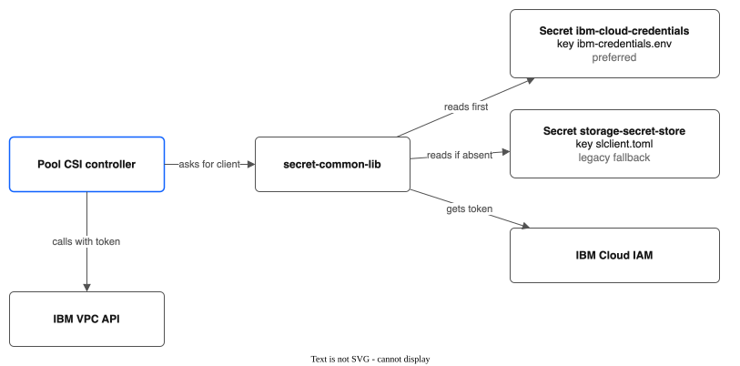
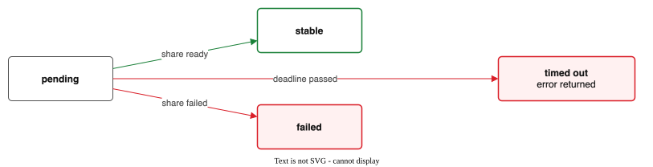

# IBM VPC API Reference

## SDK

Use the official IBM VPC Go SDK: `github.com/IBM/vpc-go-sdk`

Documentation: https://github.com/IBM/vpc-go-sdk

Install:
```bash
go get github.com/IBM/vpc-go-sdk@latest
```

## Authentication — Using secret-common-lib

**We reuse the same authentication infrastructure as the stock IBM CSI drivers.** This means our driver works out of the box on any ROKS/ROVS/IKS cluster — no separate API key setup required.

Import the shared library:
```bash
go get github.com/IBM/secret-common-lib@latest
```

### How It Works

IBM's `secret-common-lib` reads credentials from Kubernetes secrets that already exist on managed ROKS/ROVS/IKS clusters. It supports two authentication methods:

1. **API key** — `IBMCLOUD_AUTHTYPE=iam` + `IBMCLOUD_APIKEY` (traditional)
2. **Pod identity / Trusted profiles** — `IBMCLOUD_AUTHTYPE=pod-identity` + `IBMCLOUD_PROFILEID` (no long-lived keys)

The library handles IAM token exchange, caching, and renewal automatically.



### Secret Lookup Order

The library checks credentials in this order:
1. `ibm-cloud-credentials` secret (key: `ibm-credentials.env`) — **preferred**
2. `storage-secret-store` secret (key: `slclient.toml`) — **legacy fallback**

On managed ROKS/ROVS/IKS clusters, `storage-secret-store` is pre-populated by the add-on system. The `ibm-cloud-credentials` secret is the newer format and supports pod identity.

### Kubernetes Secrets Format

**`ibm-cloud-credentials`** (preferred — env file format, base64-encoded):
```
# API key auth:
IBMCLOUD_AUTHTYPE=iam
IBMCLOUD_APIKEY=<api-key>

# Or pod identity auth (no long-lived key):
IBMCLOUD_AUTHTYPE=pod-identity
IBMCLOUD_PROFILEID=<trusted-profile-id>
```

**`storage-secret-store`** (legacy — TOML format):
```toml
[Bluemix]
iam_url = "https://iam.cloud.ibm.com"
iam_api_key = "<api-key>"

[VPC]
g2_token_exchange_endpoint_url = "https://iam.cloud.ibm.com"
g2_riaas_endpoint_url = "https://us-south.iaas.cloud.ibm.com/v1"
g2_resource_group_id = "<resource-group-id>"
g2_api_key = "<api-key>"
```

### ConfigMaps Used

The library and our driver also read these ConfigMaps (pre-populated on managed clusters):

- **`ibm-cloud-provider-data`** — contains VPC ID and subnet IDs
- **`ibm-cloud-cluster-info`** — contains cluster ID and account ID
- **`cloud-conf`** (optional) — JSON with region, RIAAS endpoint, resource group ID

### Managed vs. Unmanaged Provider

| Mode | `IKS_ENABLED` env | How It Works |
|------|-------------------|--------------|
| **Managed** (ROKS/ROVS/IKS) | `true` | Sidecar container watches secrets, auto-refreshes tokens via projected service account token, LRU cache for multi-secret support |
| **Unmanaged** (self-managed OCP/K8s) | `false` | Reads secret directly in-process, no auto-refresh, pod restart required on key rotation |

On ROKS/ROVS/IKS clusters, use managed mode. On self-managed clusters, use unmanaged mode.

### Client Initialization

```go
package ibmcloud

import (
    "context"
    "fmt"

    secretlib "github.com/IBM/secret-common-lib/pkg/secret_provider"
    "github.com/IBM/go-sdk-core/v5/core"
    "github.com/IBM/vpc-go-sdk/vpcv1"
    "golang.org/x/time/rate"
    "k8s.io/client-go/kubernetes"
)

type Client struct {
    vpcService     *vpcv1.VpcV1
    secretProvider secretlib.SecretProviderInterface
    region         string
    rateLimiter    *rate.Limiter
}

// NewClient creates a VPC API client using the cluster's existing credentials.
// It uses secret-common-lib to read API keys or pod identity tokens from the
// same secrets that the stock IBM CSI drivers use.
func NewClient(k8sClient kubernetes.Interface, region string) (*Client, error) {
    // Initialize the secret provider (reads IKS_ENABLED env to choose managed/unmanaged)
    secretProvider, err := secretlib.NewSecretProvider(k8sClient, nil)
    if err != nil {
        return nil, fmt.Errorf("failed to initialize secret provider: %w", err)
    }

    // Get an IAM token from the cluster's credentials
    token, _, err := secretProvider.GetDefaultIAMToken("vpc-file-pool-csi-init", false)
    if err != nil {
        return nil, fmt.Errorf("failed to get initial IAM token: %w", err)
    }

    // Get VPC API endpoint from the secret provider
    riaasEndpoint := secretProvider.GetRIAASEndpoint()
    if riaasEndpoint == "" {
        riaasEndpoint = fmt.Sprintf("https://%s.iaas.cloud.ibm.com/v1", region)
    }

    // Create the VPC service with a bearer token authenticator
    // The token will be refreshed before each API call (see refreshToken method)
    authenticator := &core.BearerTokenAuthenticator{
        BearerToken: token,
    }

    vpcService, err := vpcv1.NewVpcV1(&vpcv1.VpcV1Options{
        Authenticator: authenticator,
        URL:           riaasEndpoint,
    })
    if err != nil {
        return nil, fmt.Errorf("failed to create VPC service: %w", err)
    }

    return &Client{
        vpcService:     vpcService,
        secretProvider: secretProvider,
        region:         region,
        rateLimiter:    rate.NewLimiter(rate.Every(time.Second), 5),
    }, nil
}

// refreshToken gets a fresh IAM token from secret-common-lib and updates
// the VPC service authenticator. Call this before any VPC API operation.
func (c *Client) refreshToken(ctx context.Context, reason string) error {
    token, _, err := c.secretProvider.GetDefaultIAMToken(reason, false)
    if err != nil {
        return fmt.Errorf("failed to refresh IAM token: %w", err)
    }

    // Update the bearer token on the authenticator
    auth, ok := c.vpcService.Service.Options.Authenticator.(*core.BearerTokenAuthenticator)
    if !ok {
        return fmt.Errorf("unexpected authenticator type")
    }
    auth.BearerToken = token
    return nil
}

// withAuth wraps a VPC API call with token refresh and rate limiting.
// Use this before every API call.
func (c *Client) withAuth(ctx context.Context, operation string) error {
    if err := c.rateLimiter.Wait(ctx); err != nil {
        return fmt.Errorf("rate limiter: %w", err)
    }
    if err := c.refreshToken(ctx, operation); err != nil {
        return err
    }
    return nil
}
```

### Pod Identity Setup (for clusters that use Trusted Profiles)

If the cluster uses pod identity instead of API keys, the controller Deployment needs a projected service account token volume:

```yaml
# In the controller Deployment spec
volumes:
  - name: vault-token
    projected:
      sources:
        - serviceAccountToken:
            path: vault-token
            expirationSeconds: 600
containers:
  - name: csi-controller
    volumeMounts:
      - mountPath: /var/run/secrets/tokens
        name: vault-token
```

The `secret-common-lib` managed provider automatically uses this projected token when `IBMCLOUD_AUTHTYPE=pod-identity`.

### Fallback: Standalone API Key (Self-Managed Clusters)

On self-managed clusters that don't have the IBM CSI add-on installed, there won't be a `storage-secret-store` or `ibm-cloud-credentials` secret. In that case, the operator creates the `ibm-cloud-credentials` secret manually:

```bash
# Create the credentials env file
cat > /tmp/ibm-credentials.env << 'EOF'
IBMCLOUD_AUTHTYPE=iam
IBMCLOUD_APIKEY=<your-api-key>
EOF

# Create the Kubernetes secret
kubectl create secret generic ibm-cloud-credentials \
  --namespace kube-system \
  --from-file=ibm-credentials.env=/tmp/ibm-credentials.env

rm /tmp/ibm-credentials.env
```

The `secret-common-lib` will find and use this secret automatically.
```

---

## File Share Operations

### Create File Share

Called by the Pool Manager when a new share is needed in a pool.

**This is a SLOW operation (30-90+ seconds).** Never call this in the CSI CreateVolume hot path.

Every share is created in **security group access mode** with one inline mount target. IBM ended new VPC-mode mount targets: the API returns HTTP 501 `shares_not_implemented` for them (seen in eu-de, October 2026), and VPC access mode reaches End of Support on 6 May 2027.

```go
type CreateShareInput struct {
    Name             string
    Zone             string
    Profile          string
    SizeGB           int64
    IOPS             *int64
    ResourceGroupID  string
    Tags             []string
    EncryptInTransit bool
    SubnetID         string   // worker subnet in Zone; required
    SecurityGroupIDs []string // groups on the mount target's network interface
}

func (c *Client) CreateFileShare(ctx context.Context, input CreateShareInput) (*ShareInfo, error) {
    // ... profile, zone, size, IOPS, resource group, tags, initial owner 65534 ...

    if input.SubnetID == "" {
        return nil, fmt.Errorf("create share %q: subnet ID is required for the mount target", input.Name)
    }
    sharePrototype.AccessControlMode = core.StringPtr("security_group")
    sharePrototype.MountTargets = []vpcv1.ShareMountTargetPrototypeIntf{
        // A virtual network interface (VNI) in SubnetID, protected by SecurityGroupIDs.
        securityGroupMountTarget(input.Name+"-mt", input.SubnetID, input.SecurityGroupIDs,
            input.EncryptInTransit, input.ResourceGroupID),
    }

    // Create (adopting an existing share of the same name on HTTP 400 "already exists"),
    // wait for "stable", then poll until the mount target's mount_path is known.
}
```

The NFS server and the export path both come from the mount target's `mount_path`, for example `10.250.0.18:/83ad9ea6_1be6_...`. The export path is specific to the share; it is never `/`. A mount target that has an IP address but no `mount_path` yet is not usable, and the driver leaves its address empty until the path appears.

### Create Share Mount Target

Called by the reconciler to give a mount target to a stable share that has none. It uses the same subnet and security groups as a new share.

```go
type CreateMountTargetInput struct {
    Name             string
    SubnetID         string
    SecurityGroupIDs []string
    EncryptInTransit bool
}

func (c *Client) CreateShareMountTarget(ctx context.Context, shareID string, input CreateMountTargetInput) (*MountTargetInfo, error)
```

### Subnet Zone and Cluster Security Group

```go
// GetSubnetZone returns the zone of a subnet. The pool manager calls it for each
// worker subnet once, and picks the subnet in the pool's zone.
func (c *Client) GetSubnetZone(ctx context.Context, subnetID string) (string, error)

// FindSecurityGroupID returns the ID of the named security group in a VPC.
// The pool manager uses it to find the cluster group, kube-<cluster ID>.
func (c *Client) FindSecurityGroupID(ctx context.Context, vpcID, name string) (string, error)
```

### getShareByName (Internal — Idempotent Share Lookup)

When `CreateFileShare` gets HTTP 400 "already exists" (e.g., reconciler retried after a status update conflict), this method looks up the existing share by name via `ListShares` with a name filter, waits for stable state, and returns its full info including mount target IPs.

```go
func (c *Client) getShareByName(ctx context.Context, name string) (*ShareInfo, error)
```

### Wait for Share Stable

VPC file shares go through lifecycle states: `pending` → `stable` → (or `failed`).



```go
func (c *Client) waitForShareStable(ctx context.Context, shareID string, timeout time.Duration) (*ShareInfo, error) {
    deadline := time.Now().Add(timeout)

    for {
        if time.Now().After(deadline) {
            return nil, fmt.Errorf("timed out waiting for share %s to become stable", shareID)
        }

        info, err := c.GetFileShare(ctx, shareID)
        if err != nil {
            return nil, err
        }

        switch info.LifecycleState {
        case "stable":
            return info, nil
        case "failed":
            return nil, fmt.Errorf("share %s entered failed state", shareID)
        case "pending":
            // Still creating, wait and retry
            select {
            case <-ctx.Done():
                return nil, ctx.Err()
            case <-time.After(10 * time.Second):
                continue
            }
        default:
            select {
            case <-ctx.Done():
                return nil, ctx.Err()
            case <-time.After(10 * time.Second):
                continue
            }
        }
    }
}
```

### Get File Share

```go
type ShareInfo struct {
    ID              string
    Name            string
    LifecycleState  string    // "pending", "stable", "failed", etc.
    SizeGB          int64
    IOPS            int64
    Profile         string
    Zone            string
    MountTargets    []MountTargetInfo
    CreatedAt       time.Time
}

type MountTargetInfo struct {
    ID         string
    Name       string
    IPAddress  string    // NFS server IP or FQDN
    ExportPath string    // NFS export path (e.g. "/share_abc123"); empty defaults to "/"
    Zone       string    // VPC zone of this mount target (for cross-zone support)
}

func (c *Client) GetFileShare(ctx context.Context, shareID string) (*ShareInfo, error) {
    opts := c.vpcService.NewGetShareOptions(shareID)
    share, response, err := c.vpcService.GetShareWithContext(ctx, opts)
    if err != nil {
        if response != nil && response.StatusCode == 404 {
            return nil, ErrShareNotFound
        }
        return nil, fmt.Errorf("VPC API GetShare failed: %w", err)
    }

    info := &ShareInfo{
        ID:             *share.ID,
        Name:           *share.Name,
        LifecycleState: *share.LifecycleState,
        SizeGB:         *share.Size,
        IOPS:           *share.Iops,
        Profile:        *share.Profile.(*vpcv1.ShareProfileReference).Name,
        Zone:           *share.Zone.(*vpcv1.ZoneReference).Name,
        CreatedAt:      time.Time(*share.CreatedAt),
    }

    // Extract mount targets
    for _, mt := range share.MountTargets {
        mtRef := mt.(*vpcv1.ShareMountTargetReference)
        // Need to fetch full mount target to get IP
        mtInfo, err := c.getMountTarget(ctx, shareID, *mtRef.ID)
        if err != nil {
            continue
        }
        info.MountTargets = append(info.MountTargets, *mtInfo)
    }

    return info, nil
}
```

### Expand File Share

```go
func (c *Client) ExpandFileShare(ctx context.Context, shareID string, newSizeGB int64) error {
    opts := c.vpcService.NewUpdateShareOptions(shareID, map[string]interface{}{
        "size": newSizeGB,
    })

    _, response, err := c.vpcService.UpdateShareWithContext(ctx, opts)
    if err != nil {
        return fmt.Errorf("VPC API UpdateShare (expand) failed (HTTP %d): %w", response.StatusCode, err)
    }

    // Wait for expansion to complete
    _, err = c.waitForShareStable(ctx, shareID, 5*time.Minute)
    return err
}
```

### Delete File Share

Called by Pool Manager when shrinking a pool or during cleanup.

```go
func (c *Client) DeleteFileShare(ctx context.Context, shareID string) error {
    // First delete all mount targets
    share, err := c.GetFileShare(ctx, shareID)
    if err != nil {
        if errors.Is(err, ErrShareNotFound) {
            return nil // Already deleted, idempotent
        }
        return err
    }

    for _, mt := range share.MountTargets {
        opts := c.vpcService.NewDeleteShareMountTargetOptions(shareID, mt.ID)
        _, err := c.vpcService.DeleteShareMountTargetWithContext(ctx, opts)
        if err != nil {
            return fmt.Errorf("failed to delete mount target %s: %w", mt.ID, err)
        }
    }

    // Then delete the share
    // Use the If-Match header with ETag for safe deletion
    deleteOpts := c.vpcService.NewDeleteShareOptions(shareID)
    _, response, err := c.vpcService.DeleteShareWithContext(ctx, deleteOpts)
    if err != nil {
        if response != nil && response.StatusCode == 404 {
            return nil // Already deleted
        }
        return fmt.Errorf("VPC API DeleteShare failed: %w", err)
    }

    return nil
}
```

### List File Shares

Used by the reconciler to discover existing shares (e.g., on startup).

```go
func (c *Client) ListFileShares(ctx context.Context, resourceGroupID string, tags []string) ([]*ShareInfo, error) {
    var allShares []*ShareInfo
    var start *string

    for {
        opts := c.vpcService.NewListSharesOptions()
        if resourceGroupID != "" {
            opts.SetResourceGroupID(resourceGroupID)
        }
        if start != nil {
            opts.SetStart(*start)
        }
        opts.SetLimit(100)

        result, _, err := c.vpcService.ListSharesWithContext(ctx, opts)
        if err != nil {
            return nil, fmt.Errorf("VPC API ListShares failed: %w", err)
        }

        for _, share := range result.Shares {
            info := shareToInfo(&share)
            allShares = append(allShares, info)
        }

        if result.Next == nil || result.Next.Href == nil {
            break
        }
        // Parse the "start" parameter from the Next URL
        start = parseStartFromURL(*result.Next.Href)
    }

    return allShares, nil
}
```

---

## Client Interface (for Testing)

Define an interface so the real client can be swapped with a fake in tests:

```go
// pkg/ibmcloud/client.go

type VPCFileClient interface {
    CreateFileShare(ctx context.Context, input CreateShareInput) (*ShareInfo, error)
    GetFileShare(ctx context.Context, shareID string) (*ShareInfo, error)
    ExpandFileShare(ctx context.Context, shareID string, newSizeGB int64) error
    DeleteFileShare(ctx context.Context, shareID string) error
    ListFileShares(ctx context.Context, resourceGroupID string, tags []string) ([]*ShareInfo, error)
    CreateShareMountTarget(ctx context.Context, shareID string, input CreateMountTargetInput) (*MountTargetInfo, error)
    GetSubnetZone(ctx context.Context, subnetID string) (string, error)
    FindSecurityGroupID(ctx context.Context, vpcID, name string) (string, error)
}

// Verify the real client implements the interface
var _ VPCFileClient = (*Client)(nil)
```

### Fake Client

```go
// pkg/ibmcloud/fake/fake_client.go

type FakeClient struct {
    mu     sync.Mutex
    shares map[string]*ibmcloud.ShareInfo
    nextID int
}

func NewFakeClient() *FakeClient {
    return &FakeClient{
        shares: make(map[string]*ibmcloud.ShareInfo),
    }
}

func (f *FakeClient) CreateFileShare(ctx context.Context, input ibmcloud.CreateShareInput) (*ibmcloud.ShareInfo, error) {
    f.mu.Lock()
    defer f.mu.Unlock()

    f.nextID++
    id := fmt.Sprintf("r006-fake-%04d", f.nextID)

    info := &ibmcloud.ShareInfo{
        ID:             id,
        Name:           input.Name,
        LifecycleState: "stable",
        SizeGB:         input.SizeGB,
        IOPS:           1000,
        Profile:        input.Profile,
        Zone:           input.Zone,
        MountTargets: []ibmcloud.MountTargetInfo{
            {
                ID:        id + "-mt",
                Name:      input.Name + "-mt",
                IPAddress: fmt.Sprintf("10.240.0.%d", f.nextID),
            },
        },
        CreatedAt: time.Now(),
    }

    f.shares[id] = info
    return info, nil
}

// ... implement other methods similarly
```

---

## Error Handling

Define sentinel errors for clean error propagation:

```go
var (
    ErrShareNotFound       = errors.New("VPC file share not found")
    ErrShareNotStable      = errors.New("VPC file share is not in stable state")
    ErrShareCreationFailed = errors.New("VPC file share creation failed")
    ErrAPIRateLimit        = errors.New("VPC API rate limit exceeded")
    ErrAuthentication      = errors.New("VPC API authentication failed")
)
```

Map VPC API HTTP status codes:
- 404 → `ErrShareNotFound`
- 429 → `ErrAPIRateLimit` (retry with backoff)
- 401/403 → `ErrAuthentication`
- 500+ → wrap with context and retry

---

## Rate Limiting & Token Refresh

IBM VPC API has rate limits. The client uses `withAuth()` before every API call, which combines rate limiting with token refresh:

```go
// withAuth wraps every VPC API call with rate limiting + token refresh.
// Defined in the Authentication section above.
func (c *Client) withAuth(ctx context.Context, operation string) error { ... }

// Usage pattern in every API method:
func (c *Client) GetFileShare(ctx context.Context, shareID string) (*ShareInfo, error) {
    if err := c.withAuth(ctx, "GetFileShare"); err != nil {
        return nil, err
    }
    // ... actual API call ...
}
```

The rate limiter is set to 5 requests/second by default. This is conservative and can be tuned via a flag or ConfigMap.

---

## Configuration

The IBM VPC client reads configuration from the cluster's existing secrets and configmaps, plus the FileSharePool spec:

| Config | Source | Description |
|--------|--------|-------------|
| **IAM credentials** | `ibm-cloud-credentials` or `storage-secret-store` secret (via secret-common-lib) | API key or pod identity — already present on managed ROKS/ROVS/IKS clusters |
| **VPC API endpoint** | secret-common-lib `GetRIAASEndpoint()` or derived from zone | Supports private endpoints automatically |
| **Resource group ID** | secret-common-lib `GetResourceGroupID()` or `FileSharePool.spec.resourceGroup` | Pool spec overrides if set |
| `region` | Derived from FileSharePool.spec.zone (e.g., "us-south" from "us-south-1") | VPC API region |
| `vpcID` | `--vpc-id`, or ConfigMap `kube-system/ibm-cloud-provider-data` key `vpc_id` | VPC where shares and mount targets are created |
| `subnetIDs` | `--subnet-id` (comma-separated), or ConfigMap `ibm-cloud-provider-data` key `vpc_subnet_ids` | Worker subnets. Each mount target goes in the one in the pool's zone |
| `securityGroupIDs` | `FileSharePool.spec.securityGroupIDs`, or the cluster group `kube-<cluster_id>` (ConfigMap `kube-system/cluster-info` key `cluster_id`) | The cluster group already allows all traffic between workers and the mount target |

The client should be created once per FileSharePool (since different pools could be in different regions), cached by the Pool Manager. Token refresh is handled by `secret-common-lib` — the client calls `refreshToken()` before each API operation.
