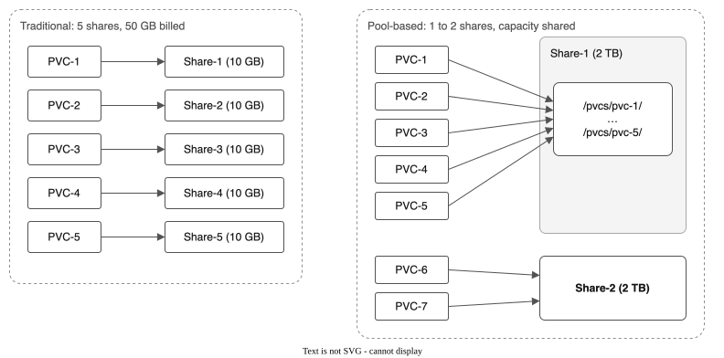

# Getting started with the IBM VPC File Pool CSI driver
<!-- evidence: executed where=rovslab-dr-eude date=2026-11-09 -->

Create a pool of VPC file shares, make a volume on it, and read the data back from a new pod. It takes about 10 minutes on a cluster with the driver installed.

**Time:** about 10 minutes.

## What you will do

- Check that the driver is running.
- Create a pool that holds one 100 GB file share.
- Create a 10 GiB volume on the pool and write a file to it.
- Read the file back from a second pod, and clean up.

## Terms used in this page

- **Pool** (`FileSharePool`): a group of VPC file shares that the driver manages. Each volume is a folder on one of the shares.
- **Share**: an IBM Cloud VPC file share. A pool creates its shares and adds more when it fills.
- **StorageClass**: the Kubernetes object a volume claim names to pick a storage backend. The driver makes one for each pool, named after the pool.
- **PVC**: a PersistentVolumeClaim, a request for a volume.
- **SubVolume**: the record the driver keeps for each volume. It names the share and the folder.



The diagram compares the two models. The stock IBM driver creates one share for each volume. This driver creates a few large shares and gives each volume a folder on one of them, so a volume is ready in seconds and uses one share quota slot for many volumes.

## Before you begin

You need:

- An IBM Cloud Red Hat OpenShift cluster on VPC, with the driver installed. [INSTALL.md](INSTALL.md) lists the steps.
- The `oc` CLI, logged in to the cluster as a cluster administrator.
- The zone your workers run in. Find it with `oc get nodes -L topology.kubernetes.io/zone`.

## Step 1: Check that the driver is running

The controller pod shows `6/6` containers ready, and the driver is registered with Kubernetes.

```bash
oc get pods -n kube-system -l app.kubernetes.io/name=ibm-vpc-file-pool-csi,app.kubernetes.io/component=controller
oc get csidriver vpc-file-pool.csi.ibm.io
```

The second command lists `vpc-file-pool.csi.ibm.io`. If either command shows nothing, install the driver first with [INSTALL.md](INSTALL.md).

## Step 2: Create a pool

Replace `eu-de-2` with your workers' zone, then apply the pool and the namespace for this guide.

```bash
oc create namespace start-here

cat <<EOF | oc apply -f -
apiVersion: storage.ibmcloud.io/v1alpha1
kind: FileSharePool
metadata:
  name: start-pool
spec:
  zone: eu-de-2
  profile: dp2
  shareSizeGB: 100
  iops: 100
  maxShares: 3
  initialShares: 1
  autoExpand: true
  expandThresholdPercent: 80
  allocationStrategy: spread
  defaultPermissions: "0777"
  defaultUID: 107
  defaultGID: 107
EOF
```

The pool creates one 100 GB share with 100 IOPS. It adds up to two more shares when 80% of the capacity is in use. Creating the share takes between 30 seconds and 2 minutes. Watch the phase:

```bash
oc get filesharepools -w
```

The pool is ready when `PHASE` shows `Ready`:

```text
NAME         ZONE      PROFILE   SHARES   CAPACITY   ALLOCATED   PVCS   PHASE
start-pool   eu-de-2   dp2       1        100        0           0      Ready
```

## Step 3: Check the StorageClass

When the pool is ready, the driver creates a StorageClass with the pool's name.

```bash
oc get storageclass start-pool
```

```text
NAME         PROVISIONER                RECLAIMPOLICY   VOLUMEBINDINGMODE   ALLOWVOLUMEEXPANSION   AGE
start-pool   vpc-file-pool.csi.ibm.io   Delete          Immediate           true                   36s
```

## Step 4: Create a volume and write a file

The claim asks for 10 GiB from the `start-pool` StorageClass. The pod runs as user 107, the user the pool gives each folder to, and writes one file.

```bash
cat <<EOF | oc apply -f -
apiVersion: v1
kind: PersistentVolumeClaim
metadata:
  name: first-volume
  namespace: start-here
spec:
  accessModes:
    - ReadWriteMany
  storageClassName: start-pool
  resources:
    requests:
      storage: 10Gi
---
apiVersion: v1
kind: Pod
metadata:
  name: writer
  namespace: start-here
spec:
  securityContext:
    runAsNonRoot: true
    runAsUser: 107
    seccompProfile:
      type: RuntimeDefault
  containers:
    - name: app
      image: busybox
      command: ["sh", "-c", "echo Pool CSI storage works > /data/note.txt && ls -ln /data && cat /data/note.txt"]
      securityContext:
        allowPrivilegeEscalation: false
        capabilities:
          drop: ["ALL"]
      volumeMounts:
        - name: data
          mountPath: /data
  volumes:
    - name: data
      persistentVolumeClaim:
        claimName: first-volume
EOF
```

The claim binds within seconds. Check it and read the pod's output:

```bash
oc get pvc first-volume -n start-here
oc logs writer -n start-here
```

The `STATUS` column shows `Bound`, and the log ends with the text the pod wrote:

```text
NAME           STATUS   VOLUME                                     CAPACITY   ACCESS MODES   STORAGECLASS   AGE
first-volume   Bound    pvc-4f02a860-46aa-4675-be1d-3c60a8c9038d   10Gi       RWX            start-pool     10s
```

```text
Pool CSI storage works
```

See how the pool recorded the volume:

```bash
oc get subvolumes -o wide
oc get filesharepools
```

The pool shows `ALLOCATED` 10 and `PVCS` 1. The SubVolume names the share that holds the volume.

## Step 5: Read the file from a new pod

Delete the writer pod. The volume and its data stay, because the claim still exists. Start a second pod that mounts the same claim and prints the file.

```bash
oc delete pod writer -n start-here

cat <<EOF | oc apply -f -
apiVersion: v1
kind: Pod
metadata:
  name: reader
  namespace: start-here
spec:
  securityContext:
    runAsNonRoot: true
    runAsUser: 107
    seccompProfile:
      type: RuntimeDefault
  containers:
    - name: app
      image: busybox
      command: ["sh", "-c", "cat /data/note.txt"]
      securityContext:
        allowPrivilegeEscalation: false
        capabilities:
          drop: ["ALL"]
      volumeMounts:
        - name: data
          mountPath: /data
  volumes:
    - name: data
      persistentVolumeClaim:
        claimName: first-volume
EOF

oc logs reader -n start-here
```

The log shows the file written by the first pod:

```text
Pool CSI storage works
```

## Clean up

Delete the pod, the claim, the pool and the namespace, in this order. Deleting the pool also deletes its VPC file shares, and the data on them.

```bash
oc delete pod reader -n start-here
oc delete pvc first-volume -n start-here
oc delete filesharepool start-pool
oc delete namespace start-here
```

## Next steps

Pick the row that matches your work.

| If you | Read |
|---|---|
| Run applications that need shared volumes | [User guide](USER-GUIDE.md), then [Tutorial 2: Snapshots and clones](TUTORIAL-02-SNAPSHOTS-AND-CLONES.md) |
| Run virtual machines on OpenShift Virtualization | [Tutorial 1: Pool creation and VMs](TUTORIAL-01-POOL-CREATION.md), then [Tutorial 15: A VM from the catalog](TUTORIAL-15-VM-FROM-THE-CATALOG.md) |
| Move volumes from the stock IBM driver | [Tutorial 8: Migration and the console](TUTORIAL-08-MIGRATION-AND-CONSOLE.md) |
| Protect data with backups and restores | [Tutorial 9: A COS bucket for backups](TUTORIAL-09-COS-BACKUP-BUCKET.md), then [Tutorial 10: Backup and restore](TUTORIAL-10-BACKUP-AND-RESTORE.md) |
| Plan disaster recovery to another region | [Tutorial 6: Replication and failover](TUTORIAL-06-REPLICATION-AND-FAILOVER.md) |
| Operate the driver in production | [Day 2 operations](DAY2-OPERATIONS.md), [Monitoring](MONITORING.md) and [Troubleshooting](TROUBLESHOOTING.md) |

The [tutorial index](TUTORIAL.md) lists all 17 tutorials.
