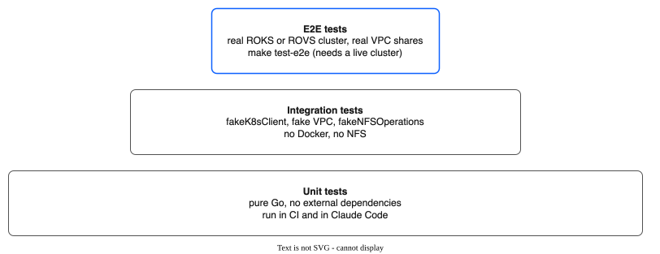

# Testing Guide — IBM VPC File Pool CSI Driver

## Testing Pyramid



**Claude Code operates in the bottom two layers.** Every piece of code must have unit tests that run with `go test ./...` — no cluster, no NFS server, no IBM Cloud credentials. Integration tests are also fully runnable locally via `make test-integration` — they use in-memory fakes, not Docker or real NFS.

---

## Test Summary

| Layer | Package / Directory | Test Count | Approach |
|-------|-------------------|------------|----------|
| Unit | `pkg/pool/manager_test.go` | 87 | fakeK8sClient, fakeNFSOperations, fake VPC client |
| Unit | `pkg/pool/reconciler_test.go` | 26 | fakeK8sClient, fake VPC client |
| Unit | `pkg/pool/replication_controller_test.go` | 23 | replFakeK8sClient, fakeNFSOperations |
| Unit | `pkg/pool/clone_worker_test.go` | 12 | fakeK8sClient, fakeNFSOperations, slowFakeNFSOperations |
| Unit | `pkg/driver/controller_test.go` | 68 | mockPoolManager, mockK8sClient |
| Unit | `pkg/driver/node_test.go` | 37 | k8s.io/mount-utils/fake, nodeTestK8sClient, failingMounter |
| Unit | `pkg/ibmcloud/vpc_client_test.go` | 68 | httptest servers, fakeSecretProvider |
| Unit | `pkg/migrate/` | 22 | In-memory fakes |
| Integration | `test/integration/` | 82 | Full stack with fakes (fakeK8sClient, fake VPC, fakeNFSOperations) |
| E2E | `test/e2e/` | 4 | Real ROKS or ROVS cluster, real VPC shares |
| **Total** | | **429+** | |

---

## Unit Testing Strategy

### What Gets Unit Tested

| Component | What to Test | Mocking Strategy |
|-----------|-------------|------------------|
| `pkg/pool/manager.go` | Allocation algorithm, share selection (spread/binpack), capacity tracking, idempotency, expand, deallocate, concurrent access, snapshots, clones, group snapshots, drain exclusion | Fake K8s client, Fake VPC client, Fake NFS operations |
| `pkg/pool/reconciler.go` | Reconcile loop, pool phase transitions, share health, threshold-based expansion, metrics reconciliation, finalizer management, accessor mount targets, drain handling, tier-based provisioning | Fake K8s client, Fake VPC client |
| `pkg/pool/clone_worker.go` | Pending clone processing, failure handling, crash recovery (InProgress retries), concurrent clone safety, deduplication, graceful shutdown, partial copy cleanup, metrics | fakeK8sClient, fakeNFSOperations, slowFakeNFSOperations |
| `pkg/pool/replication_controller.go` | Sync cycles, schedule tracking, failure/max-retry handling, SubVolume label selectors, paused/failed policy skipping, concurrent safety, metrics, time override | replFakeK8sClient, fakeNFSOperations |
| `pkg/driver/controller.go` | Request validation, parameter parsing, volume ID construction, error mapping to gRPC codes, idempotency, snapshots, clones, group snapshots, cross-zone volume context | Mock PoolManager interface |
| `pkg/driver/node.go` | Path validation, mount option construction, bind-mount logic, staging cache, NodeGetVolumeStats (per-PVC and fallback), cross-zone IP selection, clone gate (blocks mount for in-progress clones) | Mock mounter (k8s.io/mount-utils/fake), nodeTestK8sClient |
| `pkg/ibmcloud/vpc_client.go` | Response parsing, error classification, rate limiter behavior, retry logic, auth flow, mount target operations, share lifecycle, pagination | HTTP test server (`httptest.NewServer`), fakeSecretProvider |
| `pkg/migrate/` | Migration pod construction, migration planning, execution (dry-run), status tracking | In-memory fakes |
| `pkg/k8s/reconciler.go` | Reconcile loop logic, pool phase transitions, share health detection, threshold calculations | Fake K8s client (`sigs.k8s.io/controller-runtime/pkg/client/fake`) |
| `pkg/util/mount.go` | Mount cache add/remove/lookup, ref counting, concurrent access | In-memory only, no real mounts |
| `pkg/util/quota.go` | Allocation arithmetic, overcommit detection | Pure functions, no mocks needed |
| `api/v1alpha1/*_types.go` | DeepCopy generated correctly, validation markers produce expected behavior | Standard Go tests on generated code |

### What Does NOT Get Unit Tested

- Actual NFS mount/unmount syscalls
- Actual IBM Cloud VPC API calls
- Actual Kubernetes API server communication
- Actual filesystem operations (mkdir on NFS)

These are all replaced with fakes/mocks in unit tests and tested for real in e2e tests.

---

## Fakes and Mocks

### Fake VPC Client

Every unit test that touches the IBM Cloud API uses a fake. This must be built as part of the codebase, not as a test-only afterthought.

```go
// pkg/ibmcloud/fake/fake_client.go

package fake

import (
    "context"
    "fmt"
    "sync"
    "time"

    "github.com/IBM/ibm-vpc-file-pool-csi/pkg/ibmcloud"
)

// FakeVPCClient implements ibmcloud.VPCFileClient entirely in memory.
// Tests can inspect and manipulate its internal state.
type FakeVPCClient struct {
    mu     sync.Mutex
    shares map[string]*ibmcloud.ShareInfo
    nextID int

    // Test hooks — set these to inject failures
    CreateErr  error  // If set, CreateFileShare returns this error
    GetErr     error  // If set, GetFileShare returns this error
    ExpandErr  error  // If set, ExpandFileShare returns this error
    DeleteErr  error  // If set, DeleteFileShare returns this error

    // Counters for assertions
    CreateCalls int
    GetCalls    int
    ExpandCalls int
    DeleteCalls int
}
```

### Fake NFS Operations

The pool manager creates and deletes subdirectories on NFS shares. In unit tests, replace real NFS operations with an in-memory fake:

```go
// pkg/pool/fake_nfs_test.go (test-only file)

type FakeNFSOperations struct {
    mu    sync.Mutex
    dirs  map[string]os.FileMode  // path → permissions

    MkdirErr  error  // Inject mkdir failures
    RemoveErr error  // Inject remove failures
    CopyErr   error  // Inject copy failures (for clones/snapshots)
}
```

The fake also tracks `CopyDir` calls, supporting the clone worker and replication controller tests.

### Fake Mounter (for Node Agent)

Use the Kubernetes mount-utils fake mounter, not a custom one:

```go
import "k8s.io/mount-utils/fake"

mounter := &fake.FakeMounter{
    MountPoints: []fake.MountPoint{},
}
```

This tracks all mount/unmount calls and lets you assert what was mounted where.

### Fake Kubernetes Client

Unit tests use a lightweight `fakeK8sClient` that implements the `k8s.Client` interface with in-memory maps and mutex protection. Each test package has its own implementation tailored to what that package needs:

- `pkg/pool/` — `fakeK8sClient` for pools, SubVolumes, snapshots, group snapshots
- `pkg/pool/` — `replFakeK8sClient` extends the above with ReplicationPolicy operations
- `test/integration/` — full `fakeK8sClient` implementing all `k8s.Client` methods
- `pkg/driver/` — `mockK8sClient` / `nodeTestK8sClient` (minimal stubs)

---

## Interfaces for Testability

Every external dependency must be behind an interface. This is non-negotiable — without it, unit testing is impossible.

```go
// pkg/ibmcloud/client.go
type VPCFileClient interface {
    CreateFileShare(ctx context.Context, input CreateShareInput) (*ShareInfo, error)
    GetFileShare(ctx context.Context, shareID string) (*ShareInfo, error)
    ExpandFileShare(ctx context.Context, shareID string, newSizeGB int64) error
    DeleteFileShare(ctx context.Context, shareID string) error
    ListFileShares(ctx context.Context, resourceGroupID string, tags []string) ([]*ShareInfo, error)
}

// pkg/pool/manager.go
type PoolManager interface {
    Allocate(ctx context.Context, req AllocationRequest) (*AllocationResult, error)
    Deallocate(ctx context.Context, subVolumeName string) error
    Expand(ctx context.Context, subVolumeName string, newSizeGB int64) error
}

// pkg/pool/nfs_operations.go — wraps filesystem calls for testability
type NFSOperations interface {
    MkdirAll(path string, perm os.FileMode) error
    RemoveAll(path string) error
    Stat(path string) (os.FileInfo, error)
    Chown(path string, uid, gid int) error
    Chmod(path string, mode os.FileMode) error
    CopyDir(src, dst string) error
}

// Real implementation just delegates to os.*
type realNFSOperations struct{}
func (r *realNFSOperations) MkdirAll(path string, perm os.FileMode) error { return os.MkdirAll(path, perm) }
func (r *realNFSOperations) RemoveAll(path string) error { return os.RemoveAll(path) }
// ...etc

// pkg/util/mount.go — wraps mount calls for testability
// Use k8s.io/mount-utils.Interface directly — it already has a fake
```

---

## Test Cases by Component

### Pool Manager Tests (87 tests)

The largest and most critical test suite. Covers allocation, deallocation, expansion, snapshots, clones, group snapshots, tiers, cross-zone support, and drain handling. All tests use `fakeK8sClient`, `fakeNFSOperations`, and the fake VPC client.

Key test categories:

- **Allocation (spread/binpack):** Strategy selection, idempotency, capacity exhaustion, auto-expand, max shares, zone matching, custom UID/GID, tier-aware allocation
- **Deallocation:** Normal path, not-found (idempotent), NFS remove failure retention
- **Expansion:** Within capacity, exceeds capacity, same-size noop
- **Share selection:** Spread picks most-free, binpack picks least-free, skips non-stable and draining
- **Snapshots (14 tests):** Create, idempotent create, source not found, copy failure, delete, restore, list by source, metrics
- **Clones (12 tests):** Sync path, async path, same-share, cross-share, source not found, insufficient capacity, size validation, idempotent, copy failure, capacity updates
- **Group snapshots (8 tests):** All succeed, abort policy with rollback, continue policy with partial failure, empty source list, idempotent, copy order, source not found, cross-pool rejection
- **Drain handling (6 tests):** Skips draining shares, all-draining exhausted, concurrent drain+allocate, deallocate from draining share
- **Metrics:** Allocation success/error counters, deallocation counters, snapshot metrics

### Reconciler Tests (26 tests)

Tests the `FileSharePoolReconciler` that watches FileSharePool CRs and reconciles their state. Uses `fakeK8sClient` and the fake VPC client.

Key test categories:

- **Lifecycle:** Pool not found, finalizer addition, initial share provisioning, VPC error handling
- **Health checks:** Degraded share marked draining, creating share becomes stable
- **Proactive expansion:** Above/below threshold, per-tier expansion
- **Metrics reconciliation:** Drift correction from SubVolume CRs, Prometheus gauge emission
- **Deletion:** Blocked by active SubVolumes, clean deletion with no SubVolumes
- **Phase determination:** Table-driven tests for Initializing, Ready, Expanding, Degraded, Full
- **Accessor mount targets:** Cross-zone mount target creation, idempotent handling, backward compatibility
- **Drain requests (6 tests):** Mark shares draining, fully drained, progress tracking, stale status cleanup, preserve DrainStartedAt, exclude from allocation

### Clone Worker Tests (12 tests)

Tests the asynchronous `CloneWorker` that processes pending clone SubVolumes in the background. All tests are race-safe and use `fakeK8sClient` and `fakeNFSOperations`.

| Test | What it verifies |
|------|-----------------|
| `PendingCloneCompletesSuccessfully` | End-to-end clone lifecycle: Pending -> InProgress -> Complete |
| `PendingCloneFails` | NFS copy error transitions clone to Failed phase |
| `SkipsCompleteClones` | Already-completed clones are not re-processed |
| `RetriesInProgressClones` | Crash recovery: InProgress clones are retried |
| `ConcurrentPendingClones` | Multiple pending clones processed correctly |
| `MetricsRecorded` | ClonesTotal counter incremented on success |
| `MetricsRecordedOnFailure` | ClonesTotal counter incremented on failure |
| `GracefulShutdown` | Context cancellation stops the worker promptly |
| `SourceNotFoundFails` | Missing source SubVolume transitions to Failed |
| `DoesNotProcessSameCloneTwice` | Deduplication with `slowFakeNFSOperations` |
| `ProcessOnceDirectCall` | Direct `processOnce()` invocation for deterministic testing |
| `CleansUpPartialCopyOnFailure` | Partial copy directory removed after NFS error |

### Replication Controller Tests (23 tests)

Tests the `ReplicationController` that syncs SubVolumes to destination NFS servers based on `ReplicationPolicy` CRDs. Uses `replFakeK8sClient` and `fakeNFSOperations`.

| Category | Tests |
|----------|-------|
| Basic sync cycle | Verifies per-SubVolume statuses, LastSyncTime, LastSyncDuration |
| Schedule tracking | Honors schedule interval, does not re-sync before interval elapses |
| Failure handling | ConsecutiveFailures incremented, LastError set |
| Max retries exceeded | Policy transitions to Paused phase |
| SubVolume selector | Label-based filtering (MatchLabels) |
| Skip paused/failed policies | Paused and Failed policies are not processed |
| Invalid schedule | Gracefully handles unparseable duration |
| Graceful shutdown | Context cancellation stops controller |
| Metrics | ReplicationSyncsTotal counters (success/failure) |
| Success resets failures | ConsecutiveFailures reset to 0 on successful sync |
| Empty pool | Sync completes with 0 SubVolumes |
| List policies error | Handles API server errors gracefully |
| Concurrent safety | 5 goroutines calling processOnce simultaneously |
| NowFunc override | Deterministic time control for tests |
| Nil/empty/no-match selectors | Table-driven tests for filterSubVolumes and matchesLabels |
| Mkdir failure | Permission errors propagated |
| Multiple policies | Independent policies for separate pools |

### CSI Controller Tests (68 tests)

Tests the CSI gRPC controller service. Uses a `mockPoolManager` interface and `mockK8sClient`.

Key test categories:

- **CreateVolume (18 tests):** Missing name, missing pool, nil parameters, pool not found, pool exhausted, share creation pending, internal error, success (volume ID, capacity, volume context, topology), allocation request verification, idempotent (via K8s client and two calls), minimum capacity, round-up, cross-zone volume context, single-zone backward compatibility
- **DeleteVolume (8 tests):** Missing/invalid volume ID, not found (idempotent), success, internal error, volume ID parsing
- **ExpandVolume (6 tests):** Missing/invalid volume ID, success, insufficient capacity, internal error, round-up
- **ValidateVolumeCapabilities (2 tests):** Missing volume ID, all 5 NFS access modes
- **ControllerGetCapabilities (1 test):** Verifies 5 capabilities
- **Snapshots (12 tests):** Create (missing name, missing source, not found, internal error, success), Delete (missing ID, invalid ID, not found idempotent, success, internal error), List (by ID, by source, pagination)
- **Restore from snapshot (4 tests):** Success, not found, pool exhausted, invalid snapshot ID
- **Clone (6 tests):** Success, source not found, pool exhausted, internal error, custom sync threshold
- **Group snapshots (8 tests):** Create (missing name, no source volumes, success, pool from volume ID, failure), Delete (missing ID, success, internal error), Get (success)
- **Utility tests (3 tests):** parseVolumeID, parseOptionalInt64

### CSI Node Tests (37 tests)

Tests the CSI gRPC node service. Uses `k8s.io/mount-utils/fake.FakeMounter`, `failingMounter`, and `nodeTestK8sClient`.

Key test categories:

- **NodeStageVolume (7 tests):** NFS mount, default options, custom flags, idempotent (mount cache), mount failure, cross-zone IP selection, fallback to primary server
- **NodePublishVolume (12 tests):** SubDir validation (7 invalid patterns), valid subDir, bind-mount source verification, read-only, subDir auto-creation, mount failure, clone gate (InProgress, Pending, Failed, Complete, non-clone)
- **NodeUnpublishVolume (3 tests):** Unmount, unmount failure, target already gone
- **NodeUnstageVolume (3 tests):** NFS unmount, unmount failure, staging already gone
- **NodeGetVolumeStats (7 tests):** Success, invalid path, per-PVC usage, fallback on SubVolume lookup failure, fallback on bad volume ID, used exceeds quota, dirUsageBytes helper
- **NodeGetInfo (3 tests):** Returns zone topology, zone detection failure, no K8s client
- **NodeGetCapabilities (1 test):** STAGE_UNSTAGE_VOLUME + GET_VOLUME_STATS

### VPC Client Tests (68 tests)

Tests the IBM VPC API client wrapper. Uses `httptest.NewServer` to simulate the VPC API at the HTTP level, and `fakeSecretProvider` for authentication.

The httptest approach allows testing the full HTTP request/response cycle including:
- Request body validation (JSON payloads sent to VPC API)
- Response parsing (share info, mount targets, pagination)
- HTTP status code mapping to sentinel errors (`ErrShareNotFound`, `ErrAPIRateLimit`, `ErrAuthentication`)
- Auth token refresh flow
- Context cancellation propagation
- Rate limiter behavior

Key test categories:

- **Helper functions (5 tests):** `regionFromZone`, `mapHTTPError`, `parseStartFromURL`, `parseMountPathServer`, `parseRegionFromEndpoint`
- **Client construction (5 tests):** Resource group ID, region auto-discovery, success, token error, endpoint selection/normalization
- **WaitForShareStable (7 tests):** Immediately stable, pending then stable, updating then stable, failed, timeout, context cancelled, get error
- **Auth flow (5 tests):** Token refresh success/error, withAuth success/context-cancelled/refresh-error
- **GetFileShare (9 tests):** Success, not found, server error, mount path extraction, mount target fetch error, no mount targets, auth error, rate limit, context cancelled, multiple mount targets
- **CreateFileShare (8 tests):** Success, with IOPS, with encrypt-in-transit, already exists, API error, share not stable, auth failure, mount target IP polling
- **ExpandFileShare (3 tests):** Success, API error, auth failure
- **DeleteFileShare (5 tests):** Success, already gone, delete returns 404, auth failure, mount target delete error
- **ListFileShares (6 tests):** Success, empty, pagination, API error, auth failure, no resource group
- **CreateShareMountTarget (6 tests):** Success, with encryption, API error, auth failure, IP polling timeout, IP polling get error
- **GetMountTarget (5 tests):** Primary IP, mount path, no IP or mount path, not found, auth failure
- **Misc (2 tests):** `recordAPIMetrics`, `shareToInfo`

### Migration Tool Tests (22 tests)

Tests the `pkg/migrate/` package that provides live migration from the standard IBM VPC File CSI driver to the pool-based driver.

| File | Tests | Covers |
|------|-------|--------|
| `pod_test.go` | 9 | Migration pod construction: structure, labels, annotations, volume mounts, volumes, rsync command, restart policy, image, resources |
| `planner_test.go` | 7 | Migration planning: filter by StorageClass, no PVCs found, size rounding, phase tracking, ShareID from PV, find pods using PVC, sort by name |
| `executor_test.go` | 6 | Execution: dry-run mode, PVC not found, PVC not bound, status with no migrations, status finding migration pods, target PVC size calculation |

---

## Running Tests

### During Development (Claude Code)

After implementing or modifying any Go file, immediately run:

```bash
# Run all unit tests
go test ./... -v -race -count=1

# Run integration tests (also uses fakes — no cluster needed)
make test-integration

# Run tests for a specific package
go test ./pkg/pool/... -v -race -count=1

# Run a specific test
go test ./pkg/pool/... -v -race -run TestAllocate_SpreadStrategy

# With coverage
go test ./... -v -race -coverprofile=coverage.out
go tool cover -func=coverage.out
```

**The `-race` flag is mandatory.** The pool manager has concurrent access from multiple CSI gRPC calls. Race detector must pass.

**The `-count=1` flag disables test caching.** During active development, always get fresh results.

### Make Targets

| Target | What it runs |
|--------|-------------|
| `make test` | `go test ./... -v -race -count=1` (unit tests only) |
| `make test-integration` | `go test ./test/integration/ -v -race -count=1 -tags=integration` |
| `make test-coverage` | Unit tests with coverage report |
| `make test-e2e` | E2E tests (requires live ROKS or ROVS cluster + env vars) |

### Coverage Targets

| Package | Target | Notes |
|---------|--------|-------|
| `pkg/pool/` | 87%+ | Core business logic — allocation, snapshots, clones, replication |
| `pkg/driver/` | 84%+ | CSI gRPC handlers — validation, error mapping, idempotency |
| `pkg/ibmcloud/` | 90%+ | VPC API client — httptest-based, comprehensive error coverage |
| `pkg/util/` | 90% | Small utility functions, easy to test |
| `pkg/migrate/` | 85%+ | Migration tool — pod builder, planner, executor |
| `api/v1alpha1/` | Generated code, no coverage target |

### CI Pipeline

```yaml
# .github/workflows/test.yaml
name: Test
on: [push, pull_request]
jobs:
  test:
    runs-on: ubuntu-latest
    steps:
      - uses: actions/checkout@v4
      - uses: actions/setup-go@v5
        with:
          go-version: '1.22'
      - name: Unit tests
        run: go test ./... -v -race -count=1 -coverprofile=coverage.out
      - name: Integration tests
        run: make test-integration
      - name: Check coverage
        run: |
          go tool cover -func=coverage.out
          # Fail if total coverage drops below 70%
          COVERAGE=$(go tool cover -func=coverage.out | grep total | awk '{print $3}' | tr -d '%')
          if (( $(echo "$COVERAGE < 70" | bc -l) )); then
            echo "Coverage ${COVERAGE}% is below 70% threshold"
            exit 1
          fi
      - name: Lint
        uses: golangci/golangci-lint-action@v6
        with:
          version: latest
```

---

## Console and Go Job specs: golden files

The console creates some of the same Jobs as the command-line tools. To keep the Go and TypeScript Job specs in step, a Go test writes the objects to a golden JSON file, and a console test builds them again from the same input and compares them. If one side changes alone, one of the tests fails.

| Objects | Go test and golden file | Console builder and test |
|---|---|---|
| Migration claim and pod | `pkg/migrate/golden_test.go`, `pkg/migrate/testdata/migration-objects.golden.json` | `console-plugin/src/utils/migrate-objects.ts` |
| Receiver check Job | `pkg/replication/checkjob_test.go`, `pkg/replication/testdata/check-job.golden.json` | `console-plugin/src/utils/receiver-objects.ts` |
| Backup measure, delete and COS list Jobs | `pkg/pool/share_job_backup_golden_test.go`, `pkg/pool/testdata/backup-jobs.golden.json` | `console-plugin/src/utils/backup-jobs.ts` |

To change a Job on purpose, change the Go builder, rewrite the golden file (for the backup Jobs: `go test ./pkg/pool -run BackupJobs_MatchGolden -update-backup-jobs`), then change the TypeScript builder until `yarn jest` passes.

---

## Integration Tests

Integration tests exercise the full CSI controller stack (CSI driver -> Pool Manager -> fakes) without any external dependencies. They use the `integration` build tag and are located in `test/integration/`.

### Approach

All integration tests use **in-memory fakes** — no Docker, no NFS server, no Kubernetes cluster:

- **`fakeK8sClient`** — Thread-safe in-memory implementation of `k8s.Client` with support for all CRD types (FileSharePool, SubVolume, Snapshot, VolumeGroupSnapshot, ReplicationPolicy)
- **`fake.FakeVPCClient`** — In-memory VPC share tracking from `pkg/ibmcloud/fake/`
- **`fakeNFSOperations`** — In-memory directory/copy tracking with injectable errors (`MkdirErr`, `RemoveErr`, `CopyErr`, `CopyErrAfterN`)
- **`testHarness`** — Bundles all fakes with a real `pool.Manager` and `driver.Driver` for end-to-end request processing

### Test Files (82 tests across 8 files)

| File | Tests | Covers |
|------|-------|--------|
| `pool_lifecycle_test.go` | 9 | Create, allocate, deallocate, expand, full lifecycle |
| `capacity_management_test.go` | 10 | Auto-expand, max shares, spread/binpack selection, tier allocation |
| `concurrent_allocation_test.go` | 6 | Parallel CreateVolume, race condition safety, capacity correctness |
| `error_recovery_test.go` | 14 | NFS failures, K8s client errors, VPC API errors, partial failure recovery |
| `snapshot_lifecycle_test.go` | 14 | Create/delete/list/restore snapshots, idempotency, error mapping |
| `clone_lifecycle_test.go` | 14 | Async clones, same-share/cross-share, error handling |
| `clone_worker_test.go` | 7 | End-to-end async clone processing through pool manager + clone worker |
| `group_snapshot_test.go` | 8 | Create/delete group snapshots, abort/continue policies, partial failures |

### Running Integration Tests

```bash
# Via make
make test-integration

# Directly
go test ./test/integration/ -v -race -count=1 -tags=integration
```

Integration tests are fully deterministic and fast (no I/O, no network). They run in CI alongside unit tests.

---

## Release Test Run

One command checks the driver on a live cluster after a release update, and writes a pass or fail report. It runs on the build server, so the laptop can sleep. The design is in `docs/specs/2026-10-19-release-test-run.md`.

```bash
make test-release CLUSTER=rovslab-prod-eude VERSION=v0.9.0-45-gabc1234   # start; prints the run ID
bash test/release/remote.sh report <run ID>                                # copy back and print the report
```

To run it from the current machine instead, with your own kubeconfig: `bash test/release/run.sh --cluster <name> [--stages 01,02]`. Set `RT_VPC_TOKEN` to an IAM token so that the VPC checks can run.

**Stages so far:**

| Stage | Proves |
|---|---|
| `01-preflight` | Controller and node agents ready, expected version, CRDs installed, webhook refuses a bad pool, CDI's copy pod memory limit is at least 8Gi, no leftovers from an earlier run |
| `02-pool` | A pool reaches `Ready`; its share uses security group access mode and its mount target is in the pool's zone (read from the VPC API); its StorageClass exists; a pool with a missing security group says why and makes no share |
| `03-volumes` | Pods on two workers share a volume; owner and mode follow the pool; deleting the claim removes the PV, the SubVolume and the directory on the share |
| `04-growth` | A resized claim reports its new size, and its SubVolume and the pool count it; a pool with auto-expand above its threshold adds a usable second share (also in the VPC), stops at its share limit, and puts new volumes on the new share. A pod cannot see a claim's size: an NFS folder shows the whole share |
| `05-snapshots` | A snapshot becomes ready and its folder is on the share; a claim restored from it has the files as they were at snapshot time (the source is changed after the snapshot), with the pool's owner and mode; deleting the snapshot removes its folder |
| `07-clones` | A clone in a namespace with no extra permissions has the source's files and the pool's owner and mode; a pod using it starts only after the copy; the copy leaves nothing in the app's namespace; deleting the clone removes its folder |
| `08-vms` | A VM made from the standard catalog (CentOS Stream 9) with its boot disk on a pool boots and its guest agent connects; it live-migrates to another worker without a restart; CDI copies 25 GB of random data from Ceph onto the pool and the checksum matches |
| `11-draining` | A share on the drain list gets no new volumes and the pool counts the volumes left on it; taken off the list, it takes new volumes again |
| `12-restarts` | The controller pod is deleted: a new one takes over, every pool and volume is unchanged, and a new volume can still be made. A node agent pod is deleted: a pod that writes a numbered line each second keeps writing, and no number is missing. **This stage restarts the driver, so run it only when nobody else uses the driver on the cluster** |
| `13-webhooks` | Bad pools, SubVolumes and replication policies are refused with a message that names the problem; a good one of each kind is accepted. All requests are server-side dry runs |
| `14-migration` | `kubectl-migrate` copies a claim from IBM's `ibmc-vpc-file-3000-iops` class (200 Gi, the size that class needs for 3000 IOPS) into a new pool; the new claim is bound on the pool, a pod on it sees the same files (checksums match), and the source claim is unchanged. The runner builds the tool and ships it to the build server |
| `15-metrics` | Prometheus has the driver's metrics with non-zero allocation and VPC API counts; each pool reconciles about once a minute (at most 3) |
| `16-console` | The console plugin's Playwright tests pass against the cluster's console, and a screenshot of each plugin tab is saved in the run folder (`console-screenshots/`). The stage makes a read-only ServiceAccount token (no IBMid sign-in), runs the console and the deployed plugin image in podman on the build server, and checks the cluster's certificate (the kubeconfig's CA, or the system trust store). The tests run in Microsoft's Playwright container image. It also makes a pool, a namespace and a 1Gi volume, and removes them |
| `17-speed` | fio runs 5 tests of 60 s (sequential 1 MB read and write, random 4 KB read and write, 70/30 mix) on a pool volume, on IBM's `ibmc-vpc-file-3000-iops` class as the baseline, and inside a VM on a pool disk. Results go to `speed.csv` in the run folder and to `history.csv` next to the run folders; more than 20% below the last run is a NOTE |

**Rules for every stage:**
- A stage file in `test/release/stages/` defines `run` and `cleanup`.
- It records each result with `check`, `skip` or `not_checked`.
- A failed check does not stop the stage, and a failed stage does not stop the run.
- `cleanup` always runs, also after a timeout.
- Every object the run makes is named `rt-<run ID>-...` and labelled `release-test-run=<run ID>`. The final sweep deletes them, and then checks that nothing is left on the cluster or in the VPC.
- The run refuses to start if the current cluster is not the one you named.
- `make test-scripts` tests the runner itself, with fake stages and no cluster.

**One-time setup for the VPC checks.** On the build server, the VPC checks get a token from the server's metadata service through a read-only trusted profile, so no key is stored. Run these commands once:

```bash
CRN=$(ibmcloud is instance pool-csi-build --output json | jq -r .crn)
ibmcloud iam trusted-profile-create pool-csi-build-vpc-reader -d "Read-only VPC access for the release test run"
ibmcloud iam trusted-profile-policy-create pool-csi-build-vpc-reader --roles Viewer --service-name is --resource-group-name rovslab-prod-eude-rg
ibmcloud iam trusted-profile-link-create pool-csi-build-vpc-reader --name pool-csi-build --cr-type VSI --link-crn "$CRN"
ibmcloud is instance-update pool-csi-build --metadata-service true
```

Undo: `ibmcloud iam trusted-profile-delete pool-csi-build-vpc-reader -f` and `ibmcloud is instance-update pool-csi-build --metadata-service false`. Without this setup, the VPC checks report "not checked" and the rest of the run still works.

The metadata service accepts a trusted profile by ID, not by name, so `remote.sh` looks up the ID of `pool-csi-build-vpc-reader` (or `RT_VPC_PROFILE`) on your machine and passes it to the run.

## E2E Tests

End-to-end tests run against a real ROKS or ROVS cluster with live VPC file shares. They validate the full CreateVolume -> PVC Bound -> Pod mount flow.

### Running E2E Tests

```bash
E2E_HOME_ZONE=us-south-1 \
E2E_ACCESSOR_ZONE=us-south-2 \
E2E_ACCESSOR_SUBNET_ID=0717-xxxx \
E2E_RESOURCE_GROUP_ID=xxxx \
make test-e2e
```

### Environment Variables

| Variable | Required | Description |
|----------|----------|-------------|
| `E2E_HOME_ZONE` | Yes | VPC zone for pool creation (e.g., `eu-de-1`) |
| `E2E_ACCESSOR_ZONE` | Yes | Second zone for cross-zone mount target testing |
| `E2E_ACCESSOR_SUBNET_ID` | Yes | Subnet ID in the accessor zone |
| `E2E_RESOURCE_GROUP_ID` | No | IBM Cloud resource group (auto-discovered if omitted) |
| `E2E_NAMESPACE` | No | Kubernetes namespace for test resources (default: `default`) |

### Test Structure

All files use `//go:build e2e` — `make test` never runs them.

| File | Tests |
|------|-------|
| `test/e2e/e2e_test.go` | Suite setup: env vars, controller-runtime client, `TestMain` cleanup |
| `test/e2e/helpers_test.go` | Shared builders and wait functions |
| `test/e2e/basic_test.go` | `TestBasicPool` — pool with no accessor zones, verifies no `server.<zone>` keys |
| `test/e2e/crosszone_test.go` | `TestCrossZonePool` — pool with accessor zones, verifies mount targets in both zones and `server.<zone>` keys in PV. `TestCrossZonePool_CRDValidation` — CRD schema validation |

### VM Clone E2E Test

`test/e2e/test-vm-clone.sh` validates the full syncer-driven KubeVirt golden image clone pipeline. The test creates a pool with `goldenImages.enabled=true` and lets the golden image syncer handle image discovery from CDI DataImportCrons, CDI DataVolume creation, and OpenShift Template creation. It then creates a VM from the syncer-generated template, verifies the CSI clone Job completes, and checks VM boot with connectivity tests.

```bash
# Via make
make test-vm

# With options
./test/e2e/test-vm-clone.sh --zone eu-de-1 --keep

# Available flags
#   --keep          Don't clean up on success
#   --namespace NS  Override namespace (default: e2e-vm-test)
#   --pool POOL     Override pool name (default: e2e-vm-pool)
#   --zone ZONE     Override zone (default: the zone with the most workers)
#   --image FILTER  Override image filter (default: centos-stream-9)
#   --timeout SECS  Override total timeout (default: 900)
```

Requires: ROKS or ROVS cluster with OpenShift Virtualization + CDI installed, `oc`, `virtctl`, `kubectl`, `jq`. Takes approximately 13-14 minutes.

**Stage flow (11 stages):**

| Stage | Description | Timeout |
|-------|-------------|---------|
| 1. check_prerequisites | oc, virtctl, cluster auth, OCV, CDI, CRDs | — |
| 2. cleanup_previous | Idempotent delete of prior run resources | 60s |
| 3. create_namespace | Create test namespace | — |
| 4. create_pool | StorageClass + FileSharePool with goldenImages.enabled | — |
| 5. wait_pool_ready | Poll Phase=Ready | 180s |
| 6. wait_golden_images_ready | Syncer creates DataVolumes + templates | 900s |
| 7. pick_ready_image | Find first ready template in namespace | — |
| 8. create_vm_from_template | `oc process` template, apply VM + PVCs | — |
| 9. wait_clone_complete | Poll SubVolume cloneStatus=Complete | 300s |
| 10. wait_vm_running | Poll VMI Phase=Running + Ready=True | 180s |
| 11. verify_vm_connectivity | virtctl console + guest agent (best-effort) | 30s |

Automatic diagnostic collection on failure: pool YAML + goldenImages status, SubVolumes, PVC status, clone Job logs, golden DataVolumes, controller/node agent logs, VM events.

### Cleanup

The test script handles cleanup automatically in two places:

- **Before the test (Stage 2):** Runs a hardened cleanup to remove leftover resources from a previous run.
- **After the test (EXIT trap):** Runs the same cleanup on both success and failure, unless `--keep` is specified.

If you use `--keep`, ctrl-C out of a run, or the script crashes, you need to clean up manually.

#### Why Order Matters

Resources have dependencies that must be deleted in sequence:

1. **Syncer first** — if you delete PVCs while the syncer is enabled, it re-creates them immediately.
2. **VMs before PVCs** — virt-launcher pods hold PVC mounts; PVCs can't delete while mounted.
3. **PVCs before SubVolumes** — the CSI driver cascades PVC deletion to SubVolume deletion. Deleting SubVolumes first orphans PVCs.
4. **Pool last** — the pool has a finalizer that blocks deletion while SubVolumes still reference its shares.

#### Manual Cleanup

```bash
POOL=e2e-vm-pool
NS=e2e-vm-test

# Step 1: Disable golden image syncer (stops it re-creating PVCs)
oc patch filesharepools.storage.ibmcloud.io $POOL \
    --type=merge -p '{"spec":{"goldenImages":{"enabled":false}}}'

# Step 2: Delete workloads (VMs, Jobs, pods, PVCs, templates)
oc delete vm --all -n $NS --timeout=30s
oc delete jobs --all -n $NS --timeout=30s
oc delete pods --all -n $NS --force --grace-period=0
oc delete pvc --all -n $NS --timeout=60s
oc delete templates --all -n $NS

# Step 3: Grace period for CSI to cascade SubVolume deletes
sleep 5

# Step 4: Force-clean orphan SubVolumes (clear finalizers if needed)
for sv in $(oc get subvolumes.storage.ibmcloud.io \
    -l storage.ibmcloud.io/pool=$POOL -o name); do
    oc patch "$sv" --type=merge -p '{"metadata":{"finalizers":null}}'
done
oc delete subvolumes.storage.ibmcloud.io \
    -l storage.ibmcloud.io/pool=$POOL

# Step 5: Delete pool-owned PVs
oc delete job,pvc -n kube-system -l storage.ibmcloud.io/share-data-job
oc delete pv -l storage.ibmcloud.io/share-data-job
oc get pv -o json | jq -r "
    .items[]
    | select(.spec.csi.driver == \"vpc-file-pool.csi.ibm.io\")
    | select(.spec.csi.volumeAttributes.pool == \"$POOL\")
    | .metadata.name" | xargs -r oc delete pv

# Step 6: Delete pool (force-remove finalizer if stuck)
oc delete filesharepools.storage.ibmcloud.io $POOL --timeout=30s || {
    oc patch filesharepools.storage.ibmcloud.io $POOL \
        --type=merge -p '{"metadata":{"finalizers":null}}'
    oc delete filesharepools.storage.ibmcloud.io $POOL
}

# Step 7: Delete StorageClass
oc delete storageclass $POOL

# Step 8: Delete namespace
oc delete namespace $NS --timeout=60s
```

#### Stuck Namespace Recovery

If the namespace is stuck in `Terminating` after 60 seconds, PVC or SubVolume finalizers are likely blocking deletion. Clear them:

```bash
# Clear PVC finalizers
for pvc in $(oc get pvc -n $NS -o name); do
    oc patch "$pvc" -n $NS --type=merge \
        -p '{"metadata":{"finalizers":null}}'
done

# Clear SubVolume finalizers
for sv in $(oc get subvolumes.storage.ibmcloud.io -n $NS -o name); do
    oc patch "$sv" -n $NS --type=merge \
        -p '{"metadata":{"finalizers":null}}'
done
```

### Key Design Decisions

- **Standard `testing.T`** — no Ginkgo/Gomega, matches project conventions
- **controller-runtime `client.Client`** — typed access to FileSharePool/SubVolume CRs
- **100 GB shares** with `dp2` profile — cheapest valid test configuration
- **Timeouts:** pool creation 3min, PVC bind 1min, pod mount 2min
- **Cleanup via `t.Cleanup()`** — pod -> PVC -> SubVolumes -> pool -> StorageClass

---

## Test File Naming Convention

```
pkg/pool/manager.go                   -> pkg/pool/manager_test.go
pkg/pool/reconciler.go                -> pkg/pool/reconciler_test.go
pkg/pool/clone_worker.go              -> pkg/pool/clone_worker_test.go
pkg/pool/replication_controller.go    -> pkg/pool/replication_controller_test.go
pkg/driver/controller.go              -> pkg/driver/controller_test.go
pkg/driver/node.go                    -> pkg/driver/node_test.go
pkg/ibmcloud/vpc_client.go            -> pkg/ibmcloud/vpc_client_test.go
pkg/migrate/planner.go                -> pkg/migrate/planner_test.go
pkg/migrate/executor.go               -> pkg/migrate/executor_test.go
pkg/migrate/pod.go                    -> pkg/migrate/pod_test.go
pkg/util/mount.go                     -> pkg/util/mount_test.go
pkg/util/quota.go                     -> pkg/util/quota_test.go

# Fake implementations (exported, reusable across packages)
pkg/ibmcloud/fake/fake_client.go

# Test-only fakes (unexported, package-local)
pkg/pool/fake_nfs_test.go
pkg/pool/fake_k8s_test.go
test/integration/helpers_test.go      # Integration-specific fakes
```

---

## Golden Rule for Claude Code

**Every function you write must have a corresponding test. Write the test immediately after writing the function, not as a separate task later.** If you find yourself writing code that's hard to test, that's a design signal — extract an interface, inject a dependency, or restructure.

The test must run with `go test ./... -race` and pass. If it doesn't, fix the code or the test before moving on.
