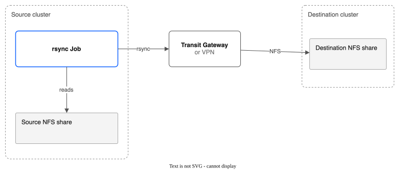
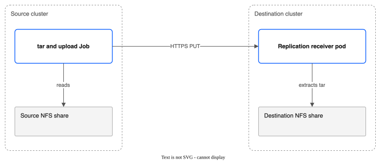

# Part 6: Replication and Failover

> **Tutorial Series:** [Index](TUTORIAL.md) | [Part 1: Pool Creation](TUTORIAL-01-POOL-CREATION.md) | [Part 2: Snapshots & Clones](TUTORIAL-02-SNAPSHOTS-AND-CLONES.md) | [Part 3: Group Snapshots & Hooks](TUTORIAL-03-GROUP-SNAPSHOTS-AND-HOOKS.md) | [Part 4: Pool Configuration](TUTORIAL-04-POOL-CONFIGURATION.md) | [Part 5: Golden Images](TUTORIAL-05-GOLDEN-IMAGES.md) | **Part 6** | [Part 7: Monitoring](TUTORIAL-07-MONITORING.md) | [Part 8: Migration & Console](TUTORIAL-08-MIGRATION-AND-CONSOLE.md) | [Part 9: COS Backup Bucket](TUTORIAL-09-COS-BACKUP-BUCKET.md)

Step-by-step guide to setting up cross-region disaster recovery replication between two clusters, pausing and resuming sync, using lifecycle hooks, inspecting metadata, and performing failover to bring workloads online at the DR site.

**Source cluster:** ROKS eu-de (Frankfurt)
**Destination cluster:** ROKS us-east (Washington, DC) -- or same cluster for testing

---

## Prerequisites

You need **two** ROKS or ROVS clusters with the CSI driver deployed (source and destination). For a single-cluster walkthrough, you can use the same cluster for both roles.

Verify the CSI driver is running on the **source** cluster:

```bash
# Controller pod (6/6 Running)
oc get pods -n kube-system -l app.kubernetes.io/name=ibm-vpc-file-pool-csi,app.kubernetes.io/component=controller

# Node pods (Running on each schedulable node)
oc get pods -n kube-system -l app.kubernetes.io/name=ibm-vpc-file-pool-csi,app.kubernetes.io/component=node

# CSI Driver registered
oc get csidriver vpc-file-pool.csi.ibm.io

# CRD installed
oc get crd replicationpolicies.storage.ibmcloud.io
```

Verify the same on the **destination** cluster (switch kubeconfig or context as needed).

For **direct NFS mode**, the destination NFS share must be reachable from the source cluster over IBM Transit Gateway or VPN. For **driver-to-driver mode**, only HTTPS connectivity between clusters is required: the source cluster's nodes must be able to reach the destination cluster's Route address. On ROKS and ROVS the Route is on the cluster's public ingress address, so the nodes need outbound internet access.

Driver-to-driver mode also needs a pool on the **destination** cluster for the receiver's volume, and either cert-manager (for the receiver's own certificate) or the Route's TLS (see [Step 6c](#step-6c-enable-the-receiver-via-helm)). Check cert-manager on the destination cluster:

```bash
oc get crd certificates.cert-manager.io
```

A new ROKS or ROVS cluster does not have it.

---

## Overview: Two Replication Modes

The CSI driver supports two replication modes, each suited to different network topologies:

**Direct NFS mode** -- The source cluster mounts the destination NFS share and uses rsync to transfer SubVolume data. This requires NFS reachability between clusters (Transit Gateway or VPN). Supports rsync incremental sync for bandwidth efficiency.



**Driver-to-driver mode** -- The source cluster creates Jobs that tar SubVolume data and upload it via HTTPS PUT to a receiver pod on the destination cluster. Works across any network that allows HTTPS. The receiver extracts the tar stream to the destination NFS share.



The rsync and tar copies apply to volumes that are not disks of a running VM. The controller copies a running VM's disks with QEMU instead. See [Running VMs](#running-vms).

---

## Step 1: Clean Up Any Previous Tutorial Resources

```bash
REPL_POOL=repl-pool
REPL_NS=pool-tutorial-repl

# 1. Delete pods and PVCs
oc delete pods --all -n ${REPL_NS} --force --grace-period=0 --ignore-not-found
oc delete pvc --all -n ${REPL_NS} --timeout=60s --ignore-not-found

# 2. Delete this tutorial's ReplicationPolicies, by name.
# ReplicationPolicy is cluster-wide. Never use --all on a cluster that others share.
oc delete replicationpolicy dr-driver dr-with-hooks dr-with-http-hooks --ignore-not-found

# 3. Grace period for CSI to cascade SubVolume deletes
sleep 5

# 4. Force-clean orphan SubVolumes
for sv in $(oc get subvolumes.storage.ibmcloud.io \
    -l storage.ibmcloud.io/pool=${REPL_POOL} -o name 2>/dev/null); do
    oc patch "$sv" --type=merge -p '{"metadata":{"finalizers":null}}'
done
oc delete subvolumes.storage.ibmcloud.io \
    -l storage.ibmcloud.io/pool=${REPL_POOL} --ignore-not-found

# 5. Delete pool
oc delete filesharepool ${REPL_POOL} --timeout=60s --ignore-not-found || {
    oc patch filesharepools.storage.ibmcloud.io ${REPL_POOL} \
        --type=merge -p '{"metadata":{"finalizers":null}}'
    oc delete filesharepool ${REPL_POOL} --ignore-not-found
}

# 6. Delete namespace
oc delete namespace ${REPL_NS} --timeout=60s --ignore-not-found
```

---

## Step 2: Set Up Variables, Namespace, and Source Pool

```bash
# Shell variables used throughout this tutorial
export REPL_POOL=repl-pool
export REPL_NS=pool-tutorial-repl

# Create namespace
oc create namespace ${REPL_NS}
```

Create the source pool:

```bash
cat <<EOF | oc apply -f -
apiVersion: storage.ibmcloud.io/v1alpha1
kind: FileSharePool
metadata:
  name: ${REPL_POOL}
spec:
  zone: eu-de-1
  profile: dp2
  shareSizeGB: 100
  iops: 100
  maxShares: 2
  initialShares: 1
  autoExpand: false
  allocationStrategy: spread
  defaultPermissions: "0777"
  defaultUID: 107
  defaultGID: 107
EOF
```

**What this does:**
- Creates a pool named `repl-pool` in `eu-de-1` with a single 100 GB share
- Uses the `dp2` profile at 100 IOPS (sufficient for tutorial data)
- Directories are owned by UID 107 (QEMU user), suitable for KubeVirt workloads

Watch the pool initialize:

```bash
oc get filesharepools -w
```

Wait until `PHASE` shows `Ready`:

```
NAME        ZONE      PROFILE   SHARES   CAPACITY   ALLOCATED   PVCS   PHASE
repl-pool   eu-de-1   dp2       1        100        0           0      Ready
```

---

## Step 3: Provision PVCs with Test Data

Create three PVCs with writer pods to populate test data:

```bash
cat <<EOF | oc apply -f -
apiVersion: v1
kind: PersistentVolumeClaim
metadata:
  name: repl-app-data
  namespace: ${REPL_NS}
  labels:
    app: repl-demo
spec:
  accessModes:
    - ReadWriteMany
  storageClassName: ${REPL_POOL}
  resources:
    requests:
      storage: 5Gi
---
apiVersion: v1
kind: PersistentVolumeClaim
metadata:
  name: repl-app-logs
  namespace: ${REPL_NS}
  labels:
    app: repl-demo
spec:
  accessModes:
    - ReadWriteMany
  storageClassName: ${REPL_POOL}
  resources:
    requests:
      storage: 5Gi
---
apiVersion: v1
kind: PersistentVolumeClaim
metadata:
  name: repl-app-config
  namespace: ${REPL_NS}
  labels:
    app: repl-demo
spec:
  accessModes:
    - ReadWriteMany
  storageClassName: ${REPL_POOL}
  resources:
    requests:
      storage: 2Gi
EOF
```

Verify PVCs are bound:

```bash
oc get pvc -n ${REPL_NS}
```

Expected output:

```
NAME              STATUS   VOLUME       CAPACITY   ACCESS MODES   STORAGECLASS   AGE
repl-app-data     Bound    pvc-aaa...   5Gi        RWX            repl-pool      5s
repl-app-logs     Bound    pvc-bbb...   5Gi        RWX            repl-pool      5s
repl-app-config   Bound    pvc-ccc...   2Gi        RWX            repl-pool      5s
```

Write test data to each PVC:

```bash
cat <<EOF | oc apply -f -
apiVersion: v1
kind: Pod
metadata:
  name: repl-writer
  namespace: ${REPL_NS}
spec:
  restartPolicy: Never
  containers:
    - name: writer
      image: busybox
      command:
        - sh
        - -c
        - |
          echo "Application database export - \$(date)" > /data/db-dump.sql
          dd if=/dev/urandom of=/data/payload.bin bs=1M count=10 2>/dev/null
          echo "Data written: \$(ls -lh /data/)"
          echo "Access log entry - \$(date)" > /logs/access.log
          echo "Error log entry - \$(date)" > /logs/error.log
          echo "Logs written: \$(ls -lh /logs/)"
          echo "app.replicas=3" > /config/app.properties
          echo "db.host=10.0.0.5" >> /config/app.properties
          echo "Config written: \$(cat /config/app.properties)"
          echo "All test data written successfully."
      volumeMounts:
        - name: data
          mountPath: /data
        - name: logs
          mountPath: /logs
        - name: config
          mountPath: /config
  volumes:
    - name: data
      persistentVolumeClaim:
        claimName: repl-app-data
    - name: logs
      persistentVolumeClaim:
        claimName: repl-app-logs
    - name: config
      persistentVolumeClaim:
        claimName: repl-app-config
EOF
```

Wait for the writer to complete and verify:

```bash
oc get pod repl-writer -n ${REPL_NS} -w
# Wait for STATUS=Completed

oc logs repl-writer -n ${REPL_NS}
```

Verify SubVolumes and pool capacity:

```bash
oc get subvolumes -o wide
oc get filesharepools
# Expected: ALLOCATED=12, PVCS=3
```

Clean up the writer pod:

```bash
oc delete pod repl-writer -n ${REPL_NS}
```

---

## Step 4: Direct NFS Replication

Direct NFS mode uses rsync Jobs to transfer SubVolume data from the source pool's NFS share to a destination NFS share. The destination share must be reachable from source cluster worker nodes over Transit Gateway or VPN.

> **Note:** Replace `10.240.0.50` with the actual NFS mount target IP of your destination share, and `destinationExportPath` with its export path. A share in security group mode (the only mode for new shares) exports a path such as `/299a1485_593a_403d_98da_b0958e446b16`, not `/`. With `/` the sync Jobs fail. Both values are in the destination pool's status (`status.shares[].mountTargetIP` and `status.shares[].exportPath`), or in the `mount_path` of `ibmcloud is share-mount-target <DEST_SHARE_ID> <MOUNT_TARGET_ID>` (`<ip>:<export path>`).

Create a ReplicationPolicy:

```bash
cat <<EOF | oc apply -f -
apiVersion: storage.ibmcloud.io/v1alpha1
kind: ReplicationPolicy
metadata:
  name: dr-direct
spec:
  sourcePoolName: ${REPL_POOL}
  destinationNFSServer: "10.240.0.50"
  destinationExportPath: "/299a1485_593a_403d_98da_b0958e446b16"   # the export path of your destination share
  destinationBasePath: "/pvcs"
  schedule: "5m"
  incrementalSync: true
  maxParallelSyncs: 2
  bandwidthLimitMbps: 100
  maxRetries: 3
EOF
```

**What this does:**
- Replicates all SubVolumes in `repl-pool` to the destination NFS server at `10.240.0.50`
- Syncs every 5 minutes using rsync incremental mode (only changed files are transferred)
- Runs up to 2 SubVolume syncs in parallel
- Limits rsync bandwidth to 100 Mbps to avoid saturating the Transit Gateway link
- Pauses the policy after 3 consecutive failures

Watch the policy status:

```bash
oc get replicationpolicies -w
```

Expected output after the first sync cycle:

```
NAME        SOURCE      DEST           SCHEDULE   PHASE    LAST SYNC
dr-direct   repl-pool   10.240.0.50    5m         Active   2026-02-25T14:30:00Z
```

Inspect per-SubVolume replication status:

```bash
oc get replicationpolicy dr-direct -o yaml | grep -A 20 subVolumeStatuses
```

Expected output:

```yaml
  subVolumeStatuses:
  - subVolumeName: pvc-aaa11111-2222-3333-4444-555566667777
    lastSyncTime: "2026-02-25T14:30:02Z"
    bytesSynced: 10485760
  - subVolumeName: pvc-bbb11111-2222-3333-4444-555566667777
    lastSyncTime: "2026-02-25T14:30:03Z"
    bytesSynced: 2048
  - subVolumeName: pvc-ccc11111-2222-3333-4444-555566667777
    lastSyncTime: "2026-02-25T14:30:01Z"
    bytesSynced: 128
```

### Optional: Filter Which SubVolumes Are Replicated

By default, all SubVolumes in the source pool are replicated. Use `subVolumeSelector` to replicate only a subset:

```bash
cat <<EOF | oc apply -f -
apiVersion: storage.ibmcloud.io/v1alpha1
kind: ReplicationPolicy
metadata:
  name: dr-selective
spec:
  sourcePoolName: ${REPL_POOL}
  destinationNFSServer: "10.240.0.50"
  destinationExportPath: "/"
  destinationBasePath: "/pvcs"
  schedule: "15m"
  maxRetries: 3
  subVolumeSelector:
    matchLabels:
      app: repl-demo
EOF
```

**What this does:**
- Only replicates SubVolumes whose parent PVCs have the label `app: repl-demo`
- Uses a 15-minute schedule (less frequent than the full-pool policy)

### Optional: Custom rsync Flags

Direct NFS mode supports extra rsync flags via `rsyncOptions`. Dangerous flags (`--daemon`, `--server`, `--rsh`, `--rsync-path`) are rejected by the validating webhook.

```yaml
spec:
  rsyncOptions:
    - "--compress"
    - "--exclude=*.tmp"
```

Clean up the selective policy (keep `dr-direct` for the next steps):

```bash
oc delete replicationpolicy dr-selective --ignore-not-found
```

---

## Step 5: Pause and Resume Replication

To temporarily stop replication (for example, during maintenance), annotate the policy:

```bash
oc annotate replicationpolicy dr-direct storage.ibmcloud.io/paused=true
```

Verify the phase changes to `Paused`. The controller checks the annotation about every 30 seconds, so wait a minute:

```bash
oc get replicationpolicies
```

Expected output:

```
NAME        SOURCE      DEST           SCHEDULE   PHASE    LAST SYNC
dr-direct   repl-pool   10.240.0.50    5m         Paused   2026-02-25T14:30:00Z
```

**What this does:**
- The replication controller detects the `storage.ibmcloud.io/paused: "true"` annotation
- Status phase is updated to `Paused`
- No new sync Jobs are created while paused
- In-flight Jobs are allowed to complete

To resume replication, remove the annotation:

```bash
oc annotate replicationpolicy dr-direct storage.ibmcloud.io/paused-
```

Verify the phase returns to `Active`:

```bash
oc get replicationpolicies
```

Expected output:

```
NAME        SOURCE      DEST           SCHEDULE   PHASE    LAST SYNC
dr-direct   repl-pool   10.240.0.50    5m         Active   2026-02-25T14:30:00Z
```

The next sync cycle will run at the scheduled interval from when the policy was resumed.

Clean up the direct NFS policy before moving to driver-to-driver mode:

```bash
oc delete replicationpolicy dr-direct
```

---

## Step 6: Driver-to-Driver Replication

Driver-to-driver mode is the recommended approach when Transit Gateway NFS reachability is not available or when you want HTTPS-based replication with authentication and TLS.

The source cluster creates Jobs that tar SubVolume data and upload it via HTTPS PUT to a receiver pod on the destination cluster. The receiver extracts the tar stream to the destination NFS share.

### Step 6a: Generate an Auth Token

Generate a shared bearer token used to authenticate the source cluster to the destination receiver:

```bash
export REPL_TOKEN=$(openssl rand -hex 32)
echo "Replication token: ${REPL_TOKEN}"
```

Save this token -- you will need it on both clusters.

### Step 6b: Set Up the Destination Cluster

Switch to the destination cluster context (or use a separate terminal with the destination kubeconfig):

```bash
# Switch context (adjust to your cluster name)
oc config use-context dest-cluster
```

Create the auth token Secret on the destination cluster:

```bash
cat <<EOF | oc apply -f -
apiVersion: v1
kind: Secret
metadata:
  name: repl-receiver-token
  namespace: kube-system
type: Opaque
stringData:
  token: "${REPL_TOKEN}"
EOF
```

**What this does:**
- Creates a Secret in `kube-system` containing the bearer token
- The receiver pod reads this token file and validates incoming requests

You also need a destination PVC. It is the receiver's data volume, so it lives on a pool on the **destination** cluster. The pool `repl-pool` exists only on the source cluster, so make a pool on the destination cluster first. Use a zone of the destination cluster. The pool can be small: the volume only has to hold the data you replicate.

```bash
export DR_POOL=dr-repl-pool

cat <<EOF | oc apply -f -
apiVersion: storage.ibmcloud.io/v1alpha1
kind: FileSharePool
metadata:
  name: ${DR_POOL}
spec:
  zone: eu-de-3      # a zone of the destination cluster
  profile: dp2
  shareSizeGB: 20
  iops: 100
  maxShares: 1
  initialShares: 1
  autoExpand: false
  defaultPermissions: "0777"
  defaultUID: 107
  defaultGID: 107
EOF

oc get filesharepool ${DR_POOL}    # wait for PHASE Ready
```

Then make the volume on that pool:

```bash
cat <<EOF | oc apply -f -
apiVersion: v1
kind: PersistentVolumeClaim
metadata:
  name: repl-destination-data
  namespace: kube-system
spec:
  accessModes:
    - ReadWriteMany
  storageClassName: ${DR_POOL}
  resources:
    requests:
      storage: 10Gi
EOF
```

> **Note:** If you are testing on the same cluster, you can use any RWX PVC. For a real DR setup, this PVC would be on a pool in the destination region. Make it big enough for everything you replicate.

### Step 6c: Enable the Receiver via Helm

Upgrade the Helm release on the **destination** cluster to enable the replication receiver. Use the chart that matches the image you run (the chart in the same release as the driver image). A chart that is newer than the image can stop the controller from starting.

**Option A: the receiver has its own certificate (needs cert-manager).**

```bash
helm upgrade ibm-vpc-file-pool-csi charts/ibm-vpc-file-pool-csi \
  -n kube-system \
  --reuse-values \
  --set replicationReceiver.enabled=true \
  --set replicationReceiver.pvcName=repl-destination-data \
  --set replicationReceiver.authSecretName=repl-receiver-token \
  --set replicationReceiver.tls.enabled=true
```

**What this does:**
- Deploys the replication receiver as a Deployment in `kube-system`
- Mounts the destination PVC at `/data` inside the receiver container
- Configures TLS with a self-signed certificate from cert-manager
- Creates a Service (`ibm-vpc-file-pool-csi-replication-receiver`) on port 8443
- Creates an OpenShift Route with TLS passthrough (auto-detected on OpenShift clusters)
- Provisions a cert-manager Certificate with SANs for the Service and Route hostnames

Without cert-manager, this command fails with `no matches for kind "Certificate" in version "cert-manager.io/v1"`, and nothing is changed.

**Option B: the Route provides the TLS (no cert-manager).** Set `tls.enabled=false`. The receiver then speaks plain HTTP inside the cluster, and the OpenShift Route ends the TLS with the cluster's ingress certificate. A ROKS or ROVS ingress certificate is signed by a public CA, so the source cluster trusts it without a CA Secret (skip Step 6d, and leave `destinationCACertSecretRef` out of the policy). The bearer token still protects the receiver.

```bash
helm upgrade ibm-vpc-file-pool-csi charts/ibm-vpc-file-pool-csi \
  -n kube-system \
  --reuse-values \
  --set replicationReceiver.enabled=true \
  --set replicationReceiver.pvcName=repl-destination-data \
  --set replicationReceiver.authSecretName=repl-receiver-token \
  --set replicationReceiver.tls.enabled=false
```

The Route is now of type `edge` instead of `passthrough`.

Verify the receiver is running:

```bash
oc get pods -n kube-system -l app.kubernetes.io/component=replication-receiver
```

Expected output:

```
NAME                                                         READY   STATUS    RESTARTS   AGE
ibm-vpc-file-pool-csi-replication-receiver-5d8f9c7b4-x2k9j  1/1     Running   0          30s
```

Verify the Route is created:

```bash
oc get route -n kube-system -l app.kubernetes.io/component=replication-receiver
```

Note the Route hostname (e.g., `ibm-vpc-file-pool-csi-replication-receiver-kube-system.apps.dest-cluster.example.com`). You will need this for the source cluster configuration.

```bash
export RECEIVER_HOST=$(oc get route -n kube-system \
    -l app.kubernetes.io/component=replication-receiver \
    -o jsonpath='{.items[0].spec.host}')
echo "Receiver endpoint: https://${RECEIVER_HOST}"
```

Check that the receiver answers (with Option B this also shows that the Route certificate is trusted). The first call needs no token and returns `200`. The second shows that the token is needed: `401`.

```bash
curl -s -o /dev/null -w "%{http_code}\n" https://${RECEIVER_HOST}/api/v1/health
curl -s -o /dev/null -w "%{http_code}\n" https://${RECEIVER_HOST}/api/v1/auth-check
```

### Step 6d: Extract the CA Certificate

**Option A only.** (With Option B, skip this step and Step 6e's CA Secret.) The self-signed CA certificate must be trusted by the source cluster. Extract it from the cert-manager Secret:

```bash
oc get secret ibm-vpc-file-pool-csi-receiver-certs -n kube-system \
    -o jsonpath='{.data.ca\.crt}' | base64 -d > /tmp/receiver-ca.crt
cat /tmp/receiver-ca.crt
```

> **Note:** If the cert-manager Secret does not contain a `ca.crt` key (some issuer configurations store it differently), use `tls.crt` instead. For production, use a trusted CA (e.g., Let's Encrypt via ClusterIssuer).

### Step 6e: Set Up the Source Cluster

Switch back to the source cluster context:

```bash
oc config use-context source-cluster
```

Create the CA certificate Secret on the source cluster (Option A only):

```bash
oc create secret generic repl-receiver-ca -n kube-system \
  --from-file=ca.crt=/tmp/receiver-ca.crt
```

Create the auth token Secret on the source cluster (same token):

```bash
cat <<EOF | oc apply -f -
apiVersion: v1
kind: Secret
metadata:
  name: repl-source-token
  namespace: kube-system
type: Opaque
stringData:
  token: "${REPL_TOKEN}"
EOF
```

### Step 6f: Create the Driver-to-Driver ReplicationPolicy

```bash
cat <<EOF | oc apply -f -
apiVersion: storage.ibmcloud.io/v1alpha1
kind: ReplicationPolicy
metadata:
  name: dr-driver
spec:
  sourcePoolName: ${REPL_POOL}
  destinationBasePath: "/pvcs"
  schedule: "5m"
  maxParallelSyncs: 2
  maxRetries: 3
  destinationEndpoint: "https://${RECEIVER_HOST}"
  destinationAuthSecretRef: "repl-source-token"
  destinationCACertSecretRef: "repl-receiver-ca"   # Option A only: leave this line out with Option B
EOF
```

**What this does:**
- Sets `destinationEndpoint` to the receiver's HTTPS URL, which triggers driver-to-driver mode
- References the auth token Secret (`repl-source-token`) for Bearer token authentication
- References the CA certificate Secret (`repl-receiver-ca`) for TLS verification (Option A only; with Option B the source trusts the Route's public certificate)
- Omits `destinationNFSServer` because data is uploaded via HTTPS, not mounted via NFS
- The controller creates Jobs that tar each SubVolume directory and PUT it to the receiver

Watch replication status:

```bash
oc get replicationpolicies -w
```

Expected output after the first sync:

```
NAME        SOURCE      DEST   SCHEDULE   PHASE    LAST SYNC
dr-driver   repl-pool          5m         Active   2026-02-25T15:00:00Z
```

> **Note:** The `DEST` column is blank because driver-to-driver mode uses `destinationEndpoint` instead of `destinationNFSServer`.

**How long this takes.** Expect 10 to 15 minutes for the three volumes, not seconds:

- `maxParallelSyncs: 2` starts two volumes at once. The third waits for the next check of the policy (`deferred: parallel limit` in the status).
- The controller looks at a running cycle only on its schedule (every 5 minutes here). The data of a small volume is at the destination within a minute, but the policy shows `sync in progress` and an empty `LAST SYNC` until the next check.

Follow the Jobs while you wait: `oc get jobs -n kube-system | grep repl-`. To see the per-volume status:

```bash
oc get replicationpolicy dr-driver -o json | jq -c '.status.subVolumeStatuses[] | {sv: .subVolumeName, last: .lastSyncTime, err: .lastError, bytes: .bytesSynced}'
```

Verify data arrived on the destination cluster by switching context and checking the receiver pod's NFS mount:

```bash
oc config use-context dest-cluster

# Exec into the receiver pod to inspect the destination data
RECEIVER_POD=$(oc get pods -n kube-system \
    -l app.kubernetes.io/component=replication-receiver \
    -o jsonpath='{.items[0].metadata.name}')

oc exec -n kube-system ${RECEIVER_POD} -- ls -la /data/pvcs/
```

You should see directories for each replicated SubVolume (named `pvc-<uuid>`).

Switch back to the source cluster:

```bash
oc config use-context source-cluster
```

---

## Step 7: Replication Hooks

ReplicationPolicy supports pre-sync and post-sync hooks that run before and after each replication cycle. Use hooks to freeze application I/O, notify external systems, or validate replicated data.

Two things to do before you try the examples:

1. Pause the `dr-driver` policy from Step 6, so two policies do not copy the same pool at the same time:

   ```bash
   oc annotate replicationpolicy dr-driver storage.ibmcloud.io/paused=true
   ```

2. An exec hook runs in a running pod that matches its `podSelector`. The writer pod from Step 3 is gone and had no labels. Start a pod that the hook can find. If no pod matches, the hook fails with `no pod found in <namespace> matching labels`, and with `onError: Abort` the cycle fails.

   ```bash
   cat <<EOF | oc apply -f -
   apiVersion: v1
   kind: Pod
   metadata:
     name: repl-app
     namespace: ${REPL_NS}
     labels:
       app: repl-demo
   spec:
     containers:
       - name: app
         image: busybox
         command: ["sleep", "3600"]
         securityContext:
           allowPrivilegeEscalation: false
           runAsNonRoot: true
           runAsUser: 107
           capabilities:
             drop: ["ALL"]
           seccompProfile:
             type: RuntimeDefault
   EOF
   ```

### Exec Hook Example: Freeze Application Before Sync

```bash
cat <<EOF | oc apply -f -
apiVersion: storage.ibmcloud.io/v1alpha1
kind: ReplicationPolicy
metadata:
  name: dr-with-hooks
spec:
  sourcePoolName: ${REPL_POOL}
  destinationBasePath: "/pvcs"
  schedule: "10m"
  maxRetries: 3
  destinationEndpoint: "https://${RECEIVER_HOST}"
  destinationAuthSecretRef: "repl-source-token"
  destinationCACertSecretRef: "repl-receiver-ca"   # Option A only: leave this line out with Option B
  preSyncHooks:
    - name: freeze-app
      type: exec
      exec:
        podSelector:
          app: repl-demo
        namespace: ${REPL_NS}
        command:
          - sh
          - -c
          - "echo 'Freezing application I/O...' && sync"
      timeoutSeconds: 30
      onError: Abort
  postSyncHooks:
    - name: thaw-app
      type: exec
      exec:
        podSelector:
          app: repl-demo
        namespace: ${REPL_NS}
        command:
          - sh
          - -c
          - "echo 'Resuming application I/O...'"
      timeoutSeconds: 30
      onError: Continue
EOF
```

**What this does:**
- `preSyncHooks` runs `freeze-app` before each sync -- executes a command in the first pod matching `app: repl-demo` in the `${REPL_NS}` namespace
- If the pre-sync hook fails, `onError: Abort` cancels the sync cycle
- `postSyncHooks` runs `thaw-app` after the sync completes
- If the post-sync hook fails, `onError: Continue` logs the error but does not affect the sync result

The pre-sync hook runs when a cycle starts, and the post-sync hook runs when the whole cycle has finished. With three volumes and one sync at a time, a cycle spans several checks of the policy, so the two hooks can be many minutes apart (see the timing note in Step 6f). Check that they ran in the controller log:

```bash
oc logs -n kube-system -l app.kubernetes.io/component=controller -c csi-controller --tail=3000 | grep -E 'Running hook|Hook (succeeded|failed)'
```

A hook that works logs `Hook succeeded` for `freeze-app` (phase `Pre`) and for `thaw-app` (phase `Post`).

### HTTP Hook Example: Notify a Webhook Endpoint

```bash
cat <<EOF | oc apply -f -
apiVersion: storage.ibmcloud.io/v1alpha1
kind: ReplicationPolicy
metadata:
  name: dr-with-http-hooks
spec:
  sourcePoolName: ${REPL_POOL}
  destinationBasePath: "/pvcs"
  schedule: "15m"
  maxRetries: 3
  destinationEndpoint: "https://${RECEIVER_HOST}"
  destinationAuthSecretRef: "repl-source-token"
  destinationCACertSecretRef: "repl-receiver-ca"   # Option A only: leave this line out with Option B
  postSyncHooks:
    - name: notify-slack
      type: http
      http:
        url: "https://hooks.slack.com/services/T00000000/B00000000/XXXXXXXX"
        method: POST
        headers:
          Content-Type: "application/json"
      timeoutSeconds: 10
      onError: Continue
EOF
```

**What this does:**
- After each successful sync, sends an HTTP POST to a Slack webhook URL
- The `headers` field sets the Content-Type for the request
- `onError: Continue` ensures a notification failure does not affect replication status

The URL above is a placeholder. The Slack service answers it with `404`, so the controller log shows `Hook failed ... HTTP POST returned 404` and the cycle still finishes. Use your own webhook URL.

Clean up the hook-based policies:

```bash
oc delete replicationpolicy dr-with-hooks dr-with-http-hooks --ignore-not-found
oc delete pod repl-app -n ${REPL_NS} --ignore-not-found
```

---

## Step 8: Metadata Sidecar

The replication controller writes a `.subvolume-metadata.json` file alongside each replicated SubVolume directory on the destination. This metadata is used by the failover CLI to reconstruct SubVolume CRs, PVs, and PVCs on the DR cluster.

Inspect the metadata on the destination cluster:

```bash
oc config use-context dest-cluster

RECEIVER_POD=$(oc get pods -n kube-system \
    -l app.kubernetes.io/component=replication-receiver \
    -o jsonpath='{.items[0].metadata.name}')

# List replicated SubVolume directories
oc exec -n kube-system ${RECEIVER_POD} -- ls /data/pvcs/

# Read the metadata file for one SubVolume (replace pvc-xxx with actual name)
oc exec -n kube-system ${RECEIVER_POD} -- cat /data/pvcs/pvc-xxx/.subvolume-metadata.json
```

Example metadata output:

```json
{
  "subVolumeName": "pvc-aaa11111-2222-3333-4444-555566667777",
  "spec": {
    "poolName": "repl-pool",
    "shareID": "r010-xxxxxxxx-xxxx-xxxx-xxxx-xxxxxxxxxxxx",
    "shareMountTargetIP": "10.240.1.10",
    "shareExportPath": "/xxxxxxxx_xxxx_xxxx_xxxx_xxxxxxxxxxxx",
    "subPath": "/pvcs/pvc-aaa11111-2222-3333-4444-555566667777",
    "requestedGB": 5,
    "pvName": "pvc-aaa11111-2222-3333-4444-555566667777",
    "pvcName": "repl-app-data",
    "pvcNamespace": "pool-tutorial-repl",
    "uid": 107,
    "gid": 107,
    "permissions": "0777",
    "reclaimPolicy": "Delete"
  },
  "labels": {
    "storage.ibmcloud.io/pool": "repl-pool",
    "storage.ibmcloud.io/share-id": "r010-xxxxxxxx-xxxx-xxxx-xxxx-xxxxxxxxxxxx"
  },
  "lastSyncTime": "2026-02-25T15:00:02Z",
  "replicationPolicy": "dr-driver"
}
```

**Key fields:**
- `subVolumeName` -- the SubVolume CR name on the source cluster
- `spec.pvcName` and `spec.pvcNamespace` -- the original PVC name and namespace (used by failover to recreate PVCs)
- `spec.requestedGB` -- the PVC size to recreate
- `spec.subPath` -- the subdirectory path within the NFS share
- `spec.shareID`, `spec.shareMountTargetIP` and `spec.shareExportPath` -- where the volume lived on the **source** share. Failover does not use them: the DR PV points at the DR share
- `labels` -- the labels of the SubVolume, not of the PVC
- `lastSyncTime` -- when this SubVolume was last synced (used to calculate RPO)
- `replicationPolicy` -- which ReplicationPolicy produced this replica. If two policies copy the same pool, this is the one that wrote last

Switch back to the source cluster:

```bash
oc config use-context source-cluster
```

---

## Step 9: Failover

When the source cluster or region is unavailable, use the `kubectl failover` CLI to bring workloads online at the DR site. The CLI reads `.subvolume-metadata.json` files from the destination NFS mount and creates matching SubVolume CRs, PVs, and PVCs on the DR cluster.

If the source cluster is still alive, stop replication first, so no copy arrives while you fail over (skip this if the source is lost):

```bash
oc config use-context source-cluster
oc annotate replicationpolicy dr-driver storage.ibmcloud.io/paused=true --overwrite
```

### Step 9a: Plan the Failover

The tool reads the replicated folders from where the destination share is mounted. The receiver pod already mounts it at `/data`. The driver image does not contain the tool, so put the tool in the receiver pod (the binary is for Linux x86; `make build-failover` makes it, with `GOOS=linux GOARCH=amd64` on another system):

```bash
oc config use-context dest-cluster

RECEIVER_POD=$(oc get pods -n kube-system \
    -l app.kubernetes.io/component=replication-receiver \
    -o jsonpath='{.items[0].metadata.name}')

oc exec -i -n kube-system ${RECEIVER_POD} -- \
    sh -c 'cat > /tmp/kubectl-failover && chmod +x /tmp/kubectl-failover' < bin/kubectl-failover

oc exec -n kube-system ${RECEIVER_POD} -- /tmp/kubectl-failover plan --nfs-mount-path /data
```

> **Note:** You can also run the tool on any host that mounts the destination share over NFS (a VSI in the VPC, for example) and reaches the DR cluster's API. The commands below then read `kubectl failover ...` and `--nfs-mount-path` is where you mounted the share. [Part 13](TUTORIAL-13-FAILOVER-OF-RUNNING-VMS.md) shows that way. From the receiver pod, the tool uses the pod's own service account to talk to the cluster, so no kubeconfig is needed.

Example output:

```
Failover Plan
=============
NFS Mount Path:  /data
SubVolumes:      3
RPO (max age):   5m12s

SUBVOLUME                                     PVC               NAMESPACE            SIZE (GiB)  LAST SYNC      POLICY
pvc-aaa11111-2222-3333-4444-555566667777      repl-app-data     pool-tutorial-repl   5           5m12s ago      dr-driver
pvc-bbb11111-2222-3333-4444-555566667777      repl-app-logs     pool-tutorial-repl   5           5m10s ago      dr-driver
pvc-ccc11111-2222-3333-4444-555566667777      repl-app-config   pool-tutorial-repl   2           5m11s ago      dr-driver

To execute failover, run:
  kubectl failover execute --nfs-mount-path /data --dr-pool <POOL> --dr-share-ip <IP>
```

**What this does:**
- Scans `/data/pvcs/` for directories containing `.subvolume-metadata.json`
- Lists each discoverable SubVolume with its PVC name, namespace, size, and age since last sync
- Calculates the RPO (recovery point objective) as the age of the oldest last sync time

### Step 9b: Find the DR Share and Dry-Run the Failover

Failover makes a PV for each volume. A PV must name its folder by the path **from the root of the DR share**. The replicated volumes are not at the root of the share: the receiver's data volume `repl-destination-data` is itself a folder on the DR pool's share, and the replicated volumes are inside it. So you need the share's address, its export path and the folder of the receiver volume:

```bash
export DR_IP=$(oc get filesharepool ${DR_POOL} -o jsonpath='{.status.shares[0].mountTargetIP}')
export DR_EXPORT=$(oc get filesharepool ${DR_POOL} -o jsonpath='{.status.shares[0].exportPath}')
RECV_PV=$(oc get pvc -n kube-system repl-destination-data -o jsonpath='{.spec.volumeName}')
RECV_SUB=$(oc get subvolume ${RECV_PV} -o jsonpath='{.spec.subPath}')

# The tool adds /pvcs/pvc-<uuid> to this path.
export DR_EXPORT_PATH="${DR_EXPORT%/}${RECV_SUB}"
echo "${DR_IP} ${DR_EXPORT_PATH}"
```

Preview what resources would be created without making changes:

```bash
oc exec -n kube-system ${RECEIVER_POD} -- /tmp/kubectl-failover execute \
    --nfs-mount-path /data \
    --dr-pool ${DR_POOL} \
    --dr-share-ip ${DR_IP} \
    --dr-export-path "${DR_EXPORT_PATH}" \
    --dry-run
```

Example output:

```
[dry-run] Would create SubVolume pvc-aaa11111-2222-3333-4444-555566667777
[dry-run] Would create PV dr-pvc-aaa11111-2222-3333-4444-555566667777 (nfs://10.245.3.8/8fbb32db_4f8e_4012_b074_27fbae9536be/pvcs/pvc-cfc98075-51ab-4cdf-98e1-ca5307debf19/pvcs/pvc-aaa11111-2222-3333-4444-555566667777)
[dry-run] Would create PVC pool-tutorial-repl/repl-app-data (bound to dr-pvc-aaa11111-2222-3333-4444-555566667777)
...
```

**What this does:**
- For each SubVolume, shows the SubVolume CR, PV, and PVC that would be created
- PV names are prefixed with `dr-` to avoid conflicts with source cluster PV names
- PVCs retain their original names and namespaces from the metadata
- No resources are created in dry-run mode

**Check the PV path.** It must end in `/pvcs/pvc-<uuid>` after the receiver's folder. Without `--dr-export-path`, the path is `/pvcs/pvc-<uuid>` from the root of the share, which is not where the receiver wrote the data, and the volume would be empty or would not mount.

### Step 9c: Execute the Failover

The tool creates each PVC in the namespace it had on the source cluster. Make that namespace on the DR cluster first (or pass `--namespace` to put every PVC in one namespace). Then run the failover:

```bash
oc create namespace ${REPL_NS}

oc exec -n kube-system ${RECEIVER_POD} -- /tmp/kubectl-failover execute \
    --nfs-mount-path /data \
    --dr-pool ${DR_POOL} \
    --dr-share-ip ${DR_IP} \
    --dr-export-path "${DR_EXPORT_PATH}"
```

Example output:

```
Preparing running VM disks (rolling back unfinished copies, rewinding where needed)...
Created SubVolume pvc-aaa11111-2222-3333-4444-555566667777
Created PV dr-pvc-aaa11111-2222-3333-4444-555566667777
Created PVC pool-tutorial-repl/repl-app-data
...
```

**What this does:**
- Creates SubVolume CRs on the DR cluster matching the source metadata
- Creates PVs that point to the DR share's NFS mount target IP and the path of each volume inside the receiver's folder
- Creates PVCs in the original namespaces, pre-bound to the new PVs
- All operations are idempotent -- running execute again skips already-existing resources (if the namespace was missing, create it and run `execute` again)

Optional flags:
- `--namespace override-ns` -- override the PVC namespace (useful when DR uses a different namespace layout)
- `--dr-export-path` is also what you use for older shares in VPC access mode, which have an NFS export path of their own. Here it is needed for a different reason: the receiver's folder

> **Note:** The PVCs that the tool makes do not name a StorageClass, so a cluster with a default StorageClass shows that class in the PVC (for example `ocs-storagecluster-ceph-rbd`). The PVC is bound to its PV by name, so this does not change where the data is.

### Step 9d: Check Failover Status

Verify the failover resources were created correctly:

```bash
oc exec -n kube-system ${RECEIVER_POD} -- /tmp/kubectl-failover status
```

Example output:

```
SUBVOLUME                                     PVC               NAMESPACE            PVC PHASE  POLICY
pvc-aaa11111-2222-3333-4444-555566667777      repl-app-data     pool-tutorial-repl   Bound      dr-driver
pvc-bbb11111-2222-3333-4444-555566667777      repl-app-logs     pool-tutorial-repl   Bound      dr-driver
pvc-ccc11111-2222-3333-4444-555566667777      repl-app-config   pool-tutorial-repl   Bound      dr-driver
```

**What this does:**
- Lists all SubVolumes with the `storage.ibmcloud.io/failover-source` label
- Shows the PVC phase for each -- `Bound` means the PVC is ready for use
- Workloads deployed to the DR cluster using these PVC names will automatically mount the replicated data

Verify PVCs are bound:

```bash
oc get pvc -n ${REPL_NS}
```

To check the data, start a pod that mounts a PVC and compare a file with the source. For example, `cksum /data/payload.bin` gives the same numbers on the source volume and on the DR volume.

At this point, you can deploy your application workloads on the DR cluster using the same PVC names, and they will access the replicated data.

Switch back to the source cluster:

```bash
oc config use-context source-cluster
```

---

## Running VMs

A VM that is running is not copied with rsync. The controller freezes the guest for a moment, copies all of its disks at that one moment, and keeps restore points at the destination. At failover, rewind **before** you start the VM:

```bash
kubectl failover plan --nfs-mount-path /data --list-moments
kubectl failover execute --nfs-mount-path /data --prepare-only --rewind-to 2026-10-20T10:30:00Z
```

The policy fields `vmCopyAdaptive` (default `true`), `vmCopySpeedLimitMBps` (the highest speed; none by default) and `restorePointKeepHours` (default 24) control the copy speed and how long the destination keeps restore points. An adaptive copy starts at 15 MB/s for each disk, speeds up while the share the VM reads is quiet, and slows down when the share's latency passes `vmCopyMaxLatencyMs` (default 15). Without the node agents' metrics, or with `vmCopyAdaptive: false`, the copy runs at the fixed `vmCopySpeedLimitMBps` (default 20; 0 means no limit).

See [CROSS-REGION-DR.md](CROSS-REGION-DR.md), "Running VM disks", for the details and the lab results.

---

## Cleanup

### Source Cluster

```bash
oc config use-context source-cluster

REPL_POOL=repl-pool
REPL_NS=pool-tutorial-repl

# 1. Delete this tutorial's ReplicationPolicies, by name (they are cluster-wide:
#    never use --all on a cluster that others share)
oc delete replicationpolicy dr-driver dr-with-hooks dr-with-http-hooks --ignore-not-found

# 2. Delete replication Jobs, temp PVCs and temp PVs of these policies. The
#    controller removes them when a cycle ends; check that none are left.
#    (The label repl-temp=true marks the temp objects of EVERY policy, so do not
#    delete by that label alone.)
for pol in dr-driver dr-with-hooks dr-with-http-hooks; do
    oc delete jobs,pvc -n kube-system -l storage.ibmcloud.io/repl-policy=${pol} --ignore-not-found
    oc delete pv -l storage.ibmcloud.io/repl-policy=${pol} --ignore-not-found
done

# 4. Delete source Secrets
oc delete secret repl-source-token -n kube-system --ignore-not-found
oc delete secret repl-receiver-ca -n kube-system --ignore-not-found

# 5. Delete pods and PVCs
oc delete pods --all -n ${REPL_NS} --force --grace-period=0 --ignore-not-found
oc delete pvc --all -n ${REPL_NS} --timeout=60s --ignore-not-found

# 6. Grace period for CSI to cascade SubVolume deletes
sleep 5

# 7. Force-clean orphan SubVolumes
for sv in $(oc get subvolumes.storage.ibmcloud.io \
    -l storage.ibmcloud.io/pool=${REPL_POOL} -o name 2>/dev/null); do
    oc patch "$sv" --type=merge -p '{"metadata":{"finalizers":null}}'
done
oc delete subvolumes.storage.ibmcloud.io \
    -l storage.ibmcloud.io/pool=${REPL_POOL} --ignore-not-found

# 8. Delete pool-owned PVs
oc get pv -o json | jq -r "
    .items[]
    | select(.spec.csi.driver == \"vpc-file-pool.csi.ibm.io\")
    | select(.spec.csi.volumeAttributes.pool == \"${REPL_POOL}\")
    | .metadata.name" | xargs -r oc delete pv

# 9. Delete pool
oc delete filesharepool ${REPL_POOL} --timeout=60s --ignore-not-found || {
    oc patch filesharepools.storage.ibmcloud.io ${REPL_POOL} \
        --type=merge -p '{"metadata":{"finalizers":null}}'
    oc delete filesharepool ${REPL_POOL} --ignore-not-found
}

# 10. Delete namespace
oc delete namespace ${REPL_NS} --timeout=60s --ignore-not-found

# 11. Verify VPC shares are being deleted
ibmcloud is shares --all-resource-groups
```

### Destination Cluster

```bash
oc config use-context dest-cluster

# 1. Delete the failover resources (if you ran failover). The tool labels the
#    SubVolumes but not the PVs; its PVs are named dr-<SubVolume name>.
oc delete pvc --all -n ${REPL_NS} --timeout=60s --ignore-not-found
for sv in $(oc get subvolumes.storage.ibmcloud.io \
    -l storage.ibmcloud.io/failover-source -o name 2>/dev/null); do
    oc delete pv "dr-${sv#*/}" --ignore-not-found
    oc delete "$sv" --ignore-not-found
done
oc delete namespace ${REPL_NS} --timeout=60s --ignore-not-found

# 2. Disable the receiver via Helm
helm upgrade ibm-vpc-file-pool-csi charts/ibm-vpc-file-pool-csi \
  -n kube-system \
  --reuse-values \
  --set replicationReceiver.enabled=false

# 3. Delete the destination Secret, the receiver's volume and the destination pool
oc delete secret repl-receiver-token -n kube-system --ignore-not-found
oc delete pvc repl-destination-data -n kube-system --ignore-not-found
oc delete filesharepool ${DR_POOL} --timeout=120s --ignore-not-found

# 4. Verify the VPC shares are being deleted
ibmcloud is shares --all-resource-groups
```

---

## Quick Reference

| What | Command |
|------|---------|
| List replication policies | `oc get replicationpolicies` |
| Policy details | `oc describe replicationpolicy <name>` |
| Per-SubVolume sync status | `oc get replicationpolicy <name> -o yaml` |
| Pause replication | `oc annotate replicationpolicy <name> storage.ibmcloud.io/paused=true` |
| Resume replication | `oc annotate replicationpolicy <name> storage.ibmcloud.io/paused-` |
| List replication Jobs | `oc get jobs -n kube-system -l storage.ibmcloud.io/repl-temp=true` |
| Replication Job logs | `oc logs -n kube-system job/<job-name>` |
| Receiver pod status | `oc get pods -n kube-system -l app.kubernetes.io/component=replication-receiver` |
| Receiver health check | `curl -k https://<receiver-route>/api/v1/health` |
| Receiver token check (needs the token) | `curl -k -H "Authorization: Bearer $TOKEN" https://<receiver-route>/api/v1/auth-check` |
| Receiver logs | `oc logs -n kube-system -l app.kubernetes.io/component=replication-receiver` |
| Failover plan | `kubectl failover plan --nfs-mount-path <path>` |
| Failover dry-run | `kubectl failover execute --nfs-mount-path <path> --dr-pool <pool> --dr-share-ip <ip> --dr-export-path <path> --dry-run` |
| Failover execute | `kubectl failover execute --nfs-mount-path <path> --dr-pool <pool> --dr-share-ip <ip> --dr-export-path <path>` |
| Failover status | `kubectl failover status` |
| List VM moments | `kubectl failover plan --nfs-mount-path <path> --list-moments` |
| Controller logs | `oc logs -n kube-system -l app.kubernetes.io/component=controller -c csi-controller --tail=50` |

---

## What's Next

Continue to **[Part 7: Monitoring](TUTORIAL-07-MONITORING.md)** to set up Prometheus metrics, alerting rules, and a Grafana dashboard for the CSI driver -- including replication-specific metrics like sync duration and failure counts.
