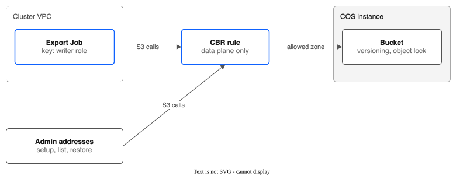

# Part 9: A COS bucket for backups (manual setup)

> **Tutorial Series:** [Index](TUTORIAL.md) | [Part 1: Pool Creation](TUTORIAL-01-POOL-CREATION.md) | [Part 2: Snapshots & Clones](TUTORIAL-02-SNAPSHOTS-AND-CLONES.md) | [Part 3: Group Snapshots & Hooks](TUTORIAL-03-GROUP-SNAPSHOTS-AND-HOOKS.md) | [Part 4: Pool Configuration](TUTORIAL-04-POOL-CONFIGURATION.md) | [Part 5: Golden Images](TUTORIAL-05-GOLDEN-IMAGES.md) | [Part 6: Replication & Failover](TUTORIAL-06-REPLICATION-AND-FAILOVER.md) | [Part 7: Monitoring](TUTORIAL-07-MONITORING.md) | [Part 8: Migration & Console](TUTORIAL-08-MIGRATION-AND-CONSOLE.md) | **Part 9**

Make an IBM Cloud Object Storage (COS) bucket that the backup export can use: a locked, versioned bucket, a key that can only write to it, and a network rule that lets only the cluster and your admin addresses reach it. This is the setup that `kubectl backup cos-setup` does for you (see `docs/specs/2026-10-21-backup-cos-export.md`). Follow these steps by hand if you want to see each one. They are what we ran on the lab on 21 October 2026, and each one was checked.

> **Note:** `kubectl backup cos-setup` automates these steps (run it with `--dry-run` first; see [BACKUP-RECOVERY.md](BACKUP-RECOVERY.md#export-to-cos-built-proved-in-stage-18-except-the-emergency-key-and-dr-cluster-restores)). It was run against real IBM Cloud in stage 18 of the release test. The command also makes the backup key and wraps it with Key Protect. These manual steps do not. This page stays the tested manual procedure and the reference for what the command makes.

**Account:** the one that holds your cluster. **Region:** the bucket is in the cluster's region (`eu-de` here).



---

## Prerequisites

- The IBM Cloud CLI with the `cloud-object-storage`, `cbr` plugins, and your login (`ibmcloud login`). You need the right to make COS instances, IAM roles, service IDs and CBR rules. This is an owner task. The driver never does it.
- The resource group of the cluster: `ibmcloud target -g <group>`.
- [Kopia](https://kopia.io) on your laptop, to check the key at the end (`brew install kopia`).
- A note of the admin addresses that should reach the bucket (your office or VPN address). Step 6 uses them.

Set names once. Change them for your account:

```bash
export RG=rovslab-prod-eude-rg          # resource group of the cluster
export COS=pool-csi-backup-test-cos     # COS instance name
export BUCKET=pool-csi-backup-test-$(date -u +%m%d%H%M)   # bucket names are unique worldwide
export SID=pool-csi-backup-test-driver  # service ID that owns the driver's key
export ROLE=PoolCsiBackupWriter         # custom role
```

---

## Step 1: Make a COS instance

```bash
ibmcloud resource service-instance-create $COS cloud-object-storage standard global \
  -g $RG -d premium-global-deployment-iam
```

The CLI asks which deployment you want if you leave out `-d`. Use `premium-global-deployment-iam`. Note the instance ID and tell the COS plugin to use it:

```bash
COS_GUID=$(ibmcloud resource service-instance $COS --output json | jq -r '.[0].guid')
ibmcloud cos config crn --crn "crn:v1:bluemix:public:cloud-object-storage:global:a/<account-id>:${COS_GUID}::"
```

Use the account ID from `ibmcloud target`. The standard plan costs nothing until you store data.

---

## Step 2: Make the bucket, with versioning and object lock

```bash
ibmcloud cos bucket-create --bucket $BUCKET --class smart --region eu-de
ibmcloud cos bucket-versioning-put --bucket $BUCKET --versioning-configuration Status=Enabled --region eu-de
ibmcloud cos object-lock-configuration-put --bucket $BUCKET \
  --object-lock-configuration '{"ObjectLockEnabled":"Enabled"}' --region eu-de
```

Check it:

```bash
ibmcloud cos bucket-versioning-get --bucket $BUCKET --region eu-de          # Status: Enabled
ibmcloud cos object-lock-configuration-get --bucket $BUCKET --region eu-de  # Object Lock Status: Enabled
```

There is **no default keep time** on the bucket. Each backup policy sets its own (`spec.export.keepFor` and `lock`). **The shortest keep time is 25 hours:** Kopia needs the keep time to be at least its maintenance interval plus 24 hours. Use 25 hours for tests and 30 days or more for real backups. A locked object cannot be deleted by anyone before its time ends, and COS bills it until then.

---

## Step 3: Make a role that can write, but not delete or unlock

IBM's standard **Writer** role can also delete versions and skip Governance locks, so a stolen key could erase backups. Make a custom role with only what the export needs:

```bash
P=cloud-object-storage; A=""
for a in account.get_account_buckets bucket.get bucket.get_basic bucket.head bucket.get_location \
         bucket.get_versioning bucket.get_versions bucket.get_object_lock_configuration bucket.get_uploads \
         object.get object.get_version object.head object.head_version object.put object.post \
         object.post_initiate_upload object.put_part object.post_complete_upload object.get_uploads \
         object.delete_upload object.delete object.get_object_lock_retention \
         object.get_object_lock_retention_version object.put_object_lock_retention \
         object.put_object_lock_retention_version object.post_extend_retention; do A="$A,$P.$a"; done
ibmcloud iam role-create $ROLE -n "Pool CSI backup writer" \
  -d "Backup export: read, write, extend locks, hide with a delete marker. No delete of versions, no skip of locks, no bucket changes." \
  --service-name cloud-object-storage --actions "${A#,}"
```

What the role leaves out on purpose:

| Left out | Why |
|----------|-----|
| `object.delete_version` | A delete with this role only adds a delete marker. The data stays. |
| `object.bypass_governance_retention` | The key cannot skip a lock. |
| `bucket.put_*`, `bucket.delete_bucket` | The key cannot change or delete the bucket. |

`object.delete` is kept because Kopia hides data it no longer needs. A hidden object is still there. Your restore command (run with your own login) removes the hiding marks first.

---

## Step 4: Make the driver's key, limited to this one bucket

```bash
ibmcloud iam service-id-create $SID -d "Driver key for the backup export bucket"
ibmcloud iam service-policy-create $SID --roles "Pool CSI backup writer" \
  --service-name cloud-object-storage --service-instance $COS_GUID \
  --resource-type bucket --resource $BUCKET
```

The role is called by its **display name** (`Pool CSI backup writer`) in the policy, not by `$ROLE`. Now make an HMAC key (the S3 style key that Kopia uses) for the service ID. **Write it to a private file. Do not print it.**

```bash
mkdir -p ~/.config/pool-csi && chmod 700 ~/.config/pool-csi
ibmcloud resource service-key-create pool-csi-backup-test-hmac \
  --instance-name $COS --service-id $SID --parameters '{"HMAC":true}' --output json \
  > ~/.config/pool-csi/cos-key.json
chmod 600 ~/.config/pool-csi/cos-key.json
```

IBM Cloud also adds a policy to the service ID by itself when it makes the HMAC key: the Writer role on the **whole** COS instance, not on one bucket. Delete it, or this key can write to every bucket in the instance (`ibmcloud iam service-policies $SID`, then `ibmcloud iam service-policy-delete $SID <policy-id>` for the one with no resource type and no resource). `kubectl backup cos-setup` finds this one policy, which did not exist before the HMAC key, and deletes it; it leaves any other wide policy for you to remove. The secret is shown once, so `cos-setup` writes the key file the moment the key is made.

The access key and secret are in `.credentials.cos_hmac_keys` of that file. Later they go into a Kubernetes Secret in the driver namespace (`spec.export.credentialsSecret`). Never put them in a repository or a log.

---

## Step 5: Check what the key can and cannot do

Use Kopia, because it is what the driver runs. This makes a small repository in the bucket without a lock:

```bash
export KOPIA_PASSWORD=$(openssl rand -base64 24)       # keep it with the key file
AK=$(jq -r .credentials.cos_hmac_keys.access_key_id ~/.config/pool-csi/cos-key.json)
SK=$(jq -r .credentials.cos_hmac_keys.secret_access_key ~/.config/pool-csi/cos-key.json)
kopia repository create s3 --bucket $BUCKET --endpoint s3.eu-de.cloud-object-storage.appdomain.cloud \
  --access-key "$AK" --secret-access-key "$SK" --prefix smoke-nolock/
mkdir -p /tmp/smoke && echo hello > /tmp/smoke/a.txt && kopia snapshot create /tmp/smoke
```

Expected: the repository is made and the snapshot is saved. Then try what must be refused. With `rclone`, giving the key through the environment (not on the command line):

```bash
export RCLONE_CONFIG_T_TYPE=s3 RCLONE_CONFIG_T_PROVIDER=IBMCOS \
  RCLONE_CONFIG_T_ACCESS_KEY_ID="$AK" RCLONE_CONFIG_T_SECRET_ACCESS_KEY="$SK" \
  RCLONE_CONFIG_T_ENDPOINT=s3.eu-de.cloud-object-storage.appdomain.cloud
rclone lsf T:$BUCKET/smoke-nolock/     # works: lists the Kopia files
rclone rmdir T:$BUCKET                 # Expected: 403 AccessDenied (DeleteBucket)
```

A delete of one object with this key adds a delete marker and removes nothing; we saw it accepted. A delete of a **version** must be refused. We did not test that one yet: the release test checks it (see the spec).

The test objects stay in the bucket. Only you can remove them, with your own login (see "Clean up").

---

## Step 6: Lock the bucket to the cluster (CBR)

A context-based restriction (CBR) rule makes COS refuse the bucket to every address except the ones you list. If the key leaks, it is useless from anywhere else. A rule needs a **network zone**: a list of addresses and VPCs.

If you already have a zone for the cluster (the lab has `rovslab-prod-eude-allowed`: the cluster VPC and the admin addresses), use it. Otherwise make one:

```bash
ibmcloud cbr zone-create --name backup-bucket-allowed \
  --description "Cluster VPC and admin addresses" \
  --vpc "<crn of the cluster VPC>" --addresses "<admin ip>,<another admin ip>"
```

Find the VPC CRN with `ibmcloud is vpcs`. **Put your own admin address in the zone**, or you lose access to the bucket from your laptop (setup, list and restore run with your login, from your machine).

Make the rule. It covers this one bucket and only the data plane (the S3 calls), so IBM Cloud can still manage the instance:

```bash
ibmcloud cbr rule-create \
  --description "Backup bucket: only the cluster VPC and the admin addresses" \
  --service-name cloud-object-storage --service-instance $COS_GUID \
  --resource-type bucket --resource $BUCKET \
  --zone-id <zone id> \
  --api-types crn:v1:bluemix:public:context-based-restrictions::::api-type:data-plane \
  --enforcement-mode enabled
```

Check it from an address that is **not** in the zone. We did this on the lab by pointing the rule at a zone with a made-up address for a minute: the same Kopia/rclone call returned `AccessDenied` at once, and worked again at once when we put the real zone back. A rule is also checked for the **cluster**: the first export Job must still work with the rule on. Run one before you trust the bucket for real backups.

Notes:
- `ibmcloud cbr rule-update` replaces the whole rule, so give it every flag again.
- A VPC in a zone counts only for traffic that comes over IBM's **private** network. A cluster that reaches COS through its public gateway would be refused. Use the private (direct) endpoint, or the private endpoint gateway in the next part.
- Use `--enforcement-mode report` first if you are unsure. COS then only records what it would refuse.

---

## Recommended: a virtual private endpoint (VPE) for COS

For real backups, give the cluster's VPC a **virtual private endpoint gateway** for COS in the same region. It gives COS a private address inside your subnet. Backup traffic then stays on IBM's private network and does not need the public gateway. With the CBR rule above, the bucket is reachable only from inside the VPC and from the admin addresses. It adds a small hourly charge and one security group rule (outbound HTTPS from the workers to the gateway). Make it in the console (VPC, Virtual private endpoint gateways) or with `ibmcloud is endpoint-gateway-create`. It is not needed for a lab test.

---

## What the lab shows after this setup

| Check | Result |
|-------|--------|
| Kopia repository create and snapshot with the key | Worked |
| Delete the bucket with the key | `403 AccessDenied` |
| Call from an address not in the CBR zone | `AccessDenied` at once |
| Call from the admin address in the zone | Worked |

---

## Clean up

Locked objects cannot be removed before their time ends (25 hours at the shortest). Then, with your own login:

```bash
ibmcloud cbr rule-delete <rule id>
# delete every object version and delete marker (the driver's key cannot), then the bucket
ibmcloud cos object-versions --bucket $BUCKET --region eu-de --output json   # lists Versions and DeleteMarkers
ibmcloud cos object-delete --bucket $BUCKET --key <key> --version-id <id> --region eu-de --force
ibmcloud cos bucket-delete --bucket $BUCKET --force
ibmcloud resource service-key-delete pool-csi-backup-test-hmac -f
ibmcloud iam service-id-delete $SID -f
ibmcloud iam role-delete $ROLE
ibmcloud resource service-instance-delete $COS -f
```

Delete the key file `~/.config/pool-csi/cos-key.json` too.

---

## Next

The backup export itself (the `spec.export` block, `kubectl backup cos-setup`, `kubectl backup restore --from-cos`) is described in [BACKUP-RECOVERY.md](BACKUP-RECOVERY.md#export-to-cos-built-proved-in-stage-18-except-the-emergency-key-and-dr-cluster-restores) and in `docs/specs/2026-10-21-backup-cos-export.md`. [Part 6: Replication and Failover](TUTORIAL-06-REPLICATION-AND-FAILOVER.md) covers replication between sites.
