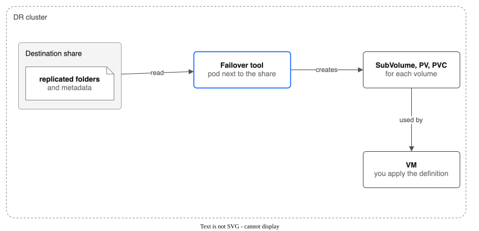

# Part 13: Failover of Running VMs

> **Tutorial Series:** [Index](TUTORIAL.md) | [Part 12: Replicating Running VMs](TUTORIAL-12-REPLICATING-RUNNING-VMS.md) | **Part 13**

Start a replicated VM on the destination (DR) cluster. Choose the moment it starts from: the newest one, or an earlier restore point. The words failover, rewind, moment and restore point are defined in [CONTEXT.md](CONTEXT.md).

**Time:** about 30 minutes, plus the time to copy a disk if you rewind.
**Before you start:** finish [Part 12](TUTORIAL-12-REPLICATING-RUNNING-VMS.md), so the destination holds copies of a VM with at least one good copy of every disk.

What the failover tool does and does not do:

- It reads the metadata that replication left on the destination share. It creates a SubVolume, a PersistentVolume and a PVC for each volume on the DR cluster.
- For a running VM, it picks the newest moment that all disks of the VM can show, so the disks fit each other. It rolls back a copy that stopped half way.
- It does **not** make the VM, start the workload or change DNS. You apply the VM definition yourself.



> **Rewind before you start the VM.** A VM that runs on the latest disk writes to it. After that, the disk no longer matches its restore points, and the tool refuses to rewind it. If you may want an earlier moment, rewind first.

---

## Prerequisites

- The destination cluster from Part 12: the receiver, the pool `dr-vm-pool`, and the volume `repl-destination-data` in `kube-system`.
- A place to run the failover tool where the destination share is mounted. The tool reads the replicated folders from a mounted share. There are two ways:
  - **A host** that can reach the destination share over NFS and the DR cluster's API. A VSI in the destination VPC works. A host in another VPC usually cannot reach the share (the NFS port times out).
  - **A pod next to the share.** The receiver pod cannot do this: it has no rights on the Kubernetes API. Make a pod that mounts the receiver volume (`repl-destination-data`, at `/data`) and runs under a service account that may create SubVolumes, PersistentVolumes and PersistentVolumeClaims and read FileSharePools. This is the way used in the steps below.
- The failover tool, built for Linux x86 (the failover pod and most hosts):

```bash
make build-failover        # makes bin/kubectl-failover; set GOOS=linux GOARCH=amd64 on another system
```

For a host, copy it to `/usr/local/bin/` and check `kubectl failover version`.

**The failover pod.** Make a service account with these rights and a pod that mounts the receiver volume. Any image with a shell works; the driver image does:

```bash
cat <<EOF | dr apply -f -
apiVersion: v1
kind: ServiceAccount
metadata: {name: failover-tool, namespace: kube-system}
---
apiVersion: rbac.authorization.k8s.io/v1
kind: ClusterRole
metadata: {name: failover-tool}
rules:
  - {apiGroups: ["storage.ibmcloud.io"], resources: ["subvolumes"], verbs: ["get", "list", "create"]}
  - {apiGroups: ["storage.ibmcloud.io"], resources: ["filesharepools"], verbs: ["get", "list"]}
  - {apiGroups: [""], resources: ["persistentvolumes", "persistentvolumeclaims"], verbs: ["get", "list", "create"]}
---
apiVersion: rbac.authorization.k8s.io/v1
kind: ClusterRoleBinding
metadata: {name: failover-tool}
roleRef: {apiGroup: rbac.authorization.k8s.io, kind: ClusterRole, name: failover-tool}
subjects: [{kind: ServiceAccount, name: failover-tool, namespace: kube-system}]
---
apiVersion: v1
kind: Pod
metadata: {name: failover-tool, namespace: kube-system}
spec:
  serviceAccountName: failover-tool
  imagePullSecrets: [{name: all-icr-io}]
  securityContext: {runAsUser: 107, runAsGroup: 107, runAsNonRoot: true, seccompProfile: {type: RuntimeDefault}}
  containers:
    - name: tool
      image: de.icr.io/ibm-vpc-file-pool-csi/driver:<your image tag>
      command: ["sleep", "infinity"]
      securityContext: {allowPrivilegeEscalation: false, capabilities: {drop: ["ALL"]}}
      volumeMounts: [{name: data, mountPath: /data}]
  volumes:
    - name: data
      persistentVolumeClaim: {claimName: repl-destination-data}
EOF
dr wait --for=condition=Ready pod/failover-tool -n kube-system
dr exec -i -n kube-system failover-tool -- sh -c 'cat > /tmp/kubectl-failover && chmod +x /tmp/kubectl-failover' < bin/kubectl-failover
failover() { dr exec -n kube-system failover-tool -- /tmp/kubectl-failover "$@"; }
```

Below, `failover <args>` is the pod way. On a host, read `kubectl failover <args>` instead, and add `--kubeconfig ${DR_KUBECONFIG}` to `execute` and `status`. Delete the pod, the ClusterRole and the binding when the failover is done.

Set the names from Part 12:

```bash
export DR_KUBECONFIG=~/.kube/dr-config
export DR_POOL=dr-vm-pool
dr() { oc --kubeconfig "${DR_KUBECONFIG}" "$@"; }
```

---

## Step 1: Stop replication (only if the source still runs)

If the source cluster is alive, pause the policy, so no copy arrives while you fail over:

```bash
oc --kubeconfig ${SRC_KUBECONFIG:-~/.kube/source-config} annotate replicationpolicy vm-to-dr storage.ibmcloud.io/paused=true
```

If the source cluster is lost, skip this step.

---

## Step 2: Find the destination share

Find the share's address and the folder of the receiver volume on the DR cluster:

```bash
export DR_IP=$(dr get filesharepool ${DR_POOL} -o jsonpath='{.status.shares[0].mountTargetIP}')
export DR_EXPORT=$(dr get filesharepool ${DR_POOL} -o jsonpath='{.status.shares[0].exportPath}')
export RECV_PV=$(dr get pvc -n kube-system repl-destination-data -o jsonpath='{.spec.volumeName}')
export RECV_SUB=$(dr get subvolume ${RECV_PV} -o jsonpath='{.spec.subPath}')
echo "${DR_IP} export='${DR_EXPORT}' receiver folder=${RECV_SUB}"
```

**In the failover pod,** the receiver volume is mounted at `/data`, so the replicated folders are in `/data/repl/pvcs`:

```bash
dr exec -n kube-system failover-tool -- ls /data/repl/pvcs
export FAILOVER_PATH=/data/repl
```

**On a host,** mount the whole share. The share needs `sec=sys`:

```bash
sudo mkdir -p /mnt/dr
sudo mount -t nfs4 -o nfsvers=4.1,sec=sys,soft,timeo=600,retrans=3 ${DR_IP}:${DR_EXPORT:-/} /mnt/dr
ls /mnt/dr${RECV_SUB}/repl/pvcs
export FAILOVER_PATH=/mnt/dr${RECV_SUB}/repl
```

**Expected:** one folder `pvc-<uuid>` for each replicated volume. In Part 12 the policy used `destinationBasePath: /repl`, so the failover path is the receiver folder plus `/repl`.

---

## Step 3: Plan the failover

```bash
failover plan --nfs-mount-path ${FAILOVER_PATH}
```

**Expected:** a table with one row for each volume. The columns are SubVolume, PVC, namespace, size, age of the last copy and policy. Then the RPO (the age of the oldest last copy) and a list of the VMs with the moment each will show:

```
Running VM disks
  VM vms/my-vm shows the moment 2026-10-22T11:15:00Z
    pvc-aaa...: in place
    pvc-bbb...: in place
```

`in place` means the disk already shows that moment, so it is used as it is. The tool refuses with "a copy is still being applied" if a copy is in progress. Wait for it to end, or add `--force`, which rolls the unfinished copy back first.

To use an earlier moment, list the moments that all disks of each VM can show (newest first):

```bash
failover plan --nfs-mount-path ${FAILOVER_PATH} --list-moments
```

The list reaches back as far as `restorePointKeepHours` of the policy (24 hours by default). Choose one:

```bash
export MOMENT=2026-10-22T10:45:00Z
failover plan --nfs-mount-path ${FAILOVER_PATH} --rewind-to ${MOMENT}
```

**Expected:** the plan now says `rewind (copies the whole disk into a new folder)` for the disks that are ahead of the moment. The tool uses the newest moment at or before `--rewind-to`.

### Or use the Failover resource and the console

The same plan and failover can run without a shell. On the DR cluster, a cluster admin creates a `Failover` (or uses the Recovery page in the console). The receiver's data claim is a claim that the driver provisioned, and the controller finds its share address by itself. Part 12 used `destinationBasePath: /repl`, so the copies are in the `repl` folder of the claim, and the Failover must say so with `basePath`:

```bash
dr apply -f - <<'YAML'
apiVersion: storage.ibmcloud.io/v1alpha1
kind: Failover
metadata:
  name: plan-1
spec:
  action: Plan
  basePath: /repl
YAML
dr get failover plan-1 -o yaml
```

**Expected:** `phase: Planned`, with the VMs and the moments in the status. If `basePath` is wrong, the Plan fails and says which folder it looked for; if it finds copies in another folder it names the `basePath` to use. An Execute needs a Plan with the same `basePath` and a `drPool`. The Recovery page does not set `basePath`: with a `destinationBasePath` other than `/`, make the Plan and the Execute with `kubectl` as above, or use `destinationBasePath: /` for the policy.

---

## Step 4: Rewind the disks (optional)

Skip this step if the plan says `in place` for every disk and you want the newest moment.

```bash
failover execute --nfs-mount-path ${FAILOVER_PATH} --prepare-only --rewind-to ${MOMENT}
```

`--prepare-only` rolls back unfinished copies and rewinds the disks, then stops. It needs no cluster and no pool name. Each rewound disk goes into a new folder next to the original, named `<volume>.rewind-<epoch>`. The latest disk is not changed. A rewind copies the whole disk, so it can take minutes (about 2.5 minutes for 14 GiB in a lab test).

**Expected:** one line for each rewound disk: `pvc-... rewound into /pvcs/pvc-....rewind-<epoch>`. The tool prints `Warning: skipping ...rewind-...: metadata file not found` for these folders in later commands. This is harmless.

---

## Step 5: Make the volumes on the DR cluster

Each PV must name its folder by the path from the root of the share. The replicated volumes are inside the receiver volume's folder, so pass that path with `--dr-export-path`. The tool adds `/pvcs/pvc-<uuid>` to it.

```bash
export DR_EXPORT_PATH="${DR_EXPORT%/}${RECV_SUB}/repl"
```

The tool makes each PVC in the namespace it had on the source cluster, so make that namespace first (or pass `--namespace` to put every PVC in one namespace):

```bash
dr create namespace vms --dry-run=client -o yaml | dr apply -f -
```

### The newest moment

```bash
failover execute --nfs-mount-path ${FAILOVER_PATH} \
  --dr-pool ${DR_POOL} --dr-share-ip ${DR_IP} --dr-export-path "${DR_EXPORT_PATH}" --dry-run

failover execute --nfs-mount-path ${FAILOVER_PATH} \
  --dr-pool ${DR_POOL} --dr-share-ip ${DR_IP} --dr-export-path "${DR_EXPORT_PATH}"
failover status
```

**Expected:** `Created SubVolume`, `Created PV` and `Created PVC` for each volume (the dry run shows three lines for each volume and makes nothing). The PV path ends in `.../repl/pvcs/pvc-<uuid>`. The status table shows each PVC as `Bound` after a few seconds. The PVs have the prefix `dr-`. The PVCs keep the namespace and name they had on the source cluster. Running `execute` again skips what exists.

The PVs carry the pool's NFS mount options, including `sec=sys`, and the PVCs name no StorageClass, so the cluster default class does not apply. Check: `dr get pv dr-pvc-<uuid> -o jsonpath='{.spec.mountOptions}'`.

### An earlier moment (after Step 4)

Add `--rewind-to ${MOMENT}`. A dry run shows the rewound folder (`...pvc-<uuid>.rewind-<epoch>`) in each PV path and checks it the same way as a real run:

```bash
failover execute --nfs-mount-path ${FAILOVER_PATH} \
  --dr-pool ${DR_POOL} --dr-share-ip ${DR_IP} --dr-export-path "${DR_EXPORT_PATH}" \
  --rewind-to ${MOMENT} --dry-run

failover execute --nfs-mount-path ${FAILOVER_PATH} \
  --dr-pool ${DR_POOL} --dr-share-ip ${DR_IP} --dr-export-path "${DR_EXPORT_PATH}" \
  --rewind-to ${MOMENT}
```

Apply the current SubVolume CRD (`config/crd`) first: older ones refuse the `.rewind-<epoch>` folder.

---

## Step 6: Start the VM

Apply the VM definition on the DR cluster. Keep these in version control, or export them from the source cluster while it is alive. Remove `status`, `metadata.uid`, `metadata.resourceVersion` and the `macAddress` of the interface, and set `spec.runStrategy` to `Halted`, so the VM does not start before you say so. Every volume must name the PVC that you made above.

```bash
dr apply -n vms -f my-vm.yaml
virtctl start my-vm -n vms --kubeconfig ${DR_KUBECONFIG}
dr get vmi -n vms -w
```

**Expected:** the VM boots. The guest agent connects. The kernel log shows no file-system errors if the copy was `FileSystemConsistent`.

Check your data. For a VM that logs files, count the files and compare their checksums to the log. In a lab test with a VM that wrote a file and logged its checksum every 2 seconds, a VM started from the rewound disk had exactly the files up to the chosen moment (and not the file written later), and a VM started from the newest moment had all the files up to the last copy. All checksums matched. Both VMs started in under a minute.

> **After the VM runs, the disk no longer fits its restore points.** `failover execute --prepare-only --rewind-to ...` now refuses with "has changed since its last copy". To try another moment, fail over again from copies that no VM has used.

---

## Clean up

```bash
dr delete vm -n vms my-vm
dr delete pvc -n vms --all
sudo umount /mnt/dr      # only if you mounted the share on a host
```

The PVs that failover made have names that start with `dr-`. Their SubVolumes have the label `storage.ibmcloud.io/failover-source`. Both have the reclaim policy `Retain`, so deleting a PVC keeps the data on the share. Delete the PVs and SubVolumes last, when you no longer need the data. The data of the rewound disks is in the `.rewind-<epoch>` folders of the receiver volume. They are deleted with the receiver volume.

---

## What you learned

- `kubectl failover plan` shows the RPO and the moment each VM will show.
- `--list-moments` and `--rewind-to` choose an earlier restore point.
- `--prepare-only` rewinds the disks before any VM runs on them.
- `execute` makes the PVCs. You apply the VM definition and start the VM.

## See also

- [Part 6: Replication and Failover](TUTORIAL-06-REPLICATION-AND-FAILOVER.md) for plain volumes.
- [CROSS-REGION-DR.md](CROSS-REGION-DR.md), "Running VM disks".
