# Part 14: Restore a Snapshot in the Console

> **Tutorial Series:** [Index](TUTORIAL.md) | [Part 8: Migration and Console](TUTORIAL-08-MIGRATION-AND-CONSOLE.md) | **Part 14**

Make a snapshot of a volume in the OpenShift console, change the volume, and restore the snapshot to a new PVC without writing any YAML. Then check the data in the new PVC. The words snapshot and restore are defined in [CONTEXT.md](CONTEXT.md).

**Time:** about 10 minutes.
**Status:** this page was run end to end on the DR lab (rovslab-dr-eude, 5 November 2026, driver v0.17.1). The screenshots and the output below are from that run. The screenshots show the namespace `tutc-console` and the StorageClass `tutc-data`, where the steps say `pool-tutorial-console` and `ibm-vpc-file-pool`. Use the names of your own cluster.
**Scope:** this page restores a **snapshot**, which stays on the same share as its volume. The console has a Backups tab for backups. To back up, restore and delete backups in the console, see [Part 16](TUTORIAL-16-CONSOLE-BACKUPS-CLONES-RECEIVER.md). To do the same with `kubectl backup`, see [Part 10](TUTORIAL-10-BACKUP-AND-RESTORE.md).

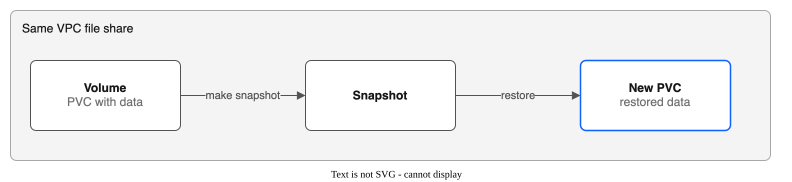

---

## Prerequisites

- The console plugin is on. In the chart it is `consolePlugin.enabled` (the default). In the console, the menu **Storage** shows **IBM VPC File Pools**. See [Part 8](TUTORIAL-08-MIGRATION-AND-CONSOLE.md) if it does not.

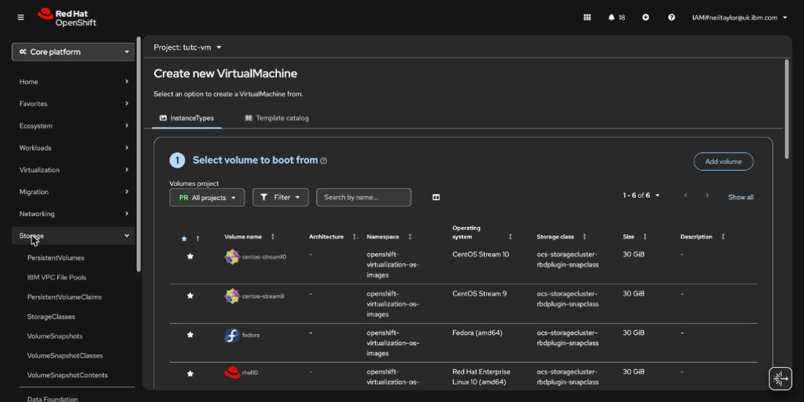

The page opens on the **Overview** tab. The other tabs are **Pools**, **SubVolumes**, **Snapshots**, **Replication**, **Backups**, **Monitoring** and **PoolBench**.

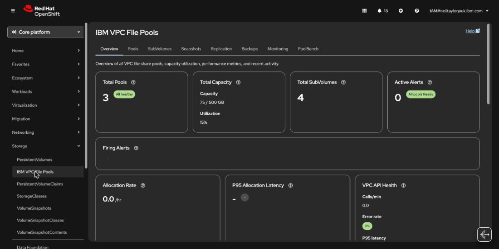
- A pool and a StorageClass, and a VolumeSnapshotClass for the driver (the chart makes `ibm-vpc-file-pool`). See [Part 1](TUTORIAL-01-POOL-CREATION.md).
- `oc`, to write and read files. You can do those steps in the console terminal instead.

---

## Step 1: Make a volume with data

```bash
export NS=pool-tutorial-console
oc create namespace ${NS}

cat <<EOF | oc apply -n ${NS} -f -
apiVersion: v1
kind: PersistentVolumeClaim
metadata:
  name: app-data
spec:
  storageClassName: ibm-vpc-file-pool
  accessModes: [ReadWriteMany]
  resources:
    requests:
      storage: 1Gi
---
apiVersion: v1
kind: Pod
metadata:
  name: app
spec:
  containers:
    - name: app
      image: registry.access.redhat.com/ubi9/ubi-minimal:latest
      command: ["/bin/bash", "-c", "echo before > /data/state; sleep 36000"]
      volumeMounts:
        - name: data
          mountPath: /data
  volumes:
    - name: data
      persistentVolumeClaim:
        claimName: app-data
EOF

oc wait -n ${NS} --for=condition=Ready pod/app --timeout=300s
oc exec -n ${NS} app -- cat /data/state
```

Change `storageClassName` if your pool has another StorageClass.

**Expected:** the first command prints a PodSecurity warning (the pod has no security context, and the namespace allows it). The pod is made. The last two commands print:

```
pod/app condition met
before
```

---

## Step 2: Make the snapshot in the console

1. Open **Storage**, then **IBM VPC File Pools**, then the **Snapshots** tab.

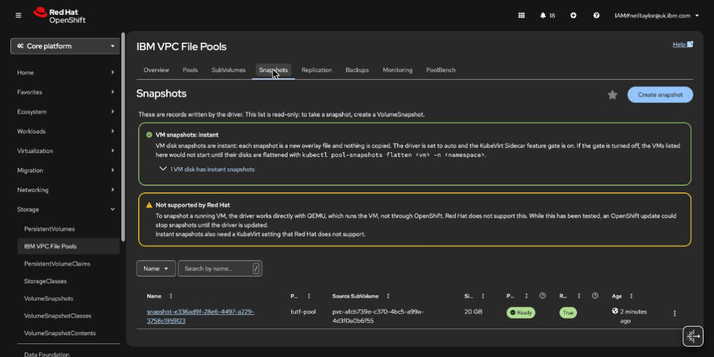

2. Choose **Create snapshot**.
3. Under **Source volume**, choose `pool-tutorial-console/app-data`. The list shows claims on a StorageClass of this driver, and also the temporary claims that CDI makes in `openshift-virtualization-os-images`.
4. The **Name** box is empty (`my-snapshot` is only a hint, and **Create** stays off). Type `app-data-before`. The snapshot goes in the namespace of the claim.

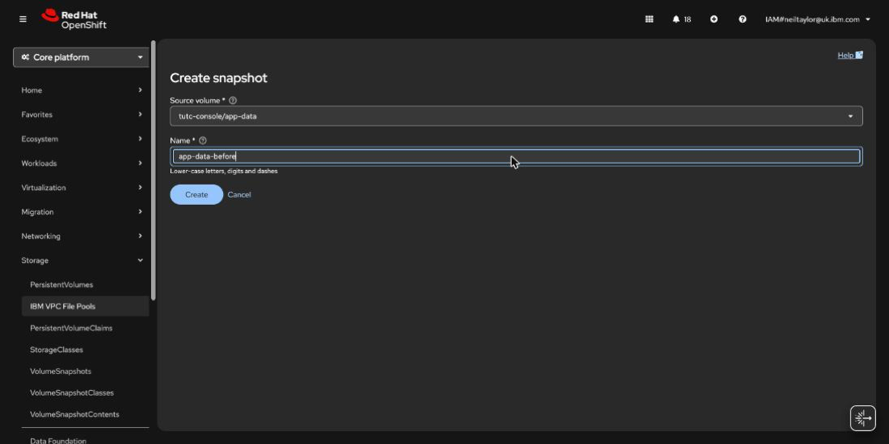

5. Choose **Create**.

If the page says **No snapshot class for this driver**, make a VolumeSnapshotClass first (the chart makes one when `volumeSnapshotClass.create` is true).

**Expected:** the console opens the page of the `VolumeSnapshot` `app-data-before`. Its status is **Ready** after a few seconds, with size 1 GiB.

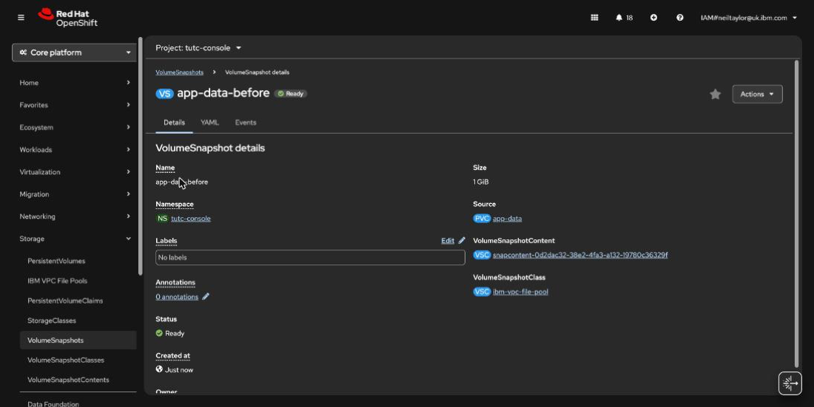

The **Snapshots** tab of IBM VPC File Pools then lists the driver's own record of it. That record is named `snapshot-<uuid>`, not `app-data-before`. Its **Ready** column is `True` when the copy has ended. A snapshot of a plain volume is a copy of its folder (a Job runs it), so a large volume takes time. A snapshot of a VM disk is a QEMU copy or an instant snapshot. See [CONTEXT.md](CONTEXT.md#snapshot).

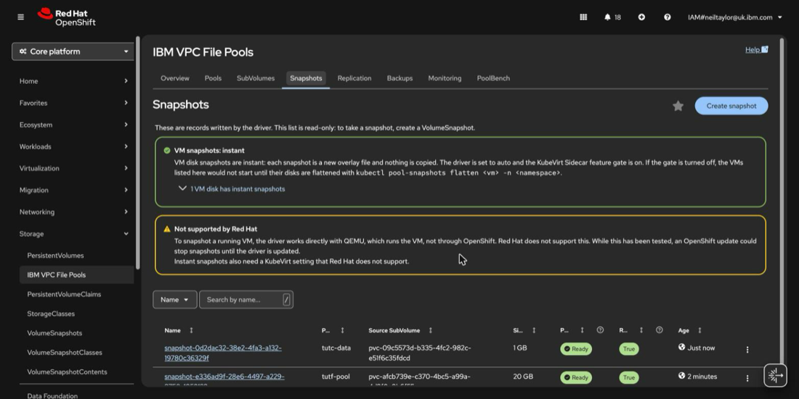

Check from a terminal:

```bash
oc get volumesnapshot -n ${NS}
```

```
NAME              READYTOUSE   SOURCEPVC   SOURCESNAPSHOTCONTENT   RESTORESIZE   SNAPSHOTCLASS       SNAPSHOTCONTENT                                    CREATIONTIME   AGE
app-data-before   true         app-data                            1Gi           ibm-vpc-file-pool   snapcontent-0d2dac32-38e2-4fa3-a132-19780c36329f   11s            11s
```

---

## Step 3: Change the volume

```bash
oc exec -n ${NS} app -- bash -c 'echo after > /data/state; echo new > /data/new-file'
oc exec -n ${NS} app -- cat /data/state
```

**Expected:** `after`.

---

## Step 4: Restore the snapshot to a new PVC

1. On the **Snapshots** tab, open the row menu (the three dots) of the snapshot record. The menu has **View Details**, **Restore to new PVC** and **Delete**.

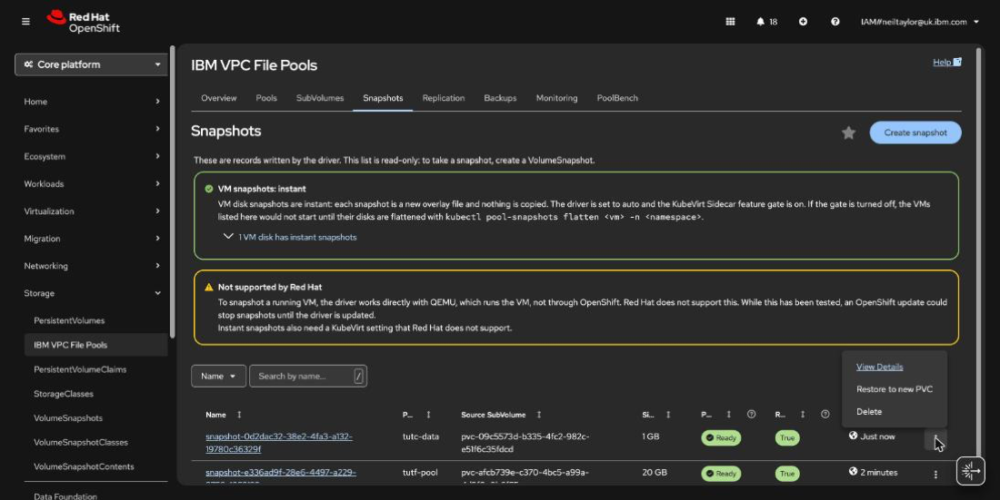

2. Choose **Restore to new PVC**.

The button is off, with a reason, in two cases: the snapshot is not ready yet, or no `VolumeSnapshot` points to it. A `Snapshot` object made directly, without a `VolumeSnapshot`, has none. Create a `VolumeSnapshot` for it first.

The form has defaults:

| Field | Default | Notes |
|-------|---------|-------|
| **Name** | `<source claim>-restored` | The name of the new claim. It must not exist. |
| **Namespace** | The snapshot's namespace | You cannot change it. This is a Kubernetes rule. |
| **Size (GiB)** | The snapshot's size | You can make it bigger, not smaller. |
| **Storage class** | The class of the source claim | Only classes of this driver are offered. |
| **Access mode** | From the source claim | |
| **Volume mode** | From the source claim | |

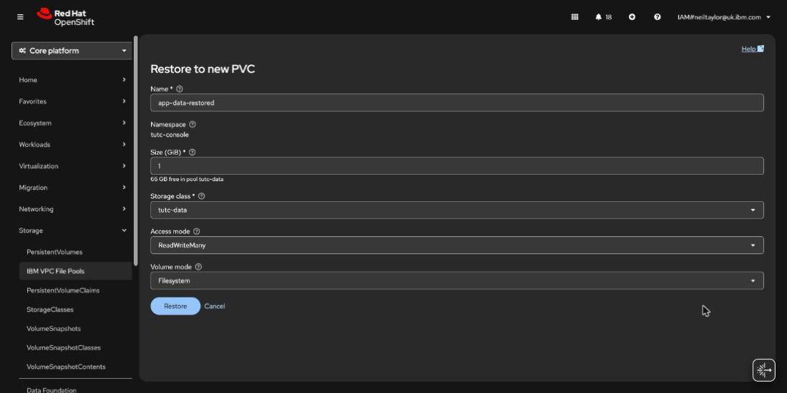

3. Leave the defaults and choose **Restore**.

If a VM uses the source claim, the form shows a warning. The warning says the snapshot may be a plain file copy that does not boot. That text is older than the driver. A snapshot of a running VM's disk is now a QEMU copy or an instant snapshot. Check `status.consistency` of the `Snapshot` (`FileSystemConsistent` is best) before you rely on it.

**Expected:** the page shows a banner. It first says **Restoring: the copy is starting**, with the line that the claim stays `Pending` until the copy ends.

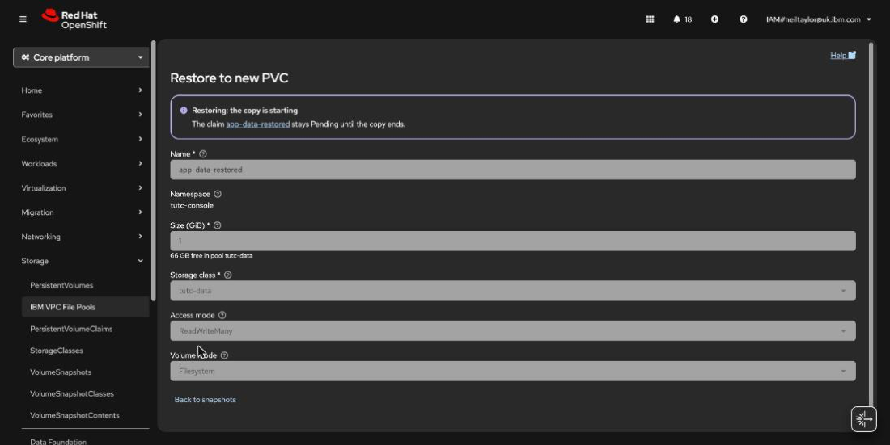

For this 1 GiB volume it said **The restored volume is ready** after about 10 seconds. A bigger volume shows a progress bar with the bytes copied in between. If the copy fails, the banner shows the error and keeps the claim. The action only makes a new claim. It never replaces an existing volume.

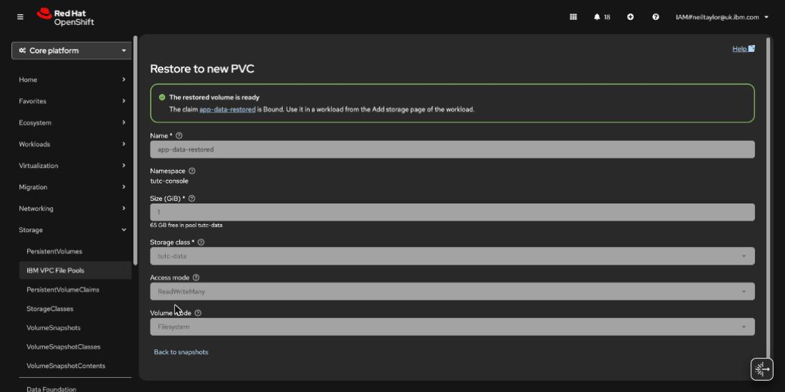

Check the claim:

```bash
oc get pvc -n ${NS}
```

**Expected:** `app-data` and `app-data-restored`, both `Bound`:

```
NAME                STATUS   VOLUME                                     CAPACITY   ACCESS MODES   STORAGECLASS   VOLUMEATTRIBUTESCLASS   AGE
app-data            Bound    pvc-09c5573d-b335-4fc2-982c-e51f6c35fdcd   1Gi        RWX            tutc-data      <unset>                 103s
app-data-restored   Bound    pvc-05a88e4b-bd41-4f0a-8ee3-bad4a87e2454   1Gi        RWX            tutc-data      <unset>                 12s
```

---

## Step 5: Check the data

```bash
cat <<EOF | oc apply -n ${NS} -f -
apiVersion: v1
kind: Pod
metadata:
  name: check
spec:
  restartPolicy: Never
  containers:
    - name: check
      image: registry.access.redhat.com/ubi9/ubi-minimal:latest
      command: ["/bin/bash", "-c", "cat /data/state; ls /data"]
      volumeMounts:
        - name: data
          mountPath: /data
  volumes:
    - name: data
      persistentVolumeClaim:
        claimName: app-data-restored
EOF

oc wait -n ${NS} --for=jsonpath='{.status.phase}'=Succeeded pod/check --timeout=300s
oc logs -n ${NS} check
```

**Expected:** the log shows `before` and a listing with `state` only. The file `new-file` is not there, because it was made after the snapshot.

```
pod/check condition met
before
state
```

---

## Clean up

Delete the snapshot first, because it holds space on the share until you delete it. A pool cannot be deleted while snapshots exist on it. You can delete it in the console (**Snapshots** tab, row menu, **Delete**), or with `oc`:

```bash
oc delete volumesnapshot -n ${NS} app-data-before
oc delete namespace ${NS}
```

The namespace delete removes the PVCs and the pods.

---

## What you learned

- You can make and restore a snapshot from the console.
- A restore always makes a new claim, and the claim waits until the copy ends.
- This page restores snapshots. Backups restore in the console on the Backups tab ([Part 16](TUTORIAL-16-CONSOLE-BACKUPS-CLONES-RECEIVER.md)) or with `kubectl backup restore`.

## Next

- [Part 16: Backups, clones and replication setup in the console](TUTORIAL-16-CONSOLE-BACKUPS-CLONES-RECEIVER.md)
- [Part 10: Backup and restore](TUTORIAL-10-BACKUP-AND-RESTORE.md)
- [Part 2: Snapshots and clones](TUTORIAL-02-SNAPSHOTS-AND-CLONES.md) does the same with YAML.
