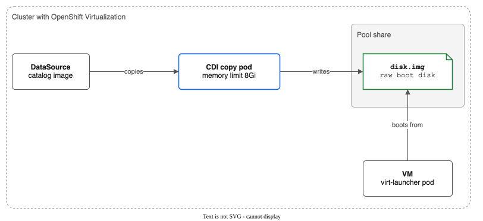

# Part 15: Make a VM from the Catalog on a Pool

> **Tutorial Series:** [Index](TUTORIAL.md) | [Part 1: Pool Creation](TUTORIAL-01-POOL-CREATION.md) | **Part 15**

Make a virtual machine (VM) from the OpenShift Virtualization catalog, with its boot disk on a pool. You pick an image and an instance type, and you choose the pool's StorageClass for the boot disk. CDI (the Containerized Data Importer) copies the image onto the pool. Then the VM starts. This is the recommended way to make a VM on a pool. The driver needs no special image setup.



**Time:** about 30 minutes, most of it waiting for the image copy. On rovslab (24 October 2026, driver v0.14.1, OpenShift 4.21), the copy of the CentOS Stream 9 image onto a 100-IOPS share took about 13 minutes for the first VM and about 7 minutes for a second VM.
**Status:** Beta. See [FEATURES.md](FEATURES.md) (the CDI copy limit feature). This page was run end to end on rovslab on 24 October 2026, both in the console and with YAML.
**Scope:** this page makes a VM from a catalog image. It does not use the pool's golden images, which are hidden. See [FEATURES.md](FEATURES.md).

---

## Prerequisites

- The driver runs on the cluster ([Part 1](TUTORIAL-01-POOL-CREATION.md)).
- OpenShift Virtualization is installed. Check that its `HyperConverged` object exists:

```bash
oc get hyperconverged -n openshift-cnv
```

**Expected:** one object named `kubevirt-hyperconverged`.

- A login that can make a namespace, a VM and read cluster-wide objects such as StorageProfiles.

---

## Step 1: Use a pool that suits VMs

A VM disk needs a pool whose folders belong to the QEMU user. KubeVirt runs QEMU as user and group 107. The pool must set `defaultUID: 107`, `defaultGID: 107` and `defaultPermissions: "0777"`. Without them, the VM can fail to start with `preparing host-disks failed: chown ... operation not permitted` ([KNOWN-LIMITATIONS.md](KNOWN-LIMITATIONS.md#kubevirt-nfs-permissions-root_squash)).

If you have the pool from [Part 1](TUTORIAL-01-POOL-CREATION.md), it already sets them. Check:

```bash
export POOL_NAME=my-pool
oc get filesharepool ${POOL_NAME} \
  -o jsonpath='{.spec.defaultUID}{" "}{.spec.defaultGID}{" "}{.spec.defaultPermissions}{"\n"}'
```

**Expected:** `107 107 0777`.

If you have no pool yet, make one. Use the zone of your workers (`oc get nodes -L topology.kubernetes.io/zone`). The share must hold the VM disk, so the example makes a 100 GB share. More IOPS make the image copy faster.

```bash
cat <<EOF | oc apply -f -
apiVersion: storage.ibmcloud.io/v1alpha1
kind: FileSharePool
metadata:
  name: ${POOL_NAME}
spec:
  zone: eu-de-1
  profile: dp2
  shareSizeGB: 100
  iops: 3000
  maxShares: 3
  initialShares: 1
  autoExpand: true
  expandThresholdPercent: 80
  allocationStrategy: spread
  defaultPermissions: "0777"
  defaultUID: 107
  defaultGID: 107
EOF

oc get filesharepools -w
```

**Expected:** `PHASE` shows `Ready` after the first share is made. [Part 1](TUTORIAL-01-POOL-CREATION.md) explains each field.

---

## Step 2: Check the StorageClass and the CDI StorageProfile

The controller makes a StorageClass with the name of the pool. A pool with tiers gets one StorageClass for each tier, named `<pool>-<tier>`.

```bash
oc get sc ${POOL_NAME}
```

**Expected:** one StorageClass with the provisioner `vpc-file-pool.csi.ibm.io`.

CDI makes a StorageProfile for each StorageClass. A StorageProfile tells CDI which access mode and volume mode to ask for when it makes a disk. The controller patches the profile of every pool StorageClass when CDI is installed.

```bash
oc get storageprofile ${POOL_NAME} -o jsonpath='{.spec}{"\n"}'
```

**Expected:** the output holds `"claimPropertySets":[{"accessModes":["ReadWriteMany"],"volumeMode":"Filesystem"}]` and `"cloneStrategy":"csi-clone"`.

If the StorageProfile is not found, CDI has not made it yet. The controller patches it on a later reconcile, so check again in a minute. If the fields stay empty, read the controller log:

```bash
oc logs -n kube-system -l app.kubernetes.io/name=ibm-vpc-file-pool-csi,app.kubernetes.io/component=controller \
  -c csi-controller --tail=200 | grep -i storageprofile
```

---

## Step 3: Check the copy pod memory limit

CDI's copy pods have a default memory limit of 600 MB. When a copy pod writes onto NFS, the file cache counts against that limit, and the pod is killed for lack of memory (`OOMKilled`). The controller keeps the limit at least 8Gi. It sets `limits.memory` in the `storageWorkloads` field of the `HyperConverged` object. It checks at start-up and every 5 minutes. It only raises the limit and never lowers it. The Helm value is `cdi.copyPodMemoryLimit` (default `8Gi`).

```bash
oc get hyperconverged -n openshift-cnv kubevirt-hyperconverged \
  -o jsonpath='{.spec.resourceRequirements.storageWorkloads}{"\n"}'

oc get cdi -o jsonpath='{.items[0].spec.config.podResourceRequirements}{"\n"}'
```

**Expected:** both outputs show `limits.memory` of `8Gi` or more.

On ROVS, IBM manages the virtualization add-on, and IBM says it cannot be modified. The driver changes one field of the `HyperConverged` object that IBM's add-on makes. After an add-on update, check the limit again. If the controller must not change `HyperConverged`, set `cdi.copyPodMemoryLimit=""`. Then catalog copies of large disks onto the pool fail. See [KNOWN-LIMITATIONS.md](KNOWN-LIMITATIONS.md#cdi-containerized-data-importer-compatibility).

---

## Step 4: Make the VM in the console

1. Make a project (namespace) for the VM. The steps below use `pool-tutorial-vm`.

```bash
export NS=pool-tutorial-vm
oc create namespace ${NS}
```

2. In the OpenShift console, open **Virtualization**, then **Catalog**, in the project `pool-tutorial-vm`. The page is called **Create new VirtualMachine**. Stay on the **InstanceTypes** tab.
3. Under **Select volume to boot from**, choose a catalog image, such as `centos-stream9` or `rhel9`.
4. Under **Select InstanceType**, keep the default (for example **U series**, `u1.medium`) or choose another.
5. Under **VirtualMachine details**, set **Name**, and set **Storage class** to the pool's StorageClass. It has the name of the pool (`my-pool` in the example). Keep the **Disk size**, or make it bigger.
6. Choose **Create VirtualMachine**.

These labels are from OpenShift 4.21. Other versions can name them differently. The three choices are the same: the image, the instance type and the StorageClass of the boot disk.

Go to [Step 6](#step-6-watch-the-copy) to watch the copy.

---

## Step 5: Make the same VM with YAML (optional)

The console makes a `VirtualMachine` with a `dataVolumeTemplate`. The template has a `sourceRef` that points to a catalog `DataSource`. You can make the same object with `oc`.

List the catalog DataSources. The catalog images are in the namespace `openshift-virtualization-os-images`:

```bash
oc get datasource -n openshift-virtualization-os-images
```

Pick one and set its name. The names depend on your cluster, so this page does not give one.

```bash
export DS=<name from the list>
```

A DataSource can carry the names of a default instance type and a default preference. Read them:

```bash
oc get datasource ${DS} -n openshift-virtualization-os-images \
  -o jsonpath='{.metadata.labels.instancetype\.kubevirt\.io/default-instancetype}{"\n"}{.metadata.labels.instancetype\.kubevirt\.io/default-preference}{"\n"}'
```

If a name is empty, list the choices and pick one:

```bash
oc get virtualmachineclusterinstancetype
oc get virtualmachineclusterpreference
```

```bash
export INSTANCETYPE=<instance type name>
export PREFERENCE=<preference name>
```

Make the VM. The `storage` block leaves out the access mode and the volume mode. CDI takes them from the StorageProfile of Step 2, which is why that profile matters. Make the size at least as big as the image needs.

```bash
cat <<EOF | oc apply -n ${NS} -f -
apiVersion: kubevirt.io/v1
kind: VirtualMachine
metadata:
  name: catalog-vm
spec:
  runStrategy: Always
  instancetype:
    name: ${INSTANCETYPE}
  preference:
    name: ${PREFERENCE}
  dataVolumeTemplates:
    - metadata:
        name: catalog-vm-rootdisk
      spec:
        sourceRef:
          kind: DataSource
          name: ${DS}
          namespace: openshift-virtualization-os-images
        storage:
          storageClassName: ${POOL_NAME}
          resources:
            requests:
              storage: 30Gi
  template:
    spec:
      domain:
        devices:
          disks:
            - name: rootdisk
              disk:
                bus: virtio
      volumes:
        - name: rootdisk
          dataVolume:
            name: catalog-vm-rootdisk
EOF
```

**Expected:** `virtualmachine.kubevirt.io/catalog-vm created`. If the instance type is namespaced rather than cluster-wide in your cluster, add `kind: VirtualMachineInstancetype` under `instancetype`, and the same for the preference. Check the fields against the `VirtualMachine` CRD with `oc explain virtualmachine.spec.instancetype`.

---

## Step 6: Watch the copy

```bash
oc get datavolume -n ${NS} -w
```

**Expected:** the DataVolume of the VM moves through its phases, and the `PROGRESS` column rises until the phase is `Succeeded`. In the console, the VM page shows the same progress.

Look at the pods and the PVC while it runs:

```bash
oc get pods,pvc -n ${NS}
```

**Expected:** the PVC `catalog-vm-rootdisk` is `Pending` while the copy runs, and becomes `Bound` when the DataVolume is `Succeeded` (the PVC and the DataVolume have the same name). CDI copies into a temporary claim on the pool, then hands the volume to your PVC. The CDI pods and the temporary claim are in the namespace of the catalog images, not in `${NS}`:

```bash
oc get pods,pvc -n openshift-virtualization-os-images
```

If you used the console, the PVC has the name of the VM with `-volume` added (for example `console-vm-volume`). It is also on the VM's **Storage** tab.

If the CDI pod restarts and the progress goes back to zero, go to [If the copy fails](#if-the-copy-fails).

---

## Step 7: Check that the VM boots and has its guest agent

```bash
export VM=catalog-vm
oc get vmi -n ${NS} ${VM}
oc get vmi -n ${NS} ${VM} \
  -o jsonpath='{.status.conditions[?(@.type=="AgentConnected")].status}{"\n"}'
```

**Expected:** the VMI is `Running`, and the second command prints `True`. The guest agent starts a little after the guest boots, so repeat the second command if it prints nothing. If you used the console, change `VM` to the name of your VM.

For a look at the screen, open the VM in the console and choose its **Console** tab.

---

## Step 8: Find the boot disk on the pool

Each PVC on a pool has a `SubVolume` object. The SubVolume has the name of the PV that the PVC uses. SubVolumes are cluster-wide, so you need no namespace.

```bash
export PVC=catalog-vm-rootdisk
export PV=$(oc get pvc -n ${NS} ${PVC} -o jsonpath='{.spec.volumeName}')
oc get subvolume ${PV} -o jsonpath='{.spec.poolName}{" "}{.spec.shareID}{" "}{.spec.subPath}{" "}{.status.phase}{"\n"}'
```

**Expected:** the name of your pool, a share ID, a folder such as `/pvcs/pvc-<uuid>`, and the phase `Bound`. The disk is the file `disk.img` in that folder, on that share.

See the file from inside the VM's pod. The VM's `virt-launcher` pod has the disk under `/var/run/kubevirt-private/vmi-disks/<disk name>/`:

```bash
LAUNCHER=$(oc get pods -n ${NS} -l vm.kubevirt.io/name=${VM} -o name | head -1)
oc exec -n ${NS} ${LAUNCHER} -c compute -- ls -l /var/run/kubevirt-private/vmi-disks/
```

**Expected:** one folder for each disk. For the YAML of Step 5, and for a VM made in the console, it is `rootdisk`. List that folder to see `disk.img`:

```bash
oc exec -n ${NS} ${LAUNCHER} -c compute -- ls -l /var/run/kubevirt-private/vmi-disks/rootdisk/
```

**Expected:** a file `disk.img`. CDI wrote it in raw format. KubeVirt needs raw format for a disk on a file system, and CDI converts the catalog image for you.

---

## If the copy fails

**The CDI pod shows `OOMKilled`, the DataVolume keeps restarting, and the progress goes back to zero.** The memory limit of the copy pods is too low. The limit is too low if `cdi.copyPodMemoryLimit` is empty, if the controller cannot patch `HyperConverged`, or if something put the old value back, such as an update of IBM's add-on on ROVS.

1. Run the two checks of [Step 3](#step-3-check-the-copy-pod-memory-limit).
2. Check that `cdi.copyPodMemoryLimit` is not empty.
3. Check that the controller's ClusterRole allows `get`, `list` and `patch` on `hco.kubevirt.io` `hyperconvergeds`.
4. The controller corrects the limit within 5 minutes. Restart the controller to make it check at once.
5. Look for a warning in the controller log, and check the metric `vpc_file_pool_cdi_copy_limit_raised_total`:

```bash
oc logs -n kube-system -l app.kubernetes.io/name=ibm-vpc-file-pool-csi,app.kubernetes.io/component=controller \
  -c csi-controller | grep -i "CDI copy pod memory limit"
```

6. If a raise happens again and again, something resets the value. On ROVS, ask IBM support.
7. Delete the failed DataVolume and make the VM again. The copy starts from zero:

```bash
oc delete datavolume -n ${NS} catalog-vm-rootdisk
```

The full steps are in [TROUBLESHOOTING.md](TROUBLESHOOTING.md#cdi-copy-pod-oomkilled-when-a-vm-disk-is-copied-onto-a-pool).

**The VM says "No bootable device".** The disk is not in raw format. CDI converts the catalog image, so check the DataVolume with `oc describe datavolume -n ${NS} catalog-vm-rootdisk`. See [TROUBLESHOOTING.md](TROUBLESHOOTING.md).

**The VM does not start and the event names a `chown` error.** The pool does not set `defaultUID: 107`. Go back to [Step 1](#step-1-use-a-pool-that-suits-vms).

---

## Clean up

Delete the VM first. The DataVolume that the VM made goes with it, then its PVC, then its SubVolume.

```bash
oc delete vm -n ${NS} catalog-vm
oc get pvc -n ${NS}
oc get subvolume ${PV}
```

**Expected:** the PVC list is empty. The last command says the SubVolume is not found. If you made the VM in the console, delete it there, or use the name of your VM.

```bash
oc delete namespace ${NS}
```

If you made the pool only for this page, delete it after the namespace is gone. A pool cannot be deleted while volumes exist on it, and deleting a pool deletes its VPC shares:

```bash
oc delete filesharepool ${POOL_NAME}
```

---

## What you learned

- A VM from the catalog needs only a pool with `defaultUID: 107`, `defaultGID: 107` and `defaultPermissions: "0777"`, and the pool's StorageClass for the boot disk.
- The controller patches the CDI StorageProfile of the pool's StorageClass, and keeps the memory limit of CDI's copy pods at 8Gi or more.
- The boot disk is one raw file, `disk.img`, in the folder of the volume's SubVolume.
- On ROVS, check the copy pod limit again after an update of the add-on.

## Next

- [Part 14: Restore a snapshot in the console](TUTORIAL-14-CONSOLE-RESTORE.md)
- [Part 1: Pool creation, PVCs and KubeVirt VMs](TUTORIAL-01-POOL-CREATION.md) writes a disk image onto a pool by hand.
- [KNOWN-LIMITATIONS.md](KNOWN-LIMITATIONS.md#cdi-containerized-data-importer-compatibility) has the measured results for CDI.
