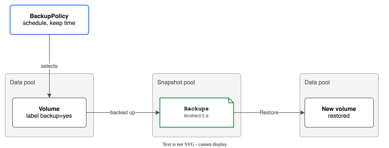
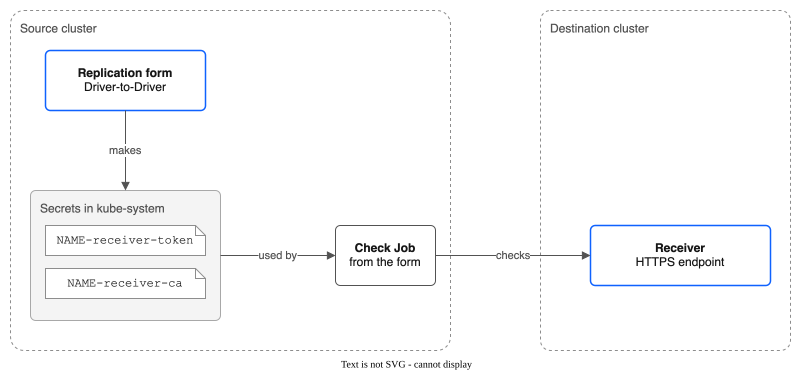

# Part 16: Backups, Clones and Replication Setup in the Console

> **Tutorial Series:** [Index](TUTORIAL.md) | [Part 6: Replication & Failover](TUTORIAL-06-REPLICATION-AND-FAILOVER.md) | [Part 10: Backup and Restore](TUTORIAL-10-BACKUP-AND-RESTORE.md) | [Part 14: Restore a Snapshot in the Console](TUTORIAL-14-CONSOLE-RESTORE.md) | **Part 16**

Do three jobs in the OpenShift console, with no YAML. First, back up a volume on a schedule, restore it, and delete its backups. Second, clone a volume to a new PVC. Third, set up a replication receiver: paste its token and certificate, let the console make the Secrets, and check the connection. The words backup, moment, restore point and snapshot pool are defined in [CONTEXT.md](CONTEXT.md).



**Time:** about 45 minutes for parts A and B, most of it waiting for backups. Part C needs a second cluster.
**Status:** backups are Experimental ([BACKUP-RECOVERY.md](BACKUP-RECOVERY.md)). This page was run end to end on rovslab on 24 October 2026 (driver v0.14.1, OpenShift 4.21), with a second cluster for part C.
**Scope:** the console does not run `kubectl backup cos-setup`. Part A shows what the COS tab does and links to the commands.

---

## Prerequisites

- The console plugin is on. In the console, the menu **Storage** shows **IBM VPC File Pools** ([Part 8](TUTORIAL-08-MIGRATION-AND-CONSOLE.md)).
- The data pool, the snapshot pool and the labelled volume of [Part 10](TUTORIAL-10-BACKUP-AND-RESTORE.md), Steps 1 to 3. They give you the namespace `pool-tutorial-backup`, the pools `tut-data` and `tut-backups`, and the PVC `files` with the label `backup=yes`. The steps below use those names.
- `oc`, to check the results. You can use the console terminal instead.
- Your login may create `BackupPolicy` and `BackupRestore` objects. Without the right, the console switches the button off, names the missing right and shows YAML for an administrator.
- For part C only: a second cluster with a running replication receiver ([Part 6](TUTORIAL-06-REPLICATION-AND-FAILOVER.md), Step 6a to 6c).

```bash
export NS=pool-tutorial-backup
export POLICY=tut-console
oc get pvc -n ${NS} files --show-labels
```

**Expected:** `files` is `Bound` and has the label `backup=yes`.

---

# Part A: Backups

## Step 1: Open the Backups tab

Open **Storage**, then **IBM VPC File Pools**, then the **Backups** tab. The list is empty, and says "No BackupPolicies found".

---

## Step 2: Make a policy with the form

1. Choose **Create BackupPolicy**.
2. Fill in the form:

| Field | What to enter |
|-------|---------------|
| **Name** | `tut-console`. The name is also a label value on the volumes the policy backs up, so you cannot change it later. |
| **Snapshot pool** | `tut-backups`. Only a pool that holds no workload claims and has a ready share can be chosen. The other pools are listed but switched off, with the reason. |
| **Schedule** | Choose **Custom** and type `5m`. The presets are `1h`, `6h`, `12h` and `24h`. The least is 1 minute. |
| **Keep for** | `48h`. The links under the box (**1 day**, **7 days**, **30 days**) fill it in. The least is 1 hour. |
| **Labels** | Key `backup`, value `yes`, then **Add label**. A policy with no labels is refused. |
| **Namespaces** | `pool-tutorial-backup`. Empty means all namespaces. |
| **VM copy speed limit (MB/s per disk)** | Leave it. It matters only for VM disks. |

3. Look under **Labels**. A line counts the claims that match. It says `1 claim matches.` If it says `No claim matches yet. Check the labels.`, the label is wrong.
4. The blue box at the top of the form says that backups stop when the snapshot pool is more than 85% full. Nothing is deleted to make room, and backups start again when the use falls to 85% or less.
5. Choose **Create**.

The form checks the same limits as the admission webhook. If the webhook still refuses the policy, the page shows its message under **Creation failed**.

**Expected:** the page of the policy opens. Its **Phase** shows `Unknown` for a few seconds, then `Active`. Check from a terminal:

```bash
oc get backuppolicy ${POLICY}
```

**Expected:** `PHASE` is `Active`. If it is `Error`, the page shows a red banner with the reason. The usual cause is a snapshot pool that is not `Ready` yet.

---

## Step 3: Read the list and the policy page

Go back to the **Backups** tab. The list has one row for each policy, with these columns:

| Column | Meaning |
|--------|---------|
| **Name** | A link to the policy page. |
| **Snapshot Pool**, **Schedule**, **Keep** | The settings of the policy. |
| **Phase** | `Active`, `Suspended` or `Error`. |
| **Volumes** | How many volumes the policy backs up. |
| **Stalest Backup** | How old the oldest "last backup" is. It says `No backup yet` until the first backup ends. |
| **Export** | `On` or `Off`: whether the policy also sends backups to COS. |

When a policy is in the `Error` phase because its snapshot pool is more than 85% full, a red banner above the table says so and links to the pool.

Open the policy. The **Overview** tab shows the settings (**Snapshot Pool**, **Schedule**, **Keep**, **Volumes picked by label**, **Namespaces**, **VM Copy Speed Limit**, **Export to COS**). Below them is a table with one row for each volume:

| Column | Meaning |
|--------|---------|
| **Claim** | `namespace/name` of the PVC. A volume that the policy no longer backs up says `No longer backed up, kept until <date>`. |
| **VM** | The VM that uses the disk, or `-`. |
| **Last Backup**, **Oldest Backup** | How long ago. A restore can go back as far as the oldest. |
| **Restore Points** | How many older moments, besides the newest, a restore can go back to. |
| **Size** | What the newest backup wrote, for a VM disk. A plain volume shows `-`: its file copy does not count bytes. |
| **Consistency** | `File copy` for a plain volume. `File-system consistent` or `Crash consistent` for a VM disk. A crash consistent copy has an orange label. |
| **Error** | The last error, or `-`. |
| **Export** | The COS state of the volume. |

**Expected:** the table has one row, `pool-tutorial-backup/files`. Its **Consistency** is `File copy` once the first backup ends. The first backup takes as long as the first copy. A new backup is made every 5 minutes.

Wait until **Last Backup** shows a time. Then wait for **Restore Points** to reach `1`, which takes one more cycle.

---

## Step 4: Suspend and resume the policy

Suspend stops new backups. The backups that exist stay.

1. On the policy page, choose **Suspend**. Or open the menu (the three dots) of the policy on the **Backups** list and choose **Suspend**.

**Expected:** **Phase** is `Suspended`, and the page shows an information box **Backups are suspended**. The button now reads **Resume**. The phase can take up to 20 seconds to change on the page.

2. Choose **Resume**.

**Expected:** **Phase** is `Active` again.

The same menu has **View Details**, **Edit** and **Delete**. **Edit** opens the same form, with the name switched off.

---

## Step 5: Restore a volume with the Restore form

A restore makes a new PVC. It never writes over a volume that exists.

1. On the policy page, open the menu (the three dots) of the row `pool-tutorial-backup/files` and choose **Restore**.

The page is called **Restore from a backup**. The fields:

| Field | Default and notes |
|-------|-------------------|
| **Volume** | The volume you chose. A volume that is gone is listed too, with `(no longer backed up)`, until its backups pass the keep time. A line below shows the oldest and the newest backup. |
| **Latest backup** / **At a moment** | **Latest backup** is on. With **At a moment**, a **Moment** field appears. Choose a time in your time zone. The restore uses the newest backup at or before it. The page refuses a time before the oldest backup. |
| **Namespace** | The namespace of the backed-up claim. |
| **New claim name** | `files-restored`. The page refuses a name that exists. |
| **Storage class** | **Same as the backed-up claim**, with the class name. Only classes of this driver are offered. |

2. Leave the defaults and choose **Restore**.
3. A box asks **Restore from this backup?** It says that a new claim is made, that nothing is overwritten, and that the copy takes time. Choose **Restore**.

**Expected:** a banner follows the restore through these titles:

1. `Restoring: the request is starting`
2. `Restoring: making the new volume`
3. `Restoring: copying the backup into the new volume`
4. `The restored volume is ready`, with the line `Restored the latest backup, from <time>.`

If the restore fails, the banner is red and says `The restore failed` with the message. Nothing was written over an existing volume. The banner links to the new claim. Choose **Back to the policy** to leave the page.

Check from a terminal:

```bash
oc get backuprestore
oc get pvc -n ${NS}
```

**Expected:** one `BackupRestore` with `PHASE` `Done`, and the PVC `files-restored`.

---

## Step 6: Check the restored data

```bash
cat <<EOF | oc apply -n ${NS} -f -
apiVersion: v1
kind: Pod
metadata:
  name: files-check
spec:
  restartPolicy: Never
  containers:
    - name: check
      image: registry.access.redhat.com/ubi9/ubi-minimal:latest
      command: ["/bin/bash", "-c"]
      args: ["cat /data/a/1; ls /data"]
      volumeMounts:
        - name: data
          mountPath: /data
  volumes:
    - name: data
      persistentVolumeClaim:
        claimName: files-restored
EOF

oc wait -n ${NS} --for=jsonpath='{.status.phase}'=Succeeded pod/files-check --timeout=300s
oc logs -n ${NS} files-check
```

**Expected:** the output is `first`, then a listing with `a`, `keep` and `written`. A pod that mounts the new claim does not start until the restore ends.

To restore an earlier moment, repeat Step 5 and choose **At a moment**. The line under **Volume** shows the oldest and the newest backup. Enter a time in your own time zone.

---

## Step 7: Delete the backups of a volume

**Delete backups** is the only destructive action of the Backups tab. It removes all backups of one volume, for good. The volume itself is not touched.

First see the refusal. The policy still backs up `files`, so:

1. On the policy page, open the menu of the row `pool-tutorial-backup/files` and choose **Delete backups**.

**Expected:** the box is called **Delete backups of pool-tutorial-backup/files**. It shows a warning, **The backups of this volume cannot be removed now**, and the text `Policy tut-console still backs up pool-tutorial-backup/files: remove the label that selects it, or delete the policy, wait for the next backup cycle, then try again.` Nothing starts. Close the box.

The box also refuses while a restore of the volume has not ended. The text is `Restore <name> of <claim> has not ended; wait for it, then try again.`

Now stop the policy from backing up the volume. Remove the label, and wait for one backup cycle (5 minutes):

```bash
oc label pvc -n ${NS} files backup-
```

**Expected:** after one cycle, the row of the volume says `No longer backed up, kept until <date>`.

2. Open **Delete backups** on the row again. The console starts a short Job in `kube-system` that only measures the backups. The box says `Measuring the backups on the snapshot pool...`.
3. When the measure ends, a red box says `This removes all backups of pool-tutorial-backup/files from policy tut-console, for good`. It shows the two folders, the size and the number of moments.
4. Type `pool-tutorial-backup/files` in the box. The button **Delete backups** turns on only when the text matches exactly.
5. Choose **Delete backups**.

**Expected:** the box says `Removing the backups on the snapshot pool...`, then **The backups are removed**, with `Removed the backups of pool-tutorial-backup/files (<size>).` The console removes its Jobs when they end. If the folders are empty, the box says **No backup data found** and stops. If the delete fails, it says **The delete stopped**. You can try again.

The Jobs run in `kube-system` with your own rights. Without them, the box names the missing rights and shows the command `kubectl backup delete --policy tut-console --pvc pool-tutorial-backup/files` for an administrator. After a policy is deleted, its status no longer says where its backups are. Then use `kubectl backup delete --pool ... --volume ...` ([Part 10](TUTORIAL-10-BACKUP-AND-RESTORE.md)).

---

## Step 8: Look at the COS tab

A policy can also send its backups, encrypted, to an IBM Cloud Object Storage (COS) bucket. Open the policy and choose the **COS** tab.

For a policy with no export, the tab says **This policy does not export to COS**. The tab shows:

- **Set up the export.** A guide with four steps. It shows the `kubectl backup cos-setup` command with your names filled in (**Region**, **Resource group**, **Bucket**, **Key Protect root key CRN**, **VPC CRN**, **Admin addresses**, **Folder in the bucket (optional)**). The console does not run it, because it needs your own IBM Cloud login and the console must not hold an IBM Cloud API key. After you run it on your machine, you paste what it wrote:
  - **Step 2. Make the Secrets.** Paste the two Secret files and the Key Protect API key, then choose **Make the Secrets**. The console makes the Secrets in `kube-system`. It sends each once, never reads a Secret back, and leaves a Secret that exists already as it is.
  - **Step 3. Save the export to the policy.** Paste the `spec.export` block that the command printed, then choose **Save the export to the policy**.
  - **Step 4. Check that it works.** A line says whether volumes have reached COS.
- **What is in the bucket.** The button **List COS contents** runs a read-only Job and shows the volumes and their moments. It is off while the policy has no export.
- **Restore from COS.** A link, also on the **Backups** list. It makes a restore from the bucket, and works in a cluster that has no policy.

For a policy with an export, the tab also shows **Export settings** and **Export state of each volume**.

Make the bucket by hand with [Part 9](TUTORIAL-09-COS-BACKUP-BUCKET.md). The commands and the full export are in [BACKUP-RECOVERY.md](BACKUP-RECOVERY.md#export-to-cos-built-proved-in-stage-18-except-the-emergency-key-and-dr-cluster-restores).

---

# Part B: Clone a volume

A clone is a new PVC with a copy of the data of another PVC. A Job copies the data in the background.

## Step 9: Clone with "Clone to new PVC"

1. Open the **SubVolumes** tab. Find the row whose **PVC** is `pool-tutorial-backup/files`.
2. Open the menu of the row and choose **Clone to new PVC**. Or open the SubVolume page and choose the button **Clone to new PVC**.

The action is off, with a reason, in these cases: the volume is not `Bound` yet, or a copy into the volume is still running.

The page is called **Clone to new PVC**. The fields:

| Field | Default and notes |
|-------|-------------------|
| **Name** | `files-clone`. |
| **Namespace** | The namespace of the source claim. You cannot change it. This is a Kubernetes rule. |
| **Size (GiB)** | The size of the source volume. You can make it bigger, not smaller. The page shows the free space of the pool. |
| **Storage class** | The class of the source claim. Only classes of this driver are offered. |
| **Access mode**, **Volume mode** | Copied from the source claim. |

3. Leave the defaults and choose **Clone**.

If a VM uses the source claim, the page warns **A VM uses this claim**: the clone is a plain file copy made while the VM runs, so the cloned disk may not boot. Here no VM uses `files`.

---

## Step 10: Follow the clone

**Expected:** a banner follows the clone:

1. `Cloning: the copy is starting`
2. `Cloning: copying <size> from the volume`, with a bar that shows `Copied <size> of <size>`
3. `The cloned volume is ready`, with `The claim files-clone is Bound.`

If the copy fails, the banner is red: `Cloning failed`, with the error. The claim is not deleted. Choose **Back to volumes** to leave the page.

The claim is `Bound` at once: the driver makes the claim and copies the data behind it. A pod that mounts the claim waits until the copy ends. The banner follows the copy, not the claim. In driver v0.14.1 and earlier, the banner showed the last title as soon as the claim was `Bound`, before the copy ended. To see the copy itself, open the SubVolume of the clone (it has the same name as the PV of the claim). The **Clone Progress** card shows the bar, **Started At**, **Completed At** and any **Clone error**. The **Clone Status** column of the SubVolumes list shows the same.

```bash
oc get pvc -n ${NS}
oc get subvolumes -o wide
```

**Expected:** the PVCs `files`, `files-restored` and `files-clone` are `Bound`.

---

# Part C: Set up a replication receiver



A receiver is a pod on the destination cluster. It takes the data of a replication policy over HTTPS. The form needs the receiver's address, its token, and its certificate. This part uses two clusters. The **destination** cluster runs the receiver. The **source** cluster runs the console you use.

## Step 11: Get the token and the certificate from the destination

On the destination cluster, read the token that you put in the receiver's Secret. [Part 6](TUTORIAL-06-REPLICATION-AND-FAILOVER.md) names it `repl-receiver-token`, with the key `token`:

```bash
oc get secret repl-receiver-token -n kube-system -o jsonpath='{.data.token}' | base64 -d; echo
```

Get the address of the receiver:

```bash
oc get route -n kube-system -l app.kubernetes.io/component=replication-receiver \
  -o jsonpath='https://{.items[0].spec.host}{"\n"}'
```

If the receiver has its own certificate (Part 6, Option A), copy the CA certificate as well. If the Route provides the TLS with a public authority (Option B), you need no certificate.

```bash
oc get secret ibm-vpc-file-pool-csi-receiver-certs -n kube-system \
  -o jsonpath='{.data.ca\.crt}' | base64 -d
```

**Expected:** a long token, an `https://` address, and for Option A a block that starts with `-----BEGIN CERTIFICATE-----`.

---

## Step 12: Fill in the replication form

On the source cluster, open **Storage**, **IBM VPC File Pools**, the **Replication** tab, and choose **Create ReplicationPolicy**.

| Field | What to enter |
|-------|---------------|
| **Name** | `dr-console`. The console names the Secrets and the check Job after it. Enter the name first. |
| **Source Pool Name** | `tut-data`. |
| **Replication Mode** | **Driver-to-Driver (cross-region)**. |
| **Receiver Endpoint** | The `https://` address. The form refuses `http://`. |
| **Token and certificate** | **Make new Secrets from what I paste**. The other choice, **Use Secrets that already exist**, asks for the names of Secrets in `kube-system` (**Auth Secret Name** with the key `token`, **CA Cert Secret Name (optional)** with the key `ca.crt`). |
| **Token** | Paste the token. |
| **CA certificate (optional)** | Paste the certificate in PEM form. Leave it empty when a public authority signed the receiver's certificate. |
| **SubVolume Selector** | Add the label `tutorial` = `receiver-setup`, with **Add**. See the note below. |

**Note:** **Create** makes a real policy. Without labels in the **SubVolume Selector**, every SubVolume in the pool is replicated. A label that no volume has replicates none. Use this to test the receiver without copying data.

---

## Step 13: Check the connection

Choose **Check connection**. The console does three things:

1. It makes the Secrets `dr-console-receiver-token` and `dr-console-receiver-ca` in `kube-system`. The token goes once from the browser to this cluster's API server. The console keeps no copy and never reads a Secret back. If a Secret with that name exists and the console did not make it, the form stops and says so.
2. It starts a short Job in `kube-system`, with the driver image. The Job tests, in order, that the receiver answers, that its certificate is trusted, and that it accepts the token.
3. It shows the result.

**Expected:** an information box, **Checking the receiver**, then a green box, **The receiver is ready**: `The receiver answered, its certificate is trusted, and the token is accepted.`

If the check fails, a red box, **The check failed**, gives one reason: `cannot connect`, `certificate not trusted`, `token refused`, `receiver storage not reachable`, or `receiver has no auth-check call; update it`. Fix the cause and choose **Check connection** again. Changing any field turns the check off, and you must run it again.

**Create** turns on only after the check passes. If your account may not make Jobs in `kube-system`, the form says **You cannot run the check**, and you can make the policy without it. A wrong address, token or certificate then shows up only when the first copy runs. If your account may not make Secrets there, the form says **You cannot make Secrets in kube-system**. Ask an administrator to make them, then choose **Use Secrets that already exist**.

Check the Secrets from a terminal. The check Job removes itself after ten minutes.

```bash
oc get secret -n kube-system dr-console-receiver-token dr-console-receiver-ca
```

**Expected:** both Secrets exist. With no certificate pasted, only the token Secret exists.

---

## Step 14: Make the policy and read the Receiver status

Leave **Destination Base Path** and **Schedule** as they are (`/pvcs` and `15m`), and choose **Create**.

**Expected:** the policy page opens. It shows the label **Driver-to-Driver**, the **Receiver Endpoint**, and a line **Receiver Status**. The status is `Checking...` until the controller's first result, then `Reachable`. If it says `Not reachable`, the reason follows. The controller repeats the same checks once for each schedule. A failing check does not stop replication.

Open the **Replication** tab. The list has a **Receiver** column with the same state.

```bash
oc get replicationpolicy dr-console -o jsonpath='{.status.conditions}{"\n"}'
```

**Expected:** a condition of type `ReceiverReachable` with status `True`.

---

## Step 15: Delete the policy and the Secrets it made

1. On the policy page, choose **Delete**.
2. The box asks **Delete ReplicationPolicy?** It has a tick box that is off: **Also delete the Secrets the receiver setup made (dr-console-receiver-token, dr-console-receiver-ca)**. The box appears only for Secrets named `<policy name>-receiver-token` and `<policy name>-receiver-ca` that this policy uses and no other policy uses.
3. Tick the box and choose **Delete**.

The console deletes a Secret only after it proves that the Secret carries the label that the setup put on it. A Secret that you made yourself with the same name is left alone, and a message names it.

```bash
oc get secret -n kube-system dr-console-receiver-token dr-console-receiver-ca
```

**Expected:** both Secrets are not found.

---

## Clean up

Delete the backup policy in the console (**Backups** tab, row menu, **Delete**). The box says that new backups stop, and that the backups already made stay on the snapshot pool. If any remain, use **Delete backups** first (Step 7).

```bash
oc delete pod -n ${NS} files-check --ignore-not-found
oc delete namespace ${NS} --timeout=120s
oc get backuprestore   # delete the ones you made with: oc delete backuprestore <name>
oc delete filesharepool tut-data tut-backups
```

Deleting a pool deletes its VPC shares and everything on them, including backups. The driver blocks the delete while volumes remain, so wait for the namespace to go first. The destination cluster keeps the receiver and anything replicated to it.

---

## What you learned

- The **Backups** tab makes and changes a policy with a form, suspends and resumes it, restores a volume to a new claim, and deletes the backups of a volume after a typed confirmation.
- **Delete backups** refuses while the policy still backs up the volume or a restore runs, and it asks you to type the claim.
- **Clone to new PVC** copies a volume to a new claim in the same namespace.
- The replication form makes the receiver Secrets, checks the connection, and shows the receiver's state on the list and the policy page. The delete box removes the Secrets that the setup made.

## Next

- [Part 10: Backup and restore](TUTORIAL-10-BACKUP-AND-RESTORE.md) does the same with `kubectl backup`.
- [Part 9: A COS bucket for backups](TUTORIAL-09-COS-BACKUP-BUCKET.md)
- [Part 6: Replication and failover](TUTORIAL-06-REPLICATION-AND-FAILOVER.md) sets up the receiver and runs a failover.
- [Part 14: Restore a snapshot in the console](TUTORIAL-14-CONSOLE-RESTORE.md)
