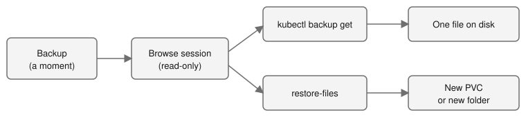

# Part 17: Get Back One File from a Backup

> **Tutorial Series:** [Index](TUTORIAL.md) | [Part 10: Backup and Restore](TUTORIAL-10-BACKUP-AND-RESTORE.md) | **Part 17**

Look inside a backup, read one file, and get back a file that you deleted. You do this without restoring the whole volume. At the end, do the same inside the disk of a VM, without starting the VM. The words restore point and snapshot pool are defined in [CONTEXT.md](CONTEXT.md).

**Time:** about 20 minutes, after Part 10 has two restore points. The VM part adds about 15 minutes.
**Status:** file restore is Experimental. See [BACKUP-RECOVERY.md](BACKUP-RECOVERY.md#browse-a-backup-and-restore-files-in-development) for the full reference.



---

## Prerequisites

- You finished Steps 1 to 6 of [Part 10](TUTORIAL-10-BACKUP-AND-RESTORE.md). The policy has backed up the volume `files` twice, so it has two restore points, and the pod `files-writer` still runs. Do not do the clean up of Part 10 yet.
- The backup gateway is on (the chart default: `backupGateway.enabled` and `backupBrowse.enabled`). Check it:

```bash
oc get configmap backup-gateway-info -n kube-system
```

- The `kubectl-backup` plugin is on your path, as in Part 10.
- **Your kubeconfig sends a bearer token.** The commands that look inside a backup (`ls`, `get`, `restore-files`) send your token to the gateway. A kubeconfig that logs in with a client certificate (the usual cluster-admin file) fails with `send your Kubernetes token as a bearer token`. Log in with a token (for example `oc login --token=...` from the console's **Copy login command**), or use a ServiceAccount, which the next step makes.
- You are an admin of the namespace `pool-tutorial-backup`. The built-in `admin` role may browse and restore files with no setup. A user with only `view` or `edit` may not.

---

## Step 1: Set variables and list the restore points

If you have no token login, make a ServiceAccount that is admin of the tutorial namespace only, and a kubeconfig for it:

```bash
export NS=pool-tutorial-backup
export POLICY=tut-nightly

oc create serviceaccount tut-admin -n ${NS}
oc create rolebinding tut-admin -n ${NS} --clusterrole=admin --serviceaccount=${NS}:tut-admin
TOK=$(oc create token tut-admin -n ${NS} --duration=3h)
kubectl config view --raw --minify > /tmp/tut17-kubeconfig
KUBECONFIG=/tmp/tut17-kubeconfig kubectl config set-credentials tut-admin --token="${TOK}"
KUBECONFIG=/tmp/tut17-kubeconfig kubectl config set-context --current --user=tut-admin
export KUBECONFIG=/tmp/tut17-kubeconfig
```

The built-in `admin` role of the namespace is all the rights the gateway needs. Then list the restore points:

```bash
kubectl backup ls --policy ${POLICY} --pvc ${NS}/files --restore-points
```

**Expected:** the restore points, **oldest first**, one a line:

```
2026-11-04T18:11:43Z
2026-11-04T18:17:04Z
```

The first call opens a session and took about 18 seconds in the lab. Take the first line as the first restore point:

```bash
export FIRST=$(kubectl backup ls --policy ${POLICY} --pvc ${NS}/files --restore-points | head -1)
echo ${FIRST}
```

Do not read `lastBackupTime` from the policy for this: it is the latest backup, not the first.

---

## Step 2: Look inside the backup

The first command opens a browse session. The driver starts a read-only helper pod for it, which takes a few seconds. Later commands reuse the session. The session ends after 15 minutes without use.

```bash
kubectl backup ls --policy ${POLICY} --pvc ${NS}/files
kubectl backup ls --policy ${POLICY} --pvc ${NS}/files /a
```

**Expected:**

```
-rw-r--r--  99:99  944   2026-11-04 18:17  .subvolume-metadata.json
drwxr-xr-x  99:99  4096  2026-11-04 18:11  a/
-rw-r--r--  99:99  4     2026-11-04 18:11  b
-rw-r--r--  99:99  0     2026-11-04 18:11  written
```

The file `keep` is not there, because Part 10 deleted it before the second backup. `.subvolume-metadata.json` is the driver's own note about the volume. The owner is `99:99`, which is how the backup share shows files; the restored files get the pool's owner. The second command shows `1`. Later calls take about a second.

Now look at the oldest restore point:

```bash
kubectl backup ls --policy ${POLICY} --pvc ${NS}/files --restore-point ${FIRST}
```

**Expected:** `a`, `keep` and `written` (and `.subvolume-metadata.json`). The file `b` is not there yet. This is the volume as it was at the first restore point. Use the restore point exactly as `--restore-points` prints it. Each different restore point text can open its own session, and a namespace may have 2 open at once (see Clean up).

---

## Step 3: Download one file

```bash
mkdir -p /tmp/restored
kubectl backup get --policy ${POLICY} --pvc ${NS}/files --restore-point ${FIRST} /keep --out /tmp/restored/
cat /tmp/restored/keep
```

**Expected:** `first`. You got back a file that no longer exists on the volume. A file is saved under its own name. A file that exists is never replaced.

To read a file on the screen, use `--out -`:

```bash
kubectl backup get --policy ${POLICY} --pvc ${NS}/files /a/1 --out -
```

**Expected:** `second`. With no `--restore-point`, you read the latest copy. A folder is saved as a `.tar` file, or unpacked with `--extract DIRECTORY`.

---

## Step 4: Restore files into a new PVC

Download is for a person. To give the files back to a pod, restore them into a PVC. The driver makes a new PVC, sized to the files plus 20%, and copies the files in with a Job.

```bash
kubectl backup restore-files --policy ${POLICY} --pvc ${NS}/files --restore-point ${FIRST} \
  --path /keep --path /a --to ${NS}/files-back --wait
```

**Expected:**

```
Restore bfr-f78b61bed75c1689-0 asked: 2 paths from pool-tutorial-backup/files (policy tut-nightly, the backup at or before 2026-11-04T18:11:43Z) into a new claim pool-tutorial-backup/files-back
  Pending
  Measuring measuring the chosen files to size the new claim
  Provisioning waiting for the driver to bind the new claim
  Restoring copying the files into the new claim
  Done restored 2 files, 1 folders and 0 links (12 bytes)
```

It took about 70 seconds. The tree is kept, so the files are at `/keep` and `/a/1` in the new PVC. The name of the restore (`bfr-...`) is yours to note: `kubectl backup restore-files --status NAME` shows it later.

Read them with a pod:

```bash
cat <<EOF | oc apply -n ${NS} -f -
apiVersion: v1
kind: Pod
metadata:
  name: files-back-check
spec:
  containers:
    - name: check
      image: registry.access.redhat.com/ubi9/ubi-minimal:latest
      command: ["/bin/bash", "-c", "find /data -type f | sort; cat /data/keep /data/a/1; sleep 600"]
      volumeMounts:
        - name: data
          mountPath: /data
  volumes:
    - name: data
      persistentVolumeClaim:
        claimName: files-back
EOF

oc wait -n ${NS} --for=condition=Ready pod/files-back-check --timeout=300s
oc logs -n ${NS} files-back-check
```

**Expected:** `/data/a/1` and `/data/keep`, then `first` twice. The file `a/1` has the old content (`first`), not the content now on the volume (`second`).

A restore never writes over a file that exists. A claim name that exists is refused.

---

## Step 5: Restore files into a PVC that exists

Use `--existing` to put the files into a new folder of a PVC that you already use. Nothing else in that PVC changes.

```bash
kubectl backup restore-files --policy ${POLICY} --pvc ${NS}/files --restore-point ${FIRST} \
  --path /keep --to ${NS}/files --existing --wait
```

**Expected:** `Done`, and a line such as `The files are in the folder restored-tut-nightly-20261104T181143Z of the claim pool-tutorial-backup/files.` The folder name holds the policy and the restore point that was restored, with the time written without dashes and colons. Check it in the running pod:

```bash
D=$(oc exec -n ${NS} files-writer -- ls /data | grep '^restored-')
echo ${D}
oc exec -n ${NS} files-writer -- cat /data/${D}/keep
```

**Expected:** the folder name, then `first`. The listing of `/data` has the new folder next to `a`, `b` and `written`.

Your own `/data/a/1` and `/data/b` did not change. To put a file back in its old place, copy it from the restored folder yourself. The driver never does that for you.

---

## Step 6: Do it in the console

1. Open **Storage**, then **IBM VPC File Pools**, then the **Backups** tab.
2. Open the policy `tut-nightly`. In the menu of the volume `files`, choose **Browse files**.
3. The page shows "Starting the reader", then the folders. The picker above the table offers **Latest copy** and every restore point. Choose the first restore point.
4. Open `a`. Tick `1` and press **Download**, or tick files and folders and press **Restore selected**.
5. In the dialog, choose **A new claim**, type the name `files-console`, and confirm. The dialog shows the phase (Measuring, Copying the files) and then Done, with a link to the claim.

**Expected:** `oc get pvc -n pool-tutorial-backup files-console` shows `Bound`. Console restore asks the same questions as `restore-files`, with the same rights. Part 16 shows the rest of the Backups tab: [Part 16](TUTORIAL-16-CONSOLE-BACKUPS-CLONES-RECEIVER.md).

---

## Step 7: Files inside a VM disk

The backup of a VM disk is one raw disk. The driver reads the file systems inside it with a small read-only appliance, so you can get back one file of the guest without starting the VM.

This step needs a VM with a disk that a `BackupPolicy` backs up (see [Part 10](TUTORIAL-10-BACKUP-AND-RESTORE.md#vms)) and VM-disk browsing on in the install:

```bash
helm upgrade ibm-vpc-file-pool-csi charts/ibm-vpc-file-pool-csi -n kube-system \
  --reset-then-reuse-values \
  --set backupBrowse.guest.enabled=true \
  --set backupBrowse.guest.image.repository=REGISTRY/browse-guest \
  --set backupBrowse.guest.image.tag=TAG
```

Set `backupBrowse.guest.kvmDevice=true` where the nodes have the KVM device. A first listing then takes about 25 seconds instead of about 45. To browse or restore a VM disk that is in COS, `backupBrowse.cos` must also be on (the default).

Set the claim of the VM disk and list it. The first listing shows the file systems of the guest as folders:

```bash
export VMNS=vms
export DISK=my-vm-rootdisk

kubectl backup ls --policy ${POLICY} --pvc ${VMNS}/${DISK}
```

**Expected:** one folder for each partition of the guest, with its type and label. The first listing took 20 seconds in the lab. Here is the list for a CentOS Stream 9 disk. A volume that cannot be read (BitLocker, LUKS, swap) is listed with the reason and cannot be opened.

```
dr-xr-xr-x  0:0  1048576      0001-01-01 00:00  sda1/ (not readable)  # No file system that the reader knows was found on this volume.
dr-xr-xr-x  0:0  209489920    0001-01-01 00:00  sda2/  # vfat ESP
dr-xr-xr-x  0:0  1006632960   0001-01-01 00:00  sda3/  # xfs boot
dr-xr-xr-x  0:0  20122152960  0001-01-01 00:00  sda4/  # xfs root
```

The folder name is the one to give to `--fs` below. Use the name from your list: a disk with other partitions has other names.

Open a folder inside one file system, download a file, and restore a folder. `--fs` puts the file system name in front of the path:

```bash
kubectl backup ls  --policy ${POLICY} --pvc ${VMNS}/${DISK} --fs sda4 /etc
kubectl backup get --policy ${POLICY} --pvc ${VMNS}/${DISK} --fs sda4 /etc/hosts --out /tmp/restored/
kubectl backup restore-files --policy ${POLICY} --pvc ${VMNS}/${DISK} --fs sda4 \
  --path /etc/hosts --to ${VMNS}/vm-files --wait
```

**Expected:** the folder list (one line each, as in `ls -l`), then the file `/tmp/restored/hosts`, then the restore progress:

```
Restore bfr-8c79aeb7900de297-0 asked: 1 paths from tutf-vms/my-vm-rootdisk (policy tutf-nightly, the latest copy) into a new claim tutf-vms/vm-files
  Pending 
  Measuring measuring the chosen files to size the new claim
  Provisioning waiting for the driver to bind the new claim
  Restoring copying the files into the new claim
  Done restored 1 files, 2 folders and 0 links (158 bytes)
Restore bfr-8c79aeb7900de297-0: Done - restored 1 files, 2 folders and 0 links (158 bytes)
The new claim tutf-vms/vm-files holds the files.
```

In the new claim the file is at `/sda4/etc/hosts`: the name of the file system is kept at the top.

Things to know:

- **The next backup of that disk waits** while a session is open, for at most 2 hours. A VM backup copies all its disks together, so they wait together. Close the session with `kubectl backup browse --close NAME` when you finish.
- **A running VM is backed up as a crash copy** unless the freeze worked. The command prints `note: ...` on standard error when a file system was read without its journal. The newest changes may be missing.
- **Speed.** Each folder you open and each file you read starts the appliance (about 1.5 seconds with KVM, about 12 without). Restore the files you need. To get back thousands of small files, restore the whole disk (Part 10).
- **From COS.** Add `--from-cos` to the same commands. Only the newest restore point of an export can be read, and the export must stay in COS for at least 3 more hours.

---

## Who may do this

| You | Browse and restore files of namespace N |
|-----|------------------------------------------|
| Admin of N (the built-in `admin` role) | Yes, with no setup |
| A user with only `view` or `edit` in N | No |
| A user with a RoleBinding to `backup-file-reader` in N | Yes |
| Admin of another namespace | No |

To let a person read the backups of N:

```bash
oc create rolebinding backup-readers -n ${NS} --clusterrole=backup-file-reader --user=alice
```

A restore into a new claim also needs `create` on `persistentvolumeclaims` in the target namespace. A restore into an existing claim also needs `update` on `persistentvolumeclaims` and `create` on `pods` there. Every start, download and restore writes an audit Event that holds the user and the paths, never the contents.

---

## Clean up

```bash
unset KUBECONFIG
oc delete pod -n ${NS} files-back-check --ignore-not-found --force --grace-period=0
oc delete pvc -n ${NS} files-back files-console --ignore-not-found
oc get backupfilerestore,backupbrowse
```

That last command lists every restore and browse session in the cluster, including those of other people. Delete only the ones you made, by name:

```bash
oc delete backupfilerestore <name> [<name> ...]
oc delete backupbrowse <name> [<name> ...]
```

Never use `--all` on a shared cluster.

`unset KUBECONFIG` comes first, because the ServiceAccount may not delete cluster-wide objects. Remove the folder `/tmp/restored` and the file `/tmp/tut17-kubeconfig` too. `BackupFileRestore` and `BackupBrowse` are cluster-wide, not in the namespace, so deleting the namespace does not remove them, and a browse pod that still runs blocks the delete of the pool. The ServiceAccount goes with the namespace. A browse session also ends by itself after 15 minutes without use. Then clean up Part 10.

---

## What you learned

- `kubectl backup ls` and `get` read one file from any restore point, without a restore of the volume.
- `kubectl backup restore-files` copies chosen files into a new PVC, or into a new folder of a PVC that exists. It never writes over a file.
- The console does the same with **Browse files** and **Restore selected**.
- The disk of a VM is browsed and restored by file system, and the next backup of that disk waits while a session is open.
- The built-in `admin` role of the namespace has the right with no setup. Others need `backup-file-reader`.

## Next

- [Part 10: Backup and Restore](TUTORIAL-10-BACKUP-AND-RESTORE.md) for the whole-volume restore and the clean up.
- [Part 9: A COS bucket for backups](TUTORIAL-09-COS-BACKUP-BUCKET.md) to keep backups outside the VPC.
