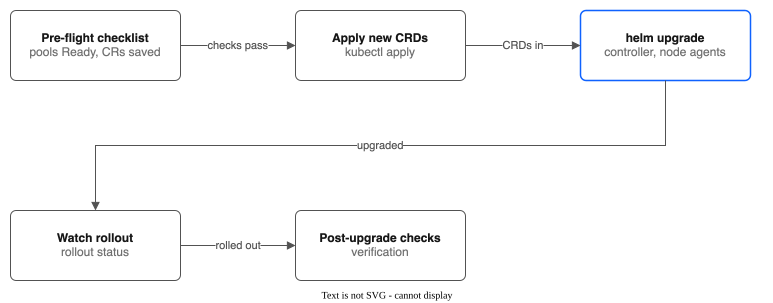

# Upgrade Guide — IBM VPC File Pool CSI Driver

This guide covers upgrading the driver between versions without data loss or downtime.



---

## Pre-Flight Checklist

Before upgrading, complete every item:

- [ ] **Read the [CHANGELOG.md](../CHANGELOG.md)** entry for the target version — note breaking changes, new CRD fields, and required actions
- [ ] **Verify pool health** — all pools should be in `Ready` phase:
  ```bash
  kubectl get filesharepools
  # All pools should show Phase: Ready
  ```
- [ ] **Back up CRD resources** (pools and subvolumes are the source of truth for all state):
  ```bash
  kubectl get filesharepools -o yaml > backup-pools.yaml
  kubectl get subvolumes -o yaml > backup-subvolumes.yaml
  kubectl get snapshots.storage.ibmcloud.io -o yaml > backup-snapshots.yaml 2>/dev/null
  kubectl get replicationpolicies -o yaml > backup-replication.yaml 2>/dev/null
  kubectl get volumegroupsnapshots -o yaml > backup-groupsnapshots.yaml 2>/dev/null
  ```
- [ ] **Check for in-flight operations** — no PVCs should be in `Pending` state and no clones should be in progress:
  ```bash
  kubectl get pvc --all-namespaces | grep Pending
  kubectl get subvolumes -o jsonpath='{range .items[?(@.spec.cloneStatus=="InProgress")]}{.metadata.name}{"\n"}{end}'
  ```
- [ ] **Verify you have the correct target version** of the Helm chart or manifests
- [ ] **Confirm cluster meets the compatibility requirements** for the target version (see below)

---

## Compatibility Matrix

| Driver Version | Kubernetes | OpenShift (ROKS) | Helm | Go | Key Dependencies |
|---------------|-----------|-----------------|------|-----|-----------------|
| v0.1.0–v0.3.0 | 1.28+ | 4.14+ | v3.10+ | 1.25+ | controller-runtime v0.18+ |
| v0.4.0–v0.5.0 | 1.28+ | 4.14+ | v3.10+ | 1.25+ | controller-runtime v0.18+, VolumeSnapshot CRDs |
| v0.6.0–v0.8.0 | 1.28+ | 4.14+ | v3.10+ | 1.25+ | controller-runtime v0.23+, cert-manager v1.12+ |
| v0.9.0–v0.10.0 | 1.28+ | 4.14+ | v3.10+ | 1.25+ | controller-runtime v0.23+, cert-manager v1.12+ |
| v0.11.0 | 1.28+ | 4.14+ | v3.10+ | 1.25+ | controller-runtime v0.23+, cert-manager v1.12+, CDI (optional) |
| v0.12.0 | 1.28+ | 4.14+ | v3.10+ | 1.25+ | controller-runtime v0.23+, cert-manager v1.12+, CDI (optional) |
| v0.13.0–v0.13.2 | 1.28+ | 4.14+ | v3.10+ | 1.25+ | controller-runtime v0.23+, cert-manager v1.12+, CDI (optional) |
| v0.14.0–v0.16.3 | 1.28+ | 4.14+ | v3.10+ | 1.25+ | controller-runtime v0.23+, cert-manager v1.12+, CDI (optional), OpenShift Virtualization (for VM features) |

---

## Upgrade Methods

### Helm Upgrade (Recommended)

```bash
# 1. Update the chart repository (if using a remote repo)
helm repo update

# 2. Preview changes
helm diff upgrade ibm-vpc-file-pool-csi charts/ibm-vpc-file-pool-csi/ \
  --namespace kube-system \
  --values my-values.yaml

# 3. Apply the upgrade
helm upgrade ibm-vpc-file-pool-csi charts/ibm-vpc-file-pool-csi/ \
  --namespace kube-system \
  --values my-values.yaml \
  --timeout 5m

# 4. Watch rollout
kubectl rollout status deployment/ibm-vpc-file-pool-csi-controller -n kube-system
kubectl rollout status daemonset/ibm-vpc-file-pool-csi-node -n kube-system
```

### Raw Manifest Upgrade

```bash
# 1. Apply updated CRDs first (CRDs are not managed by kubectl apply on deployments)
kubectl apply -f config/crd/

# 2. Apply updated RBAC
kubectl apply -f config/rbac/

# 3. Apply updated deployments and daemonsets
kubectl apply -f config/controller/
kubectl apply -f config/node/

# 4. Watch rollout
kubectl rollout status deployment/ibm-vpc-file-pool-csi-controller -n kube-system
kubectl rollout status daemonset/ibm-vpc-file-pool-csi-node -n kube-system
```

---

## CRD Upgrade Procedures

CRDs require special handling because Helm does not upgrade CRDs on `helm upgrade` (by design).

### Additive Schema Changes (Safe)

Most upgrades add new optional fields to existing CRDs. These are backward-compatible — existing CRs continue to work without modification. Apply the new CRDs before upgrading the controller:

```bash
kubectl apply -f config/crd/
```

### Breaking Schema Changes

No versions to date have introduced breaking CRD schema changes. All field additions have been optional with backward-compatible defaults. If a future version requires a breaking change, it will be called out explicitly in the CHANGELOG and this guide will be updated with migration steps.

### Verifying CRD Updates

```bash
# Check CRD versions
kubectl get crd filesharepools.storage.ibmcloud.io -o jsonpath='{.spec.versions[*].name}'
kubectl get crd subvolumes.storage.ibmcloud.io -o jsonpath='{.spec.versions[*].name}'

# Verify new fields are present (example: check for ExportPath added in v0.9.0)
kubectl get crd filesharepools.storage.ibmcloud.io -o json | \
  python3 -c "import sys,json; schema=json.load(sys.stdin); print('exportPath' in str(schema))"
```

---

## Version-Specific Upgrade Notes

### Upgrading to v0.16.3 (from v0.16.2)

**Changes:** a new pool can no longer end with a share that has no mount target. A lost status save is saved again, and a share without a mount target switches to the same-named share that has one.

**CRD changes:** none.

**Action required:** upgrade with Helm (set `image.tag` and `consolePlugin.image.tag` to `v0.16.3` if you pin them). To go back, run `helm rollback`.

### Upgrading to v0.16.2 (from v0.16.1)

**Changes:** a wrong COS key is named as the cause when browsing or restoring files from COS, instead of "COS could not be read".

**CRD changes:** none.

**Action required:** upgrade with Helm (set `image.tag` and `consolePlugin.image.tag` to `v0.16.2` if you pin them). To go back, run `helm rollback`.

### Upgrading to v0.16.1 (from v0.16.0)

**Changes:**
- **Audit Events for backup browsing and file restore are recorded.** In v0.16.0 the API server refused them. They are now written on the ConfigMap `backup-gateway-info` in the driver namespace, so only people who can read Events there see them. Each Event names the session or restore it is about.
- The gateway address in `backup-gateway-info` is filled in on a first install, so `kubectl backup` no longer needs `--gateway` until a second upgrade.
- The replication policy page shows the last error as an error alert.

**CRD changes:** none.

**Action required:** upgrade with Helm (set `image.tag` and `consolePlugin.image.tag` to `v0.16.1` if you pin them). To go back, run `helm rollback`.

### Upgrading to v0.16.0 (from v0.15.3)

**Changes:**
- **Failover from the console.** A new cluster-scoped resource `Failover` plans and runs a failover on the destination cluster (all VMs, or the VMs you name). The console has a Recovery page for it, and the replication policy page shows how each running VM can be recovered. Nothing is bound to the `<release>-failover-admin` role: bind it to the people who may fail over.
- **Browse and restore files from a backup.** A new backup gateway (a Deployment, a Service and on OpenShift a Route) and `kubectl backup ls / get / browse / restore-files`. The console has a file browser, download and a restore dialog. A new resource `BackupFileRestore` runs the restore. Backups in COS can be browsed too (plain volumes only; VM disks inside backups are not covered yet).
- A volume request that finds no room may create one share when `autoExpand` is on. The code did this before; the rule text now says so.
- Fixes: failover works when the receiver's data claim is a claim the driver provisioned, and a failover Plan with no copies now fails with a clear message; the PoolBench backup event shows the copy speed; the console restore banner waits for the copy state.

**CRD changes (additive):** two new CRDs, `Failover` and `BackupFileRestore`; new fields on `ReplicationPolicy` status (`vms`), and `source`/`fromCOS` on `BackupBrowse`. Apply them first: `kubectl apply --server-side --force-conflicts -f config/crd/`.

**New objects from the chart:** a namespace `ibm-vpc-file-pool-csi-browse` (`backupBrowse.namespace`) for browse sessions, which allows root pods without capabilities; on OpenShift one SCC for it; the gateway Deployment, Service, Route and ConfigMap `backup-gateway-info`; ClusterRoles for the gateway, `failover-admin`, and a Role in the driver namespace that lets the controller create and delete the per-session Secrets for COS browsing. Both `backupBrowse.enabled` and `backupGateway.enabled` are on by default; turn them off to avoid these objects. A cluster that is not OpenShift needs `backupGateway.tls.secretName`.

**Action required:**
1. Apply the CRDs.
2. Upgrade with Helm. Set `image.tag` if you pin it. The `browse` and console plugin images change too (`consolePlugin.image.tag`, and the browse tag follows the driver tag unless set).
3. Bind `<release>-failover-admin` to the administrators who may fail over.

To go back, run `helm rollback`. Unused new CRDs stay.

### Upgrading to v0.15.3 (from v0.15.2)

**Changes:**
- PoolBench: the backup event reports the copy speed. The PoolBench service can now read replication policies. Before, it read no speed and said nothing.

**CRD changes:** none. No chart value changes.

**Action required:** upgrade with Helm (the role is part of the chart). Set `image.tag` if you pin it. The console plugin image did not change.

To go back, run `helm rollback`.

### Upgrading to v0.15.2 (from v0.15.1)

**Changes:**
- The controller role can watch pods, so the volume resizer sidecar stops logging "Failed to watch *v1.Pod" and stops restarting.

**CRD changes:** none. No chart value changes. The driver and console plugin images did not change.

**Action required:** upgrade with Helm (the role is part of the chart). Set `image.tag` if you pin it.

To go back, run `helm rollback`.

### Upgrading to v0.15.1 (from v0.15.0)

**Changes:**
- A COS export of a backup no longer reads a disk that changes under it (issue #310). While the export of a volume runs, the next local backup of that volume waits; all disks of a running VM wait together. The volume's status says `held: export to COS running`. A hold ends with the export, or after 6 hours.
- The adaptive copy speed now also changes the speed of the disks that still copy when another disk of the VM has finished (issue #313).
- PoolBench: the backup event reports the copy speed and the latency of the VMs during the backup.

**CRD changes (additive):** new fields in the status of `PoolBench` events. The SubVolume gets a short-lived annotation `storage.ibmcloud.io/export-hold` while an export runs. No chart value changes.

**Action required:**
1. Apply the CRDs: `kubectl apply --server-side --force-conflicts -f config/crd/`.
2. Upgrade with Helm. Set `image.tag` if you pin it. The console plugin image did not change.

To go back, run `helm rollback`. The older driver ignores the annotation.

### Upgrading to v0.15.0 (from v0.14.3)

**Changes:**
- Copies of running VM disks (replication, backup and snapshot copies) adapt their speed to the load on the share the VM reads. A copy starts at 15 MB/s, speeds up by 5 MB/s every 30 seconds while the share is quiet, and halves (never below 15 MB/s) when the average latency of the share passes `vmCopyMaxLatencyMs` (15 ms by default).
- **The fixed 20 MB/s default is gone for adaptive copies.** `vmCopySpeedLimitMBps` is now the highest speed, and unset means there is no highest speed. If you rely on 20 MB/s as a ceiling, set `vmCopySpeedLimitMBps: 20`. To keep a fixed speed, set `vmCopyAdaptive: false` on the policy (or on the `VolumeSnapshotClass`).
- PoolBench, a storage performance test in the console. It is off by default (`poolBench.enabled`).

**CRD changes (additive):** the new `PoolBench` resource, and `vmCopyAdaptive` and `vmCopyMaxLatencyMs` on `BackupPolicy` and `ReplicationPolicy`. `vmCopySpeedLimitMBps` no longer has a default of 20. The status of a replication volume shows the speed now in `vmCopy.speedMBps`.

**New objects from the chart:** a service account `<release>-node-reader` that can only read the node agents' `/metrics`; a Role for the controller (list endpoint slices, create a token of that one account); a ConfigMap `<release>-node-ca` that the OpenShift service CA fills in. On a cluster without the OpenShift service CA, copies stay at the fixed speed.

**Action required:**
1. Apply the CRDs: `kubectl apply --server-side --force-conflicts -f config/crd/`.
2. Upgrade with Helm. Set both `image.tag` and `consolePlugin.image.tag` if you pin image tags. No chart value changes are needed.
3. Check the controller log: a line "Cannot read the latency of the pool's shares" means the copies stay at their fixed speed, and the line says why.

To go back, run `helm rollback`. The older driver works with the new CRDs.

### Upgrading to v0.14.3 (from v0.14.2)

**Changes:** the node agent finishes the unmount of a volume whose share was already deleted. Before, such a volume stayed on the node, and kubelet repeated a failing unmount forever. Share metrics are no longer minutes late on a node with dead mounts. See `CHANGELOG.md`.

**CRD changes:** none.

**Action required:**
1. Upgrade with Helm. No CRD step, and no chart value changes. Set both `image.tag` and `consolePlugin.image.tag` if you pin image tags.
2. Nothing to clean by hand. After the upgrade, kubelet's next retries remove the leftover volumes of deleted shares from each node. Each one takes up to about 4 minutes. To check a node, count the folders under `<kubelet dir>/plugins/kubernetes.io/csi/vpc-file-pool.csi.ibm.io/`: only volumes in use stay.

### Upgrading to v0.14.2 (from v0.14.1)

**Changes:** the node agent `/metrics` endpoint no longer answers HTTP 500 when a node holds the same share twice, so share metrics and the alerts built on them work again on those nodes. The driver refuses CreateVolume on a backup policy's snapshot pool (FailedPrecondition, naming the policy), and the console leaves those pools out of its lists. The console clone banner follows the copy, a refused "Delete backups" dialog says "Close", and the clone and restore pages no longer call their own new claim a taken name. See `CHANGELOG.md`.

**CRD changes:** none.

**Action required:**
1. Upgrade with Helm. No CRD step, and no chart value changes.
2. Upgrade the driver and the console plugin image to v0.14.2 together. If you pin image tags, set both `image.tag` and `consolePlugin.image.tag`.
3. If a volume already sits on a backup policy's snapshot pool, it stays. Only new volumes on that pool are refused. Move the volume off the pool so the policy backs up again.

### Upgrading to v0.14.1 (from v0.14.0)

**Changes:** the console box on the Snapshots and Pools pages now shows how the driver takes VM disk snapshots: instant, copy, or unknown. Before, it read only the KubeVirt `Sidecar` gate and said "on" even when the driver was set to `vmSnapshots.method=copy`. The driver code is the same as v0.14.0.

**CRD changes:** none.

**Action required:**
1. Upgrade with Helm. No CRD step.
2. The chart now renders a ConfigMap `ibm-vpc-file-pool-csi-settings` (key `vmSnapshotMethod`, no secret) in the release namespace, and a Role and RoleBinding that let every signed-in user `get` that one ConfigMap by name. Nothing else in the namespace becomes readable. The console reads it.
3. Upgrade the console plugin image to v0.14.1 with the chart. A console plugin that is newer than the driver shows "unknown" until the driver is upgraded too.

### Upgrading to v0.14.0 (from v0.13.2)

**Changes:** shares use security group access mode; VM snapshots and replication use a QEMU copy of running VMs; golden images are imported by CDI; new console pages. See `CHANGELOG.md` for the full list.

**CRD changes (additive):** `FileSharePool.spec.securityGroupIDs`, new status fields on `Snapshot` (`consistency`, `copyMoment`) and `ReplicationPolicy` (restore points, copy moments), and `ReplicationPolicy.spec.vmCopySpeedLimitMBps`.

**Action required:**
1. Apply updated CRDs: `kubectl apply -f config/crd/`
2. Upgrade with Helm. The controller ClusterRole gains permissions (DataVolumes, DataSources, KubeVirt migrations, the `kubevirt-controller` SCC, `hyperconvergeds`) and loses ImageStreams and RoleBindings.
3. Shares you made before this version in VPC access mode keep working until IBM ends support on 6 May 2027. New shares use security group access mode. The driver does not change an existing share.
4. If the Prometheus Operator API is present, the chart now creates a ServiceMonitor by default (`metrics.serviceMonitor.enabled`).
5. **BREAKING: the controller metrics endpoint (`:8080/metrics`) is now HTTPS with a token login (PR #174).** Anything that scraped it over plain HTTP must change to HTTPS with a bearer token. The node agent also serves metrics on port 9810 over HTTPS.
6. **On OpenShift, alerts need user workload monitoring turned on** (`enableUserWorkload: true`); without it no alert fires. The chart does not change that setting. The command is in `docs/INSTALL.md`.
7. The guides moved into `docs/` (PR #184). README, CHANGELOG, CONTRIBUTING, CLAUDE.md and SKILL.md stay in the root. Update bookmarks; the console help links already point to `docs/`. A branch that edits a guide at its old place: run `hack/follow-docs-move.sh` after `git merge origin/main`.
8. Hardening (PRs #156, #105, #203): the image runs as user 65532 (the node agent stays root), the replication receiver has its own ServiceAccount, and receiver TLS stays off by default (turning it on needs cert-manager and a trusted CA on the source cluster).
9. The default image tag is `v` plus the chart `appVersion`, not `latest`.
10. **The replication receiver memory limit is raised from `512Mi` to `1Gi`** (`replicationReceiver.resources.limits.memory`). If you set your own value, check that it is at least `512Mi`. The receiver now forces data out every 32 MiB for VM disks and plain files (PRs #219, #226).
11. **Failover:** apply the new SubVolume CRD (`config/crd`) before `kubectl failover execute --rewind-to`. The dry run now needs `--kubeconfig` because it reads the pool for the mount options. PVs it makes now carry `sec=sys`, and its PVCs bind only to the PV it made (PR #218).
12. **Migrating a claim** (`kubectl migrate`, console page) now runs as the namespace's user with the cluster's `openshift/tools` image. Owners are not kept and files unreadable to that user are not copied (PR #207; `KNOWN-LIMITATIONS.md`).
13. Snapshot records of failed snapshots (not ready, older than 2 minutes, no VolumeSnapshotContent) are removed by the controller, including old leftovers (PR #204).

**Fixes in this release:** instant VM snapshot of a disk not owned by user 107 is refused and leaves the chain clean (#191, PR #194); replication and backup status follow the Jobs within seconds (#192, PR #197); the restore page no longer spins without the right to read VolumeSnapshotContents (#186, PR #188); a VM disk copy no longer sticks when its apply Job expires (#160, PR #161); `kubectl backup cos-list` works (PR #183).

**Also fixed:** receiver damaged upload record and Failed Jobs with in-place restarts (#213, PR #219); failover rewind path rule, mount options and StorageClass (#209 to #211, PR #218); plain-file receiver memory (#225, PR #226); #214 and #215 verified fixed by #161 and #197 (tests in PR #217).

**Not in this release:** auto-expand making a share inside the volume request (#222), the console restore banner (#224), failback (no command, untested), and file-level restore from a backup (issue #92). Parts 1 and 2 (the browse helper and the `BackupBrowse` resource with its session controller) are in the code, but nothing creates a `BackupBrowse`, so users see no change.

### Upgrading to v0.13.2 (from v0.13.1)

**Fixes:** Receiver Helm template ServiceAccount, ReplicationPolicy CRD validation, sync-client Job image selection, receiver path-doubling bug, scheduling fairness for parallel syncs.

**CRD changes (additive):**
- `ReplicationPolicy.spec.destinationNFSServer` is now optional at the OpenAPI level (was incorrectly required, blocking driver-to-driver mode)
- New field: `ReplicationPolicy.spec.destinationCACertSecretRef` — references a Secret containing a `ca.crt` key for verifying the receiver's TLS certificate (required for self-signed certs)

**Action required:**
1. Apply updated CRDs: `kubectl apply -f config/crd/`
2. Upgrade controller — now passes `--driver-image` to receiver-mode sync-client Jobs automatically
3. If using driver-to-driver mode with TLS: create a Secret with the receiver's CA cert and set `destinationCACertSecretRef` on the ReplicationPolicy

**New features:**
- **Receiver TLS support** — native HTTPS on the replication receiver via cert-manager. Enable with `replicationReceiver.tls.enabled=true` in Helm values. Creates a self-signed Issuer and Certificate automatically. OpenShift Route switches to passthrough TLS termination
- `--driver-image` CLI flag and Helm wiring for receiver-mode sync-client Jobs
- New CLI flags: `--receiver-tls-cert-file`, `--receiver-tls-key-file` (receiver), `--ca-cert-file` (sync-client)
- Annotation-based pause/resume: `storage.ibmcloud.io/paused=true` on a ReplicationPolicy pauses replication; removing it resumes
- Scheduling fairness: SubVolumes sorted by last-sync-time (oldest first) to prevent starvation under `maxParallelSyncs` limits
- BytesWritten tracking: sync-client Jobs report bytes transferred via termination log; recorded in `SubVolumeReplicationStatus.bytesSynced`

**Bug fixes:**
- Receiver path-doubling: when `subPath` already included the `basePath` prefix (e.g., `/pvcs/pvc-xxx`), the receiver would double it (e.g., `/data/pvcs/pvcs/pvc-xxx`). Now strips the prefix automatically
- Sync-client Jobs now mount the CA cert Secret when `destinationCACertSecretRef` is set, enabling TLS verification for self-signed receiver certificates

---

### Upgrading to v0.13.1 (from v0.13.0)

**Fixes:** Console plugin table rows not rendering in tabbed layout.

**No CRD changes.** No RBAC changes. No data migration required.

**Action required:**
1. Upgrade controller — metrics now register with controller-runtime registry (fixes scraping when using Prometheus Operator)
2. Update image references from `icr.io` to `de.icr.io` (Frankfurt regional registry) if using explicit image tags

**Console plugin changes:**
- Replaced VirtualizedTable with PatternFly composable Table in all 5 list pages
- Added client-side column sorting on all list pages

---

### Upgrading to v0.13.0 (from v0.12.0)

**New features:** Console plugin tabbed navigation, CDI DataSource creation for InstanceTypes catalog, monitoring tab with Prometheus charts.

**No CRD changes.** No RBAC changes. No data migration required.

**Action required:**
1. Upgrade controller — golden image syncer now creates DataSource CRs in `openshift-virtualization-os-images` for InstanceTypes catalog visibility
2. If using the console plugin, the UI now uses a single tabbed interface instead of 7 sidebar items

**Console plugin changes (if enabled):**
- Single "IBM VPC File Pools" sidebar entry with tabbed interface (Overview, Pools, SubVolumes, Snapshots, Group Snapshots, Replication, Monitoring)
- New Monitoring tab with time-series charts and stat cards
- IOPS column in pool table
- Create buttons now route to custom form wizards instead of YAML editor

---

### Upgrading to v0.12.0 (from v0.11.0)

**New feature:** OpenShift Console dynamic plugin for visual pool management.

**No CRD changes.** No RBAC changes. No data migration required.

**Console plugin is opt-in.** The plugin is disabled by default (`consolePlugin.enabled: false`). To enable:

```bash
helm upgrade ibm-vpc-file-pool-csi charts/ibm-vpc-file-pool-csi/ \
  --namespace kube-system \
  --set consolePlugin.enabled=true \
  --reuse-values
```

After upgrade, register the plugin with the console:

```bash
# Adds this plugin to the list and keeps the other plugins enabled.
# (A merge patch with a "plugins" list would replace the whole list.)
oc patch console.operator.openshift.io cluster --type=json \
  -p '[{"op":"add","path":"/spec/plugins/-","value":"ibm-vpc-file-pool-csi"}]'
```

**Requires OpenShift 4.14+** with the ConsolePlugin v1 API. Non-OpenShift clusters can skip this — no impact on existing functionality.

---

### Upgrading to v0.11.0 (from v0.10.0)

**New features:** Golden image syncer, mount target recovery, `selectShare` IP guard.

**CRD changes (additive):**
- `FileSharePool.spec.goldenImages` — new optional field for golden image syncer config
- `FileSharePool.status.goldenImages` — new status field for per-image sync state

**RBAC changes:** ClusterRole extended with `cdi.kubevirt.io` (dataimportcrons, datasources), `batch/jobs`, and `template.openshift.io/templates`. Apply updated RBAC before upgrading.

**Action required:**
1. Apply updated CRDs: `kubectl apply -f config/crd/`
2. Apply updated RBAC: `kubectl apply -f config/rbac/`
3. Upgrade controller — the new mount target recovery and IP guard activate automatically
4. (Optional) Configure `spec.goldenImages` on FileSharePool CRs if using KubeVirt

**No data migration required.** Shares with missing mount targets are automatically recovered or drained.

---

### Upgrading to v0.10.0 (from v0.9.0)

**New features:** NFS `sec=sys` default mount option, CDI StorageProfile auto-patching.

**Action required:**
1. Upgrade controller and node DaemonSet
2. Existing NFS mounts continue with their current `sec=` negotiation. New mounts get `sec=sys` automatically.
3. To apply `sec=sys` to existing mounts, restart the node DaemonSet pods (rolling restart happens automatically during upgrade)

**KubeVirt users:** This upgrade fixes the "chown operation not permitted" issue. After upgrade, restart affected VMs.

---

### Upgrading to v0.9.0 (from v0.8.0)

**Critical fix:** NFS mount used server root instead of share export path.

**CRD changes (additive):**
- `PoolShareStatus.ExportPath` — new field for NFS export path
- `ZoneMountTarget.ExportPath` — new field
- `SubVolumeSpec.ShareExportPath` — new field

**Action required:**
1. Apply updated CRDs: `kubectl apply -f config/crd/`
2. Upgrade controller — existing shares without export paths are **automatically backfilled** during the reconciler's health check
3. Upgrade node DaemonSet — new mounts use the correct export path

**No manual data migration required.** The health check backfill handles existing shares.

---

### Upgrading to v0.8.0 (from v0.7.0)

**Fixes:** Hardcoded staging path, mount flags override, resource requests/limits, probes, webhook cert permissions.

**Action required:**
1. Apply updated CRDs
2. Upgrade controller — now includes `--kubelet-dir` flag wired through Helm
3. Upgrade node DaemonSet — gains resource limits, probes, and readiness checks

**ROKS and ROVS users:** Verify `node.kubeletDir` is set to `/var/data/kubelet` in your Helm values. The controller's staging path now respects this setting.

---

### Upgrading to v0.7.0 (from v0.6.0)

**New feature:** Automatic StorageClass creation.

**RBAC changes:** Controller ClusterRole needs `create` verb for `storageclasses`.

**Action required:**
1. Apply updated RBAC: `kubectl apply -f config/rbac/`
2. Apply updated CRDs
3. Upgrade controller — auto-creates StorageClasses for existing pools

**Note:** If you already have manually created StorageClasses, they are not overwritten. To opt out of auto-creation, annotate the pool:
```bash
kubectl annotate filesharepool <pool-name> storage.ibmcloud.io/skip-storageclass="true"
```

---

### Upgrading to v0.6.0 (from v0.5.0)

**New features:** Validating admission webhooks, lifecycle hooks, incremental rsync.

**Prerequisites:**
- cert-manager v1.12+ must be installed (for webhook TLS certificates). ROVS has no cert-manager; on ROKS and ROVS you can set `webhook.certProvider=openshift` instead (see [INSTALL.md — Webhook Certificates](INSTALL.md#webhook-certificates))

**CRD changes (additive):**
- `ReplicationPolicy.spec.preSyncHooks` / `postSyncHooks` — new hook fields
- `ReplicationPolicy.spec.incrementalSync` — new field (default `true`)
- `VolumeGroupSnapshot.spec.preSnapshotHooks` / `postSnapshotHooks` — new hook fields
- New CRD types: `Hook`, `ExecHookSpec`, `HTTPHookSpec`, `HookResult`

**Action required:**
1. Install cert-manager if not already present: `kubectl apply -f https://github.com/cert-manager/cert-manager/releases/latest/download/cert-manager.yaml`
2. Apply updated CRDs: `kubectl apply -f config/crd/`
3. Apply webhook configurations: `kubectl apply -f config/webhook/`
4. Upgrade controller

**Known issue fixed:** VPC auto-discovery silent failure — if you experienced pools without mount targets, this version fixes it by using `kubernetes.Clientset` for pre-start ConfigMap reads.

---

### Upgrading to v0.5.0 (from v0.4.0)

**New feature:** Cross-region disaster recovery (ReplicationPolicy CRD).

**CRD changes (additive):**
- New CRD: `ReplicationPolicy`

**Action required:**
1. Apply new CRD: `kubectl apply -f config/crd/`
2. Upgrade controller
3. (Optional) Create `ReplicationPolicy` CRs for DR — see [CROSS-REGION-DR.md](CROSS-REGION-DR.md)

---

### Upgrading to v0.4.0 (from v0.3.0)

**New features:** Volume snapshots, volume cloning, volume group snapshots, share draining, migration CLI.

**CRD changes (additive):**
- New CRD: `Snapshot`
- New CRD: `VolumeGroupSnapshot`
- `SubVolume` gains clone fields: `sourceVolume`, `sourceShareID`, `cloneStatus`, `cloneProgress`
- `FileSharePool.spec.drainShares` — new field for graceful share draining

**Prerequisites:**
- VolumeSnapshot CRDs must be installed (external-snapshotter):
  ```bash
  kubectl apply -f https://raw.githubusercontent.com/kubernetes-csi/external-snapshotter/master/client/config/crd/
  ```

**Action required:**
1. Install VolumeSnapshot CRDs (if not already present)
2. Apply updated CRDs: `kubectl apply -f config/crd/`
3. Upgrade controller and node DaemonSet
4. (Optional) Create `VolumeSnapshotClass` for the pool driver

---

### Upgrading to v0.3.0 (from v0.2.0)

**New features:** Cross-zone accessor binding, idempotent CreateFileShare, nsenter mount wrapper.

**CRD changes (additive):**
- `FileSharePool.spec.accessorZones` — new field for multi-zone mount targets
- `PoolShareStatus.mountTargets` — new status field (ZoneMountTarget array)

**Action required:**
1. Apply updated CRDs: `kubectl apply -f config/crd/`
2. Upgrade controller and node DaemonSet
3. **Node DaemonSet now requires `hostPID: true`** for the nsenter mount wrapper — verify your DaemonSet spec includes this

---

### Upgrading to v0.2.0 (from v0.1.0)

**New features:** Share tiering, per-PVC usage reporting, Prometheus metrics, auto-discovery.

**CRD changes (additive):**
- `FileSharePool.spec.tiers` — new optional field for tiered storage
- Various status fields for metrics

**Action required:**
1. Apply updated CRDs: `kubectl apply -f config/crd/`
2. Upgrade controller — metrics endpoint becomes available on `:8080/metrics`
3. (Optional) Configure Prometheus scraping — see [MONITORING.md](MONITORING.md)
4. (Optional) Configure tiered storage if needed

---

### Fresh Install: v0.1.0

Initial release. See [INSTALL.md](INSTALL.md) for first-time installation.

---

## Rollback Procedures

### Helm Rollback

```bash
# List revision history
helm history ibm-vpc-file-pool-csi -n kube-system

# Rollback to previous revision
helm rollback ibm-vpc-file-pool-csi <revision-number> -n kube-system
```

### Manual Rollback

```bash
# Reapply the previous version's manifests
kubectl apply -f config/controller/  # previous version
kubectl apply -f config/node/        # previous version
```

### CRD Rollback Caveats

**Helm does not roll back CRDs.** If the upgrade added new CRD fields, those fields remain in the CRD schema after rollback. This is generally safe because:

- New fields are optional with defaults
- The older controller version ignores unknown fields
- Existing CR data is preserved

If you need to roll back a CRD, apply the previous version's CRD manifests manually:

```bash
kubectl apply -f config/crd/  # from the previous version's checkout
```

**Warning:** Rolling back CRDs that removed fields can cause data loss in those fields. Always back up CRs before rollback (see pre-flight checklist).

---

## Post-Upgrade Verification

Run this checklist after every upgrade:

```bash
# 1. Verify all pods are running
kubectl get pods -n kube-system -l app.kubernetes.io/name=ibm-vpc-file-pool-csi,app.kubernetes.io/component=controller
kubectl get pods -n kube-system -l app.kubernetes.io/name=ibm-vpc-file-pool-csi,app.kubernetes.io/component=node

# 2. Verify all pools are Ready
kubectl get filesharepools

# 3. Verify CSI driver is registered
kubectl get csidriver vpc-file-pool.csi.ibm.io

# 4. Test PVC creation (create a test PVC and verify it binds)
kubectl apply -f - <<'EOF'
apiVersion: v1
kind: PersistentVolumeClaim
metadata:
  name: upgrade-test-pvc
  namespace: default
spec:
  accessModes: [ReadWriteMany]
  storageClassName: ibm-vpc-file-pool
  resources:
    requests:
      storage: 1Gi
EOF
kubectl get pvc upgrade-test-pvc -w  # Should bind within seconds

# 5. Verify metrics endpoint (if applicable)
kubectl port-forward -n kube-system svc/ibm-vpc-file-pool-csi-metrics 8080:8080 &
curl -s http://localhost:8080/metrics | grep vpc_file_pool | head -5
kill %1

# 6. Clean up test PVC
kubectl delete pvc upgrade-test-pvc

# 7. Check controller logs for errors
kubectl logs -n kube-system -l app.kubernetes.io/name=ibm-vpc-file-pool-csi,app.kubernetes.io/component=controller -c csi-controller --tail=50 | grep -i "error\|fail"
```

---

## Downtime Expectations

| Component | Downtime | Impact |
|-----------|----------|--------|
| **Controller** | ~30 seconds | Leader election gap. New PVC creation pauses during the gap. Existing mounted PVCs are unaffected. |
| **Node DaemonSet** | Rolling update, ~60s per node | No mount disruption for existing pods. New `NodePublishVolume` calls queue until the new pod is ready. |
| **CRD apply** | None | CRD updates are live. Existing CRs continue to work. |
| **Webhook update** | ~10 seconds | CRD creation/update requests may briefly fail validation. Retry resolves this. |

**Zero-downtime for existing workloads.** Pods with mounted PVCs are not affected by controller or node agent upgrades — NFS mounts are kernel-level and persist independently of the CSI driver pods.

---

## See Also

- [CHANGELOG.md](../CHANGELOG.md) — Full version history
- [INSTALL.md](INSTALL.md) — First-time installation
- [HELM-VALUES.md](HELM-VALUES.md) — Helm chart configuration reference
- [CRD-SPEC.md](CRD-SPEC.md) — CRD field definitions
- [DAY2-OPERATIONS.md](DAY2-OPERATIONS.md) — Post-upgrade operational procedures
