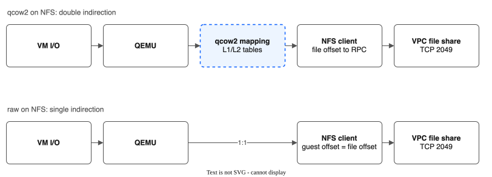
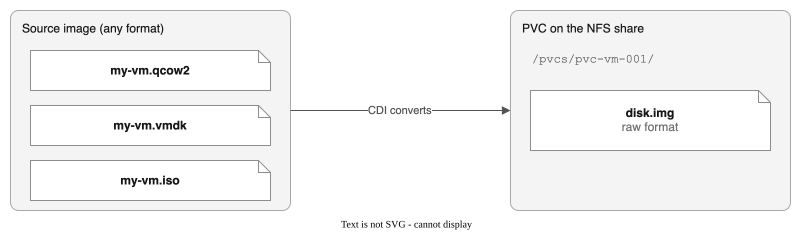

# VM Disk Formats on NFS

This document explains why VM boot disks use raw format on NFS-backed storage, and how this applies to OpenShift Virtualization workloads using the pool CSI driver.

## Why Raw, Not qcow2

When a VM boots from an NFS-backed PVC, the disk image is stored as a **raw file** (`disk.img`), not qcow2. This is a deliberate choice by KubeVirt / OpenShift Virtualization.

```
NFS Share (VPC File Share)
└── pvcs/
    ├── pvc-vm-001/
    │   └── disk.img        ← raw format, e.g. 40 GB
    ├── pvc-vm-002/
    │   └── disk.img        ← raw format, e.g. 100 GB
    └── pvc-app-003/
        └── (regular app data, not a VM disk)
```

### qcow2 Features Are Redundant on NFS

qcow2 was designed for local block storage where the filesystem doesn't provide certain features natively. On NFS, the filesystem already handles these:

| Feature | qcow2 | NFS Filesystem |
|---------|-------|---------------|
| **Thin provisioning** | Copy-on-write cluster allocation | Sparse files — unwritten regions consume no space |
| **Snapshots** | Internal snapshot chains | The driver's snapshots: a folder copy, or a QEMU copy or instant snapshot for a running VM disk (see [VM-INSTANT-SNAPSHOTS.md](VM-INSTANT-SNAPSHOTS.md)). The driver does not use VPC file share snapshots |
| **Space reclamation** | QEMU manages free clusters | `fallocate` / `DEALLOCATE` on the NFS client |

Using qcow2 on NFS means paying for features the storage already provides.

### Performance: Raw Eliminates a Layer



With qcow2, QEMU resolves the qcow2 cluster mapping (L1/L2 tables) and translates the guest offset to a host file offset. The NFS client then translates the file offset to an NFS READ/WRITE RPC over TCP 2049 to the VPC file share. With raw, the guest offset is the file offset (1:1), so the step is skipped.

Raw eliminates qcow2's cluster table lookups. Every guest block maps directly to a file offset — no metadata parsing, no L1/L2 table walks, no refcount updates. This reduces:

- **Read latency** — no cluster resolution step
- **Write amplification** — no refcount block updates on every write
- **Memory overhead** — no in-memory L2 cache tables

For a boot disk doing random I/O (OS page cache misses, journaling, swap), this difference is measurable.

## How KubeVirt Handles Disk Images

### Import Flow (CDI)

The Containerized Data Importer (CDI) converts source images to raw during import:



CDI handles:

- Format detection (qcow2, vmdk, vdi, raw)
- Decompression (gzip, xz)
- Conversion to raw
- Writing to the PVC's filesystem as `disk.img`

### Manual Import (Without CDI)

CDI registry import works on pool StorageClasses, and the pool's golden images are made by CDI (see [KNOWN-LIMITATIONS.md](KNOWN-LIMITATIONS.md#cdi-containerized-data-importer-compatibility)). Convert qcow2 to raw by hand only if you write images to the pool yourself:

```bash
# Use a container with qemu-img (e.g., quay.io/centos/centos:stream9)
dnf install -y qemu-img
curl -L -o /boot/disk.qcow2 <cloud-image-url>
qemu-img convert -f qcow2 -O raw /boot/disk.qcow2 /boot/disk.img
rm /boot/disk.qcow2
chmod 0666 /boot/disk.img
```

**If you skip the conversion**, QEMU receives the qcow2 file via `"driver":"file"` (raw protocol) and reads the qcow2 headers as raw MBR/GPT data. The VM boots to "No bootable device."

See [TUTORIAL.md](TUTORIAL.md) Step 8b for a complete worked example.

### Runtime

At runtime, QEMU opens `disk.img` with `format=raw` (via `"driver":"file"` blockdev) and uses the NFS-mounted filesystem directly. No format conversion happens during VM operation. KubeVirt's pre-start expansion resizes the raw image to fill the PVC capacity.

## Disk Format by Virtualization Platform

| Platform | Format on NFS | Notes |
|----------|--------------|-------|
| **KubeVirt / OpenShift Virt** | raw (`disk.img`) | CDI converts on import |
| **VMware ESXi** | VMDK flat (thick/thin) | Essentially raw with a descriptor file |
| **Proxmox** | raw recommended | qcow2 supported but slower on NFS |
| **libvirt / QEMU standalone** | Either | raw preferred for NFS performance |

The common pattern: every major platform defaults to or recommends raw (or raw-equivalent) when the backing store is NFS.

## Sizing Considerations for VM Pools

VM boot disks are typically larger and have different I/O patterns than application PVCs:

| Workload | Typical PVC Size | I/O Pattern | IOPS Profile |
|----------|-----------------|-------------|-------------|
| App container | 1-50 GB | Sequential or light random | `dp2` (standard) |
| VM boot disk | 40-200 GB | Heavy random (OS activity) | `dp2` with a higher `spec.iops` |
| VM data disk | 100-1000 GB | Depends on workload | `dp2` with `spec.iops` set |

When creating pools for VM workloads, consider:

- **Larger share sizes** — fewer VMs fit per share due to larger disk images
- **Higher IOPS** — VM boot disks generate more random I/O than typical container workloads. Set `spec.iops` on the pool; higher IOPS costs more
- **Dedicated pools** — separate VM pools from application pools to avoid I/O contention

```yaml
apiVersion: storage.ibm.io/v1alpha1
kind: FileSharePool
metadata:
  name: vm-boot-disks
spec:
  zone: us-south-1
  profile: dp2
  iops: 10000
  shareSizeGB: 1000
  maxShares: 10
  # ...
```

## Sparse Files and Thin Provisioning

Raw files on NFS support **sparse allocation**. A 100 GB `disk.img` doesn't consume 100 GB on the share immediately — only written blocks use space.

```
VM requests 100 GB boot disk:

  Logical size:   100 GB  (what the VM sees)
  Physical usage:  12 GB  (only OS + installed packages)
  NFS share space: 12 GB  (sparse file, unwritten blocks = holes)
```

The pool manager tracks **logical** (requested) capacity for allocation decisions, not physical usage. This is conservative — it prevents overcommit even though actual usage is lower.

!!! warning "Sparse file growth"
    As the VM writes data, the sparse file grows toward its logical size. Monitor actual share usage via `NodeGetVolumeStats` or Prometheus metrics to avoid unexpected capacity exhaustion.
