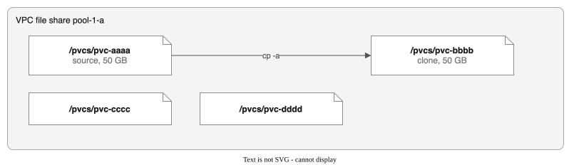
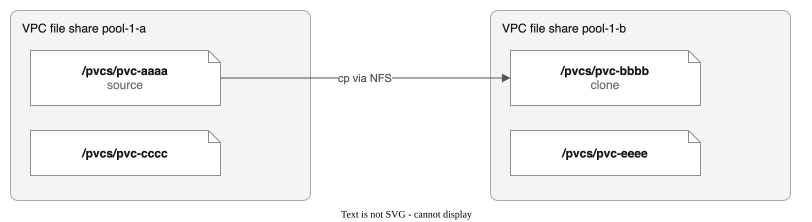
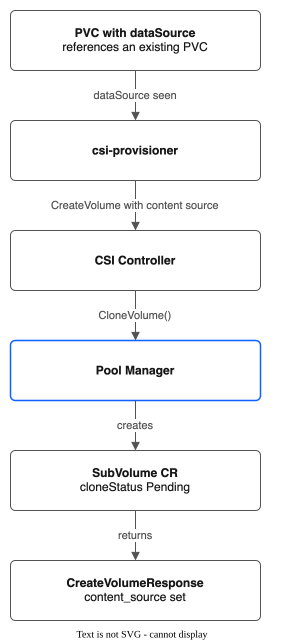
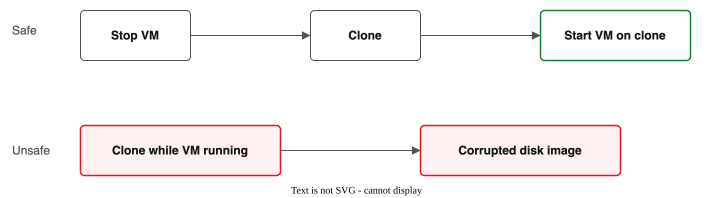
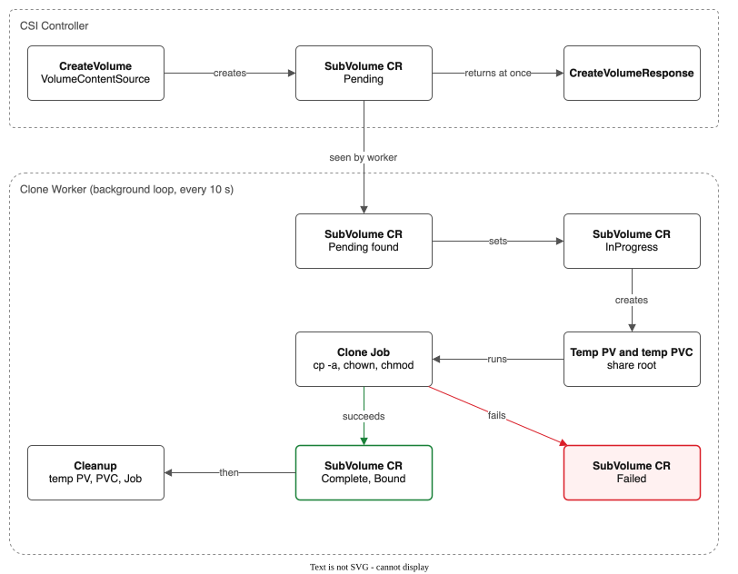
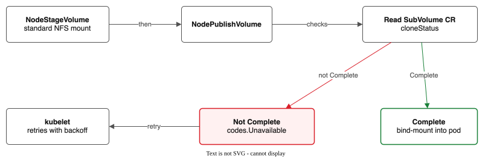
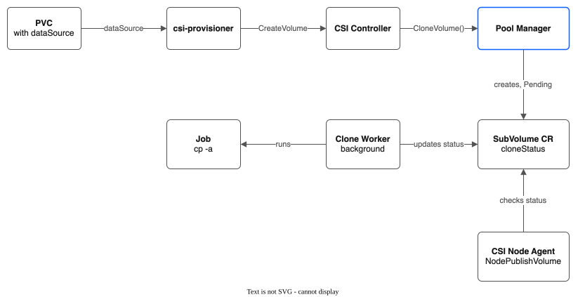

# Volume Cloning Design (Phase 4b)

**Status:** Implemented (v0.4.0)

## Overview

Volume cloning creates a new SubVolume that is a copy of an existing one. In the pool model, a SubVolume is a subdirectory under `/pvcs/pvc-{uuid}` on a shared VPC NFS file share. Cloning is therefore a directory copy (`cp -a`) from one subdirectory to another.

Unlike snapshots (Phase 4a), which are immutable point-in-time copies stored under `/pvcs/.snapshots/`, a clone is a fully writable, independent SubVolume. The clone has its own PVC, PV, and SubVolume CR. After creation, the clone and source are completely independent -- writes to one do not affect the other.

Key characteristics:

- **Full data copy** -- NFS has no copy-on-write. Every byte of the source is copied to the clone.
- **Not instant** -- Copy time is proportional to data size. A 100 GB subdirectory takes minutes.
- **No crash consistency guarantee** if the source is being actively written to.
- **Same-share or cross-share** -- The clone can land on the same VPC file share as the source or a different share in the pool.

Clone on the same share:



Or across shares:



---

## CSI Interface

The CSI specification defines volume cloning through `CreateVolume` with a `volume_content_source` of type `VOLUME`. No separate RPC exists for cloning.

### Request Flow



1. The user creates a PVC with a `dataSource` that references an existing PVC.
2. `csi-provisioner` detects the `dataSource` and sets `volume_content_source`.
3. The CSI Controller receives `CreateVolume` with:
   - `req.Name` = the new PV name (`pvc-bbbb`)
   - `req.VolumeContentSource.Type` = `VOLUME`
   - `req.VolumeContentSource.Volume.VolumeId` = `"pool/share-id/pvc-aaaa"`
   - `req.CapacityRange.RequiredBytes` >= the source size
4. The CSI Controller delegates to `PoolManager.CloneVolume()`.
5. The Pool Manager:
   - Validates that the source SubVolume exists.
   - Selects the target share (prefers the same share).
   - Creates the target SubVolume CR with clone tracking fields.
   - Records the clone intent (`cloneStatus=Pending`); the clone worker copies the data later in a Job.
   - Returns an `AllocationResult`.
6. The CSI Controller returns `CreateVolumeResponse` with `content_source` set.

### PVC Definition (User-Facing)

```yaml
apiVersion: v1
kind: PersistentVolumeClaim
metadata:
  name: my-clone
  namespace: default
spec:
  accessModes:
    - ReadWriteMany
  storageClassName: ibm-vpc-file-pool
  resources:
    requests:
      storage: 50Gi          # Must be >= source PVC size
  dataSource:
    kind: PersistentVolumeClaim
    name: my-original-pvc     # Source PVC in the same namespace
```

### Clone in the console

The console can clone without YAML. Open a volume in the IBM VPC File Pools page (SubVolumes tab) and choose **Clone to new PVC**, on the details page or in the row menu.

- The form has defaults: the name is `<source claim>-clone`, the size is the volume's size (you can make it bigger, not smaller), and the storage class, access mode and volume mode come from the source claim.
- The namespace is fixed to the namespace of the source claim. This is a Kubernetes rule.
- The action only creates a new claim. It never changes the source volume.
- The claim is created and `Bound` at once. The copy runs behind it, and a pod cannot mount the volume until the copy is done (the clone gate in `NodePublishVolume`). Follow the copy in the `cloneStatus` and `cloneProgress` of the volume's SubVolume. If the copy fails, the SubVolume shows the error, and the claim is not deleted.
- The action is off, with a reason, when the volume is not `Bound`, when a copy into it is still running, or when its claim no longer exists.
- **A clone of a running VM's disk is a plain file copy, and the cloned disk may not boot.** The form warns when a VM uses the source claim.

### CSI CreateVolume Request (from csi-provisioner)

The provisioner translates the PVC `dataSource` into a `VolumeContentSource`:

```go
req := &csi.CreateVolumeRequest{
    Name: "pvc-bbbb-uuid",
    VolumeContentSource: &csi.VolumeContentSource{
        Type: &csi.VolumeContentSource_Volume{
            Volume: &csi.VolumeContentSource_VolumeSource{
                VolumeId: "general-purpose/r006-xxxx/pvc-aaaa-uuid",
            },
        },
    },
    CapacityRange: &csi.CapacityRange{
        RequiredBytes: 50 * (1 << 30), // 50 GB
    },
    Parameters: map[string]string{
        "pool": "general-purpose",
    },
}
```

### CSI CreateVolume Response

```go
resp := &csi.CreateVolumeResponse{
    Volume: &csi.Volume{
        VolumeId:      "general-purpose/r006-xxxx/pvc-bbbb-uuid",
        CapacityBytes: 50 * (1 << 30),
        VolumeContext: map[string]string{
            "server":  "10.240.1.5",
            "share":   "/",
            "subDir":  "/pvcs/pvc-bbbb-uuid",
            "pool":    "general-purpose",
            "shareID": "r006-xxxx",
        },
        ContentSource: &csi.VolumeContentSource{
            Type: &csi.VolumeContentSource_Volume{
                Volume: &csi.VolumeContentSource_VolumeSource{
                    VolumeId: "general-purpose/r006-xxxx/pvc-aaaa-uuid",
                },
            },
        },
    },
}
```

---

## Consistency Guarantees

Volume cloning copies data via `cp -a` over NFS. The consistency of the clone depends entirely on what the source is doing during the copy.

### Source Quiesced (Not Being Written To)

Full consistency. The clone is a byte-for-byte copy of the source. This is the recommended approach for any workload where consistency matters.

**Best practice:** Scale down the application or pause writes before cloning.

### Source Actively Written To (General Files)

File-level consistency only. NFS close-to-open semantics mean each individual file is internally consistent (the copy sees a complete version of each file), but there are no cross-file guarantees. If a write modifies files A and B, the clone might capture the new A and old B.

This is the same consistency level as `rsync` against a live NFS mount.

**Acceptable for:** Log files, static assets, web content, data that tolerates minor inconsistency.

### VM Disk Images

**NOT safe to clone while the VM is running.** VM disk images (QCOW2, VMDK, raw) are single large files with internal structure. `cp` of a file being actively written to can produce an internally inconsistent disk image -- partial block writes, torn metadata, corrupted filesystem structures.



Cloning a SubVolume that holds a running VM's disk image will almost certainly produce an unusable clone. Stop the VM first.

### Consistency Matrix

| Source State | Consistency | Safe? |
|-------------|-------------|-------|
| Quiesced (no writes) | Full (byte-for-byte) | Yes |
| Active writes (many small files) | File-level (NFS close-to-open) | Depends on workload |
| Active writes (single large file, e.g., DB) | None (partial file state) | No |
| Running VM disk image | None (intra-file inconsistency) | No |

---

## Architecture

The core challenge is that `cp -a` of a large SubVolume can take minutes, but the CSI `CreateVolume` call should not block the provisioner indefinitely. Additionally, the controller pod has no NFS filesystem access — it cannot mount shares directly. All clones therefore use the **asynchronous Job-based path**: `CreateVolume` returns immediately after recording the intent, and a Kubernetes Job performs the actual data copy.

### Job-Based Clone Worker

All clone operations use the same asynchronous Job-based workflow, regardless of volume size:



`CreateVolume` with a `VolumeContentSource` (clone):

1. Validate that the source SubVolume exists.
2. Select the target share (prefer the source share).
3. Create the SubVolume CR (`phase=Cloning`, `cloneStatus=Pending`).
4. Update the pool capacity tracking.
5. Return `CreateVolumeResponse` immediately.

The CloneWorker background loop (every 10 s):

6. Detect a SubVolume with `cloneStatus=Pending`.
7. Move it to `cloneStatus=InProgress`.
8. Create a temp NFS PV (mounts the target share root).
9. Create a temp PVC (bound to the temp PV).
10. Create the clone Job:
    - Mounts the source PVC read-only at `/source`.
    - Mounts the temp PVC (share root) at `/target-share`.
    - Runs `cp -a /source/. /target-share/<subPath>/`.
    - Runs `chown` and `chmod` to match the SubVolume UID/GID/permissions.
11. Poll the Job status until it succeeds or fails.
12. On success: `cloneStatus=Complete`, `phase=Bound`.
13. On failure: `cloneStatus=Failed`, `phase=Failed`.
14. Clean up the temp PV, PVC and Job.

Later, when the pod is scheduled, the node agent runs `NodeStageVolume` (a standard NFS mount), then `NodePublishVolume`:



1. Read the SubVolume CR `cloneStatus`.
2. If `cloneStatus != Complete`: return `codes.Unavailable` ("clone in progress, retry"). Kubelet retries with backoff.
3. If `cloneStatus == Complete`: bind-mount the subdirectory into the pod (the normal path).

The node agent gates pod access on clone completion. Kubelet retries `NodePublishVolume` with exponential backoff, so the pod simply waits until the clone finishes. This is the same pattern used by CSI drivers that support asynchronous volume provisioning.

### Why Jobs Instead of In-Process Copy

The controller pod runs as a Deployment with no NFS mounts. It cannot directly execute `cp -a` against share filesystems. The Job-based approach:

1. **Works without controller NFS access** — the Job pod mounts the share roots via temp NFS PVs/PVCs.
5. **Needs no permissions in the user's namespace** — the Job runs in the driver's namespace (`kube-system`), so app namespaces need no `anyuid` grant.
2. **Survives controller restarts** — Jobs are Kubernetes-managed; the CloneWorker re-discovers in-progress clones on startup.
3. **Observable** — `kubectl get jobs` and `kubectl logs` provide standard debugging.
4. **Resource-isolated** — clone CPU/memory usage does not affect the controller.

### Temporary Clone Resources

Each clone runs as a share data Job, the same mechanism that copies snapshots and restores. The Job and its claims are in the driver's namespace (`kube-system`); all resources carry the label `storage.ibmcloud.io/share-data-job=<job name>`:

| Resource | Name Pattern | Purpose |
|----------|-------------|---------|
| PV | `share-data-clone-<subvolume>-s0` (and `-s1` when source and target are on different shares) | NFS mount of a share root, reclaim policy `Retain` so deleting it never touches the share |
| PVC | same as the PV, in `kube-system` | Binds to the temp PV |
| Job | `share-data-clone-<subvolume>` | Runs `cp -a` from the source folder to the clone's folder, then `chown -R` and `chmod` |

Long names are shortened with a hash. All of them are removed after the clone completes (success or failure). If the clone is deleted while its copy runs, the delete first stops the Job and waits until its pod is gone.

### Architecture Diagram



- **CSI Controller:** `CreateVolume(VolumeContentSource=VOLUME)` parses the source volume ID, fetches the source SubVolume CR, selects the target share, creates the SubVolume CR (`cloneStatus=Pending`) and returns `CreateVolumeResponse` immediately.
- **Clone Worker (background):** polls every 10 s for SubVolumes with `cloneStatus=Pending` or `InProgress`. It creates temp NFS PVs and PVCs for the share roots (in `kube-system`), creates the share data Job (`cp -a` + `chown`), polls the Job until it succeeds or fails, updates the SubVolume to `Complete` or `Failed`, and cleans up the temp resources.
- **CSI Node Agent:** `NodePublishVolume` fetches the SubVolume CR. If `cloneStatus` is `Complete`, it takes the normal bind-mount path. If not, it returns `codes.Unavailable` and kubelet retries.

---

## CRD Changes

### SubVolume Spec Additions

```go
type SubVolumeSpec struct {
    // ... existing fields ...

    // SourceVolume is the name of the source SubVolume this was cloned from.
    // Empty for non-clone SubVolumes.
    // +optional
    SourceVolume string `json:"sourceVolume,omitempty"`

    // SourceShareID is the VPC file share ID of the source SubVolume.
    // Populated when the clone source is on a different share than the target.
    // +optional
    SourceShareID string `json:"sourceShareID,omitempty"`
}
```

### SubVolume Status Additions

```go
type SubVolumeStatus struct {
    // ... existing fields ...

    // CloneStatus tracks the progress of an asynchronous clone operation.
    // Empty for non-clone SubVolumes.
    // +kubebuilder:validation:Enum=Pending;InProgress;Complete;Failed
    // +optional
    CloneStatus string `json:"cloneStatus,omitempty"`

    // CloneProgress tracks bytes copied during a clone operation.
    // +optional
    CloneProgress *CloneProgress `json:"cloneProgress,omitempty"`
}

// CloneProgress tracks the data copy progress for a clone operation.
type CloneProgress struct {
    // BytesCopied is the number of bytes copied so far.
    BytesCopied int64 `json:"bytesCopied"`

    // TotalBytes is the total size of the source data to copy.
    TotalBytes int64 `json:"totalBytes"`

    // StartedAt is when the copy operation started.
    // +optional
    StartedAt *metav1.Time `json:"startedAt,omitempty"`

    // CompletedAt is when the copy operation finished (success or failure).
    // +optional
    CompletedAt *metav1.Time `json:"completedAt,omitempty"`

    // Error records the failure reason if cloneStatus is Failed.
    // +optional
    Error string `json:"error,omitempty"`
}
```

### SubVolume Phase Updates

The existing `Phase` enum needs the `Cloning` value for the async path:

```go
// +kubebuilder:validation:Enum=Creating;Cloning;Bound;Expanding;Deleting;Retained;Archived;Failed
Phase string `json:"phase,omitempty"`
```

### Example SubVolume CR (Clone, Async In-Progress)

```yaml
apiVersion: storage.ibmcloud.io/v1alpha1
kind: SubVolume
metadata:
  name: pvc-bbbb-uuid
  labels:
    storage.ibmcloud.io/pool: general-purpose
    storage.ibmcloud.io/share-id: r006-xxxx-1
    storage.ibmcloud.io/clone-source: pvc-aaaa-uuid
spec:
  poolName: general-purpose
  shareID: r006-xxxx-1
  shareMountTargetIP: "10.240.1.5"
  subPath: /pvcs/pvc-bbbb-uuid
  requestedGB: 50
  pvName: pvc-bbbb-uuid
  pvcName: my-clone
  pvcNamespace: default
  sourceVolume: pvc-aaaa-uuid
  reclaimPolicy: Delete
status:
  phase: Cloning
  cloneStatus: InProgress
  cloneProgress:
    bytesCopied: 21474836480     # 20 GB copied so far
    totalBytes: 53687091200      # 50 GB total
    startedAt: "2026-02-16T10:00:00Z"
```

### Example SubVolume CR (Clone, Complete)

```yaml
apiVersion: storage.ibmcloud.io/v1alpha1
kind: SubVolume
metadata:
  name: pvc-bbbb-uuid
  labels:
    storage.ibmcloud.io/pool: general-purpose
    storage.ibmcloud.io/share-id: r006-xxxx-1
spec:
  poolName: general-purpose
  shareID: r006-xxxx-1
  shareMountTargetIP: "10.240.1.5"
  subPath: /pvcs/pvc-bbbb-uuid
  requestedGB: 50
  pvName: pvc-bbbb-uuid
  pvcName: my-clone
  pvcNamespace: default
  sourceVolume: pvc-aaaa-uuid
  reclaimPolicy: Delete
status:
  phase: Bound
  cloneStatus: Complete
  cloneProgress:
    bytesCopied: 53687091200
    totalBytes: 53687091200
    startedAt: "2026-02-16T10:00:00Z"
    completedAt: "2026-02-16T10:04:30Z"
  createdAt: "2026-02-16T10:00:00Z"
```

---

## Same-Share vs Cross-Share Cloning

A clone can be placed on the same VPC file share as the source or on a different share in the pool. Both have tradeoffs.

### Same-Share Clone


**Advantages:**
- Faster copy. Data stays on the same NFS server; no network transfer between shares.
- Simpler implementation. Both source and target are under the same NFS mount.
- The node agent already has the share mounted if the source is in use.

**Disadvantages:**
- Consumes capacity on the same share. A 50 GB clone of a 50 GB source requires 100 GB on that share.
- Increases blast radius. Source and clone share the same NFS server failure domain.
- May conflict with the pool's allocation strategy (e.g., spread wants to distribute across shares).

### Cross-Share Clone


**Advantages:**
- Better capacity distribution. The clone uses free space on a different share.
- Lower blast radius. Source and clone on different NFS servers.
- Consistent with spread allocation strategy.

**Disadvantages:**
- Slower copy. Data must traverse the NFS client, flow through the node's network stack, and write to a different NFS server.
- Requires both shares to be mounted on the controller node (or whichever node performs the copy).
- More complex implementation. The controller must handle mounting two shares and copying between them.

### Design Decision

The clone operation uses the **standard share selection logic** (same as a normal `Allocate`), with a **preference for the source's share** when it has sufficient capacity. This means:

1. If the source share has enough free space, the clone goes there (fast, local copy).
2. If the source share is full, the clone goes to another share selected by the pool's allocation strategy (spread or binpack).
3. The user cannot force same-share or cross-share placement -- it is an automatic decision based on capacity.

This approach is consistent with how the pool model works for all allocations: the pool manager picks the best share, and the user does not need to care which share their data lands on.

---

## Share Selection for Clones

The clone share selection algorithm extends the existing `selectShare` function with a same-share preference:

```
selectShareForClone(strategy, shares, requestedGB, tier, sourceShareID):
  │
  ├── 1. Check if source share has capacity
  │      source = shares[sourceShareID]
  │      if source.State == "stable" && source.FreeGB >= requestedGB:
  │          return source   (same-share clone, fastest)
  │
  ├── 2. Fall back to normal selection
  │      return selectShare(strategy, shares, requestedGB, tier)
  │      (may return a different share -- cross-share clone)
  │
  └── 3. If all shares full:
         Auto-expand if allowed, else return ErrPoolExhausted
```

### Cross-Share Copy Mechanics

When the clone lands on a different share than the source, the controller must mount both shares to perform the copy. The controller node agent approach:

```
Controller (has NFS access via nfsOps):
  │
  ├── Source share already mounted at:
  │     /staging/{source-share-id}/pvcs/pvc-aaaa
  │
  ├── Target share mounted at:
  │     /staging/{target-share-id}/pvcs/pvc-bbbb
  │
  └── cp -a /staging/{source-share-id}/pvcs/pvc-aaaa  \
            /staging/{target-share-id}/pvcs/pvc-bbbb
```

If the controller does not have both shares mounted (controller mode runs without `nfsOps`), the cross-share copy must be deferred to a node agent that can mount both. This is handled by:

1. The controller creates the SubVolume CR with `cloneStatus=Pending` and both `sourceShareID` and `shareID` set.
2. A clone worker (running as part of the pool reconciler or a dedicated DaemonSet pod) picks up the pending clone, mounts both shares, performs the copy, and updates the CR.

For the initial implementation, cross-share cloning uses the same async path as large-volume cloning: the controller creates the CR, and the reconciler background loop performs the copy on the next reconcile cycle.

---

## Controller Capabilities

Add `CLONE_VOLUME` to the controller capabilities:

```go
func (d *Driver) ControllerGetCapabilities(_ context.Context, _ *csi.ControllerGetCapabilitiesRequest) (*csi.ControllerGetCapabilitiesResponse, error) {
    return &csi.ControllerGetCapabilitiesResponse{
        Capabilities: []*csi.ControllerServiceCapability{
            newControllerCap(csi.ControllerServiceCapability_RPC_CREATE_DELETE_VOLUME),
            newControllerCap(csi.ControllerServiceCapability_RPC_EXPAND_VOLUME),
            newControllerCap(csi.ControllerServiceCapability_RPC_CREATE_DELETE_SNAPSHOT),
            newControllerCap(csi.ControllerServiceCapability_RPC_LIST_SNAPSHOTS),
            newControllerCap(csi.ControllerServiceCapability_RPC_CLONE_VOLUME),  // NEW
        },
    }, nil
}
```

This capability tells the csi-provisioner that the driver supports volume cloning via `CreateVolume` with `VolumeContentSource` of type `VOLUME`.

---

## Pool Manager Interface Changes

Add a `CloneVolume` method to `PoolManager`:

```go
type PoolManager interface {
    // ... existing methods ...

    // CloneVolume creates a new SubVolume that is a copy of an existing one.
    // The copy always runs asynchronously -- the SubVolume CR is created with
    // cloneStatus=Pending and the clone worker completes the copy with a Job.
    CloneVolume(ctx context.Context, sourceVolumeID string, req AllocationRequest) (*AllocationResult, error)
}
```

### CloneVolume Implementation (Pseudocode)

```go
func (m *Manager) CloneVolume(ctx context.Context, sourceVolumeID string, req AllocationRequest) (*AllocationResult, error) {
    m.mu.Lock()
    defer m.mu.Unlock()

    // 1. Parse source volume ID
    _, _, pvName, err := parseManagerVolumeID(sourceVolumeID)
    if err != nil {
        return nil, fmt.Errorf("invalid source volume ID: %w", err)
    }

    // 2. Fetch source SubVolume CR
    sourceSV, err := m.k8sClient.GetSubVolume(ctx, pvName)
    if err != nil {
        return nil, fmt.Errorf("%w: %s", ErrSourceNotFound, pvName)
    }

    // 3. Validate: clone size must be >= source size
    if req.RequestedGB < sourceSV.Spec.RequestedGB {
        return nil, fmt.Errorf("clone size (%d GB) must be >= source size (%d GB)",
            req.RequestedGB, sourceSV.Spec.RequestedGB)
    }

    // 4. Fetch pool and select target share (prefer source share)
    pool, err := m.k8sClient.GetFileSharePool(ctx, req.PoolName)
    if err != nil {
        return nil, fmt.Errorf("%w: %s", ErrPoolNotFound, req.PoolName)
    }

    share, err := selectShareForClone(
        pool.Spec.AllocationStrategy, pool.Status.Shares,
        req.RequestedGB, req.Tier, sourceSV.Spec.ShareID,
    )
    if err != nil && errors.Is(err, ErrPoolExhausted) {
        share, err = m.tryAutoExpand(ctx, pool, req.RequestedGB, req.Tier)
        if err != nil {
            return nil, err
        }
    } else if err != nil {
        return nil, err
    }

    // 5. Create SubVolume CR with cloneStatus=Pending.
    //    The clone worker picks it up and runs a copy Job.

    // 6. Update pool capacity tracking
    // 7. Return AllocationResult
}
```

---

## CSI Controller Changes

The `CreateVolume` method is extended to handle `VolumeContentSource` of type `VOLUME`:

```go
func (d *Driver) CreateVolume(ctx context.Context, req *csi.CreateVolumeRequest) (*csi.CreateVolumeResponse, error) {
    // ... existing validation ...

    // Check for content source
    if req.GetVolumeContentSource() != nil {
        if snapSource := req.GetVolumeContentSource().GetSnapshot(); snapSource != nil {
            return d.createVolumeFromSnapshot(ctx, req, snapSource.GetSnapshotId(), poolName, requiredGB, zone)
        }
        if volSource := req.GetVolumeContentSource().GetVolume(); volSource != nil {
            return d.createVolumeFromClone(ctx, req, volSource.GetVolumeId(), poolName, requiredGB, zone)
        }
    }

    // ... normal allocation path ...
}

func (d *Driver) createVolumeFromClone(ctx context.Context, req *csi.CreateVolumeRequest, sourceVolumeID, poolName string, requiredGB int64, zone string) (*csi.CreateVolumeResponse, error) {
    params := req.GetParameters()

    allocReq := pool.AllocationRequest{
        PVName:       req.GetName(),
        PVCName:      params["csi.storage.k8s.io/pvc/name"],
        PVCNamespace: params["csi.storage.k8s.io/pvc/namespace"],
        PoolName:     poolName,
        RequestedGB:  requiredGB,
        Zone:         zone,
        Tier:         params["tier"],
        UID:          parseOptionalInt64(params["uid"]),
        GID:          parseOptionalInt64(params["gid"]),
        Permissions:  params["permissions"],
    }

    result, err := d.poolManager.CloneVolume(ctx, sourceVolumeID, allocReq)
    if err != nil {
        switch {
        case errors.Is(err, pool.ErrSourceNotFound):
            return nil, status.Errorf(codes.NotFound, "source volume not found")
        case errors.Is(err, pool.ErrPoolExhausted):
            return nil, status.Errorf(codes.ResourceExhausted, "pool %q has no available capacity", poolName)
        default:
            return nil, status.Errorf(codes.Internal, "clone failed: %v", err)
        }
    }

    volumeID := fmt.Sprintf("%s/%s/%s", poolName, result.ShareID, req.GetName())

    return &csi.CreateVolumeResponse{
        Volume: &csi.Volume{
            VolumeId:      volumeID,
            CapacityBytes: requiredGB * (1 << 30),
            VolumeContext: buildVolumeContext(result, poolName),
            ContentSource: &csi.VolumeContentSource{
                Type: &csi.VolumeContentSource_Volume{
                    Volume: &csi.VolumeContentSource_VolumeSource{
                        VolumeId: sourceVolumeID,
                    },
                },
            },
        },
    }, nil
}
```

---

## Node Agent Changes

### NodePublishVolume Gate

The node agent must check clone status before allowing a pod to mount a cloned SubVolume:

```go
func (d *Driver) NodePublishVolume(ctx context.Context, req *csi.NodePublishVolumeRequest) (*csi.NodePublishVolumeResponse, error) {
    // ... existing path validation ...

    // Check if this is a clone that is still in progress
    if d.k8sClient != nil {
        _, _, pvName, err := parseVolumeID(req.GetVolumeId())
        if err == nil {
            sv, err := d.k8sClient.GetSubVolume(ctx, pvName)
            if err == nil && sv.Status.CloneStatus != "" && sv.Status.CloneStatus != "Complete" {
                return nil, status.Errorf(codes.Unavailable,
                    "clone is %s, not ready for mount (retry later)", sv.Status.CloneStatus)
            }
            if err == nil && sv.Status.CloneStatus == "Failed" {
                return nil, status.Errorf(codes.Internal,
                    "clone failed: %s", sv.Status.CloneProgress.Error)
            }
        }
    }

    // ... existing bind-mount logic ...
}
```

When `NodePublishVolume` returns `codes.Unavailable`, the kubelet retries with exponential backoff (starting at ~1s, capped at ~5 minutes). The pod stays in `ContainerCreating` until the clone completes.

---

## Background Clone Worker

The clone worker runs as part of the pool reconciler and processes SubVolumes with `cloneStatus=Pending` or `cloneStatus=InProgress` (for crash recovery):

```go
func (m *Manager) reconcileClones(ctx context.Context) error {
    // List SubVolumes with pending or in-progress clones
    svList, err := m.k8sClient.ListSubVolumesByCloneStatus(ctx, "Pending", "InProgress")
    if err != nil {
        return err
    }

    for _, sv := range svList {
        if sv.Status.CloneStatus == "Pending" || sv.Status.CloneStatus == "InProgress" {
            go m.performClone(ctx, &sv)
        }
    }
    return nil
}

func (m *Manager) performClone(ctx context.Context, sv *v1alpha1.SubVolume) {
    // 1. Update status to InProgress
    sv.Status.CloneStatus = "InProgress"
    now := metav1.Now()
    sv.Status.CloneProgress = &v1alpha1.CloneProgress{
        TotalBytes: sv.Spec.RequestedGB * (1 << 30),
        StartedAt:  &now,
    }
    m.k8sClient.UpdateSubVolumeStatus(ctx, sv)

    // 2. Mount source and target shares if needed

    // 3. Perform copy
    srcPath := m.resolvePath(sv.Spec.SourceShareID, sv.Spec.SourceVolume)
    dstPath := m.resolvePath(sv.Spec.ShareID, sv.Spec.SubPath)
    err := m.nfsOps.CopyDir(srcPath, dstPath)

    // 4. Update status
    completedAt := metav1.Now()
    if err != nil {
        sv.Status.CloneStatus = "Failed"
        sv.Status.Phase = "Failed"
        sv.Status.CloneProgress.Error = err.Error()
        sv.Status.CloneProgress.CompletedAt = &completedAt
    } else {
        sv.Status.CloneStatus = "Complete"
        sv.Status.Phase = "Bound"
        sv.Status.CloneProgress.BytesCopied = sv.Status.CloneProgress.TotalBytes
        sv.Status.CloneProgress.CompletedAt = &completedAt
    }
    m.k8sClient.UpdateSubVolumeStatus(ctx, sv)
}
```

### Clone Progress Tracking

For fine-grained progress tracking (optional enhancement), the clone worker can use `du` on the destination directory periodically to update `bytesCopied`. The initial implementation sets `bytesCopied = totalBytes` only on completion, which is sufficient for correctness.

### Crash Recovery

If the controller crashes during an async clone:

1. On restart, the reconciler lists SubVolumes with `cloneStatus=InProgress`.
2. It checks whether the target directory exists and has data.
3. If the target directory exists but the copy is incomplete, it removes the partial directory and restarts the copy from scratch. `cp -a` is not resumable, so starting over is the only safe option.
4. If the target directory does not exist, it restarts from `Pending`.

This is safe because:
- The SubVolume CR records the intent; the data copy is idempotent (remove and redo).
- The node agent will not mount the SubVolume until `cloneStatus=Complete`, so no pod sees partial data.

---

## Error Handling

### Source Not Found

```
Condition: Source volume ID references a SubVolume CR that does not exist.
Response:  codes.NotFound ("source volume not found")
Cause:     Source PVC was deleted, or volume ID is malformed.
Recovery:  User must recreate the PVC or fix the dataSource reference.
```

### Source on Unhealthy Share

```
Condition: Source SubVolume's share has state "degraded" or "draining".
Response:  codes.Unavailable ("source share is not healthy, retry later")
Cause:     The VPC file share is experiencing issues.
Recovery:  If degraded: wait for VPC to recover. If draining: clone is blocked
           (draining shares should not be sources for new operations).
```

### Insufficient Capacity

```
Condition: No share in the pool has enough free space for the clone.
Response:  codes.ResourceExhausted ("pool has no available capacity")
Cause:     Pool is full and auto-expand is disabled or maxShares reached.
Recovery:  Increase pool maxShares, or delete unused volumes to free space.
```

### Copy Failure Mid-Way (Async)

```
Condition: cp -a fails partway through (NFS error, disk full on share, etc.)
Response:  SubVolume CR updated: cloneStatus=Failed, cloneProgress.error set.
           NodePublishVolume returns codes.Internal with error message.
Cleanup:   Background worker removes the partial target directory.
           Pool capacity tracking is NOT decremented until the SubVolume CR
           is explicitly deleted (to prevent double-allocation of that space).
Recovery:  User deletes the failed clone PVC. DeleteVolume cleans up the CR
           and frees the capacity tracking. User can retry the clone.
```

### Clone Size Smaller Than Source

```
Condition: Requested clone size is smaller than source SubVolume size.
Response:  codes.InvalidArgument ("clone size must be >= source size")
Cause:     PVC spec requests less storage than the source PVC.
Recovery:  Increase the clone PVC's storage request to match or exceed source.
```

### Idempotency

Clone operations are idempotent, following the same pattern as `Allocate`:

1. Before starting a clone, check if a SubVolume CR with the target PV name already exists.
2. If it exists and `cloneStatus=Complete`, return the existing allocation (success).
3. If it exists and `cloneStatus=InProgress` or `Pending`, return the existing allocation (the background worker will complete it).
4. If it exists and `cloneStatus=Failed`, return an error (user must delete and retry).

---

## Metrics

New Prometheus metrics for clone operations:

```go
// Clone operation counters
pool_csi_clones_total{pool, status}           // Total clone operations (success/error)
pool_csi_clone_duration_seconds{pool}          // Time from the clone worker picking up a clone to the end of its copy Job

// Clone state gauges
pool_csi_clones_pending{pool}                  // Number of clones in Pending state
pool_csi_clones_in_progress{pool}              // Number of clones in InProgress state
pool_csi_clones_failed{pool}                   // Number of clones in Failed state
```

---

## Testing Strategy

### Unit Tests

**`pkg/pool/manager_test.go`** -- Clone allocation logic:

| Test Case | Description |
|-----------|-------------|
| `TestCloneVolume_AsyncPath` | Clone returns immediately, SubVolume CR has `cloneStatus=Pending` |
| `TestCloneVolume_SameShare` | Clone lands on the same share when source share has capacity |
| `TestCloneVolume_CrossShare` | Clone lands on a different share when source share is full |
| `TestCloneVolume_SourceNotFound` | Returns `ErrSourceNotFound` when source SubVolume does not exist |
| `TestCloneVolume_InsufficientCapacity` | Returns `ErrPoolExhausted` when no share has room |
| `TestCloneVolume_SizeTooSmall` | Returns error when requested size < source size |
| `TestCloneVolume_Idempotent` | Second call with same PV name returns existing SubVolume |
| `TestCloneVolume_CopyFailure` | Copy failure sets `cloneStatus=Failed` and cleans up |
| `TestCloneVolume_SourceOnDrainingShare` | Returns error when source is on a draining share |

**`pkg/driver/controller_test.go`** -- CSI handler tests:

| Test Case | Description |
|-----------|-------------|
| `TestCreateVolume_WithVolumeSource` | CreateVolume with `VolumeContentSource.Volume` delegates to CloneVolume |
| `TestCreateVolume_CloneNotFound` | Returns `codes.NotFound` when source does not exist |
| `TestCreateVolume_CloneExhausted` | Returns `codes.ResourceExhausted` when pool is full |
| `TestControllerGetCapabilities_IncludesClone` | Capabilities include `CLONE_VOLUME` |

**`pkg/driver/node_test.go`** -- Node publish gate:

| Test Case | Description |
|-----------|-------------|
| `TestNodePublishVolume_CloneInProgress` | Returns `codes.Unavailable` when clone is not complete |
| `TestNodePublishVolume_CloneComplete` | Normal bind-mount when clone is complete |
| `TestNodePublishVolume_CloneFailed` | Returns `codes.Internal` when clone has failed |
| `TestNodePublishVolume_NonClone` | Normal path when SubVolume has no clone status |

**`pkg/pool/clone_worker_test.go`** -- Background worker:

| Test Case | Description |
|-----------|-------------|
| `TestCloneWorker_CompletesSuccessfully` | Worker copies data and sets `cloneStatus=Complete` |
| `TestCloneWorker_CopyFailure` | Worker sets `cloneStatus=Failed` on copy error |
| `TestCloneWorker_CrashRecovery` | Worker restarts incomplete clone on reconcile |
| `TestCloneWorker_CleansUpPartialCopy` | Worker removes partial target directory on failure |

All tests use `FakeNFSOperations` and the fake K8s client. The `FakeNFSOperations.CopyDir` method simulates copy behavior (success, failure, partial) without actual filesystem operations.

### Integration Tests (E2E)

These require a live ROKS or ROVS cluster with the driver deployed:

| Test Case | Description |
|-----------|-------------|
| `TestE2E_CloneSmallVolume` | Create PVC, write data, clone via dataSource, verify data in clone |
| `TestE2E_CloneLargeVolume` | Create PVC > threshold, clone, verify pod waits then mounts |
| `TestE2E_CloneAndModify` | Clone a PVC, modify data in clone, verify source is unchanged |
| `TestE2E_CloneExpand` | Clone with larger size than source, verify extra capacity available |
| `TestE2E_CloneDeleteSource` | Clone a PVC, delete source PVC, verify clone still works |
| `TestE2E_CloneCrossShare` | Fill source share, clone, verify clone lands on different share |

---

## Dependencies

Volume cloning is **independent of Phase 4a (snapshots)**. Cloning does not require snapshots as a prerequisite. The two features share some infrastructure:

| Component | Snapshots (4a) | Cloning (4b) | Shared? |
|-----------|---------------|--------------|---------|
| `NFSOperations.CopyDir` | Yes | Yes | Yes -- same `cp -a` mechanism |
| `SubVolume.Status.CloneStatus` | No | Yes | No -- new field |
| `Snapshot` CRD | Yes | No | No |
| Background worker | No (snapshots are sync) | Yes | No |
| `CLONE_VOLUME` capability | No | Yes | No |
| Node publish gate | No | Yes | No |
| Share selection preference | No | Yes (prefer source share) | No |

The following must exist before implementing cloning:

1. **`NFSOperations.CopyDir`** -- Already implemented in `pkg/pool/nfs.go` (used by snapshots). No changes needed.
2. **`SubVolume` CRD** -- Already exists. Needs new fields (`sourceVolume`, `cloneStatus`, `cloneProgress`).
3. **Pool Manager** -- Already exists. Needs the new `CloneVolume` method.
4. **CSI Controller** -- Already handles `VolumeContentSource` for snapshots. Needs the volume source branch.
5. **Node Agent** -- Already exists. Needs the clone status gate in `NodePublishVolume`.

### Implementation Order

```
1. CRD changes (SubVolume spec/status additions, run make generate)
2. Pool Manager: CloneVolume() method + selectShareForClone()
3. CSI Controller: createVolumeFromClone() handler
4. CSI Controller: Add CLONE_VOLUME capability
5. Node Agent: Clone status gate in NodePublishVolume
6. Background clone worker
7. Unit tests for all components
8. E2E tests
```

---

## StorageClass Parameters

There are no clone-specific StorageClass parameters. Earlier versions had a synchronous path for small volumes, controlled by `cloneSyncThresholdGB`; it was removed because the controller has no NFS access. If a StorageClass still sets `cloneSyncThresholdGB`, it is ignored.

---

## Limitations

1. **No crash consistency for active sources.** Cloning an actively-written SubVolume produces file-level consistency at best. There is no quiesce mechanism built into the driver. Applications must coordinate their own quiesce if consistency is required.

2. **Full data copy, not copy-on-write.** Every clone doubles the storage consumption. NFS does not support reflinks, snapshots, or any deduplication mechanism that would make cloning space-efficient.

3. **Clones delay pod startup.** Every clone is asynchronous, so the pod referencing the clone PVC will stay in `ContainerCreating` until the copy completes. This can be minutes for large data sets.

4. **Cross-share clones are slower.** Data must traverse the network twice (NFS read from source share, NFS write to target share). Performance depends on VPC network bandwidth between the NFS servers and the node performing the copy.

5. **No progress visibility in PVC status.** Kubernetes PVC status does not expose driver-specific clone progress. Users must inspect the SubVolume CR directly (`kubectl get subvolumes`) to see `cloneProgress`.

6. **Clone of a clone is supported** but not optimized. The second clone copies all data from the first clone -- there is no chain or deduplication.
