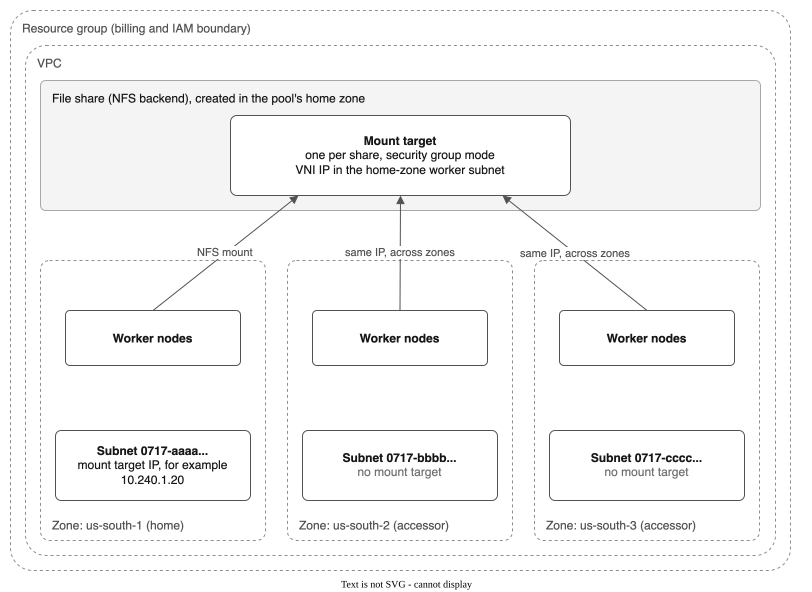
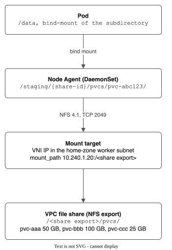
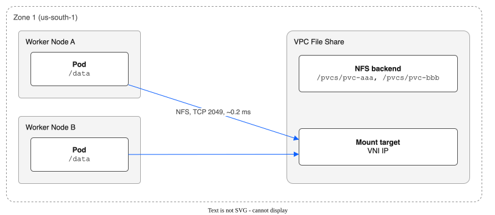
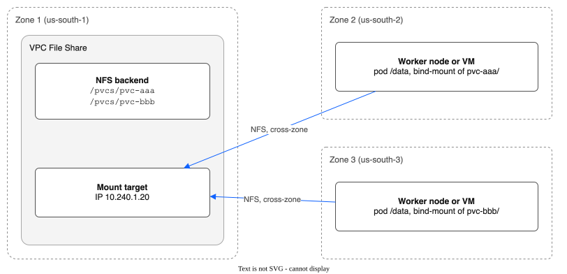
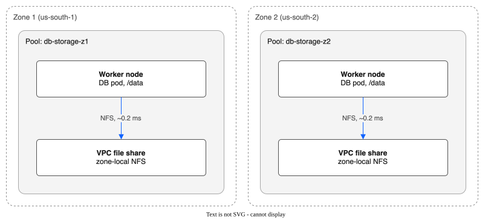
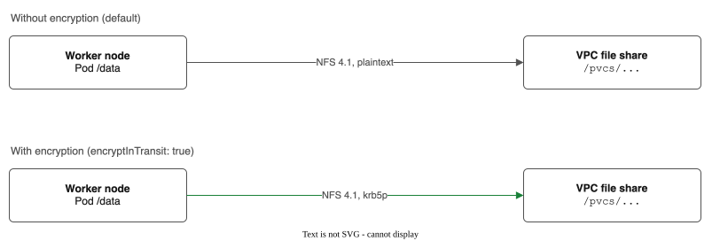

# VPC Networking and NFS Connectivity

This document explains how NFS traffic flows between Kubernetes worker nodes and IBM Cloud VPC file shares, what VPC resources are involved, and what prerequisites must be in place.

## VPC Resource Topology



Every file share in a pool belongs to the same VPC. Cross-VPC sharing is not supported.

## Mount Target Access Mode

The driver creates every share in **security group access mode**. IBM has deprecated VPC access mode: it reaches End of Support on 6 May 2027, and the API already refuses new VPC-mode mount targets with HTTP 501 `shares_not_implemented` (seen in `eu-de-1` and `eu-de-3`, October 2026).

In security group mode, the mount target has a **virtual network interface (VNI)**. A VNI is a network port with its own IP address in one subnet. Security groups on the VNI control which clients can reach NFS.

| Setting | Where the driver gets it |
|---------|--------------------------|
| **Subnet** | The cluster's worker subnet in the pool's zone. The driver reads every ID in `vpc_subnet_ids` from the `kube-system/ibm-cloud-provider-data` ConfigMap (or `--subnet-id`), asks the VPC API for each subnet's zone, and uses the one that matches `spec.zone`. If no subnet is in that zone, the pool reports an error and creates no share. |
| **Security groups** | The cluster's own group, `kube-<cluster ID>`, with the ID from the `kube-system/cluster-info` ConfigMap. This is the group IBM's own file CSI driver uses. A pool can set `spec.securityGroupIDs` to use other groups. |
| **NFS address** | The mount target's `mount_path`, for example `10.250.0.18:/83ad9ea6_1be6_...`. The server is an IP address, and the export path is specific to the share. |

### Mount Target Creation

The mount target is created **inline** with the file share, in one VPC API call. A share is never created without one: initial provisioning, proactive expansion and auto-expansion all build the request in one place. If a stable share has no mount target, the reconciler creates one with the same subnet and security groups.

The mount path may not be known at once when the share reaches `stable`. The driver polls for up to 2 minutes, and the reconciler's health check fills it in later if needed. A share counts as **ready** only when it is stable and its mount path is known. A pool with no ready share is `Degraded`, with the `SharesReady` condition naming the shares that have no mount target, and it does not add shares until the existing ones are usable.

## Network Path: End to End



All NFS traffic stays within the VPC private network. No traffic traverses the public internet.

## VPC Configuration Sources

The driver discovers VPC configuration from secrets and ConfigMaps that already exist on managed ROKS/ROVS/IKS clusters:

| Config | Source | Example |
|--------|--------|---------|
| VPC ID | ConfigMap `ibm-cloud-provider-data` | `r006-a1b2c3d4-...` |
| Subnet ID | ConfigMap `ibm-cloud-provider-data` | `0717-12345678-...` |
| Resource Group | Pool spec or secret provider default | UUID |
| Region | Derived from pool spec zone or API endpoint | `us-south` |

These are passed to the reconciler at startup via `SetVPCConfig(vpcID, subnetID, defaultResourceGroup)`.

## VPC API Endpoint Selection

The driver prefers **private endpoints** so VPC API traffic stays on the IBM Cloud backbone:

| Priority | Endpoint Pattern | When Used |
|----------|-----------------|-----------|
| 1st | `https://{region}.private.iaas.cloud.ibm.com/v1` | Clusters with private service endpoints (VPE/CSE) |
| 2nd | `https://{region}.iaas.cloud.ibm.com/v1` | Clusters with public endpoints |
| 3rd | Constructed from region name | Fallback |

On managed ROKS/ROVS/IKS clusters with private service endpoints enabled, all VPC API calls stay within the IBM network.

## Security Group Requirements

The mount target's VNI is a member of the security groups the driver gives it. With the default group, `kube-<cluster ID>`, no rule change is needed: that group allows all traffic between its members, and every worker is a member.

If a pool sets `spec.securityGroupIDs`, those groups must allow **inbound TCP 2049** from the worker nodes, and the worker security groups must allow the matching outbound traffic.

```
Mount target VNI (security groups from the pool, or kube-<cluster ID>)
  └── Inbound: TCP 2049 from the worker nodes   (required)
Worker node security groups
  └── Outbound: TCP 2049 to the mount target IP  (required)
```

The controller's IAM identity needs to read subnets and security groups, and to create shares and mount targets with a VNI. `VPC Infrastructure Services` **Editor** on the resource group covers this.

!!! warning "Common troubleshooting issue"
    If pods hang during mount with `nfs: server not responding` errors, check the security groups on the mount target's VNI: `ibmcloud is share-mount-target <share-id> <mount-target-id>`.

## Cross-Zone Access

### Single-Zone (Default)

A pool with only `spec.zone` creates shares and mount targets in one availability zone. All worker nodes and file shares are co-located — NFS traffic never leaves the zone.



```yaml
apiVersion: storage.ibm.io/v1alpha1
kind: FileSharePool
metadata:
  name: general-purpose
spec:
  zone: us-south-1
  # no accessorZones — single-zone only
```

Worker nodes in **other zones cannot access the share** unless accessor zones are configured. This is the simplest and lowest-latency configuration.

### Multi-Zone with Accessor Zones

```yaml
apiVersion: storage.ibm.io/v1alpha1
kind: FileSharePool
metadata:
  name: general-purpose
spec:
  zone: us-south-1
  accessorZones:
    - zone: us-south-2
      subnetID: "0717-12345678"
    - zone: us-south-3
      subnetID: "0717-87654321"
  # ...
```

One mount target, in the home zone, serves every zone. The driver records its IP address for each accessor zone in the pool status, and nodes in other zones mount it across zones over the VPC network. IBM documents cross-zone mounting for security group mode. This project has not yet tested it on a multi-zone cluster. The `subnetID` of an accessor zone is not used.

### Cross-Zone Traffic Flow

In a cross-zone pool, the file share lives in the home zone but pods on worker nodes in accessor zones access it over the VPC backbone:



All NFS traffic stays within the VPC private network — it never traverses the public internet.

### Cross-Zone Trade-offs

| Factor | Same-Zone | Cross-Zone |
|--------|-----------|------------|
| **NFS latency** | ~0.2ms | ~1-2ms |
| **Bandwidth cost** | Included | Metered cross-zone traffic |
| **Reliability** | Zone-local only | Inter-zone link dependency |
| **Failure mode** | `soft` mount returns error | `soft` mount returns error (no hang) |

**Good fit for cross-zone:** log storage, batch processing, model artifacts, config data — workloads that are read-heavy or latency-tolerant.

**Prefer same-zone for:** databases, real-time applications, latency-sensitive workloads — create a separate pool per zone instead.

### Alternative: One Pool Per Zone

For latency-sensitive workloads, avoid cross-zone NFS entirely by creating a **separate pool in each zone**. Each pool's shares and consumers stay zone-local.



No cross-zone NFS traffic.

```yaml
# Pool for zone 1
apiVersion: storage.ibm.io/v1alpha1
kind: FileSharePool
metadata:
  name: db-storage-z1
spec:
  zone: us-south-1
---
# Pool for zone 2
apiVersion: storage.ibm.io/v1alpha1
kind: FileSharePool
metadata:
  name: db-storage-z2
spec:
  zone: us-south-2
```

Use Kubernetes topology constraints (node affinity or `allowedTopologies` on the StorageClass) to ensure pods land in the same zone as their pool. This trades operational simplicity for guaranteed low latency.

### How the Node Agent Selects the Right IP

During `NodeStageVolume`, the node agent:

1. Reads its zone from the node's `topology.kubernetes.io/zone` label
2. Checks the VolumeContext for a zone-specific key (e.g., `server.us-south-2`)
3. If found, uses the zone-specific IP; otherwise falls back to the primary IP

This keeps cross-zone latency low and avoids metered cross-zone bandwidth charges.

## File Share Lifecycle and VPC API Timing

VPC file share operations are **slow** (30-90 seconds). The driver keeps them out of the CSI hot path, with one exception (auto-expand, below):

| Operation | Typical Duration | Where It Runs |
|-----------|-----------------|---------------|
| Create share + inline mount target | 30-90s | Pool reconciler (background) |
| Wait for mount target IP | 10-120s | Pool reconciler (background) |
| Expand share | 30-60s | Pool reconciler (background) |
| Delete share | 10-30s | Pool reconciler (background) |
| `CreateVolume` (pick existing share) | < 1s | CSI controller (hot path) |
| `NodeStageVolume` (NFS mount) | 1-5s | CSI node agent |
| `NodePublishVolume` (bind-mount) | < 1s | CSI node agent |

The CSI `CreateVolume` call normally creates no VPC resources. It picks an existing share from the pool and records a SubVolume CR. One exception: with `autoExpand` on, if no share has room, `Allocate` (`tryAutoExpand` in `pkg/pool/manager.go`) calls `CreateFileShare` inside the request and returns a retriable error, so the provisioner retries once the share is ready. All other VPC API calls happen in the pool reconciler's background loop.

## NFS Mount Options

```
nfsvers=4.1,soft,timeo=600,retrans=3
```

| Option | Value | Why |
|--------|-------|-----|
| `nfsvers` | `4.1` | Modern NFS protocol with better performance |
| `soft` | - | Returns errors instead of hanging indefinitely on NFS failure |
| `timeo` | `600` (60s) | Timeout in deciseconds before first retransmission |
| `retrans` | `3` | Maximum retransmissions before giving up |

!!! danger "Never use `hard` mount option"
    Hard mounts cause pods to hang **indefinitely** when the NFS server is unreachable. With `soft`, pods receive an error after ~3 minutes (60s x 3 retries) and can fail gracefully.

Optional encryption in transit adds `sec=krb5p` when `spec.encryptInTransit: true` is set on the pool.

## Mounts: One NFS Mount per Staged Volume

The node agent mounts at the staging folder kubelet gives for each volume. The volume ID includes the PV name, so each volume has its own staging folder. A second pod on the same volume reuses the mount. A different volume on the same share is mounted again:

```
Node with 3 PVCs from the same share:

  NFS mounts (3 total, one per staged volume):
    10.240.1.5:/ → <staging folder of aaa>/
    10.240.1.5:/ → <staging folder of bbb>/
    10.240.1.5:/ → <staging folder of ccc>/

  Bind mounts (one per pod):
    <staging folder of aaa>/pvcs/pvc-aaa/ → Pod A /data/
    <staging folder of bbb>/pvcs/pvc-bbb/ → Pod B /data/
    <staging folder of ccc>/pvcs/pvc-ccc/ → Pod C /data/
```

When `NodeStageVolume` is called for a share that's already mounted on the node, it's a no-op. The NFS mount is only removed when the last PVC using that share on the node is unpublished.

## Rate Limiting

The VPC API client enforces a client-side rate limit of **5 requests per second** to stay within IBM Cloud API rate limits. All operations go through `withAuth()` which combines rate limiting with IAM token refresh.

| HTTP Status | Error | Behavior |
|-------------|-------|----------|
| 404 | `ErrShareNotFound` | Treated as success for deletes (idempotent) |
| 429 | `ErrAPIRateLimit` | Retry with backoff |
| 401/403 | `ErrAuthentication` | Credential issue, check secrets |
| 500+ | Server error | Retry with backoff |

## Resource Group

All shares in a pool belong to the same IBM Cloud resource group, set via `spec.resourceGroup` on the FileSharePool CR. If not specified, the default resource group from the cluster's secret provider configuration is used. This controls:

- **IAM access control** — who can manage the shares
- **Billing** — cost tracking and quota enforcement

## Encryption in Transit

When `spec.encryptInTransit: true` is set on the pool, the mount target is created with `TransitEncryption: "user_managed"`. This adds Kerberos encryption (`sec=krb5p`) to the NFS mount, encrypting all data on the wire between the worker node and the file share.



With encryption, the mount options are `nfsvers=4.1,soft,timeo=600,retrans=3,sec=krb5p` and the mount target has `TransitEncryption: "user_managed"`. Traffic uses TCP 2049 within the VPC in both cases.

```yaml
apiVersion: storage.ibm.io/v1alpha1
kind: FileSharePool
metadata:
  name: compliant-storage
spec:
  zone: us-south-1
  encryptInTransit: true
  # ...
```

!!! note
    Encryption in transit adds CPU overhead on both the client (worker node) and server (file share backend). Use it when compliance requirements (HIPAA, PCI-DSS, etc.) mandate encrypted storage traffic. For workloads within a single VPC where the network is already trusted, the default plaintext NFS is sufficient.

## Summary: What Must Be in Place

Before deploying the driver, ensure these VPC resources and configurations exist:

| Prerequisite | How to Verify |
|-------------|---------------|
| VPC exists | `ibmcloud is vpcs` |
| Worker node subnet exists in target zone(s) | `ibmcloud is subnets --vpc <vpc-id>` |
| Security group allows TCP 2049 outbound | `ibmcloud is security-group-rules <sg-id>` |
| IAM credentials available (API key or pod identity) | Check `ibm-cloud-credentials` or `storage-secret-store` secret in `kube-system` |
| `ibm-cloud-provider-data` ConfigMap exists | `kubectl get cm ibm-cloud-provider-data -n kube-system` |
| File share quota sufficient | `ibmcloud is share-profiles` and account quotas |
