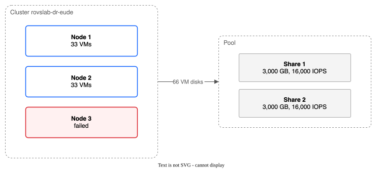

# Typical VM sizes, VM capacity of rovslab-dr-eude, and the shares needed

Date: 2026-10-24

Question answered: what does an everyday Linux or Windows Server VM look like, how many fit on the 3-node cluster `rovslab-dr-eude`, and how many dp2 shares do they need?

## Conclusion

- Recommended size for the sums: Linux 2 vCPU, 4 GiB, 50 GiB disk. Windows Server 2 vCPU, 8 GiB, 80 GiB disk. Disk sizes are my estimate (no source gives a typical disk).
- **Memory is the limit, not CPU or pod count.** With no memory overcommit and a mix of 2/3 Linux and 1/3 Windows: 132 VMs on all 3 nodes, and 66 VMs if one node can fail.
- Those VMs need 7,920 GiB (3 nodes) or 3,960 GiB (N+1) of provisioned disk, and about 2,300 to 4,600 average guest IOPS (3,700 to 7,400 IBM operations, at 1.6 operations per I/O of the test's block mix). If every VM bursts to 300 IOPS together, the need is 31,680 (N+1) or 63,360 (3 nodes) IBM operations.
- Proposal at 80 percent fill: N+1 is 2 shares of 3,000 GB at 16,000 IOPS. All 3 nodes is 4 shares of 3,000 GB at 16,000 IOPS. These are estimates.
- The running performance test on DR (one share at 3,000, 10,000 and 20,000 IOPS, up to 90 VMs) measures the real VMs per share. Put its number into the formula in section 8 and it replaces my IOPS-based share count.

## How to read this file

- Every number has a source link beside it. "My estimate" means no source exists and I chose the number. "Lower confidence" means only a secondary source exists.
- Units: Red Hat and KubeVirt use MiB and GiB. IBM writes GB and KB. I treat IBM's GB as 10^9 bytes and its KB as 1,024 bytes where IBM does not say. The cluster's memory figures are converted from the bytes Kubernetes reports to GiB (388.9 GB allocatable per node is 362.15 GiB).
- Sections 1 to 3 are research. Sections 4 to 8 are calculations.

## 1. Typical VM sizes: what the sources say

### 1.1 Vendor minimums (these are floors, not typical sizes)

| Item | Value | Source |
|---|---|---|
| Windows Server 2022, RAM | 1 GB Server Core, 2 GB with Desktop Experience | https://learn.microsoft.com/en-us/windows-server/get-started/hardware-requirements |
| Windows Server 2025, RAM | 2 GB Server Core. 2 GB with Desktop Experience, 4 GB recommended | same page |
| Windows Server, CPU and disk | 1.4 GHz 64-bit processor. 32 GB system disk, "an absolute minimum" | same page |
| Windows Server, recommended size | Microsoft says a recommended size "is unrealistic" to state, and tells you to test | same page |
| RHEL 9, RAM | 1.5 GiB minimum for install from local media or NFS. 3.5 GiB for network install on x86_64. No recommended figure on the page | https://docs.redhat.com/en/documentation/red_hat_enterprise_linux/9/html/interactively_installing_rhel_from_installation_media/system-requirements-and-supported-architectures_rhel-installer |
| RHEL 9, disk | 10 GiB minimum | same page |

Not found: the RHEL 10 page. I did not read it. Other websites quote "2 GB, 4 GB recommended" for RHEL 9. I could not trace that to a Red Hat page, so I do not use it.

### 1.2 Platform sizing guides (these show sizes people plan with)

| Source | What it defines | Link |
|---|---|---|
| KubeVirt common-instancetypes, u1 series | "General purpose", 1:4 vCPU to memory ratio, burstable CPU. nano 1 vCPU 512Mi, micro 1/1Gi, small 1/2Gi, medium 1/4Gi, 2xmedium 2/4Gi, large 2/8Gi, xlarge 4/16Gi, 2xlarge 8/32Gi | https://github.com/kubevirt/common-instancetypes/blob/main/README.md |
| KubeVirt common-instancetypes, o1 series | Same sizes as u1 (no 2xmedium). The only difference is that memory is overcommitted for higher density | same page |
| Red Hat OpenShift Virtualization Cluster Sizing Guide 3.1.0 (June 2026) | "Reasonable starting points" when real data is missing: Micro 1 vCPU 1 GiB. X-small 1/4 GiB. Small 2/8 GiB. Medium 4/24 GiB. Large 8/48 GiB. X-large 16/64 GiB. XX-large 32/96 GiB. It says to use real utilisation data when you have it | https://access.redhat.com/articles/7107457 (PDF attachment `openshift_virtualization_cluster_sizing_guide_v3.1.0.pdf`, link on that page: https://access.redhat.com/node/7107457/40/0/23834985) |
| Our own performance test spec | Linux 1 vCPU 2 GB. Windows Server 2022 2 vCPU 4 GB. 20 to 50 IOPS average, 300 IOPS bursts | `docs/specs/2026-10-24-performance-test-30-vms.md` |

The Red Hat guide's sizes are for a large estate (its example is 1,700 VMs with an average of 4.7 vCPU and 22.4 GiB). They are bigger than "everyday small" VMs. The guide gives no disk size and no IOPS.

### 1.3 Real estates (lower confidence)

I found no primary, published estate average from Dell Live Optics, Broadcom/VMware, AWS, Azure or Google. What I found:

| Source | What it gives | Confidence |
|---|---|---|
| Dell Live Optics help pages: https://www.dell.com/support/kbdoc/en-ie/000299118/live-optics-optical-prime-vtab and https://www.dell.com/support/kbdoc/en-ae/000299135/live-optics-optical-prime-vmware-guest-vm-performance | How Live Optics works out per-VM averages of vCPU, memory and disk used. It publishes no global averages | Method only, no numbers |
| Microsoft Azure Migrate documentation: https://learn.microsoft.com/en-us/azure/migrate/ | Tool documentation. No estate averages found | Method only, no numbers |
| One consultant's analysis of one estate of 756 VMs: https://occasional-it.com/2020/04/19/smart-sizing-2-analysis/ | Average 3.5 vCPU (range 1 to 29), 9.2 GB vRAM (2 to 128), 72 GB disk used (1.3 to 1,698). Source of the data is not named. Dated April 2020 | Lower confidence. One estate, secondary |
| Nutanix sizing lab answers: https://sizing-workshop.readthedocs.io/en/latest/datacollection/rvtools-lab1-answers/rvtools-lab1-answers.html | Three example clusters, 4.0 to 5.3 vCPU per core. Totals only, no per-VM figure | Lower confidence. Training example |

The 756-VM estate has a mean that is pulled up by a few big VMs (the maxima are 29 vCPU, 128 GB and 1.7 TB). The typical VM is smaller than the mean. This is my reading of the ranges, not a figure from the source.

### 1.4 Disk IOPS per VM (lower confidence)

| Source | What it gives | Confidence |
|---|---|---|
| Cisco lab blog, Windows 7 desktops on an all-flash array: https://news-blogs.cisco.com/datacenter/vdi-the-missing-questions-9-how-many-storage-iops | Steady state about 11 read plus 7 write IOPS per desktop (about 18). Boot storm about 260 read IOPS per desktop at peak, about 133 sustained for 5 to 6 minutes. The author says not to design from these numbers | Lower confidence. Desktops, not servers. Lab test |
| Our performance spec | Server VMs at 20 to 50 average and 300 burst. These are the issue's defaults, not measured | Assumption |

I found no primary source for the IOPS of an everyday server VM. The numbers in sections 5 to 7 use the spec's 35 average (the middle of 20 to 50) and 300 burst. The Cisco figures are the same order of size.

## 2. Table of typical small, medium and large VMs

| Size | Linux (vCPU / RAM / disk) | Windows Server (vCPU / RAM / disk) | Average IOPS | Source of each number |
|---|---|---|---|---|
| Small | 1 / 2 GiB / 20 GiB | 2 / 4 GiB / 60 GiB | 20 | Linux: u1.small (1.2); RHEL floor of 1.5 GiB and 10 GiB (1.1). Windows: 2025 "4 GB recommended" and 32 GB floor (1.1). Test spec sizes (1.2). Disk is my estimate |
| Medium | 2 / 4 GiB / 50 GiB | 2 / 8 GiB / 80 GiB | 35 | Linux: u1.2xmedium (1.2). Windows: between Red Hat X-small and Small (1.2). Disk is my estimate. IOPS: spec middle |
| Large | 4 / 16 GiB / 100 GiB | 4 / 16 GiB / 120 GiB | 50 | u1.xlarge (1.2). Close to the 3.5 vCPU, 9.2 GB mean of one estate (1.3). Disk is my estimate |

Where sources disagree: for RAM a medium VM runs from 4 GiB (u1.medium) to 8 GiB (Red Hat Small) to 9.2 GB (one estate's mean). For vCPU it runs from 1 to 4.

**Recommended size for the calculations: medium.** Linux 2 vCPU, 4 GiB, 50 GiB. Windows 2 vCPU, 8 GiB, 80 GiB. Reasons:
- It sits above every vendor floor (1.1) and equals a named KubeVirt size for Linux (1.2).
- It sits below the Red Hat example sizes, which are for big estates, and below the one-estate mean, which large VMs inflate.
- The test spec uses smaller VMs (Linux 1/2, Windows 2/4). Section 4.5 repeats the sums with those sizes, so the test and the plan can be compared.

## 3. What a VM costs the cluster

### 3.1 Memory overhead of the virt-launcher pod

Red Hat OpenShift Virtualization 4.20 gives this formula (https://docs.redhat.com/en/documentation/openshift_container_platform/4.20/html/virtualization/installing, section "Virtual machine memory overhead"; I read the single-page version, https://docs.redhat.com/en/documentation/openshift_container_platform/4.20/html-single/virtualization/index):

- Overhead per VM is about 0.002 x requested memory, plus 218 MiB, plus 8 MiB per vCPU, plus 16 MiB per graphics device, plus extra overhead.
- Extra overhead: 1 GiB for each SR-IOV device or GPU, 256 MiB for SEV, 53 MiB for TPM.
- The Red Hat Cluster Sizing Guide uses the same formula (https://access.redhat.com/articles/7107457).
- Overhead is added on top of the guest memory. The pod requests guest memory plus overhead.

The KubeVirt user guide says only that the default memory overhead is 32Mi for "additional system resources" and does not give this formula (https://kubevirt.io/user-guide/compute/resources_requests_and_limits/). I use the Red Hat formula because it covers the whole pod.

I do not add graphics devices, SR-IOV, GPU, SEV or TPM. Windows Server 2022 needs no TPM. A vTPM would add 53 MiB per VM, which is under 1 percent.

| VM | Guest memory | Overhead | Memory request |
|---|---|---|---|
| Linux 2 vCPU 4 GiB | 4,096 MiB | 8.2 + 218 + 16 = 242 MiB | 4,338 MiB = 4.237 GiB |
| Windows 2 vCPU 8 GiB | 8,192 MiB | 16.4 + 218 + 16 = 250 MiB | 8,442 MiB = 8.245 GiB |

### 3.2 CPU request

KubeVirt asks for 1/cpuAllocationRatio core per vCPU. The ratio defaults to 10 (https://kubevirt.io/user-guide/compute/resources_requests_and_limits/; the Red Hat guide says the same, https://access.redhat.com/articles/7107457). Your cluster has 10, so each vCPU requests 0.1 core. A 2 vCPU VM requests 0.2 core.

I did not add the small CPU requests of the other containers in the virt-launcher pod. I have no source for them. At 0.2 core per VM the CPU limit is far from binding (section 4), so a few extra millicores do not change the result.

### 3.3 Pod count

Each VM is one virt-launcher pod, so one pod per VM. The limit is 250 pods per node (your measurement). I do not know how many pods the other workloads use. I show the pod limit with those pods ignored, which is the best case.

## 4. How many VMs fit

### 4.1 Free room (from your measurements)

| Node | Allocatable memory | Requested | Free memory | Allocatable cores | Requested | Free cores |
|---|---|---|---|---|---|---|
| 1 | 362.15 | 124.97 | 237.2 | 95.68 | 40.2 | 55.48 |
| 2 | 362.15 | 105.56 | 256.6 | 95.68 | 48.5 | 47.18 |
| 3 | 362.15 | 115.79 | 246.4 | 95.68 | 47.3 | 48.38 |
| All 3 | 1,086.45 | 346.32 | **740.1** | 287.04 | 136.0 | **151.04** |

Memory is in GiB, converted from the bytes Kubernetes reports (for example, 388,858,399,457 bytes allocatable is 362.15 GiB). Cores are cores.

For N+1, one node fails and its other workloads restart on the two that remain. So I take the capacity of two nodes and subtract all the existing requests:

- Memory: 2 x 362.15 = 724.3, minus 346.32 = **378.0 GiB** free.
- Cores: 2 x 95.68 = 191.36, minus 136.0 = **55.36 cores** free.
- Pods: 2 x 250 = 500, minus the pods of other workloads (not known).

This treats memory as one pool. Real scheduling leaves small gaps on each node, so the true count is a little lower.

### 4.2 No memory overcommit (the default)

Mix: 2/3 Linux, 1/3 Windows, so a group of 3 VMs is 2 Linux plus 1 Windows. One group requests 2 x 4.237 + 8.245 = **16.72 GiB** and 0.6 core.

| Case | By memory | By CPU (0.2 core per VM) | By pods (ignoring other pods) | Binds |
|---|---|---|---|---|
| All 3 nodes, Linux only | 740.1 / 4.237 = 174 | 151.04 / 0.2 = 755 | 750 | Memory |
| All 3 nodes, Windows only | 740.1 / 8.245 = 89 | 755 | 750 | Memory |
| **All 3 nodes, mix** | 740.1 / 16.72 = 44.3, so 44 groups = **132 VMs** (88 Linux, 44 Windows) | 755 | 750 | **Memory** |
| N+1, Linux only | 378.0 / 4.237 = 89 | 55.36 / 0.2 = 276 | 500 less other pods | Memory |
| N+1, Windows only | 378.0 / 8.245 = 45 | 276 | 500 less other pods | Memory |
| **N+1, mix** | 378.0 / 16.72 = 22.6, so 22 groups = **66 VMs** (44 Linux, 22 Windows) | 276 | 500 less other pods | **Memory** |

### 4.3 With memory overcommit (not on in your cluster; shown for comparison)

How it works (Red Hat docs, https://docs.redhat.com/ko/documentation/openshift_container_platform/4.21/html/virtualization/virt-configuring-higher-vm-workload-density, and the Cluster Sizing Guide, https://access.redhat.com/articles/7107457):
- The HyperConverged setting is `memoryOvercommitPercentage`. The scheduler counts "assigned memory x (100 / percentage)" for each VM. 200 percent counts half of the guest memory. The docs allow 100 to 400 percent.
- It needs swap on every worker, set up with a MachineConfig. The wasp-agent component is deployed when the percentage is above 100 at the time the HyperConverged CR is first created. Swap should be at least as large as the overcommitted RAM (OKD copy of the same procedure: https://docs.okd.io/4.21/virt/post_installation_configuration/virt-configuring-higher-vm-workload-density.html).
- Only Burstable VM pods can swap. Without swap, Red Hat says overcommit is "strongly discouraged": the node's out-of-memory killer can end a running VM.
- Red Hat says the path of the setting differs between versions. Check it against the version you run. I read the 4.21 page only through a search result summary and the OKD copy, not the full Red Hat page, because the page was too large for my fetch tool.

I assume the overhead from section 3.1 is not reduced. I could not confirm that from the docs.

| Setting | Linux request | Windows request | Group of 3 | 3 nodes (mix) | N+1 (mix) |
|---|---|---|---|---|---|
| 100 percent (now) | 4.237 GiB | 8.245 GiB | 16.72 GiB | 132 VMs | 66 VMs |
| 200 percent | 2,048 + 242 = 2.237 GiB | 4,096 + 250 = 4.245 GiB | 8.72 GiB | 740.1 / 8.72 = 84 groups = **252 VMs** | 378.0 / 8.72 = 43 groups = **129 VMs** |

At 200 percent, CPU requests still allow 755 VMs (3 nodes) or 276 VMs (N+1), so memory still binds. The N+1 count of 129 VMs also uses 129 of the 500 pod places that remain.

This is a count of what the scheduler allows. It is safe only if the VMs' real memory use is about half of their configured memory (Red Hat: the working set decides, https://access.redhat.com/articles/7107457). I do not assume it is on.

### 4.4 Real CPU

CPU requests (0.1 core per vCPU) are bookkeeping, not use. A check against real demand:

- Red Hat plans CPU at 4:1 (4 vCPU per physical core) in its worked example. That turns a 4.7 vCPU average VM into about 1.2 cores (https://access.redhat.com/articles/7107457).
- VMware's design guide says 1:1 to 3:1 is "not typically an issue", 3:1 to 5:1 may show performance loss, and 6:1 or more often causes problems. It quotes these as rules of thumb, not measurements. Source: VMware vCloud Architecture Toolkit, section 5.8, https://download3.vmware.com/vcat/vmw-vcloud-architecture-toolkit-spv1-webworks/Core%20Platform/Architecting%20a%20vSphere%20Compute%20Platform/Architecting%20a%20vSphere%20Compute%20Platform.1.019.html. I read this only through a search result summary, not the page. Lower confidence.
- An old Dell/vKernel paper says physical servers averaged only 5 to 15 percent use (https://virtualizationreview.com/~/media/ECG/Tech%20Library%202013/04/DELL%20VKERNEL%20APRIL/Dell%20%20%20Best%20Practices%20for%20Oversubscription%20of%20CPU%20%20Memory%20and%20Storage%20in%20vSphere%20Virtual%20Environments_0.ashx). It is about 10 years old. I read it only through a search summary. Lower confidence.

Sums with my sizes (every VM has 2 vCPU, so 2 vCPU each):

| Case | VMs | vCPU | At 4:1 (0.25 core per vCPU) | At 15 percent of a vCPU |
|---|---|---|---|---|
| 3 nodes | 132 | 264 | 66 cores | 40 cores |
| N+1 | 66 | 132 | 33 cores | 20 cores |

Compare with the free room in 4.1: the surviving two nodes have 191 allocatable cores. Real use of the other workloads is not known (I have only their requests), so I cannot say how much of that is idle. VM CPU is not the limit at these counts under either assumption.

### 4.5 Same sums with the test spec's smaller VMs

Linux 1 vCPU 2 GiB: overhead 4.1 + 218 + 8 = 230 MiB, request 2.225 GiB. Windows 2 vCPU 4 GiB: 242 MiB overhead, request 4.237 GiB. A group of 3 requests 8.69 GiB.

| Case | Mix VMs |
|---|---|
| 3 nodes, no overcommit | 740.1 / 8.69 = 85 groups = 255 VMs |
| N+1, no overcommit | 378.0 / 8.69 = 43 groups = 129 VMs |

So the 90-VM test fits in the N+1 case (129 VMs) with room to spare.

## 5. Disk, IOPS and throughput of the maximum VM count

### 5.1 Capacity

My disk sizes: Linux 50 GiB, Windows 80 GiB (section 2).

| Case | Linux | Windows | Provisioned total |
|---|---|---|---|
| N+1 (66 VMs) | 44 x 50 = 2,200 GiB | 22 x 80 = 1,760 GiB | **3,960 GiB** (4,252 GB) |
| 3 nodes (132 VMs) | 88 x 50 = 4,400 GiB | 44 x 80 = 3,520 GiB | **7,920 GiB** (8,504 GB) |

Thin files: this driver's VM disks are raw files, and raw files on NFS can be sparse, so unwritten space uses nothing (`docs/VM-DISK-FORMATS.md`, "Sparse Files and Thin Provisioning"; its example is 100 GB logical, 12 GB used). The pool counts logical (requested) size, not used size, when it places a volume (same file). So the share must be sized for the provisioned total, even if real use is lower. One estate averaged 72 GB used per VM (1.3), which is above my disk sizes, so I do not assume large savings.

Not confirmed: whether a cloned disk stays sparse. I searched `docs/VOLUME-CLONING.md` and `pkg/pool/clone*.go` for "sparse" and found nothing. A clone that copies the full size would use the full logical size. Treat clones as full size until tested.

### 5.2 IOPS and throughput

IOPS per VM: average 35 (range 20 to 50) and burst 300 (section 1.4, spec).

| Case | Average (35 each) | Range at 20 to 50 | Typical peak: 10 percent of VMs burst, rest at 35 | Worst case: all VMs burst at 300 |
|---|---|---|---|---|
| N+1 (66) | 2,310 | 1,320 to 3,300 | 7 x 300 + 59 x 35 = 4,165 | 19,800 |
| 3 nodes (132) | 4,620 | 2,640 to 6,600 | 13 x 300 + 119 x 35 = 8,065 | 39,600 |

These are guest I/Os. IBM counts more (next list).

The 10 percent burst share is my estimate. The worst case is the spec's patch window (all VMs at 300 for 10 minutes).

How IBM counts operations (https://cloud.ibm.com/docs/vpc?topic=vpc-file-storage-profiles): "IOPS values are based on a 16 KB block size for all profiles, with a 50-50 random workload. Each 16 KB of data that is read or written counts as one read/write operation. A single write of less than 16 KB counts as a single write operation." (The repo's earlier research quotes the same text.) So:

- IBM operations = sum over I/Os of ceil(size / 16 KB). An I/O of 16 KB or less counts as 1. A 64 KB I/O counts as 4.
- My IOPS figures above are guest I/Os. The performance test's block mix (50 percent 4k, 30 percent 16k, 20 percent 64k, `test/perf/profile.sh`) counts as 1.6 IBM operations per I/O on average. I use that factor: average N+1 2,310 x 1.6 = 3,696, 3 nodes 4,620 x 1.6 = 7,392; all-burst N+1 19,800 x 1.6 = 31,680, 3 nodes 39,600 x 1.6 = 63,360. The mix is the test's model, not a measurement of real VMs. Larger I/O (backup scans, boot, copy) raises the factor.

Throughput:
- IBM sets the maximum bandwidth as IOPS x 256 KB. The dp2 maximum is 8,192 Mbps (same IBM page).
- The mix's average I/O is 0.5 x 4 + 0.3 x 16 + 0.2 x 64 = 19.6 KiB. Average throughput is 35 x 19.6 KiB = 0.67 MiB/s per VM: about 44 MiB/s for N+1 and 88 MiB/s for 3 nodes.
- Worst case (all burst): N+1 19,800 x 19.6 KiB = about 379 MiB/s, 3 nodes about 758 MiB/s, so about 190 MiB/s per share in either proposal. That is far under the 8,192 Mbps (about 1,000 MiB/s) dp2 limit of one share.

## 6. Proposed dp2 shares

IBM rules used (https://cloud.ibm.com/docs/vpc?topic=vpc-file-storage-profiles, https://cloud.ibm.com/docs/vpc?topic=vpc-quotas, https://cloud.ibm.com/docs/vpc?topic=vpc-file-storage-vpc-about):
- Size 10 to 32,000 GB. Allowed IOPS depend on size. The table is the one in `docs/specs/2026-10-24-performance-test-30-vms.md` and matches IBM's page: 2,000 to 3,999 GB allows 200 to 40,000 IOPS. 4,000 to 7,999 GB allows 300 to 40,000. 8,000 to 15,999 GB allows 500 to 64,000.
- Up to 300 file shares per account per region. One mount target per share per VPC. 256 hosts per mount target.
- A share used by one client is limited to 48,000 IOPS. The 96,000 maximum needs several clients (IBM profile note). Not a limit at these sizes.

Headroom: fill each share to 80 percent at most. This is the default target utilisation in `docs/CAPACITY-PLANNING.md` (80 percent). Reasons: thin disks grow as VMs write (warning in `docs/VM-DISK-FORMATS.md`), snapshots use share space (a copy is charged the volume's size, an instant VM snapshot a tenth of it; `docs/CAPACITY-PLANNING.md`), and a share without room refuses a snapshot.

Capacity needed at 80 percent fill:
- N+1: 4,252 GB / 0.8 = **5,315 GB**.
- 3 nodes: 8,504 GB / 0.8 = **10,630 GB**.

Proposal (estimate until the test result replaces it):

| Case | Shares | Size each | IOPS each | Total capacity | Total IOPS | Fill |
|---|---|---|---|---|---|---|
| N+1, 66 VMs | 2 | 3,000 GB | 16,000 | 6,000 GB | 32,000 | 71 percent |
| 3 nodes, 132 VMs | 4 | 3,000 GB | 16,000 | 12,000 GB | 64,000 | 71 percent |

Why 16,000 IOPS: each share carries 33 VMs in both cases. If all of them burst at 300, that is 9,900 guest I/Os, or 33 x 300 x 1.6 = 15,840 IBM operations a second. 16,000 covers that. This meets the worst case on paper. It assumes the test's block mix and an even spread of VMs across shares. If the burst I/O is larger, the IBM count is higher and this is too low. 16,000 is under the 48,000 limit for a share used by one client. The 3,000 GB size is in the 2,000 to 3,999 GB row, which allows up to 40,000 IOPS, so there is room to raise IOPS without resizing.

Two shares in the N+1 case means a lost share takes half the VMs. Four shares limits that to a quarter. More, smaller shares spread the risk but each smaller share allows fewer IOPS (a 1,000 to 1,999 GB share allows up to 20,000). I did not choose on cost, because no budget was set. Cost of the IOPS is not calculated here.

## 7. Where the numbers are weak

- Memory is the limit in every case. Anything that changes VM memory changes the count in direct proportion. A group at Red Hat's "Small" size (2/8 GiB) for all VMs would give fewer VMs than shown.
- Average and burst IOPS are assumptions. The performance test measures them.
- Disk sizes are my estimates. Used space could be much lower, but clones may not be sparse.

## 8. Swap in the performance test result

A performance test is running on DR now: one share at 3,000, 10,000 and 20,000 IOPS, with up to 90 VMs. It finds how many VMs one share carries before latency rises. Its result replaces my IOPS-based share count (section 6). The formulas, so you can put the measured number in:

- VMs per share (measured) = the knee count x 0.8. The spec recommends 80 percent of the knee.
- Shares for the IOPS = ceil(VM count / VMs per share at the chosen IOPS tier).
- Shares for the capacity = ceil((provisioned GiB / 0.8) / share size in GB).
- Shares needed = the larger of the two.
- Check the result against the cluster limit: VM count = the smaller of the memory, CPU and pod counts in section 4.

Example with a made-up number: if one 16,000 IOPS share carries 40 VMs at the safe point, then for 66 VMs: ceil(66 / 40) = 2 shares for IOPS, and ceil(5,315 / 3,000) = 2 for capacity. Shares needed = 2.

The test's VMs are the smaller test sizes (Linux 1/2, Windows 2/4). The IOPS per VM does not depend on RAM, so the count carries over. Disk per VM is larger in my sizing, so re-check the capacity formula.

## Decisions I made

- Used medium VMs: Linux 2 vCPU 4 GiB 50 GiB, Windows 2 vCPU 8 GiB 80 GiB.
- Used the Red Hat 4.20 overhead formula (0.002 x memory + 218 MiB + 8 MiB per vCPU), not the KubeVirt 32Mi note.
- Converted the cluster's memory from bytes to GiB.
- For N+1, moved all existing workloads onto the two surviving nodes before counting free room.
- Pooled memory across nodes and ignored fragmentation.
- Ignored the other pods' count and the small CPU requests of the virt-launcher helper containers.
- Used 35 average and 300 burst IOPS from the spec because I found no primary source for server VMs.
- Used a 10 percent burst share for "typical peak" and all VMs for "worst case".
- Kept the pool count at logical (provisioned) disk size and 80 percent fill.
- Sized IOPS per share for the all-burst case at the test's block mix (1.6 IBM operations per I/O).
- Chose 3,000 GB shares so IOPS can rise to 40,000 without resizing.
- Did not assume memory overcommit is on.

## Claims I could not source

- A typical disk size (provisioned or used) for small, medium and large VMs: no source. The only data point is one estate at 72 GB used.
- Published estate averages (vCPU, RAM, disk, IOPS) from Dell Live Optics, Broadcom, AWS, Azure or Google: not found. Their pages describe methods only.
- IOPS of an everyday server VM: no primary source. Only desktop lab figures (Cisco) and the spec's assumption.
- RHEL 10 system requirements: not read.
- A recommended RHEL 9 RAM figure on a Red Hat page: the page gives only minimums.
- Whether memory overcommit also shrinks the per-VM overhead: not confirmed.
- Whether VM clone copies stay sparse: not found in the repo docs or code.
- CPU requests of the other containers in the virt-launcher pod: no source.
- Pod count of the existing workloads on the cluster: not measured.
- The VMware vCAT section 5.8 and the Dell/vKernel paper were read through a search summary only.

## Sources

- Microsoft, Windows Server hardware requirements: https://learn.microsoft.com/en-us/windows-server/get-started/hardware-requirements
- Red Hat, RHEL 9 system requirements: https://docs.redhat.com/en/documentation/red_hat_enterprise_linux/9/html/interactively_installing_rhel_from_installation_media/system-requirements-and-supported-architectures_rhel-installer
- Red Hat, OpenShift Virtualization 4.20 (memory overhead formula): https://docs.redhat.com/en/documentation/openshift_container_platform/4.20/html-single/virtualization/index and https://docs.redhat.com/en/documentation/openshift_container_platform/4.20/html/virtualization/installing
- Red Hat, OpenShift Virtualization Cluster Sizing Guide 3.1.0: https://access.redhat.com/articles/7107457 and https://access.redhat.com/node/7107457/40/0/23834985
- Red Hat, higher VM workload density (4.21): https://docs.redhat.com/ko/documentation/openshift_container_platform/4.21/html/virtualization/virt-configuring-higher-vm-workload-density
- OKD, same procedure: https://docs.okd.io/4.21/virt/post_installation_configuration/virt-configuring-higher-vm-workload-density.html
- KubeVirt user guide, resource requests and limits: https://kubevirt.io/user-guide/compute/resources_requests_and_limits/
- KubeVirt common-instancetypes: https://github.com/kubevirt/common-instancetypes/blob/main/README.md
- IBM Cloud, File Storage for VPC profiles (dp2 table, 16 KB counting, bandwidth): https://cloud.ibm.com/docs/vpc?topic=vpc-file-storage-profiles
- IBM Cloud, VPC quotas (300 shares per account per region, mount targets): https://cloud.ibm.com/docs/vpc?topic=vpc-quotas
- IBM Cloud, File Storage for VPC about (32,000 GB, 256 hosts): https://cloud.ibm.com/docs/vpc?topic=vpc-file-storage-vpc-about
- Dell Live Optics help: https://www.dell.com/support/kbdoc/en-ie/000299118/live-optics-optical-prime-vtab and https://www.dell.com/support/kbdoc/en-ae/000299135/live-optics-optical-prime-vmware-guest-vm-performance
- Azure Migrate documentation: https://learn.microsoft.com/en-us/azure/migrate/
- One 756-VM estate analysis (lower confidence): https://occasional-it.com/2020/04/19/smart-sizing-2-analysis/
- Nutanix sizing workshop RVTools answers (lower confidence): https://sizing-workshop.readthedocs.io/en/latest/datacollection/rvtools-lab1-answers/rvtools-lab1-answers.html
- Cisco, VDI IOPS lab blog (lower confidence): https://news-blogs.cisco.com/datacenter/vdi-the-missing-questions-9-how-many-storage-iops
- VMware vCAT, vCPU-to-pCPU ratio (lower confidence, search summary): https://download3.vmware.com/vcat/vmw-vcloud-architecture-toolkit-spv1-webworks/Core%20Platform/Architecting%20a%20vSphere%20Compute%20Platform/Architecting%20a%20vSphere%20Compute%20Platform.1.019.html
- Dell/vKernel oversubscription paper (lower confidence, search summary): https://virtualizationreview.com/~/media/ECG/Tech%20Library%202013/04/DELL%20VKERNEL%20APRIL/Dell%20%20%20Best%20Practices%20for%20Oversubscription%20of%20CPU%20%20Memory%20and%20Storage%20in%20vSphere%20Virtual%20Environments_0.ashx
- This repo: `docs/specs/2026-10-24-performance-test-30-vms.md`, `docs/VM-DISK-FORMATS.md`, `docs/CAPACITY-PLANNING.md`, `docs/research/2026-10-24-storage-benchmark-tools.md`
