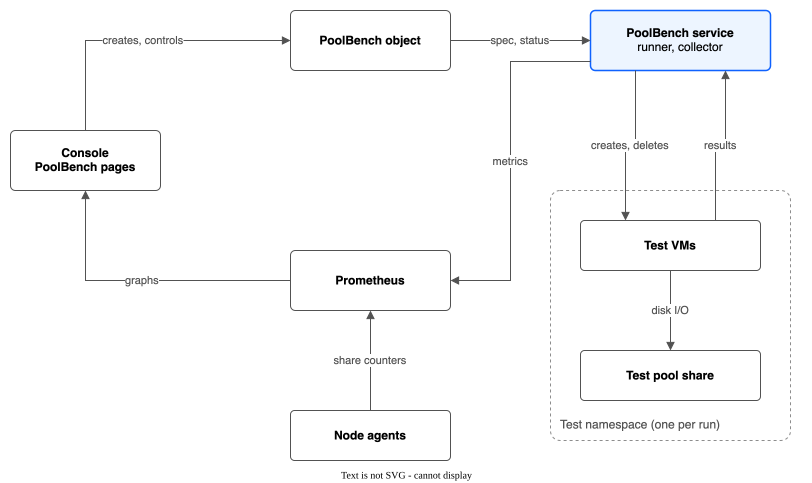
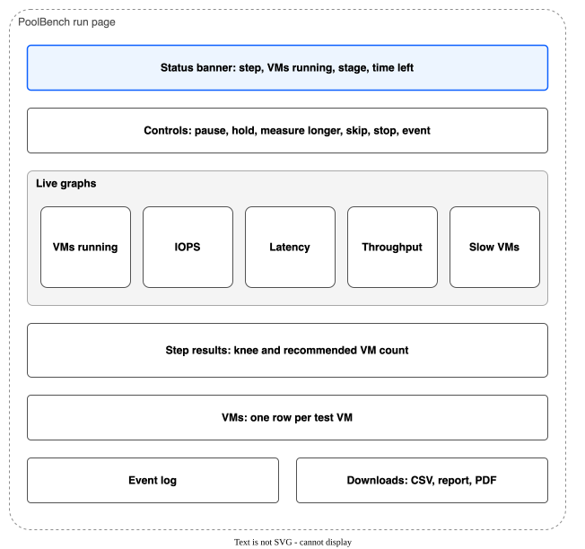

# Spec: PoolBench, a storage performance test in the console

Date: 2026-10-25. Status: draft for review. It builds on the performance test spec (`2026-10-24-performance-test-30-vms.md`, issue #118) and the VM capacity research (`docs/research/2026-10-24-vm-sizes-and-cluster-capacity.md`).

## Goal

An administrator opens the OpenShift console and, without a terminal, can:

- set up a performance test of a file pool share with VMs, with every setting the command-line test has;
- start it, watch it live, and control it while it runs (pause, hold, skip a step, stop);
- see at every moment how many VMs are running, what the share does, and how the VMs feel;
- get a final result in the style of VMware HCIBench: one row per VM count, the knee, and the recommended VM count for that share;
- keep, compare and download the results of earlier runs.

"Comprehensive" is the bar: every fact a person needs to trust the result or to stop a bad run must be on the page, with help text. A person must never need a terminal to find out what the test is doing.

## What exists today (from the repo and the lab clusters)

- **The command-line test** in `test/perf/` (`run-tier.sh`, `collect.sh`, `report.sh`, `profile.sh`, `guest.sh`, `windows/`). It runs from the build server with a kubeconfig. It makes a pool with one share, adds VMs in steps of 15 (1 in 3 Windows), lets them settle, measures, applies the knee rule, writes a CSV and a Markdown report, and cleans up. It has run the 3,000 IOPS tier (knee at 45 VMs, recommended 30) and is running the 10,000 IOPS tier on `rovslab-dr-eude`.
- **How the test reads the VMs today.** Each guest prints one result line per load phase on its serial console. `collect.sh` reads the console logs after each step. So results arrive only at the end of a step, and only to the machine that runs the script.
- **Share counters.** The node agents publish NFS operations, latency and bytes for each share (`vpc_file_pool_share_nfs_*`, see `docs/MONITORING.md`). Prometheus keeps them.
- **The console plugin** has a Monitoring page with time graphs that read Prometheus (`TimeSeriesChart.tsx`, `use-pool-metrics.ts`), a Dashboard, and tabs under VPC File Pools for pools, volumes, snapshots, replication, migration and backups. It checks the person's rights by access review before an action (the backup UI pattern).
- **Not built in the command-line test yet:** boot storm, patch window, and a live migration, snapshot and backup under load.

## The gap

The test needs a terminal, a kubeconfig on a build server, and someone who reads logs. Nothing is live: a person sees a step's result 45 to 60 minutes after it starts. There is no control except killing the script, and no place where old results are kept and compared.

## Design that meets the goal

### The parts

1. **A `PoolBench` resource** (cluster-scoped, `storage.ibmcloud.io/v1alpha1`). Its spec holds every setting of the run. Its status holds the live state and the results table. All state is in this object, as for the other features.
2. **The PoolBench service**: a new Deployment in the driver namespace, off by default (`poolBench.enabled` in Helm). One replica with leader election. It has its own service account, so the CSI controller's rights do not grow. It does two jobs:
   - **Runner.** A reconciler moves each `PoolBench` through its stages and records each stage in the status. If the pod restarts, it reads the status and goes on from the same stage. It never loses a run and never starts a step twice.
   - **Collector.** An HTTP endpoint inside the cluster. Each test VM sends its result line to it at the end of every load phase (Linux with `curl` from the cloud-init script, Windows with `Invoke-WebRequest` from `load.ps1`). The collector publishes the results as Prometheus metrics and keeps the raw lines on a small results volume.
3. **The PoolBench pages** in the console plugin, a new tab "PoolBench" under VPC File Pools.

Sending results to the collector replaces reading the serial console. Results then arrive within seconds of each phase, from every VM, and the console log stays only as a fallback for a VM that cannot reach the collector.

### Safety: the test never touches real VMs' storage

- Every run makes **its own new pool and share** and **its own namespace** (`poolbench-<run name>`). Nothing is shared with other pools. Every object carries the run label, and the end of a run deletes them all and checks in the VPC that the share is gone, as the command-line test does.
- A finalizer on `PoolBench` makes sure that deleting the object, or a failed run, still cleans up.
- The test VMs still use the nodes' CPU, memory and network. The new-run form checks free room first (below) and the page says plainly that real VMs share the nodes.
- Only a cluster administrator can create a `PoolBench` (cluster-scoped, plus an access review in the console). The admission webhook refuses a run that does not fit the IBM `dp2` size and IOPS table, or the cluster.

### What the person can set (the new-run form)

Every setting has help text and a sensible default. **Presets** fill the form: "Quick check" (5 VMs, 10 minutes), "One tier" (the spec's full ramp), "Three tiers" (3,000, 10,000 and 20,000 IOPS one after another).

- **Share:** size in GB and IOPS, with the allowed IOPS range for that size shown live from the `dp2` table. The form works out the size the VMs need and warns if the share is too small.
- **VM mix:** VMs per step (15), number of steps or the largest VM count (90), the Windows share of the mix (1 in 3, or none), and the Linux and Windows sizes (vCPU, memory). Windows needs the prepared image; the form shows whether it exists and when its evaluation licence ends.
- **Load profile:** steady IOPS per VM, burst IOPS, burst length and gap, read and write mix, block size mix. The form shows the resulting demand per step in IOPS and in IBM operations (the 1.6 factor of the research note) beside the share's limit.
- **Timing:** settle minutes and measure minutes per step. The form shows the expected total run time.
- **Knee rule:** the latency limit (20 ms), the share of VMs that may be over it (a quarter), the stall time (5 s), and whether the run stops at the knee.
- **Events at a chosen step** (optional): boot storm, patch window, live migration, snapshot, backup.
- **At the end:** delete everything (default), or keep the VMs and pool for a look (the page then shows a "Clean up now" button and a cost warning).

Before **Run**, a check panel shows: free CPU and memory on the nodes against the largest step, also with one node down (the N+1 rule of the research note); the share size and IOPS and how long it will exist; whether the images exist; and anything that would block the run. The button stays off until every blocking check passes.

### The run page

1. **Status banner.** Stage and progress in plain words, for example "Step 3 of 6: 45 VMs running (15 Windows), measuring, 20 min left". Also the run's start, expected end, and share size and IOPS.
2. **Controls**, each with a short note of what it does:
   - **Pause / Resume.** The VMs stop their load; the clock of the step stops.
   - **Hold at this step.** Keep measuring this VM count until the person says go on.
   - **Measure longer.** Add minutes to the current step.
   - **Skip to the next step.** End this step now; its row is marked "cut short".
   - **Stop and clean up.** End the run and delete everything; confirmed with a dialog.
   - **Run an event now.** Boot storm, patch window, migration, snapshot or backup, at the current step.
3. **Live graphs**, all with the same time axis, a marker at the start of each step and at each event, and a range picker:
   - **VMs running**, Linux and Windows stacked, and VMs that are not ready yet.
   - **IOPS**: share NFS IOPS, guest IOPS, and IBM operations, against the share's IOPS limit.
   - **Latency**: the VMs' p50, p95 and p99, and the share's average latency per request, against the 20 ms line.
   - **Throughput** in MB/s, read and write.
   - **Slow VMs**: the percent of VMs over the latency limit, against the knee threshold.
4. **Step results** (the HCIBench-style table): VMs (Linux and Windows), share IOPS, guest IOPS, IBM operations and percent of the limit, p50, p95 and p99, percent of VMs slow, stalls, time to ready, and a pass or fail per step. The knee row and the recommended count are marked, with one sentence that explains the result.
5. **VMs.** One row per test VM: name, OS, node, state, last IOPS, last p95, slow phases, stalls. A row opens that VM's result lines and console log.
6. **Event log.** Every stage change, control action, warning and error, with the time.
7. **Downloads:** step table (CSV), raw VM results (CSV), the report (Markdown), and a print view that the browser saves as PDF.

### Other pages

- **Runs list:** name, share size and IOPS, state, VMs now, knee, recommended count, started, run time. A failed run shows its reason in plain words.
- **Compare:** pick two or more finished runs and see their step results side by side, and one graph of p95 latency against VM count, one line per run. This is how a person reads the three tiers together.
- **Help:** the knee rule, the profile, what IBM operations are, and the limits below, in plain words, linked from every card.

### Measurements kept and for how long

- The step table, the knee, the settings and the summary stay in the `PoolBench` status for as long as the object exists.
- The raw results stay on the results volume until the `PoolBench` is deleted.
- The live graphs read Prometheus. After Prometheus drops old data (15 days by default), the run page shows the step table and the raw results, but not the graphs. The page says so.

### Metrics added

The collector publishes, per run, step and VM: guest IOPS, p50, p95 and p99 latency, slow phases and stalls; and per run: VMs running by OS, VMs not ready, current step and stage. They go into `docs/MONITORING.md`.

## Plan (one PR each, in this order; each with tests, help text, `FEATURES.md` and `CHANGELOG.md` lines)

1. **The `PoolBench` resource and its admission checks**, with `make generate` and `docs/CRD-SPEC.md`.
2. **The collector**, and the guest scripts that send to it. A golden-file test keeps the Go load profile and the Bash profile the same.
3. **The runner**: stages, steps, knee rule, cleanup, finalizer, restart in the middle of a run. Tested with fake clients.
4. **Helm**: the Deployment, its service account and rights, the service, the results volume, metrics scraping; off by default. `docs/HELM-VALUES.md`.
5. **Console: runs list and run page** with banner, step table, VM table and event log.
6. **Console: live graphs.**
7. **Console: new-run form** with presets, live checks and the check panel.
8. **Console: controls, downloads, print view and compare.**
9. **Events:** boot storm, patch window, migration, snapshot and backup under load, in the runner and the form.
10. **Lab check on `rovslab-dr-eude`:** run the 3,000 IOPS tier from the console and compare with the command-line result (knee at 45, recommended 30). Both must agree within the noise of the share.

After step 10, the command-line runner stays for the build server until the console run agrees with it. Then a later PR makes `run-tier.sh` create a `PoolBench` instead of doing the work itself, so there is one runner, not two.

## Cost, effort and risk

- **Effort:** large, about 10 PRs, near the size of the backup UI. The runner (PR 3) and the run page (PRs 5 to 8) are most of it.
- **Cost:** a run costs what the command-line test costs: one share for the run's length (a 3,900 GB share for about 8 hours per tier), deleted at the end. Leaving the resources kept after a run costs money until "Clean up now".
- **Risk:**
  - The test VMs load the nodes' CPU and network. On a cluster with real VMs, the check panel and the N+1 rule limit this, but a run can still slow real VMs' network. The page says so before Run.
  - A run that cannot clean up (for example the VPC API is down) leaves a share that costs money. The finalizer keeps trying, and the page shows a red banner until the share is gone.
  - The PoolBench service has rights to create namespaces, VMs and pools. Its own service account, admin-only access, and the feature being off by default limit this.
  - The VMs must reach the collector over the pod network. If a cluster blocks this, the runner falls back to reading the console logs, and the live graphs then update once per step.

## Decisions I made for you

- The name is PoolBench (the owner chose it).
- The test runs inside the cluster as its own service, not from the build server, so the console can start it, show it live and control it.
- The service is off by default and has its own rights, so a normal install does not gain the right to create VMs.
- Every run makes its own pool, share and namespace and deletes them at the end, so real VMs' storage is never loaded.
- VMs send each result to the service as it happens, instead of the service reading console logs after each step. The console log stays as a fallback.
- Only cluster administrators can start a run.
- The form blocks a run that does not fit the cluster with one node down.
- The PDF comes from the browser's print view, so no PDF library is added.
- Results stay until the run object is deleted; the graphs last as long as Prometheus keeps its data.
- The command-line runner stays until the console run gives the same result, then becomes a thin starter for PoolBench.
