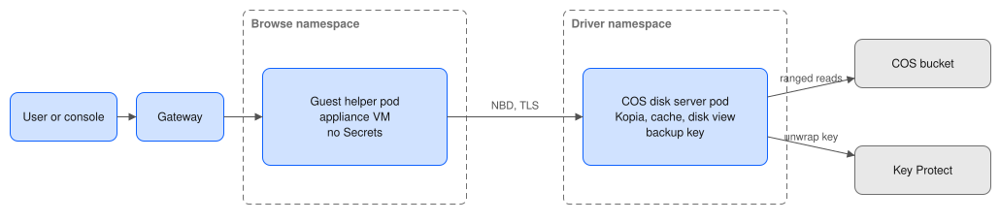

# Spec: browse and restore files from VM disks in COS (issue #92, phase 6)

Date: 2026-10-29. Status: draft for review. It fills in phase 6 of `2026-10-22-backup-file-restore.md` (the parent spec). Read section 3 ("VM disks") and section 4 ("Backups in COS") of the parent first. It builds on phase 4 (COS, plain volumes, merged) and phase 5 (VM disks in the snapshot pool, PRs #337, #338, #341 and #342, not merged and not yet run on the lab). Facts here come from `main` and the `vm-browse-c2` branch on 29 Oct 2026.

## Goal

This is the parent spec's goal, **like Veeam**, for the last case it does not cover yet: a VM disk whose backup is only in COS. This happens when the moment is older than every local restore point, when the snapshot pool is lost, or when the backup is opened in a different cluster.

When this is done:
- A user picks a VM disk and a moment held in COS. They list the guest's file systems and folders, download a file, and restore files or folders to a new or an existing claim. In the console and with `kubectl backup`, exactly as for the snapshot pool.
- **Nothing downloads the whole disk.** Only the parts of the disk that the guest's file system reads are fetched from COS.
- It works in a second cluster that has the COS Secrets and no policy (`--from-cos`), for cluster administrators, as in phase 4.

**Speed bar.** The goal is met if, for a 100 GiB disk with a 30 GiB XFS or NTFS file system, using the private COS endpoint in the same region:
- the file system list shows within **5 minutes** of asking,
- a folder of 1,000 entries lists within **30 seconds**,
- a 1 GiB file downloads at **50 MiB/s or more** after its first byte.

These numbers are my estimate of what makes the feature usable. They are not measured yet. Phase 6a measures them. If they are missed by a wide margin, I will show you the real numbers before more is built.

## What exists today

- **Disk view (phase 5).** `pkg/replication/diskview.go` shows a backed-up disk at one moment, read-only. It rebuilds the old contents from the latest `disk.img` and the undo files, on every read. It opens these by path on the NFS share, and it watches for a new copy starting (`ErrDiskChanged`).
- **NBD server (phase 5).** `pkg/nbd` serves anything that can be read at an offset (`io.ReaderAt` and a size) to the appliance VM.
- **Guest helper (phase 5).** The disk server and the libguestfs appliance run in **one container** of the helper pod and talk over a local socket. The helper pod runs in the browse namespace and holds no Secrets.
- **Guest restore Job (phase 5, #341).** It is split into a reader, which parses the disk and holds no rights, and a writer, which holds only the target and `CHOWN`/`FOWNER`.
- **COS reader (phase 4).** `pkg/cosbrowse` drives the pinned Kopia program as a child process. It lists snapshots and reads whole files with `kopia show`. It runs in a pod in the **driver namespace**, because it needs the COS key, the wrapped backup key and the Key Protect API key. A NetworkPolicy there lets only the gateway reach it.
- **What an export holds.** Each export is two Kopia snapshots, tagged with the volume and the moment. One is the backup folder, which holds the latest `disk.img`. The other is the moments folder, which holds the undo files up to that export. A restore of a moment uses the oldest export made at or after it. Kopia cuts files into chunks of about 4 MiB on average, by content. The export does not set compression.

## What is not reachable

- **Reading a range of a file in COS with the Kopia program alone.** `kopia show` and `kopia snapshot restore` give whole files only. Mounting with `kopia mount` and FUSE needs `/dev/fuse` and extra rights, which the parent spec rules out. So either the Kopia program serves ranges another way (see 1, option A), or Kopia is used as a Go library (option B).
- **The key and a hostile disk in one pod.** The phase 5 helper parses the guest's file system in the same container that serves the disk. For COS, the container that serves the disk holds the backup key, which can decrypt every volume in the policy's area of the bucket. So the phase 5 layout **cannot** be reused as it is. See 2.

## Design that meets the goal

### 1. Reading parts of `disk.img` and the undo files from COS

The disk view gets a small source interface: open a file by name for reads at an offset, and list the undo files. The NFS source is today's code, unchanged. The COS source reads the two Kopia snapshots of the chosen export. COS objects never change, so the COS source has no change check and no lease.

Two ways to read ranges. Phase 6a picks one on the lab.

- **Option A: the Kopia program, over WebDAV (preferred).** `kopia mount --webdav` serves a snapshot as a WebDAV share on localhost, with no FUSE and no extra rights. A WebDAV GET with a Range header reads part of a file. The COS source then makes ranged HTTP reads to `127.0.0.1` inside the pod. This keeps Kopia out of our Go code, as phase 4 does, and adds no Go dependency. **Not proven:** that the pinned Kopia 0.23.1 serves WebDAV on Linux without trying an OS mount, and that it honours Range without reading from the start of the file. Phase 6a checks both.
- **Option B: Kopia as a Go library.** Open the repository read-only in process and seek within the file object. The parent spec already allows this, in the browse binary only. Cost: a large new dependency in `go.mod` (the module is shared, but only `cmd/browse` links it), and its version must match the pinned program. Used only if option A fails.

Either way:
- **Cache.** Kopia's own content cache, on an `emptyDir` on the node's disk (not memory), default **5 GiB** (`backupBrowse.cos.cacheSize`). The first file system list reads a lot of metadata. The cache keeps later reads local.
- **Indexing the undo files.** Today the view reads every byte of each undo file once, to index and check it. Over COS that would fetch all the changed data of the export before the first listing. The COS source indexes by reading the record headers and skipping over the data, and checks a record's data when it is read. If the undo format has no way to check one record alone, the whole-file check stays, and phase 6a measures what it costs.
- **Keep time.** A session or restore is refused if the export's snapshots reach the end of their keep time within the session's hard limit (2 hours) plus 1 hour. Kopia maintenance must not delete the data while it is being read. Phase 6a also checks Kopia's own safety margin for data that is no longer referenced.

### 2. Keeping the key away from the hostile disk

Two pods per session, as in phase 4 and #341:

- **COS disk server**, in the driver namespace. It has the Secrets, the Kopia child (or library), the cache and the disk view, and it serves the disk at the chosen moment over NBD. **It never parses the guest's file system.** It sees only blocks.
- **Guest helper**, in the browse namespace, the phase 5 image with no Secrets. It reaches the disk server over the pod network instead of a local socket. Everything else is phase 5 unchanged: the appliance, the file system picker, `norecovery`, and the notices.

The NBD link uses **TLS** with the session's own certificate, which already exists for the gateway link. The NBD server accepts only that client. A NetworkPolicy in the driver namespace allows only that guest helper pod to reach that disk server. The disk is read-only at the NBD level: the server refuses writes.

A **file restore** from COS uses the #341 split. The reader container gets its disk from a COS disk server pod in the same way. The writer is unchanged.

### 3. Choosing COS

The gateway already picks COS for a plain-volume moment that only COS holds (phase 4). The same rule applies to VM disks: `source: cos`, or an automatic choice when there is no local copy. `kubectl backup browse --from-cos` and `restore-files --from-cos` accept a VM disk. The console file browser gets the **source switch** that phase 4 left out (local or COS), for plain volumes and VM disks alike.

### 4. Limits and cost

- A COS VM session counts as one session against the existing limits (5 in the cluster, 2 per namespace). It uses two pods: the guest helper (about 550 MiB, measured in phase 0) and the disk server (estimate 256 MiB plus Kopia's index cache, measured in 6a).
- **COS cost.** Reads through the private or direct endpoint have no data transfer charge. The cost is the GET requests (class B) and, for the Standard class, nothing more. Phase 6a counts requests and bytes for the speed bar run and adds a cost line here. A browse never writes to the bucket.
- The 5-minute start limit for COS sessions (`backupBrowse.cos.startTimeout`) is raised for VM disks to **10 minutes**, because the first listing may be slow. 6a sets the final value.

### 5. User stories

- As a namespace admin, I browse the files inside my VM's disk at a moment that is only in COS, and download one file, without a whole-disk restore.
- As a namespace admin, I restore a folder from that disk to a new claim.
- As a cluster admin in the DR cluster, with no policy there, I browse a VM disk from the bucket with `--from-cos`.
- As anyone, if the disk is encrypted inside the guest (BitLocker, LUKS), I am told it cannot be read here and pointed at the whole-disk restore.

## Tests

- **Disk view source interface:** the existing property tests run against both sources. The COS source is fed from a local Kopia repository, built in the test as phase 4 does. Every moment must give byte for byte what `RestoreDisk` writes.
- **Ranges:** a test reads small, unaligned and chunk-crossing ranges and counts the bytes fetched. A range read must not fetch the file from the start.
- **Isolation:** the guest helper pod spec has no Secret volumes, no environment from Secrets and no API token. The disk server refuses NBD writes, a client without the session certificate, and any volume other than the session's (including traversal and crafted snapshot names, as in phase 4).
- **Keep time:** a moment near the end of its keep time is refused with a clear message.
- **Release test stage 20:** a new part that exports a VM disk, deletes the local restore points (or uses a moment older than all of them), browses a file inside it from COS, restores a folder, and compares checksums. It runs once in prod and once from the DR cluster with `--from-cos`. It records the three speed bar numbers in the report.

## Build plan: phases, one PR each

Phase 6 needs phase 5 merged and passing on the lab first.

- **6a. Spike on the lab (S, risk check).** Use a real export of a lab VM (stage 18 makes them). Try option A, then option B if A fails. Measure the speed bar, bytes fetched, COS requests, disk server memory, and the cost of indexing the undo files. Write the results and the choice into this spec, in a PR with no product code. **If neither option meets the speed bar within a factor of 2, I stop and show you the gap.**
- **6b. COS disk server (M).** The source interface, the COS source, the cache, the keep-time check, the TLS NBD link, the disk server pod and its NetworkPolicy, and the guest helper over the network. Command line browse and download.
- **6c. Restore and console (M).** The file restore from COS through the #341 split, the console source switch, the help text, and stage 20's COS VM part.

Total: about 1.5 to 2.5 weeks of agent work, plus the lab runs.

## Cost and risk

- **Biggest risk: speed.** Each cold read fetches at least a 4 MiB chunk from COS. A file system list touches many small, scattered metadata blocks, so the first listing may fetch hundreds of MiB. The cache helps only after that. This is why 6a comes first.
- **Second risk: option A not working.** Option B then adds a large dependency. It is still inside the browse image only.
- **Fall-back, which does not meet the goal:** download the export's `disk.img` and undo files to scratch space first, then browse as phase 5 does. This needs a scratch claim the size of the disk and a full download for every session. I would put it in front of you as a choice, not build it quietly.

## Decisions I made for you

- Phase 6 starts only after phase 5 is merged and has passed on the lab.
- A short spike (6a) comes before any product code, with a stop-and-show-you rule if speed misses the bar.
- I set the speed bar myself: listing within 5 minutes, folders within 30 seconds, downloads at 50 MiB/s. Change it if your users expect more.
- The Kopia program over WebDAV is tried first, so Kopia stays out of our Go code. The Kopia library is the second choice.
- The pod that holds the backup key never parses the guest's file system. The disk is served over the network to the existing unprivileged guest helper.
- The link between the two pods is encrypted and allows only the one session's client, even inside the cluster.
- COS sessions need no hold on the next backup, because COS objects never change.
- A moment whose keep time ends within 3 hours cannot be browsed.
- The cache is 5 GiB on the node's disk per session, and can be changed in the chart.
- The console gets a local or COS switch for every volume type, not only VM disks.
- VM disks from COS follow the same session limits as everything else. There is no separate limit.

## Needs from you

- Nothing blocks writing 6a. It needs a lab run, which waits for your go-ahead as usual.
- Is the speed bar right? If you have a figure from Veeam's file-level restore that your users compare against, give it to me and I will use it instead.
