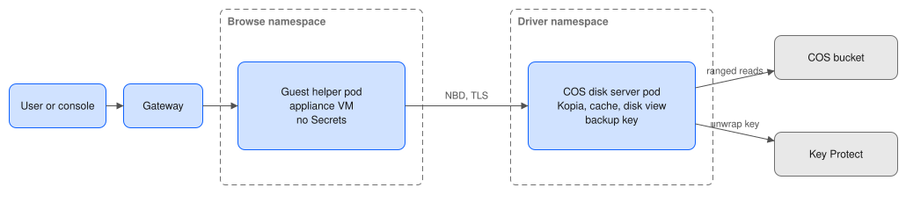

# Spec: browse and restore files from VM disks in COS (issue #92, phase 6)

Date: 2026-10-29. Status: speed bar agreed by the owner (29 Oct 2026); design ready for build; phase 6a measured on the lab on 2 Nov 2026 (section "Phase 6a results"); phase 6b built and run on the lab on 3 Nov 2026 (section "Phase 6b results"). It fills in phase 6 of `2026-10-22-backup-file-restore.md` (the parent spec). Read section 3 ("VM disks") and section 4 ("Backups in COS") of the parent first. It builds on phase 4 (COS, plain volumes, merged) and phase 5 (VM disks in the snapshot pool, PRs #337, #338, #341 and #342, not merged and not yet run on the lab). Facts here come from `main` and the `vm-browse-c2` branch on 29 Oct 2026.

## Goal

This is the parent spec's goal, **like Veeam**, for the last case it does not cover yet: a VM disk whose backup is only in COS. This happens when the moment is older than every local restore point, when the snapshot pool is lost, or when the backup is opened in a different cluster.

When this is done:
- A user picks a VM disk and a moment held in COS. They list the guest's file systems and folders, download a file, and restore files or folders to a new or an existing claim. In the console and with `kubectl backup`, exactly as for the snapshot pool.
- **Nothing downloads the whole disk.** Only the parts of the disk that the guest's file system reads are fetched from COS.
- It works in a second cluster that has the COS Secrets and no policy (`--from-cos`), for cluster administrators, as in phase 4.

**Speed bar.** The goal is met if, for a 100 GiB disk with a 30 GiB XFS or NTFS file system, using the private COS endpoint in the same region:
- the file systems and the top folder show within **30 seconds** of asking,
- any other folder of up to 1,000 entries shows within **5 seconds**,
- a download or a restore starts within **2 minutes**, and a 1 GiB file then downloads at **50 MiB/s or more**.

This holds for the newest moment of each export. An older moment inside an export (see section 1a) is listed from the disk itself and may take up to 5 minutes; the console says so before the user waits.

The first version of this spec allowed 5 minutes for the first listing. The owner judged that too long for a user to wait, so the listing now comes from a file list saved at backup time (section 1a). The numbers are not measured yet. Phase 6a measures them. If they are missed by a wide margin, I will show you the real numbers before more is built.

## What exists today

- **Disk view (phase 5).** `pkg/replication/diskview.go` shows a backed-up disk at one moment, read-only. It rebuilds the old contents from the latest `disk.img` and the undo files, on every read. It opens these by path on the NFS share, and it watches for a new copy starting (`ErrDiskChanged`).
- **NBD server (phase 5).** `pkg/nbd` serves anything that can be read at an offset (`io.ReaderAt` and a size) to the appliance VM.
- **Guest helper (phase 5).** The disk server and the libguestfs appliance run in **one container** of the helper pod and talk over a local socket. The helper pod runs in the browse namespace and holds no Secrets.
- **Guest restore Job (phase 5, #341).** It is split into a reader, which parses the disk and holds no rights, and a writer, which holds only the target and `CHOWN`/`FOWNER`.
- **COS reader (phase 4).** `pkg/cosbrowse` drives the pinned Kopia program as a child process. It lists snapshots and reads whole files with `kopia show`. It runs in a pod in the **driver namespace**, because it needs the COS key, the wrapped backup key and the Key Protect API key. A NetworkPolicy there lets only the gateway reach it.
- **What an export holds.** Each export is two Kopia snapshots, tagged with the volume and the moment. One is the backup folder, which holds the latest `disk.img`. The other is the moments folder, which holds the undo files up to that export. A restore of a moment uses the oldest export made at or after it. Kopia cuts files into chunks of about 4 MiB on average, by content. The export does not set compression.

## What is not reachable

- **Reading a range of a file in COS with the Kopia program alone.** `kopia show` and `kopia snapshot restore` give whole files only. Mounting with `kopia mount` and FUSE needs `/dev/fuse` and extra rights, which the parent spec rules out. So either the Kopia program serves ranges another way (see 1, option A), or Kopia is used as a Go library (option B).
- **The key and a hostile disk in one pod.** The phase 5 helper parses the guest's file system in the same container that serves the disk. For COS, the container that serves the disk holds the backup key, which can decrypt every volume in the policy's area of the bucket. So the phase 5 layout **cannot** be reused as it is. See 2.

## Design that meets the goal

### 1. Reading parts of `disk.img` and the undo files from COS

The disk view gets a small source interface: open a file by name for reads at an offset, and list the undo files. The NFS source is today's code, unchanged. The COS source reads the two Kopia snapshots of the chosen export. COS objects never change, so the COS source has no change check and no lease.

Two ways to read ranges. Phase 6a picks one on the lab.

- **Option A: the Kopia program, over WebDAV (chosen; proven in 6a).** `kopia mount --webdav` serves a snapshot as a WebDAV share on localhost, with no FUSE and no extra rights. A WebDAV GET with a Range header reads part of a file. The COS source then makes ranged HTTP reads to `127.0.0.1` inside the pod. This keeps Kopia out of our Go code, as phase 4 does, and adds no Go dependency. Phase 6a proved both: the pinned Kopia 0.23.1 serves WebDAV on Linux in an ordinary pod (its OS mount fails with exit 32, which is harmless; the server stays up), and it honours Range without reading the file from the start.
- **Option B: Kopia as a Go library.** Open the repository read-only in process and seek within the file object. The parent spec already allows this, in the browse binary only. Cost: a large new dependency in `go.mod` (the module is shared, but only `cmd/browse` links it), and its version must match the pinned program. Used only if option A fails.

Either way:
- **Cache.** Kopia's own content cache, on an `emptyDir` on the node's disk (not memory), default **5 GiB** (`backupBrowse.cos.cacheSize`). The first file system list reads a lot of metadata. The cache keeps later reads local.
- **Indexing the undo files.** Today the view reads every byte of each undo file once, to index and check it. Over COS that would fetch all the changed data of the export before the first listing. The COS source indexes by reading the record headers and skipping over the data, and checks a record's data when it is read. If the undo format has no way to check one record alone, the whole-file check stays, and phase 6a measures what it costs.
- **Keep time.** A session or restore is refused if the export's snapshots reach the end of their keep time within the session's hard limit (2 hours) plus 1 hour. Kopia maintenance must not delete the data while it is being read. Phase 6a also checks Kopia's own safety margin for data that is no longer referenced.

### 1a. A file list saved with each export

Reading folders straight from a disk in COS is slow: every cold read fetches a whole chunk, and a file system list touches many scattered blocks. So the listing does not read the disk.

- **When.** Each export to COS of a VM disk also saves a file list of the guest's file systems at the export's newest moment. It is made from the local copy in the snapshot pool, before or while the export runs, by the phase 5 guest helper (no Secrets, unprivileged, the hostile-disk rules of phase 5).
- **What.** For each file system: its label and type, and for each entry the path, type, size, mode, owner, times and link target. No file contents. The list is compressed and stored in the same Kopia repository as the export, so it is encrypted with the same backup key and kept and deleted with the export.
- **Trust.** The list comes from a hostile disk, so the reader treats it as untrusted: size limits on the list and on each name, names shown escaped as phase 3 does, and paths checked against traversal. A wrong list can only show wrong names. A download or restore reads the disk itself and refuses a path that is not there.
- **Use.** The COS disk server reads the list (a few MiB to tens of MiB) when the session starts and answers folder requests from it. The appliance and the disk are opened only for a download or a restore.
- **Older moments.** An export holds the undo files back to the previous export, so it covers several moments, but only the newest has a list. Making a list per moment would multiply the export's work. An older moment is listed from the disk, slowly, as the first version of this spec did. 6a measures how slow.
- **No list.** Exports made before this feature, or whose list failed, are browsed from the disk, slowly, with the same notice. A failed list does not fail the export: the export is the backup and comes first. The policy's status says the list failed.
- **Cost.** One guest file system scan per VM disk per export, measured in 6a. If it makes exports late, the list is made after the export, from the same local moment, and the session falls back to the slow path until it exists.

### 2. Keeping the key away from the hostile disk

Two pods per session, as in phase 4 and #341:

- **COS disk server**, in the driver namespace. It has the Secrets, the Kopia child (or library), the cache and the disk view, and it serves the disk at the chosen moment over NBD. **It never parses the guest's file system.** It sees only blocks.
- **Guest helper**, in the browse namespace, the phase 5 image with no Secrets. It reaches the disk server over the pod network instead of a local socket. Everything else is phase 5 unchanged: the appliance, the file system picker, `norecovery`, and the notices.

The NBD link uses **TLS** with the session's own certificate, which already exists for the gateway link. The NBD server accepts only that client. A NetworkPolicy in the driver namespace allows only that guest helper pod to reach that disk server. The disk is read-only at the NBD level: the server refuses writes.

A **file restore** from COS uses the #341 split. The reader container gets its disk from a COS disk server pod in the same way. The writer is unchanged.

### 3. Choosing COS

The gateway already picks COS for a plain-volume moment that only COS holds (phase 4). The same rule applies to VM disks: `source: cos`, or an automatic choice when there is no local copy. `kubectl backup browse --from-cos` and `restore-files --from-cos` accept a VM disk. The console file browser gets the **source switch** that phase 4 left out (local or COS), for plain volumes and VM disks alike.

### 4. Limits and cost

- A COS VM session counts as one session against the existing limits (5 in the cluster, 2 per namespace). It uses two pods: the guest helper (about 550 MiB, measured in phase 0) and the disk server (estimate 256 MiB plus Kopia's index cache, measured in 6a).
- **COS cost.** Reads through the private or direct endpoint have no data transfer charge. The cost is the GET requests (class B) and, for the Standard class, nothing more. Phase 6a counts requests and bytes for the speed bar run and adds a cost line here. A browse never writes to the bucket.
- The 5-minute start limit for COS sessions (`backupBrowse.cos.startTimeout`) stays for a moment with a file list. A moment without one is allowed **10 minutes**. 6a sets the final values.

### 5. User stories

- As a namespace admin, I browse the files inside my VM's disk at a moment that is only in COS, and download one file, without a whole-disk restore.
- As a namespace admin, I restore a folder from that disk to a new claim.
- As a cluster admin in the DR cluster, with no policy there, I browse a VM disk from the bucket with `--from-cos`.
- As anyone, if the disk is encrypted inside the guest (BitLocker, LUKS), I am told it cannot be read here and pointed at the whole-disk restore.

## Tests

- **Disk view source interface:** the existing property tests run against both sources. The COS source is fed from a local Kopia repository, built in the test as phase 4 does. Every moment must give byte for byte what `RestoreDisk` writes.
- **Ranges:** a test reads small, unaligned and chunk-crossing ranges and counts the bytes fetched. A range read must not fetch the file from the start.
- **Isolation:** the guest helper pod spec has no Secret volumes, no environment from Secrets and no API token. The disk server refuses NBD writes, a client without the session certificate, and any volume other than the session's (including traversal and crafted snapshot names, as in phase 4).
- **Keep time:** a moment near the end of its keep time is refused with a clear message.
- **File list:** a list made from a test disk matches the files the appliance sees. A crafted list (huge, names with `..`, newlines or control characters, entries outside the file system) is refused or shown escaped, and a download of a path that is only in the list is refused. A failed list leaves the export Done and says so in the policy status. A session on a moment with no list uses the slow path and says so.
- **Release test stage 20:** a new part that exports a VM disk, deletes the local restore points (or uses a moment older than all of them), browses a file inside it from COS, restores a folder, and compares checksums. It runs once in prod and once from the DR cluster with `--from-cos`. It records the speed bar numbers, with and without the file list, in the report.

## Phase 6a results (2 Nov 2026, DR lab, no product code)

Method. Real exports from release run 1102-1005 in the COS bucket (private endpoint, same region), read by a test pod on the DR cluster: the Kopia program over WebDAV, a 10 GiB VM disk (XFS, about 28,800 files), the newest moment. The pod used the driver image's Kopia and, for the guest tools, the phase 5 `browse-guest` image without KVM (the appliance runs under TCG). The scripts are not kept; the numbers are below.

**Raw reads (option A).**

| What | Result |
|---|---|
| Connect to the repository | 1.2 s |
| Start of the WebDAV server | 0.5 s |
| Cold read of 64 KiB at a random offset | median 38 ms, worst 220 ms |
| One cold sequential stream | 38 to 42 MiB/s (a repeat from cache: 225 MiB/s) |
| 4 or 8 cold parallel reads | 320 to 250 MiB/s |
| Kopia cache after 1 GiB read | 1.1 GiB (the 5 GiB default is enough) |

So the 50 MiB/s download bar is met only with parallel reads or read-ahead. One stream is just under it.

**Listing from the disk (the slow path).**
- The appliance reads in small pieces (about 4 KB). Without a read-ahead layer, `virt-filesystems` had made 14,296 requests and run for more than 9 minutes without finishing. **The COS disk server must read ahead and cache in large segments.** 4 MiB segments with 8 segments read ahead (a spike bridge between the WebDAV server and NBD) fixed it.
- With that layer: file systems found in 22.6 s, top folder 34.9 s and `/etc` 19.7 s (each a separate tool run, so each started its own appliance, about 12 s under TCG), the whole tree of 28,758 entries in 32.6 s. It fetched 2.1 GiB from COS to do so (read-ahead reads more than is used) and kept 1.9 GiB in the cache. The spike cache had no limit; the real one must.
- One appliance session that serves everything saves the repeated start, and KVM cuts the start from about 12 s to about 1.5 s. So the slow path alone is near the 30-second bar on this small disk and clearly under the 5-minute allowance for older moments. A 30 GiB disk with millions of files will take longer; 6c measures it.

**File list.** Building the list is the same tree walk: 28,758 entries took about 20 s beyond the appliance start, and the list was 737 KB as text before compression. The first listing from a saved list reads one small object, so it does not depend on the disk size. Not measured: a list of a disk with millions of files, NTFS, and the cost on an export that is running.

**Not measured in 6a.** The cost of indexing the undo files (the newest moment needs none), the COS request count and the cost line, disk server memory with a bounded cache, and an older moment.

**Verdict.** Neither stop rule applies: the raw reads meet the bar, and the slow path is within a factor of 2 of the 30-second first listing even without the file list. Section 1 is confirmed as written, with one addition: the disk server reads ahead in 4 MiB segments and fetches several in parallel, behind a bounded cache.

## Phase 6b results (3 Nov 2026, DR lab, driver built from the branch)

Run with `test/e2e/test-backup-files-vm-cos.sh`: three small VM disks (XFS on LVM, ext4, NTFS; one holds a 256 MiB file) backed up twice to the snapshot pool and exported to COS with the file list; then read as a namespace admin through the gateway with `--from-cos`. The last run passed every check.

| Bar | Result |
|---|---|
| First listing, 30 s | 21 to 26 s (with the KVM device on; 44 to 46 s without it) |
| Another folder in the open session, 5 s | 0.4 s |
| A download starts within 2 min | The first byte after about 11 s (with KVM) |
| 50 MiB/s after the start | 41 to 54 MiB/s measured inside the reader pod over six downloads of 256 MiB; the rate through the gateway to a laptop over the VPN was 5 to 8 MiB/s, which is the laptop's network, not the product |

Also checked: file systems of all three kinds read from COS; a 256 MiB file has the same checksum; an older moment and a file restore from a VM disk in COS are refused in words; the disk server has no API token, mounts no share and has no capability; the browse namespace holds no COS or Key Protect key and the copy of the disk server Secret there has no private key; closing the session leaves no pod, Job or Secret.

**What the lab found, and what changed because of it**

- Sessions advanced only on the controller's 30-second pass, and a session on a VM disk in COS needs two steps (disk server, then reader), so the first listing took 96 s. A quick 2-second pass now looks only at sessions that are starting. First listing: 46 s.
- The file list status was dropped at the next pass; it is now kept.
- A download that starts the reader waits longer than the 30-second default of the OpenShift router, and the load balancer in front of it ends a silent connection after 50 s. The gateway Route now allows 5 minutes. The first byte still has to arrive within 50 s: it needs the KVM device (reader start 1.5 s instead of 12 s). **On nodes without the KVM device, `backupBrowse.guest.kvmDevice` stays off and the first download of a session can fail on a slow disk.**
- A newer backup could land after the list was built and before the export began; its copy replaced the folder, and the list with it, so the session fell back to the slow path. The list is now built again when the moment changed.
- The 30-minute rule for the moment of a list was not tested at its edge: the lists were for the same moment to the second. The publisher could write into the backup folder as it is (no permission change needed).

## Build plan: phases, one PR each

Phase 6 needs phase 5 merged and passing on the lab first.

- **6a. Spike on the lab (S, risk check). Done 2 Nov 2026; results above.** Use a real export of a lab VM (stage 18 makes them). Try option A, then option B if A fails. Make a file list of the lab VM's disk and measure its time and size. Measure the speed bar (with the list, and the slow path without it), bytes fetched, COS requests, disk server memory, and the cost of indexing the undo files. Write the results and the choice into this spec, in a PR with no product code. **If neither option meets the speed bar within a factor of 2, I stop and show you the gap.**
- **6b. COS disk server (M).** The file list at export (made, stored with the export, read and checked), the source interface, the COS source, the cache, the keep-time check, the TLS NBD link, the disk server pod and its NetworkPolicy, and the guest helper over the network. Command line browse and download.
- **6c. Restore and console (M).** The file restore from COS through the #341 split, the console source switch, the help text, and stage 20's COS VM part.

Total: about 1.5 to 2.5 weeks of agent work, plus the lab runs.

## Cost and risk

- **Biggest risk: speed.** Each cold read fetches at least a 4 MiB chunk from COS. A file system list touches many small, scattered metadata blocks, so a listing from the disk may fetch hundreds of MiB. The file list (section 1a) takes this off the normal path; it remains for older moments and for exports without a list. 6a comes first to measure both.
- **Second risk: option A not working.** Option B then adds a large dependency. It is still inside the browse image only.
- **Fall-back, which does not meet the goal:** download the export's `disk.img` and undo files to scratch space first, then browse as phase 5 does. This needs a scratch claim the size of the disk and a full download for every session. I would put it in front of you as a choice, not build it quietly.

## Decisions I made for you

- Phase 6 starts only after phase 5 is merged and has passed on the lab.
- A short spike (6a) comes before any product code, with a stop-and-show-you rule if speed misses the bar.
- Speed bar: first listing within 30 seconds, other folders within 5 seconds, a download starts within 2 minutes and runs at 50 MiB/s. You judged 5 minutes for the first listing too long.
- To meet it, each export also saves a file list of the VM disk, so folders are shown without reading the disk in COS.
- Only the newest moment of each export gets a file list. Older moments in the export are listed slowly, up to 5 minutes, and the console says so first.
- A failed file list never fails the export.
- The Kopia program over WebDAV is used, so Kopia stays out of our Go code. The 6a spike proved it on the lab; the Kopia library is not needed.
- The disk server reads ahead in large segments behind a bounded cache, because the appliance's small reads made listing take more than 9 minutes without it.
- The pod that holds the backup key never parses the guest's file system. The disk is served over the network to the existing unprivileged guest helper.
- The link between the two pods is HTTPS with range reads, behind the session's own certificate and token, and a network policy lets only the guest reader pods reach the disk server. I changed this from NBD with TLS: the libguestfs tools cannot be given the session certificate for an NBD link, and the reader already bridges a disk to its appliance over a local socket (built in 6b).
- COS sessions need no hold on the next backup, because COS objects never change.
- An export that will be deleted within the session limit plus an hour (3 hours with the defaults) cannot be browsed.
- The disk server's cache is 64 MiB in memory (4 MiB segments, 8 read ahead), set by flags. The spike showed that a bounded memory cache is enough, and Kopia keeps its own cache on its scratch folder.
- The file list is saved as `.filelist.json.gz` in the volume's backup folder, next to `disk.img`, so the existing export snapshot carries it and the existing delete and measure steps cover it. A second container copies it there (a plain file of at most 256 MiB); the reader that parses the disk never writes to the share.
- A file list counts as being for the disk if its moment is within 30 minutes of the disk's. The 3 Nov 2026 lab run built each list for the same moment as the disk (to the second), so it shows the rule works but did not test the edge of 30 minutes.
- In 6b only the newest moment of an export can be browsed in COS. Older moments need the undo files served too, and come later if you want them.
- A VM disk named directly by bucket (`--bucket`) is browsed as plain files, because nothing there says it is a VM disk. Browse it through its policy.
- The console gets a local or COS switch for every volume type, not only VM disks.
- VM disks from COS follow the same session limits as everything else. There is no separate limit.
- The speed bar was met on the DR lab with the KVM device on (first listing 21 to 26 s, other folders 0.4 s, a download starts after 11 s). Without the KVM device the first listing is 44 to 46 s, above the bar, so I recommend it wherever nodes have it.
- Browse sessions that are starting get a 2-second pass of their own, because the usual 30-second pass made two-step sessions slow.
- The gateway address allows 5 minutes for a first byte (the default is 30 seconds), because a first read starts the reader.
- The download rate to a person depends on their network. The test records the rate inside the reader pod, which is what the product controls.

## Needs from you

- Nothing blocks 6c. It needs a lab run, which waits for your go-ahead as usual.
- Nothing else. The speed bar is agreed: first listing within 30 seconds.
